# Engineering Roadmap (Milestones M0–M7) — Distributed Commerce & Flash Sale Platform

- **Document ID:** `DCP-DOC-RDM-001`
- **Status:** `PROPOSED` (Milestone M0 — Pending Human Approval)
- **Last Updated:** 2026-11-10

---

## Milestone Progression Overview

```mermaid
flowchart LR
    M0["M0: Product Discovery & Architecture (Current)"] --> M1["M1: Monorepo & Polyglot Foundation"]
    M1 --> M2["M2: Core Commerce (Product, Customer, Order, UI)"]
    M2 --> M3["M3: Distributed Systems (Kafka, Redis, Inventory, Outbox, Saga)"]
    M3 --> M4["M4: Advanced Commerce (Flash Sale, Payment Sim, Promotions, Search)"]
    M4 --> M5["M5: AI Agentic Assistant (Tools, RAG, Guardrails, Eval)"]
    M5 --> M6["M6: On-Prem Kubernetes (VMs, Helm, Argo CD, Observability)"]
    M6 --> M7["M7: Performance, Profiling & Chaos Engineering"]
```

---

## M0 — Product Discovery & Architecture (`CURRENT — IN REVIEW`)
- **Entry Criteria**: Mission initialization.
- **Deliverables**:
  - Complete root & `docs/` architecture documentation (`PROJECT_CONSTITUTION.md`, `SPEC.md`, `PRODUCT_REQUIREMENTS.md`, `DOMAIN_MODEL.md`, `SYSTEM_ARCHITECTURE.md`, `SERVICE_BOUNDARIES.md`, `DATA_ARCHITECTURE.md`, `EVENT_DRIVEN_ARCHITECTURE.md`, `AI_AGENT_ARCHITECTURE.md`, `SECURITY_ARCHITECTURE.md`, `DEPLOYMENT_ARCHITECTURE.md`, `PERFORMANCE_STRATEGY.md`, `TEST_STRATEGY.md`, `ENGINEERING_ROADMAP.md`, `BACKLOG.md`).
  - Initial OpenAPI 3.1 & JSON Schema Event Contracts (`docs/api-contracts/`, `docs/event-contracts/`).
  - 10 Architecture Decision Records (`ADR-0001` to `ADR-0010`).
- **Exit Criteria / Acceptance Gate**: Explicit Human Architect review, resolution of Open Questions (`Q1–Q7`), and approval to transition to `M1`.

---

## M1 — Foundation & Polyglot Scaffolding
- **Entry Criteria**: `M0` approved (`Status: ACCEPTED`).
- **Scope**:
  - Monorepo structure, Git initialization, `.gitignore`, `.editorconfig`, shared Makefile / task scripts.
  - Local/VM toolchain provisioning script (`Java 21`, `Maven`, `.NET 10 SDK`, `Python 3.12 + uv`, `Docker Engine + Compose`, `k6`).
  - Composable `docker-compose.yml` (`PostgreSQL 17` with 7 isolated databases, `Redis 7.4`, `Apache Kafka 3.8 KRaft`, `MinIO`, `Mailpit`).
  - Clean skeletal scaffolding (health checks, OpenTelemetry tracing, ProblemDetails error handling, Flyway/EF/Alembic migration wiring, ArchUnit/NetArchTest boundary tests—**zero business logic implemented yet**) for:
    - Java 21 parent POM & service skeletons (`product-service`, `order-service`, `inventory-service`, `payment-service`).
    - .NET 10 solution (`DistributedCommerce.sln`) & service skeletons (`api-gateway`, `customer-service`, `promotion-service`, `notification-service`).
    - Python 3.12 FastAPI skeleton (`ai-agent-service`).
    - React 19 + TypeScript + Vite + Tailwind + TanStack Query + Zustand shell (`frontend/`).
  - GitHub Actions CI pipeline validating compilation, lint, typecheck, and architecture tests.
- **Exit Criteria & Acceptance Tests**:
  - `docker compose --profile infra up -d` starts Postgres, Redis, Kafka, MinIO cleanly with passing health checks.
  - Every service skeleton compiles, runs migrations, passes `/health/live` & `/health/ready`, and passes ArchUnit/NetArchTest/Vitest checks.

---

## M2 — Core Commerce (Synchronous Baseline & Dual React UI)
- **Entry Criteria**: `M1` verified (`DONE`).
- **Scope**:
  - `customer-service` (.NET): Registration, `RS256` JWT login + JWKS endpoint, profile & shipping addresses, Redis shopping cart.
  - `product-service` (Java): Category hierarchy, SPU/SKU management, MinIO pre-signed image upload, PostgreSQL full-text + faceted catalog search.
  - `order-service` (Java): Basic order creation with `Idempotency-Key`, immutable price/address snapshot, and order history queries.
  - `api-gateway` (.NET YARP): Route configuration, JWT authentication middleware, correlation ID propagation.
  - `frontend` (React): Storefront (Catalog browse/filter, Product Detail, Login/Register, Cart, Checkout, Order History) + Admin UI (Category/Product/SKU Manager).
- **Exit Criteria & Acceptance Tests**:
  - Full Playwright E2E journey: Admin creates product/SKU → Customer registers, logs in, adds to cart, places order, and views order history.
  - Positive, negative (`400`, `401`, `403`, `404`, `409`), and idempotency unit/integration tests pass.

---

## M3 — Distributed Systems Core (Kafka, Outbox/Inbox, Inventory & Saga)
- **Entry Criteria**: `M2` verified (`DONE`).
- **Scope**:
  - `inventory-service` (Java): `StockItem`, `StockReservation`, `InventoryLedgerEntry`, conditional atomic SQL reservation, and background reservation expiration worker.
  - Transactional Outbox Relay + Idempotent Inbox Consumer across Java and .NET services.
  - `order-service` (Java): Full **Order Fulfillment Saga Orchestrator** (`PENDING_RESERVATION` → `AWAITING_PAYMENT` → `CONFIRMED` / `CANCELLED` / `EXPIRED`) with compensating stock release.
  - `notification-service` (.NET): Kafka consumer dispatching transactional order emails to Mailpit with non-blocking retry topics and DLQ + Admin DLQ Inspector.
- **Exit Criteria & Acceptance Tests**:
  - `TC-CONC-01` (100 concurrent threads vs. 10 stock items: zero oversell).
  - `TC-IDEMP-02` (Duplicate Kafka event replay: zero double deduction or duplicate email).
  - Outbox fault-injection test (kill Kafka during order creation, restart Kafka, verify eventual Saga completion).

---

## M4 — Advanced Commerce (Flash Sale Engine, Payment Simulator, Promotions & Caching)
- **Entry Criteria**: `M3` verified (`DONE`).
- **Scope**:
  - `payment-service` (Java): Deterministic Payment Simulator, signed webhooks, timeout sweeper, refunds, and late-payment auto-refund compensation (`INV-PAY-2`).
  - `promotion-service` (.NET): Coupon campaign rules, atomic redemption locks, and **Flash Sale Campaign Engine** (Quota allocation handshake with Inventory, Redis Pre-Warming, Atomic Lua Claim Gate, asynchronous Kafka order materialization, and Redis-to-PostgreSQL reconciliation worker).
  - Redis Cache-Aside + Single-Flight Stampede protection on Product Catalog & Active Promotions.
  - Storefront **Flash Sale Live Arena UI** (countdown timer, real-time stock gauge, claim queuing state, 10m payment countdown) + Admin **Flash Sale Scheduler & Payment Inspector**.
- **Exit Criteria & Acceptance Tests**:
  - `TC-CONC-02` & `k6` Spike Test: 10,000+ requests against 100 Flash Sale units → exactly 100 winners, 0 oversold, 0 duplicate per user, `0%` `5xx` errors.
  - `TC-SAGA-01`: Late payment webhook arriving after 10m Flash Sale expiry triggers automatic refund.

---

## M5 — AI Agentic Assistant (Shopping & Operations Agents)
- **Entry Criteria**: `M4` verified (`DONE`).
- **Scope**:
  - `ai-agent-service` (Python FastAPI): Vendor-agnostic LLM orchestration, `pgvector` RAG indexing of catalog/policies, JWT-bound Tool Executor (`search_products`, `compare_products`, `check_inventory`, `get_active_promotions`, `get_my_order_status`), and Admin Ops diagnostic tools with Human-in-the-Loop approval gate.
  - Input/output guardrails, prompt injection defense, token budget rate limiting, and OpenTelemetry GenAI spans.
  - React Storefront **AI Shopping Drawer** (streaming SSE + product cards) & Admin **AI Ops Console** (diagnostic charts + HITL approval buttons).
- **Exit Criteria & Acceptance Tests**:
  - 50-case AI evaluation suite passes (`0%` price/stock hallucination against tool output, `100%` block rate on cross-user order IDOR and indirect prompt injection tests).

---

## M6 — On-Prem Multi-VM Kubernetes, GitOps & Full Observability
- **Entry Criteria**: `M5` verified (`DONE`).
- **Scope**:
  - Multi-VM Linux cluster bootstrap (`K3s` or `kubeadm`), `MetalLB`, `Ingress-NGINX`, `NetworkPolicies`, persistent storage (`local-path` / `Longhorn`), and `SOPS` secret encryption.
  - Production `Helm` charts for all 9 services + `Argo CD` declarative GitOps pipeline.
  - Full Observability stack (`OpenTelemetry Collector`, `Prometheus`, `Grafana` dashboards, `Loki` logs, `Tempo` distributed traces).
- **Exit Criteria & Acceptance Tests**:
  - Zero-downtime rolling deployment verified under active `k6` load (`FAIL-10`).
  - Distributed trace (`trace_id`) visible in Grafana Tempo spanning `React → YARP Gateway → Order Service → Kafka Outbox → Inventory Service → Payment Service`.

---

## M7 — Performance Engineering, Profiling, Chaos & Case Studies
- **Entry Criteria**: `M6` verified (`DONE`).
- **Scope**:
  - Execute all 7 `k6` test types (`Smoke`, `Load`, `Stress`, `Spike`, `Soak`, `Breakpoint`, `Chaos`).
  - Capture JVM FlameGraphs (`JFR`/`Async-Profiler`), `.NET` allocation profiles, and PostgreSQL lock/query plans; implement targeted optimizations and run before/after retests.
  - Execute and record all 10 infrastructure failure scenarios (`FAIL-01` to `FAIL-10`).
  - Publish interview-ready **Engineering Case Studies** in [`docs/engineering-case-studies/`](file:///home/anhltn/projects/distributed-commerce-platform/docs/engineering-case-studies/).
- **Exit Criteria & Acceptance Tests**:
  - Complete 10-point Benchmark Reports and Chaos Engineering Postmortems committed and verified.
