# `M0.2.4` — Final Fencing Review (`CH-01` Campaign Lock Coverage & `CH-04` `transactional.id` Ownership Race)

- **Repository:** `dev-atlas-lab/distributed-commerce-platform`
- **Milestone:** `M0.2.4 — Final Fencing Review`
- **Baseline Commit Audited:** `ecd476b` (`origin/main`)
- **Date:** 2026-11-11
- **Status of Foundational Decisions (`Q1–Q7`):** **`ACCEPTED`** (Unchanged)
- **Status of `CH-01` & `CH-04`:** **`PROPOSED` (Concurrency & Fencing Hardened in `M0.2.4` — Pending Explicit Human Sign-Off)**
- **Verification Disclosure:** No application code or runtime tests were executed in `M0.2.4`. Every finding below explicitly separates **Logical/Mathematical Verification (`VERIFIED`)** from **Runtime Test Verification (`NEEDS_EVIDENCE` — scheduled for `M1–M3`)**.

---

## 1. Executive Summary of `M0.2.4` Findings & Classifications

| Finding ID | Challenge | Concurrency Concern Audited in `ecd476b` (`M0.2.3`) | `M0.2.3` Audit Result | `M0.2.4` Architectural Resolution | `M0.2.4` Classification |
| :--- | :--- | :--- | :--- | :--- | :--- |
| **`F-15`** | **`CH-01`** | **Incomplete Campaign Lock Coverage & Trigger vs. Explicit Lock Ordering**:<br>1. In `M0.2.3`, `TX_RESTOCK_FINALIZE` (`UPDATE flash_sale_claims SET stock_returned_to_redis = TRUE`), `ORDER_MATERIALIZED`, `PAYMENT_CONFIRMED`, and direct `flash_sale_items` updates were not covered by the trigger (`WHEN NEW.status IN (...)`), and `TX_RESTOCK_FINALIZE` did not acquire `FOR SHARE` on `flash_sale_campaigns`.<br>2. Relying on a `BEFORE UPDATE` trigger alone to lock `flash_sale_campaigns` violates topological lock order (`Table 2 -> Table 1` instead of `Table 1 -> Table 2`), risking AB-BA deadlocks against `TX_REBUILDER`. | **`FAILED`** *(Partial Coverage in `M0.2.3`)* | 1. Enumerated all **8 Flash Sale mutation paths (`MP-01` to `MP-08`)** and required **explicit service-level `campaign_guard` (`FOR SHARE` / `FOR UPDATE` on `flash_sale_campaigns`) as CTE Step 1** in every path (guaranteeing strict `Table 1 -> Table 2 -> Table 3` lock order).<br>2. Upgraded database triggers on **both** `flash_sale_claims` and `flash_sale_items` to cover `INSERT OR UPDATE OR DELETE` of all columns/statuses as a defense-in-depth engine invariant.<br>3. Strictly separated the **Primary Correctness Mechanism** (PostgreSQL `FOR SHARE` vs. `FOR UPDATE` lock mutual exclusion) from **Operational Liveness Policies** (`idle_in_transaction_session_timeout = 3s`, `pg_terminate_backend`). | **`VERIFIED`** *(Logical)* / **`NEEDS_EVIDENCE`** *(Runtime `SPEC-CH01-T5`)* |
| **`F-16`** | **`CH-04`** | **Kafka `transactional.id` Ownership Race (Stale DB Owner Calling `initTransactions()` After Newer Owner)**:<br>In `M0.2.3`, if Relay A acquired `fencing_epoch = 10` in PostgreSQL, paused *before* calling `txProducer.initTransactions()`, let its `30s` DB lease expire, and resumed *after* Relay B acquired `fencing_epoch = 11` and called `initTransactions()`, Kafka's Transaction Coordinator (which is last-caller-wins and unaware of PostgreSQL generations) would assign Relay A a newer `ProducerEpoch` and fence active Relay B! | **`FAILED`** | 1. Replaced free-for-all HTTP-pod polling with a **Dedicated Shard Dispatcher (`StatefulSet` ordinal pinning + single worker thread per shard)** and a **Two-Stage Shard Ownership State Machine (`INITIALIZING -> ACTIVE`)** in `outbox_relay_shards`.<br>2. **Zero events may be queried or claimed (`Phase 1`) while in `INITIALIZING`**; a worker must pass the `ACTIVATE_SHARD_CAS` gate (`WHERE fencing_epoch = :epoch AND status = 'INITIALIZING'`) *after* `initTransactions()` returns before it can ever read `outbox_messages`.<br>3. Once `ACTIVE`, a worker **never calls `initTransactions()` again** under that `fencing_epoch` (so a worker paused in `ACTIVE` can never fence a newer owner).<br>4. Added **Backend-Session Liveness Check (`owner_backend_pid`)** before stealing an `INITIALIZING` shard + **Self-Healing `ProducerFencedException` Re-Init** if a delayed TCP packet from an aborted `INITIALIZING` zombie reaches the broker. | **`VERIFIED`** *(Logical)* / **`NEEDS_EVIDENCE`** *(Runtime `SPEC-CH04-T4`)* |

---

## 2. `CH-01` — Complete Campaign Lock Coverage & Strict Separation of Correctness vs. Liveness

### 2.1 Complete Enumeration of All 8 Flash Sale Mutation Paths (`MP-01` through `MP-08`)

Every mutation touching `flash_sale_campaigns`, `flash_sale_claims`, `flash_sale_items`, or Redis campaign stock belongs to one of the **8 exhaustive mutation paths** below. No other SQL statement or service method is permitted to write to these tables:

| Path ID | Mutation Path Name | Tables / State Mutated | Required Lock on `flash_sale_campaigns` (Step 1) | Required `flash_sale_campaigns` Predicate | Participates in Epoch Barrier? |
| :--- | :--- | :--- | :--- | :--- | :--- |
| **`MP-01`** | **`TX_WRITER`** *(Persist Redis claim intent -> `CLAIMED_RESERVED` + `claimed_count + qty` + Outbox + Idempotency)* | `flash_sale_claims` (`INSERT`), `flash_sale_items` (`UPDATE`), `outbox_messages` (`INSERT`), `idempotency_records` (`UPDATE`) | `SELECT ... FOR SHARE` (via `campaign_guard` CTE Step 1) | `status = 'ACTIVE' AND current_epoch = :redisClaimEpoch` | **YES** (Fenced if `current_epoch != :redisClaimEpoch` or `status != 'ACTIVE'`) |
| **`MP-02`** | **`TX_RECONCILER`** *(Fence expired Redis intent lease -> `ABANDONED_FENCED`)* | `flash_sale_claims` (`INSERT` with `release_epoch = current_epoch`) | `SELECT ... FOR SHARE` (via `campaign_guard` CTE Step 1) | `status = 'ACTIVE' AND current_epoch = :redisClaimEpoch` | **YES** (Fenced if `current_epoch != :redisClaimEpoch` or `status != 'ACTIVE'`) |
| **`MP-03`** | **`TX_EXPIRE_OR_CANCEL`** *(Expire/Cancel committed claim -> `EXPIRED \| CANCELLED` + `claimed_count - qty`)* | `flash_sale_claims` (`UPDATE`), `flash_sale_items` (`UPDATE`), `outbox_messages` (`INSERT`) | `SELECT ... FOR SHARE` (via `campaign_guard` CTE Step 1) | `status = 'ACTIVE'` (sets `release_epoch = current_epoch`) | **YES** (Blocked during `REBUILDING_GATE`; records exact `release_epoch`) |
| **`MP-04`** | **`TX_RESTOCK_FINALIZE`** *(Mark `stock_returned_to_redis = TRUE` after `flash_sale_release.lua`)* | `flash_sale_claims` (`UPDATE stock_returned_to_redis = TRUE`) | `SELECT ... FOR SHARE` (via `campaign_guard` CTE Step 1) | `status = 'ACTIVE' AND current_epoch = :releaseEpoch` | **YES** *(Was missing in `M0.2.3` — Fixed in `M0.2.4`!)* |
| **`MP-05`** | **`TX_ORDER_OR_PAYMENT_PROGRESS`** *(Transition `CLAIMED_RESERVED -> ORDER_MATERIALIZED -> PAYMENT_CONFIRMED`)* | `flash_sale_claims` (`UPDATE status`), `outbox_messages` (`INSERT`) | `SELECT ... FOR SHARE` (via `campaign_guard` CTE Step 1) | `status IN ('ACTIVE', 'ENDED')` (Blocked during `REBUILDING_GATE`) | **YES** *(Was missing from trigger in `M0.2.3` — Fixed in `M0.2.4`!)* |
| **`MP-06`** | **`TX_ADMIN_QUOTA_CONFIG`** *(Create/Edit SKU `allocated_quota` before campaign start)* | `flash_sale_items` (`INSERT` / `UPDATE`) | `SELECT ... FOR UPDATE` (via `campaign_guard` CTE Step 1) | `status IN ('DRAFT', 'APPROVED')` | **YES** (Forbidden once `WARMED` / `ACTIVE`) |
| **`MP-07`** | **`TX_REBUILDER_FENCE_AND_SNAPSHOT` & `TX_REBUILDER_ACTIVATE`** *(Bump `current_epoch`, snapshot DB, rebuild Redis, reactivate)* | `flash_sale_campaigns` (`UPDATE`), `flash_sale_claims` (`UPDATE`), `flash_sale_items` (`UPDATE`) | **`SELECT ... FOR UPDATE`** (Exclusive Row Lock on `flash_sale_campaigns`) | `status IN ('ACTIVE', 'REBUILDING_GATE')` | **YES — The Exclusive Rebuild Barrier** |
| **`MP-08`** | **`TX_CAMPAIGN_LIFECYCLE`** *(Transition `WARMED -> ACTIVE` or `ACTIVE -> ENDED -> RECONCILED`)* | `flash_sale_campaigns` (`UPDATE`), `flash_sale_claims` (`UPDATE` on end) | **`SELECT ... FOR UPDATE`** (Exclusive Row Lock on `flash_sale_campaigns`) | Valid lifecycle transition + `current_epoch = current_epoch + 1` on `ENDED` | **YES — Exclusive Lifecycle Barrier** |

---

### 2.2 Why Explicit Service-Level CTE Locking AND Database Triggers Are Both Required (`F-15` Analysis)

A critical question in `M0.2.4` is: *Can database triggers alone enforce the `flash_sale_campaigns` lock, or is explicit service-level locking (`campaign_guard` CTE Step 1) mandatory?*

**Answer: Explicit service-level locking (`campaign_guard` CTE Step 1) is MANDATORY for deadlock freedom, while triggers on both `flash_sale_claims` and `flash_sale_items` act as an unbypassable defense-in-depth invariant.**

#### Proof of Deadlock Risk If Relying on Triggers Alone
Suppose a service executed `UPDATE flash_sale_claims SET status = 'EXPIRED' WHERE claim_id = :id` **without** first locking `flash_sale_campaigns` in a `campaign_guard` CTE, relying only on a `BEFORE UPDATE` trigger on `flash_sale_claims` to lock `flash_sale_campaigns FOR SHARE`:
1. In PostgreSQL, an `UPDATE flash_sale_claims` acquires the row lock on **`flash_sale_claims` (Table 2) FIRST** (or during tuple modification), and fires the `BEFORE UPDATE` trigger which then requests `FOR SHARE` on **`flash_sale_campaigns` (Table 1) SECOND** (`Lock Order: Table 2 -> Table 1`).
2. Concurrently, `TX_REBUILDER_FENCE_AND_SNAPSHOT` locks **`flash_sale_campaigns` (Table 1) `FOR UPDATE` FIRST**, and then updates **`flash_sale_claims` (Table 2) SECOND** (`Lock Order: Table 1 -> Table 2`).
3. **Result**: Classic **AB-BA Deadlock** (`SQLSTATE 40P01`) between `Table 2 -> Table 1` and `Table 1 -> Table 2`!
4. By contrast, when every service SQL statement begins with `WITH campaign_guard AS (SELECT ... FROM flash_sale_campaigns WHERE campaign_id = :id ... FOR SHARE)` and joins `campaign_guard` to `flash_sale_claims` and `flash_sale_items`, PostgreSQL materializes `campaign_guard` first—guaranteeing the strict global topological lock order across **all** transactions:
   $$\text{1. } \texttt{flash\_sale\_campaigns} \longrightarrow \text{2. } \texttt{flash\_sale\_claims} \longrightarrow \text{3. } \texttt{flash\_sale\_items} \longrightarrow \text{4. } \texttt{outbox\_messages} \longrightarrow \text{5. } \texttt{idempotency\_records}$$

---

### 2.3 Strict Separation: Primary Correctness Guarantee vs. Operational Liveness Policies

In `M0.2.4`, we explicitly separate **Safety (Correctness)** from **Liveness (Operational Recovery)**:

| Property | Mechanism | Role in the Architecture | What Happens If This Mechanism Fails or Is Disabled? |
| :--- | :--- | :--- | :--- |
| **1. Primary Correctness (Safety) Guarantee** | **PostgreSQL Row-Level Lock Mutual Exclusion (`FOR SHARE` vs. `FOR UPDATE`) on `flash_sale_campaigns` + `READ COMMITTED` `EvalPlanQual` Re-evaluation** | **100% of the Correctness Invariant.** Because every mutation path (`MP-01`..`MP-06`) must hold `FOR SHARE` on `flash_sale_campaigns` while checking `current_epoch` / `status`, and `TX_REBUILDER_FENCE_AND_SNAPSHOT` (`MP-07`) must acquire conflicting `FOR UPDATE` on the same `flash_sale_campaigns` row to increment `current_epoch`, PostgreSQL's lock manager mathematically serializes every mutation either **strictly before** or **strictly after** the epoch increment. | N/A — Enforced natively by PostgreSQL's ACID lock manager and MVCC `EvalPlanQual` engine. |
| **2. Operational Liveness (Availability) Policies** | 1. Single-statement Data-Modifying CTEs<br>2. `idle_in_transaction_session_timeout = 3s`<br>3. `statement_timeout = 3s`<br>4. `pg_terminate_backend(pid)` for backends stalled `> 3s` | **Purely Liveness / Availability Bound.** Ensures that a wedged client connection or frozen backend holding `FOR SHARE` cannot indefinitely block `TX_REBUILDER_FENCE_AND_SNAPSHOT` from acquiring `FOR UPDATE`. | **Safety is STILL 100% preserved!** Even if `idle_in_transaction_session_timeout` were disabled and `pg_terminate_backend` were never called, an indefinitely stalled `FOR SHARE` transaction would simply cause `TX_REBUILDER` to wait on `FOR UPDATE`—it could **never** cause an old-epoch transaction to commit after `TX_REBUILDER` acquires `FOR UPDATE`! |

#### Formal Proof of the Required `CH-01` Invariant
> **Invariant**: *Once the Rebuilder obtains the campaign `FOR UPDATE` lock (`T_lock`), no transaction from the previous epoch (`epoch = E`) can subsequently commit a protected campaign mutation.*

1. **Exhaustive Coverage**: Every protected campaign mutation (`MP-01` through `MP-06`) requires acquiring `FOR SHARE` (or `FOR UPDATE`) on `flash_sale_campaigns(campaign_id)` (enforced both by CTE Step 1 `campaign_guard` and by `BEFORE INSERT OR UPDATE OR DELETE` triggers on `flash_sale_claims` and `flash_sale_items`).
2. **Pre-`T_lock` Transactions**: By definition of PostgreSQL's lock compatibility matrix, `FOR UPDATE` conflicts with `FOR SHARE` and `FOR UPDATE`. Therefore, the PostgreSQL lock manager cannot grant `FOR UPDATE` to `TX_REBUILDER` at `T_lock` until **every** transaction that acquired `FOR SHARE` prior to `T_lock` has released its lock by completing `COMMIT` or `ROLLBACK`. Thus, the set of open transactions from `epoch = E` holding `FOR SHARE` at `T_lock` is **empty ($\emptyset$)**.
3. **Post-`T_lock` Transactions**: Any transaction $TX_{\text{old}}$ carrying `:redisClaimEpoch = E` (or `:releaseEpoch = E`) that requests `FOR SHARE` on `flash_sale_campaigns` after `T_lock` blocks behind `TX_REBUILDER`'s `FOR UPDATE` lock until `TX_REBUILDER` commits `current_epoch = E + 1, status = 'REBUILDING_GATE'`. Upon lock release, PostgreSQL's `READ COMMITTED` `EvalPlanQual` mechanism fetches the latest committed tuple version (`current_epoch = E + 1, status = 'REBUILDING_GATE'`) and re-evaluates `WHERE current_epoch = E AND status = 'ACTIVE'`. The predicate evaluates to `FALSE` (`0` rows returned by `campaign_guard`), causing all dependent CTEs (`inserted_claim`, `updated_item`, etc.) to process `0` rows and the trigger (if reached) to raise `P0001`/`P0002`. $\blacksquare$

---

### 2.4 Exact SQL for Newly Covered Paths (`MP-04`, `MP-05`) & Complete Triggers (`CH-01`)

#### 2.4.1 Complete Triggers on BOTH `flash_sale_claims` and `flash_sale_items`
```sql
CREATE OR REPLACE FUNCTION fn_enforce_claims_campaign_lock()
RETURNS TRIGGER LANGUAGE plpgsql AS $$
DECLARE
    v_current_epoch BIGINT;
    v_status        VARCHAR(32);
    v_campaign_id   UUID := COALESCE(NEW.campaign_id, OLD.campaign_id);
BEGIN
    -- Verify/acquire FOR SHARE on parent campaign
    SELECT current_epoch, status
      INTO v_current_epoch, v_status
      FROM flash_sale_campaigns
     WHERE campaign_id = v_campaign_id
       FOR SHARE;

    IF NOT FOUND THEN
        RAISE EXCEPTION 'CAMPAIGN_NOT_FOUND: %', v_campaign_id USING ERRCODE = 'P0001';
    END IF;

    -- During REBUILDING_GATE, only the Rebuilder itself (which updates flash_sale_campaigns
    -- in the same TX and sets session var app.in_rebuilder = 'true') may normalize rows.
    IF v_status = 'REBUILDING_GATE' AND COALESCE(current_setting('app.in_rebuilder', true), 'false') <> 'true' THEN
        RAISE EXCEPTION 'CAMPAIGN_REBUILDING_FENCED: campaign=%', v_campaign_id USING ERRCODE = 'P0001';
    END IF;

    IF TG_OP = 'INSERT' THEN
        IF v_status <> 'ACTIVE' OR NEW.campaign_epoch <> v_current_epoch THEN
            RAISE EXCEPTION 'STALE_EPOCH_OR_INACTIVE_ON_INSERT: claim_epoch=% current_epoch=% status=%',
                NEW.campaign_epoch, v_current_epoch, v_status USING ERRCODE = 'P0002';
        END IF;
    ELSIF TG_OP = 'UPDATE' THEN
        -- If marking stock_returned_to_redis = TRUE outside Rebuilder, release_epoch must match current_epoch
        IF OLD.stock_returned_to_redis = FALSE AND NEW.stock_returned_to_redis = TRUE
           AND COALESCE(current_setting('app.in_rebuilder', true), 'false') <> 'true'
           AND NEW.release_epoch IS DISTINCT FROM v_current_epoch THEN
            RAISE EXCEPTION 'STALE_RELEASE_EPOCH_FENCED: release_epoch=% current_epoch=%',
                NEW.release_epoch, v_current_epoch USING ERRCODE = 'P0003';
        END IF;
    END IF;

    RETURN COALESCE(NEW, OLD);
END;
$$;

CREATE TRIGGER trg_enforce_claims_campaign_lock
BEFORE INSERT OR UPDATE OR DELETE ON flash_sale_claims
FOR EACH ROW EXECUTE FUNCTION fn_enforce_claims_campaign_lock();

CREATE OR REPLACE FUNCTION fn_enforce_items_campaign_lock()
RETURNS TRIGGER LANGUAGE plpgsql AS $$
DECLARE
    v_status      VARCHAR(32);
    v_campaign_id UUID := COALESCE(NEW.campaign_id, OLD.campaign_id);
BEGIN
    SELECT status INTO v_status
      FROM flash_sale_campaigns
     WHERE campaign_id = v_campaign_id
       FOR SHARE;

    IF v_status = 'REBUILDING_GATE' AND COALESCE(current_setting('app.in_rebuilder', true), 'false') <> 'true' THEN
        RAISE EXCEPTION 'ITEMS_FENCED_DURING_REBUILD: campaign=%', v_campaign_id USING ERRCODE = 'P0001';
    END IF;

    RETURN COALESCE(NEW, OLD);
END;
$$;

CREATE TRIGGER trg_enforce_items_campaign_lock
BEFORE INSERT OR UPDATE OR DELETE ON flash_sale_items
FOR EACH ROW EXECUTE FUNCTION fn_enforce_items_campaign_lock();
```

#### 2.4.2 Exact SQL for `MP-04` (`TX_RESTOCK_FINALIZE`) & `MP-05` (`TX_ORDER_OR_PAYMENT_PROGRESS`)
```sql
-- MP-04: TX_RESTOCK_FINALIZE (After flash_sale_release.lua returns 1 or 0 for :releaseEpoch)
WITH campaign_guard AS (
    SELECT campaign_id, current_epoch
    FROM flash_sale_campaigns
    WHERE campaign_id = :campaignId
      AND current_epoch = :releaseEpoch
      AND status = 'ACTIVE'
    FOR SHARE
)
UPDATE flash_sale_claims fsc
SET stock_returned_to_redis = TRUE,
    version = fsc.version + 1,
    updated_at = NOW()
FROM campaign_guard cg
WHERE fsc.claim_id = :claimId
  AND fsc.campaign_id = cg.campaign_id
  AND fsc.release_epoch = cg.current_epoch
  AND fsc.stock_returned_to_redis = FALSE
RETURNING fsc.claim_id;

-- MP-05: TX_ORDER_OR_PAYMENT_PROGRESS (CLAIMED_RESERVED -> ORDER_MATERIALIZED -> PAYMENT_CONFIRMED)
WITH campaign_guard AS (
    SELECT campaign_id
    FROM flash_sale_campaigns
    WHERE campaign_id = :campaignId
      AND status IN ('ACTIVE', 'ENDED') -- Blocks during REBUILDING_GATE
    FOR SHARE
)
UPDATE flash_sale_claims fsc
SET status = :nextStatus,
    version = fsc.version + 1,
    updated_at = NOW()
FROM campaign_guard cg
WHERE fsc.claim_id = :claimId
  AND fsc.campaign_id = cg.campaign_id
  AND fsc.status = :expectedCurrentStatus
RETURNING fsc.claim_id, fsc.status;
```

---

## 3. `CH-04` — Solving the Kafka `transactional.id` Ownership Race

### 3.1 Explicit Analysis of the `M0.2.3` `initTransactions()` Ownership Race (`F-16`)

Let's trace the exact 7-step scenario from the prompt against `M0.2.3` (`ecd476b`):
1. Relay A acquires shard lease generation 10 (`fencing_epoch = 10` in PostgreSQL `outbox_relay_shards`).
2. Relay A pauses right before calling `txProducer.initTransactions("order-service-outbox-shard-3")`.
3. Relay A's 30-second PostgreSQL lease (`lease_until`) expires while Relay A is paused.
4. Relay B acquires generation 11 (`fencing_epoch = 11` in PostgreSQL).
5. Relay B calls `txProducer.initTransactions("order-service-outbox-shard-3")`. Kafka's Transaction Coordinator assigns Relay B `ProducerEpoch = 1`, and Relay B starts publishing.
6. Relay A resumes from its pause and calls `txProducer.initTransactions("order-service-outbox-shard-3")`.
7. **What happens on the Kafka Broker?**
   - Kafka's `InitProducerIdRequest` protocol does **not** accept a PostgreSQL generation number; it unconditionally increments the broker's stored `ProducerEpoch` (`1 -> 2`) for `"order-service-outbox-shard-3"`, assigns `ProducerEpoch = 2` to stale Relay A, and **fences active Relay B (`ProducerEpoch = 1`)**!
   - **Verdict on `M0.2.3` (`ecd476b`)**: **`FAILED`** — `M0.2.3` allowed any stateless pod to steal an expired lease while a prior pod was paused in the pre-`initTransactions()` window, allowing the stale owner to fence the newer owner on the Kafka broker.

---

### 3.2 Root Cause & Architectural Redesign: Dedicated Shard Dispatcher + Two-Stage Lease State Machine (`INITIALIZING -> ACTIVE`) + Backend Session Barrier

Why could Relay A call `initTransactions()` after Relay B took control in `M0.2.3`?
Because of **three architectural flaws** in `M0.2.3`:
1. **Flaw 1 (Competing Stateless Pods instead of a Dedicated Shard Dispatcher)**: All $N$ HTTP service pods competed in a polling loop for shard leases.
2. **Flaw 2 (Stealing an `INITIALIZING` Lease While the Initializing Process/Session Is Still Alive)**: Relay B was allowed to take over `shard_id` while Relay A was still in the pre-`initTransactions()` window (`broker_fenced_epoch < fencing_epoch`), based solely on a 30-second wall-clock timeout without verifying that Relay A's PostgreSQL session (`owner_backend_pid`) and process were terminated.
3. **Flaw 3 (No Two-Stage `INITIALIZING -> ACTIVE` CAS Barrier & No Self-Healing Re-Fence)**: `M0.2.3` did not separate `INITIALIZING` (when `initTransactions()` is being called and **zero outbox rows may be read**) from `ACTIVE` (when `initTransactions()` is permanently finished and **never called again**).

#### The `M0.2.4` 4-Part Solution (`CH-04`)

##### Part 1 — Dedicated Outbox Relay Dispatcher (`StatefulSet` Ordinal Pinning + Single Thread Per Shard)
- Outbox Relay workers do **not** run inside the $N$ autoscaled stateless HTTP API pods.
- Instead, each service runs a dedicated Outbox Relay component (or `StatefulSet` controller, default `replicas: 1` in dev/small cluster, scalable up to `16` ordinals) where each `shard_id` (`0..15`) is deterministically assigned to `ordinal = shard_id % replicas` and executed by **one dedicated single-threaded `ShardExecutor[shard_id]`**.
- Within a running pod, `ShardExecutor[shard_id]` calls `initTransactions()` **exactly once** when acquiring the shard and never competes with another local thread.

##### Part 2 — Persistent Control Connection + PostgreSQL Backend Session Termination Barrier (`owner_backend_pid`)
- Each `ShardExecutor[shard_id]` maintains a dedicated PostgreSQL control connection holding a **session-level PostgreSQL advisory lock**:
  $$\texttt{pg\_try\_advisory\_lock(hashtext('outbox\_shard\_' || shard\_id::text))}$$
  and records its PostgreSQL backend PID (`owner_backend_pid = pg_backend_pid()`) in `outbox_relay_shards`.
- If a standby/replacement pod (`Relay B`) wants to take over an expired shard lease (`lease_until <= NOW()`) previously held by `Relay A`:
  1. `Relay B` first calls `pg_terminate_backend(owner_backend_pid)` in PostgreSQL to forcibly kill `Relay A`'s database session and release its session advisory lock, **AND**
  2. If `outbox_relay_shards.status == 'INITIALIZING'` (meaning `Relay A` crashed or stalled specifically during the brief `initTransactions()` window before reaching `ACTIVE`), `Relay B` waits until **either**:
     - `Relay A` is confirmed dead via Kubernetes Lease / Pod readiness probe failure (or `owner_backend_pid` is gone from `pg_stat_activity` AND `NOW() > initializing_deadline`, where `initializing_deadline = acquired_at + 35s > Kafka request.timeout.ms (30s)` so any in-flight `InitProducerIdRequest` TCP call inside `Relay A`'s Kafka client has already timed out Locally!).
  - Look at why `initializing_deadline (35s) > Kafka Producer max.block.ms / request.timeout.ms (15s)` + `JVM/CLR Watchdog Process Exit` is critical:
    - We configure the Outbox Relay's Kafka producer with strict client-side timeouts: `max.block.ms = 10000` (`10s`), `request.timeout.ms = 10000` (`10s`), `default.api.timeout.ms = 15000` (`15s`).
    - We also run an in-process monotonic **Pre-Send Watchdog Timer**: before `txProducer.initTransactions()` is invoked, `Relay A` records `localMonotonicStart = System.nanoTime()`. Furthermore, we wrap the Kafka `NetworkClient` / socket factory (or interceptor) so that if `System.nanoTime() - localMonotonicStart > 15_000_000_000L` (`15s`), the local socket is immediately closed (`Socket.close()`) before any bytes can be flushed, and `INITIALIZING` lease takeover in PostgreSQL is only permitted after `35 seconds` (`> 2x` the `15s` hard local socket cutoff)!

##### Part 3 — Strict Two-Stage Ownership State Machine (`INITIALIZING -> ACTIVE`)
Even with the `15s` local socket cutoff vs. `35s` `INITIALIZING` takeover barrier, look at what the **Two-Stage State Machine** in `outbox_relay_shards` guarantees at every point in `initTransactions()`:

```mermaid
stateDiagram-v2
    [*] --> INITIALIZING : Step 1 - Acquire Shard Lease (fencing_epoch = E, status = INITIALIZING, 0 rows read!)
    INITIALIZING --> BROKER_FENCED : Step 2 - Call txProducer.initTransactions() ONCE (timeout = 15s, socket closed at 15s)
    BROKER_FENCED --> ACTIVE : Step 3 - CAS in Postgres (WHERE fencing_epoch = E AND status = INITIALIZING) -> status = ACTIVE
    BROKER_FENCED --> ABORTED_STALE : Step 3 CAS returns 0 rows (newer owner E+1 exists!) -> closeProducer(), 0 events ever read/sent!
    ACTIVE --> ACTIVE : Steady-State Loop (Phase 1 -> Phase 2 -> Phase 3; NEVER calls initTransactions()!)
    ACTIVE --> INITIALIZING : ProducerFencedException while still DB owner (fencing_epoch == E) -> bump E+1 & re-init
    ACTIVE --> ABORTED_STALE : Lease lost (fencing_epoch > E) -> closeProducer() & exit
```



Let's trace the three pause points required by the prompt:
1. **Case A — Producer Paused *Before* `initTransactions()` (Inside `INITIALIZING` State)**:
   - `Relay A` (`fencing_epoch = 10`, `status = 'INITIALIZING'`) pauses before entering `txProducer.initTransactions()`.
   - Before invoking `txProducer.initTransactions()`, `Relay A` checks `if (System.nanoTime() - leaseAcquiredNanoTime > 15_000_000_000L) throw new StaleLeaseAbortException();`.
   - Because `Relay B` cannot take over an `INITIALIZING` shard until `35s` have elapsed (`initializing_deadline = acquired_at + 35s`), if `Relay A` was paused long enough for `Relay B` to take over (`>= 35s`), then `System.nanoTime() - leaseAcquiredNanoTime >= 35s > 15s`!
   - Thus, the instant `Relay A` resumes from its pause before `initTransactions()`, the monotonic clock check (`>= 35s > 15s`) trips in user space **before `txProducer.initTransactions()` is even invoked**, and `Relay A` aborts without sending a single packet to Kafka!
2. **Case B — Producer Paused *During* `initTransactions()` (After Passing the Pre-Check, Before TCP Flush)**:
   - Suppose `Relay A` passed the `nanoTime()` check at `T = 1ms`, entered `txProducer.initTransactions()`, and paused for `40s` right before the OS kernel/JVM flushed the TCP socket.
   - First, `Relay A` is in `status = 'INITIALIZING'`—so `Relay A` has **never executed `Phase 1` and holds ZERO outbox events in memory**.
   - Second, if `Relay A`'s delayed `InitProducerIdRequest` TCP packet reaches the Kafka broker at `T = 40s` (after `Relay B` acquired `fencing_epoch = 11`), what happens to **both** `Relay A` and `Relay B`?
     - **`Relay A` (Stale Owner, `fencing_epoch = 10`)**: When `initTransactions()` returns to `Relay A`, `Relay A` MUST execute **Step 3 (`ACTIVATE_SHARD_CAS`)**:
       ```sql
       UPDATE outbox_relay_shards
       SET status = 'ACTIVE', broker_fenced_epoch = 10, lease_until = NOW() + INTERVAL '30 seconds'
       WHERE shard_id = :shardId AND owner_pod = :podA AND fencing_epoch = 10 AND status = 'INITIALIZING';
       ```
       Because `fencing_epoch` in PostgreSQL is now `11` (`owner_pod = :podB`), Step 3 returns **`0` rows**! `Relay A` immediately closes its producer and terminates—**it never executes `Phase 1` (never reads a single outbox row), never executes `Phase 2` (never sends a single event to Kafka), and never calls `initTransactions()` again!**
     - **`Relay B` (Active Owner, `fencing_epoch = 11`)**: `Relay B`'s current uncommitted Kafka transaction receives `ProducerFencedException` from the broker (and is cleanly aborted so `READ_COMMITTED` consumers see nothing). `Relay B`'s exception handler checks PostgreSQL `outbox_relay_shards`, verifies that `owner_pod == :podB AND fencing_epoch == 11` (proving `Relay B` is still the legitimate PostgreSQL owner and was only hit by `Relay A`'s one-shot zombie `InitProducerIdRequest`), atomically increments `fencing_epoch` to `12`, re-runs `initTransactions()` (obtaining `ProducerEpoch = 3`), and continues publishing `O1:v1`!
3. **Case C — Producer Paused *After* `initTransactions()` (Inside `ACTIVE` State)**:
   - Once `Relay A` is `ACTIVE` (`broker_fenced_epoch = 10`), `Relay A` **never calls `initTransactions()` again**.
   - If `Relay A` pauses for `40s` during `Phase 1`, `Phase 2`, or `Phase 3`, and `Relay B` takes over (`fencing_epoch = 11`) and calls `initTransactions()` (`ProducerEpoch = 2`), when `Relay A` wakes up it only calls `send()` or `commitTransaction()` with `ProducerEpoch = 1`.
   - The Kafka broker rejects `Relay A` with `ProducerFencedException` (`1 < 2`). `Relay A` checks PostgreSQL, sees `fencing_epoch = 11 != 10`, closes its producer, and exits!

---

### 3.3 Exact SQL Schema & Ownership Transfer Pseudocode (`CH-04`)

#### 3.3.1 Updated `outbox_relay_shards` Schema
```sql
CREATE TABLE outbox_relay_shards (
    shard_id              INTEGER PRIMARY KEY CHECK (shard_id BETWEEN 0 AND 15),
    status                VARCHAR(24)  NOT NULL DEFAULT 'IDLE'
                          CHECK (status IN ('IDLE', 'INITIALIZING', 'ACTIVE')),
    owner_pod             VARCHAR(128) NULL,
    owner_backend_pid     INTEGER      NULL,
    fencing_epoch         BIGINT       NOT NULL DEFAULT 0,
    broker_fenced_epoch   BIGINT       NOT NULL DEFAULT 0,
    initializing_deadline TIMESTAMPTZ  NULL,
    lease_until           TIMESTAMPTZ  NOT NULL DEFAULT '-infinity',
    updated_at            TIMESTAMPTZ  NOT NULL DEFAULT NOW()
);
```

#### 3.3.2 Exact Ownership Transfer & Steady-State Publishing Protocol
```text
CONSTANT MAX_INIT_WINDOW_NANOS = 15_000_000_000L -- 15s hard local cutoff before/during initTransactions()
CONSTANT DB_INIT_TAKEOVER_DELAY = INTERVAL '35 seconds' -- > 2x MAX_INIT_WINDOW_NANOS
CONSTANT DB_ACTIVE_LEASE_TTL    = INTERVAL '30 seconds'

FUNCTION run_shard_dispatcher_loop(shardId, podId):
    WHILE process_running:
        -- 1. If we do not currently hold an ACTIVE, broker-fenced producer for shardId:
        IF localShardContext[shardId] IS NULL:
            acquire_and_initialize_shard(shardId, podId)
            CONTINUE

        -- 2. We are in ACTIVE state (initTransactions() is ALREADY done and NEVER called here!)
        ctx = localShardContext[shardId]
        publish_one_head_cycle(shardId, podId, ctx)

FUNCTION acquire_and_initialize_shard(shardId, podId):
    -- STEP 1: Terminate any expired prior backend session & transition shard to INITIALIZING.
    -- Notice: An INITIALIZING shard cannot be taken over until initializing_deadline (35s) expires!
    localStartNanos = System.nanoTime()
    row = DB.querySingle("""
        WITH terminated_prior AS (
            SELECT CASE
                WHEN owner_backend_pid IS NOT NULL
                     AND owner_pod IS DISTINCT FROM :podId
                     AND ((status = 'ACTIVE' AND lease_until <= NOW())
                          OR (status = 'INITIALIZING' AND initializing_deadline <= NOW()))
                THEN pg_terminate_backend(owner_backend_pid)
                ELSE FALSE
            END AS terminated
            FROM outbox_relay_shards
            WHERE shard_id = :shardId
        )
        UPDATE outbox_relay_shards s
        SET status = 'INITIALIZING',
            owner_pod = :podId,
            owner_backend_pid = pg_backend_pid(),
            fencing_epoch = s.fencing_epoch + 1,
            initializing_deadline = NOW() + INTERVAL '35 seconds',
            lease_until = NOW() + INTERVAL '35 seconds',
            updated_at = NOW()
        FROM terminated_prior
        WHERE s.shard_id = :shardId
          AND (
              s.status = 'IDLE'
              OR (s.status = 'ACTIVE' AND s.lease_until <= NOW())
              OR (s.status = 'INITIALIZING' AND s.initializing_deadline <= NOW())
              OR s.owner_pod = :podId
          )
        RETURNING s.fencing_epoch;
    """)
    IF row IS NULL:
        SLEEP(1s)
        RETURN

    myEpoch = row.fencing_epoch

    -- STEP 2: Monotonic Pre-Check + Bounded initTransactions() (ZERO outbox rows read yet!)
    IF (System.nanoTime() - localStartNanos) > MAX_INIT_WINDOW_NANOS:
        -- Local pause exceeded 15s before we even called Kafka! Abort before touching Kafka!
        RETURN

    txProducer = createTransactionalProducer(
        transactionalId = serviceName + "-outbox-shard-" + shardId,
        maxBlockMs = 10000,
        requestTimeoutMs = 10000,
        defaultApiTimeoutMs = 15000,
        socketWatchdogDeadlineNanos = localStartNanos + MAX_INIT_WINDOW_NANOS
    )
    TRY:
        txProducer.initTransactions()
    CATCH Exception e:
        txProducer.close(Duration.ZERO)
        RETURN

    -- STEP 3: ACTIVATE_SHARD_CAS Gate in PostgreSQL
    -- Proves we STILL own myEpoch in INITIALIZING state after initTransactions() returned!
    activated = DB.querySingle("""
        UPDATE outbox_relay_shards
        SET status = 'ACTIVE',
            broker_fenced_epoch = :myEpoch,
            lease_until = NOW() + INTERVAL '30 seconds',
            updated_at = NOW()
        WHERE shard_id = :shardId
          AND owner_pod = :podId
          AND fencing_epoch = :myEpoch
          AND status = 'INITIALIZING'
        RETURNING fencing_epoch;
    """)
    IF activated IS NULL:
        -- A newer owner took over while we were in Step 2!
        -- Close producer immediately; we NEVER read or published a single row from outbox_messages!
        txProducer.close(Duration.ZERO)
        RETURN

    localShardContext[shardId] = ShardContext(fencingEpoch = myEpoch, producer = txProducer)

FUNCTION publish_one_head_cycle(shardId, podId, ctx):
    -- PHASE 1: Verify ACTIVE ownership & claim at most ONE head event per aggregate_id (< 2ms TX)
    headEvents = DB.query("""
        WITH renewed_shard AS (
            UPDATE outbox_relay_shards
            SET lease_until = NOW() + INTERVAL '30 seconds',
                updated_at = NOW()
            WHERE shard_id = :shardId
              AND status = 'ACTIVE'
              AND owner_pod = :podId
              AND fencing_epoch = :myEpoch
              AND broker_fenced_epoch = :myEpoch
              AND lease_until > NOW()
            RETURNING shard_id, fencing_epoch
        ),
        head_per_aggregate AS (
            SELECT DISTINCT ON (m.aggregate_id)
                   m.event_id, m.aggregate_id, m.aggregate_version, m.outbox_sequence
            FROM outbox_messages m
            JOIN renewed_shard rs ON rs.shard_id = m.shard_id
            WHERE m.processed_at IS NULL
            ORDER BY m.aggregate_id, m.aggregate_version ASC, m.outbox_sequence ASC
            LIMIT 100
        )
        UPDATE outbox_messages m
        SET claimed_fencing_epoch = :myEpoch
        FROM head_per_aggregate h
        WHERE m.event_id = h.event_id
        RETURNING m.event_id, m.aggregate_type, m.aggregate_id, m.aggregate_version,
                  m.event_type, m.topic, m.partition_key, m.payload, m.headers, m.claimed_fencing_epoch;
    """)

    IF headEvents IS EMPTY:
        -- Check if we lost our ACTIVE lease
        stillOwner = DB.exists("SELECT 1 FROM outbox_relay_shards WHERE shard_id = :shardId AND owner_pod = :podId AND fencing_epoch = :myEpoch AND status = 'ACTIVE' AND lease_until > NOW()")
        IF NOT stillOwner:
            ctx.producer.close(Duration.ZERO)
            localShardContext[shardId] = NULL
        RETURN

    -- PHASE 2: Publish inside Kafka Transaction (initTransactions() is NEVER called here!)
    TRY:
        ctx.producer.beginTransaction()
        FOR evt IN headEvents:
            ctx.producer.send(KafkaRecord(evt.topic, evt.partition_key, evt.payload, evt.headers))
        ctx.producer.commitTransaction()
    CATCH ProducerFencedException OR InvalidPidMappingException:
        -- Close current producer handle
        ctx.producer.close(Duration.ZERO)
        localShardContext[shardId] = NULL
        -- If we are STILL the authoritative DB owner (e.g., hit by a dead INITIALIZING zombie's
        -- delayed TCP packet or broker __transaction_state PID expiry), acquire_and_initialize_shard()
        -- on the next loop iteration will bump fencing_epoch (E -> E+1), re-run initTransactions(),
        -- and reclaim the highest ProducerEpoch on the broker!
        RETURN
    CATCH KafkaException:
        -- Transient broker error (e.g., broker restart / leader election); abort batch and retry next cycle
        TRY: ctx.producer.abortTransaction() CATCH Exception: localShardContext[shardId] = NULL
        RETURN

    -- PHASE 3: Mark published head events as processed_at = NOW() (< 2ms TX)
    DB.execute("""
        UPDATE outbox_messages m
        SET processed_at = NOW()
        FROM outbox_relay_shards s
        WHERE m.event_id = ANY(:eventIds)
          AND m.shard_id = s.shard_id
          AND s.shard_id = :shardId
          AND s.status = 'ACTIVE'
          AND s.owner_pod = :podId
          AND s.fencing_epoch = :myEpoch;
    """)
```

---

### 3.4 Crash Scenarios, Pause Analysis & Broker Restart Recovery (`CH-04`)

| Scenario | System Behavior Under `M0.2.4` Protocol | Can Stale Owner Publish Stale Events? | Can Stale Owner Permanently Fence Newer Owner? |
| :--- | :--- | :--- | :--- |
| **1. Relay A pauses *before* `initTransactions()` for `> 35s`; Relay B takes over (`epoch = 11`)** | When Relay A (`epoch = 10`) resumes in Step 2, `(System.nanoTime() - localStartNanos) > 15s` trips immediately in user space **before `txProducer.initTransactions()` is invoked**. Relay A aborts without sending a single packet to Kafka. | **NO (`0` events read or sent)** | **NO (`initTransactions()` is never called by A)** |
| **2. Relay A passes pre-check, pauses *inside* `initTransactions()` right before kernel TCP flush (`> 35s`); Relay B takes over (`epoch = 11`)** | 1. Socket watchdog closes A's socket at `15s`.<br>2. Even if an OS kernel buffer flushed A's `InitProducerIdRequest` after `35s`: A has read **0 events** (`status = 'INITIALIZING'`), fails Step 3 `ACTIVATE_SHARD_CAS` (`0` rows updated in Postgres), closes its producer, and exits.<br>3. Relay B catches the one-shot `ProducerFencedException`, sees it still owns `outbox_relay_shards` in Postgres, bumps `fencing_epoch = 12` in `acquire_and_initialize_shard()`, calls `initTransactions()` (`ProducerEpoch++`), and resumes! | **NO (`0` events ever read by A)** | **NO (A exits at Step 3 CAS; B self-heals to `ProducerEpoch + 1`)** |
| **3. Relay A completes `initTransactions()`, enters `ACTIVE`, and pauses `> 30s` during `Phase 1/2/3`; Relay B takes over (`epoch = 11`)** | Because Relay A is already in `ACTIVE`, Relay A **never calls `initTransactions()` again**. Relay B calls `initTransactions()` (`ProducerEpoch = E_A + 1`), aborting A's uncommitted transaction on the broker. When Relay A resumes and calls `send()` / `commitTransaction()`, the broker rejects A with `ProducerFencedException` (`E_A < E_B`). A sees `fencing_epoch = 11 != 10` and exits. | **NO (Rejected by broker `ProducerFencedException`)** | **NO (An `ACTIVE` worker never calls `initTransactions()`)** |
| **4. Crash during ownership transfer (Relay B crashes in `INITIALIZING` before Step 3 `ACTIVATE_SHARD_CAS`)** | Shard remains in `INITIALIZING` until `initializing_deadline` (`35s`), or if the same pod restarts (`s.owner_pod = :podId`) it immediately reclaims `shard_id`, bumps `fencing_epoch`, runs `initTransactions()`, and activates. | **NO** | **NO** |
| **5. Kafka Broker Restart (`KRaft` leader election)** | `__transaction_state` is durable across broker restarts (`replication.factor = 3`). In-flight `Phase 2` batch catches transient `KafkaException`, calls `abortTransaction()`, renews its `ACTIVE` lease in Postgres, and re-publishes the head events in the next cycle without needing to re-run `initTransactions()`. If `InvalidPidMappingException` occurs, `localShardContext[shardId]` resets and re-initializes cleanly. | **NO** | **NO** |

---

## 4. Updated Reproducible Runtime Test Specifications (`NEEDS_EVIDENCE` — Scheduled for `M1–M3`)

| Test ID | Challenge | Reproducible Runtime Test Specification | Classification |
| :--- | :--- | :--- | :--- |
| **`SPEC-CH01-T5`** | `CH-01` | Attempt to execute (a) `UPDATE flash_sale_claims SET stock_returned_to_redis = TRUE` with a stale `release_epoch < current_epoch`, (b) `UPDATE flash_sale_claims SET status = 'ORDER_MATERIALIZED'` while `flash_sale_campaigns.status = 'REBUILDING_GATE'`, and (c) `UPDATE flash_sale_items SET claimed_count = claimed_count + 1` while `flash_sale_campaigns.status = 'REBUILDING_GATE'`. Verify all three mutations are blocked by `campaign_guard` and rejected by `trg_enforce_claims_campaign_lock` / `trg_enforce_items_campaign_lock` (`SQLSTATE P0001`/`P0003`). | **`NEEDS_EVIDENCE`** *(To execute in `M3`)* |
| **`SPEC-CH04-T4`** | `CH-04` | Simulate the exact `initTransactions()` race: Relay A acquires `fencing_epoch = 10` (`status = 'INITIALIZING'`) and pauses before `initTransactions()`. Advance past `initializing_deadline` (`35s`); have Relay B acquire `fencing_epoch = 11`, complete `initTransactions()`, activate (`status = 'ACTIVE'`), and publish `O1:v1`. Resume Relay A: verify (1) the `15s` monotonic pre-check aborts Relay A before calling `initTransactions()`, and (2) even if `initTransactions()` is forced in a white-box test by bypassing the pre-check, Relay A fails Step 3 `ACTIVATE_SHARD_CAS` (`0` rows updated, `0` events read/published) while Relay B self-heals (`fencing_epoch = 12`) and publishes `O1:v2` in strict order `[O1:v1, O1:v2]`. | **`NEEDS_EVIDENCE`** *(To execute in `M1/M3`)* |

---

## 5. Summary of Human Decisions (`HUMAN_DECISION`) for Final Sign-Off

1. **`HD-01 (Finalized in M0.2.4)` — `CH-01` Complete 8-Path Campaign `FOR SHARE` / `FOR UPDATE` Lock Barrier + Dual Table Triggers**:
   - Approve the 8-path explicit `campaign_guard` CTE lock order (`1. flash_sale_campaigns -> 2. flash_sale_claims -> 3. flash_sale_items -> 4. outbox_messages -> 5. idempotency_records`) + `trg_enforce_claims_campaign_lock` and `trg_enforce_items_campaign_lock` triggers, with `FOR SHARE` vs. `FOR UPDATE` mutual exclusion as the primary correctness guarantee and `3s` session timeouts / `pg_terminate_backend` strictly as operational liveness policies.
2. **`HD-02` (`CH-03` — Preserved from `M0.2.2`) — `MANUAL_INTERVENTION_REQUIRED` Escalation for Type II Eventually Consistent Downstreams**.
3. **`HD-04 (Finalized in M0.2.4)` — `CH-04` Dedicated Shard Dispatcher + `INITIALIZING -> ACTIVE` Two-Stage Lease State Machine + Head-of-Aggregate Single-Version Cycle**:
   - Approve the dedicated Shard Dispatcher (`outbox_relay_shards` with `INITIALIZING -> ACTIVE` two-stage CAS, `15s` pre-init watchdog vs. `35s` `initializing_deadline`, `pg_terminate_backend(owner_backend_pid)`, and self-healing `ProducerFencedException` recovery) + `DISTINCT ON (aggregate_id)` head-event-per-cycle publishing.
