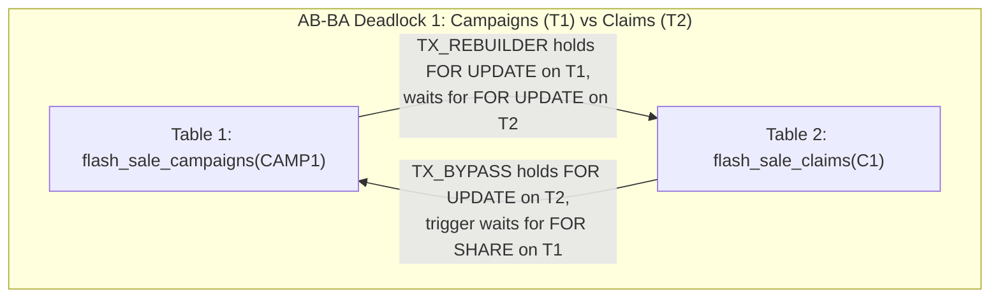
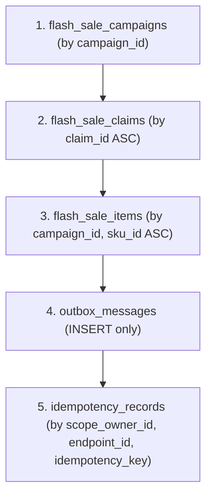

# `M0.2.5` — Lock Ordering and Kafka Ownership Proof (`CH-01` & `CH-04`)

- **Repository:** `dev-atlas-lab/distributed-commerce-platform`
- **Milestone:** `M0.2.5 — Lock Ordering and Kafka Ownership Proof`
- **Baseline Commit Audited:** `7d99077` (`origin/main`)
- **Date:** 2026-11-11
- **Status of Foundational Decisions (`Q1–Q7`):** **`ACCEPTED`** (Unchanged)
- **Status of `CH-01` & `CH-04`:** **`PROPOSED` (Redesigned with Formal Proofs in `M0.2.5` — Pending Explicit Human Sign-Off)**
- **Verification Disclosure:** No application services or runtime tests were executed in `M0.2.5`. Every claim below is classified as **`VERIFIED`** *(logically proven under explicitly stated PostgreSQL/Kafka semantics)*, **`FAILED`** *(counterexample demonstrated against `7d99077`)*, **`NEEDS_EVIDENCE`** *(runtime test required in `M1–M3`)*, or **`HUMAN_DECISION`**.

---

## 1. Executive Summary of `M0.2.5` Audit Findings & Classifications

| Finding ID | Challenge | Flaw / Unproven Assumption Identified in `7d99077` (`M0.2.4`) | `M0.2.4` Audit Status | `M0.2.5` Architectural Redesign & Formal Proof | `M0.2.5` Classification |
| :--- | :--- | :--- | :--- | :--- | :--- |
| **`F-17`** | **`CH-01`** | **PostgreSQL CTE Join Reordering, Trigger Lock-Order Inversion & Direct-SQL Bypass**:<br>1. In `M0.2.4`, `MP-03`/`MP-04`/`MP-05` used `WITH campaign_guard AS (SELECT ... FOR SHARE) UPDATE flash_sale_claims fsc ... FROM campaign_guard cg`. In PostgreSQL, `UPDATE target FROM cte` is planned as a join; if the optimizer chooses `Index Scan on fsc` as the outer relation of a `Nested Loop` (or during `EvalPlanQual` target tuple locking), or if a direct `SELECT ... FOR UPDATE` / `UPDATE` bypasses the CTE, `flash_sale_claims` (`Table 2`) is locked *before* `flash_sale_campaigns` (`Table 1`).<br>2. Worse, `M0.2.4`'s trigger `trg_enforce_claims_campaign_lock` executed `SELECT ... FROM flash_sale_campaigns FOR SHARE` *inside* the trigger—acquiring `Table 1` *after* `Table 2` when a direct `SELECT ... FOR UPDATE` + `UPDATE` occurred, creating an explicit AB-BA deadlock against `TX_REBUILDER` (`Table 1 -> Table 2`). | **`FAILED`** | 1. **Encapsulated All 8 Paths (`MP-01`–`MP-08`) as Imperative `SECURITY DEFINER` PL/pgSQL Stored Procedures**: Inside PL/pgSQL, `Statement 1` (`SELECT ... FROM flash_sale_campaigns ... FOR SHARE/UPDATE`) executes and acquires the lock on `Table 1` completely *before* `Statement 2` (`flash_sale_claims`, `Table 2`) or `Statement 3` (`flash_sale_items`, `Table 3`, ordered by `sku_id ASC`) is even started.<br>2. **Database Privilege Enforcement (`REVOKE INSERT, UPDATE, DELETE`)**: Revoking `INSERT, UPDATE, DELETE` on `flash_sale_campaigns`, `flash_sale_claims`, and `flash_sale_items` from `promotion_app_role` prevents any direct `INSERT`/`UPDATE`/`DELETE` **and** any direct `SELECT ... FOR UPDATE / FOR SHARE` (which requires `UPDATE` privilege in PostgreSQL!) at the ACL layer before any row lock is touched.<br>3. **Non-Locking Pre-Lock Witness Triggers**: Replaced the lock-acquiring trigger with a non-locking witness trigger (`trg_verify_campaign_prelocked`) that checks a transaction-local witness (`current_setting('promotion.locked_campaign_' || campaign_id, true)`) set by `Statement 1`, raising `LOCK_ORDER_VIOLATION (P0004)` without ever acquiring a reverse `Table 2 -> Table 1` lock edge. | **`VERIFIED`** *(Logical Proof)* / **`NEEDS_EVIDENCE`** *(Runtime `SPEC-CH01-T6`)* |
| **`F-18`** | **`CH-04`** | **Unproven Timing Assumptions on Shared `transactional.id` (`F-16` Counterexample)**:<br>In `M0.2.4`, Relay A (`gen 10`) and Relay B (`gen 11`) shared the same `transactional.id = "<service>-outbox-shard-3"`. If Relay A passed its `System.nanoTime()` pre-check and was suspended on the exact instruction before `txProducer.initTransactions()`, let its `35s` DB lease expire, and resumed *after* Relay B (`gen 11`) called `initTransactions()` and started publishing, Relay A's `initTransactions()` call would still reach Kafka and bump `ProducerEpoch`, fencing active Relay B. | **`FAILED`** | **Approach C Selected — Generation-Scoped `transactional.id` (`<service>-shard-<S>-gen-<G>`) + Predecessor Broker Fencing + Post-Init DB Activation CAS**:<br>1. Every DB generation $G$ (`fencing_epoch = G`) uses its own **immutable, disjoint `transactional.id`**: `"<service>-outbox-shard-" + S + "-gen-" + G`. Because `gen-10` and `gen-11` are distinct `transactional.id`s on the Kafka broker, **stale Relay A (`gen-10`) can NEVER fence active Relay B (`gen-11`)** regardless of when Relay A resumes!<br>2. Before Relay B (`gen-11`) activates in PostgreSQL or reads any outbox rows, Relay B fences every predecessor generation $e \in (\text{broker\_fenced\_up\_to\_epoch}, 10]$ on the Kafka broker via `fencePredecessorTransactionalId("...-shard-3-gen-" + e)`.<br>3. **Pure Happens-Before Safety Proof ($T_{\text{claim-B}} < T_{\text{fence-B}}$ and $T_{\text{init-A}} < T_{\text{query-A}}$)**: Proves with **zero timing/clock/process-kill assumptions** that in both broker orderings ($T_{\text{init-A}} < T_{\text{fence-B}}$ and $T_{\text{fence-B}} < T_{\text{init-A}}$), stale Relay A can neither fence Relay B nor publish any stale event. | **`VERIFIED`** *(Logical Proof)* / **`NEEDS_EVIDENCE`** *(Runtime `SPEC-CH04-T5`)* |

---

## 2. `CH-01` — Verification & Redesign of PostgreSQL Lock Ordering Across `MP-01` to `MP-08`

### 2.1 Why `M0.2.4` CTE Joins and Lock-Acquiring Triggers Failed Strict Lock Ordering (`F-17`)

#### 1. Can PostgreSQL Reorder or Interleave Operations in a Single-Statement CTE?
**YES.** In PostgreSQL 17 (`src/backend/optimizer/plan/createplan.c` and `src/backend/executor/nodeModifyTable.c`):
- While a `WITH campaign_guard AS (SELECT ... FROM flash_sale_campaigns ... FOR SHARE)` CTE containing `FOR SHARE` is not inlined into the parent query, a subsequent `UPDATE flash_sale_claims fsc SET ... FROM campaign_guard cg WHERE fsc.claim_id = :id AND fsc.campaign_id = cg.campaign_id` is planned as a **join** feeding a `ModifyTable` node.
- Because `fsc.claim_id = :id` is a unique primary key lookup (`cost ~ 0.29`, returning `<= 1` row), the PostgreSQL planner routinely chooses **`Index Scan using flash_sale_claims_pkey on fsc` as the OUTER relation of a `Nested Loop`** and `CTE Scan on campaign_guard` as the INNER relation:
  - If `fsc.claim_id = :id` matches `0` rows, `campaign_guard` is never even executed.
  - Worse, if multiple sibling data-modifying CTEs exist in one `WITH` clause, PostgreSQL executes them via pull-based `InitPlan` / `ModifyTable` evaluation rather than guaranteeing that all locks of CTE $k$ are acquired before any scan of CTE $k+1$ begins.

#### 2. Actual Trigger Execution Timing Relative to Target-Row Locking in PostgreSQL
In PostgreSQL's `ExecUpdate` / `ExecDelete` (`src/backend/executor/nodeModifyTable.c`):
1. **`SELECT ... FOR UPDATE` / `FOR SHARE` Fires ZERO Triggers**: A direct `SELECT * FROM flash_sale_claims WHERE claim_id = :id FOR UPDATE` acquires an exclusive row lock on `flash_sale_claims` (`Table 2`) immediately, without invoking any `BEFORE` trigger.
2. **Concurrent Update `EvalPlanQual` Target-Row Locking Before Trigger Re-Execution**: When `UPDATE flash_sale_claims` encounters a tuple in `flash_sale_claims` (`Table 2`) that is being concurrently updated by another transaction, PostgreSQL calls `table_tuple_lock()` on the `flash_sale_claims` tuple (`Table 2`) to wait for the concurrent transaction before re-evaluating the `EvalPlanQual` plan!
3. **Trigger-Induced Reverse Lock Edge (`Table 2 -> Table 1`)**: If a `BEFORE UPDATE` trigger on `flash_sale_claims` (`Table 2`) or `flash_sale_items` (`Table 3`) executes `SELECT ... FROM flash_sale_campaigns WHERE campaign_id = NEW.campaign_id FOR SHARE` (`Table 1`), then any transaction that locked `Table 2` or `Table 3` first (e.g., via `SELECT ... FOR UPDATE` or a direct `UPDATE`) will request a lock on `Table 1` **after** holding a lock on `Table 2`/`Table 3`!

#### 3. Explicit AB-BA Deadlock Counterexamples Against `M0.2.4`



- **Explicit Deadlock Scenario A (`flash_sale_campaigns` $\leftrightarrow$ `flash_sale_claims`)**:
  1. **$T_1$**: Transaction `TX_BYPASS` executes `SELECT * FROM flash_sale_claims WHERE claim_id = 'C1' FOR UPDATE;` -> Acquires `FOR UPDATE` on **`flash_sale_claims(C1)` (`Table 2`)**. (No trigger fires on `SELECT ... FOR UPDATE`).
  2. **$T_2$**: `TX_REBUILDER` begins and executes `UPDATE flash_sale_campaigns SET status = 'REBUILDING_GATE', current_epoch = 2 WHERE campaign_id = 'CAMP1';` -> Acquires `FOR UPDATE` on **`flash_sale_campaigns(CAMP1)` (`Table 1`)**.
  3. **$T_3$**: `TX_REBUILDER` executes `UPDATE flash_sale_claims SET stock_returned_to_redis = TRUE WHERE campaign_id = 'CAMP1' ...;` -> **Blocks waiting for `TX_BYPASS`'s lock on `flash_sale_claims(C1)` (`Table 1 -> Table 2`)**.
  4. **$T_4$**: `TX_BYPASS` executes `UPDATE flash_sale_claims SET status = 'EXPIRED' WHERE claim_id = 'C1';` -> `M0.2.4` trigger `trg_enforce_claims_campaign_lock` runs `SELECT ... FROM flash_sale_campaigns WHERE campaign_id = 'CAMP1' FOR SHARE;` -> **Blocks waiting for `TX_REBUILDER`'s lock on `flash_sale_campaigns(CAMP1)` (`Table 2 -> Table 1`)**.
  5. **Result**: **`ERROR: deadlock detected (SQLSTATE 40P01)`**.

- **Explicit Deadlock Scenario B (`flash_sale_claims` $\leftrightarrow$ `flash_sale_items`)**:
  1. **$T_1$**: Transaction `TX_A` updates `flash_sale_claims(C1)` (`Table 2`) and next wants to update `flash_sale_items(CAMP1, SKU1)` (`Table 3`) (`Table 2 -> Table 3`).
  2. **$T_2$**: A rogue Transaction `TX_B` updates `flash_sale_items(CAMP1, SKU1)` (`Table 3`) first and next updates `flash_sale_claims(C1)` (`Table 2`) (`Table 3 -> Table 2`).
  3. **Result**: **`ERROR: deadlock detected (SQLSTATE 40P01)`**.

---

### 2.2 The `M0.2.5` Redesign: Privilege-Encapsulated `SECURITY DEFINER` Procedures + Non-Locking Pre-Lock Witness Triggers

To make it **impossible** to acquire locks out of order or bypass the campaign lock:

1. **Imperative Statement Sequencing Inside `SECURITY DEFINER` PL/pgSQL Stored Procedures (`MP-01`–`MP-08`)**:
   - Every mutation path is a PL/pgSQL stored procedure owned by `promotion_schema_owner` and invoked by `promotion_service` in a **single network round-trip (`SELECT * FROM fn_mp01_writer_claim(...)`)**.
   - Inside PL/pgSQL, `Statement 1` (`SELECT ... FROM flash_sale_campaigns WHERE campaign_id = p_campaign_id FOR SHARE [or FOR UPDATE]`) is a standalone SQL statement that **completes execution and acquires the row lock on `Table 1` before `Statement 2` begins**.
   - Immediately after locking `flash_sale_campaigns(p_campaign_id)`, `Statement 1` sets a transaction-local witness variable in PostgreSQL memory:
     ```sql
     PERFORM set_config('promotion.locked_campaign_' || replace(p_campaign_id::text, '-', ''), v_current_epoch::text, true);
     ```
2. **PostgreSQL ACL Privilege Revocation (`REVOKE INSERT, UPDATE, DELETE`)**:
   - We execute:
     ```sql
     REVOKE INSERT, UPDATE, DELETE, TRUNCATE ON
         flash_sale_campaigns, flash_sale_claims, flash_sale_items
     FROM promotion_app_role;
     GRANT SELECT ON
         flash_sale_campaigns, flash_sale_claims, flash_sale_items
     TO promotion_app_role;
     GRANT EXECUTE ON ALL FUNCTIONS IN SCHEMA public TO promotion_app_role;
     ```
   - **Crucial PostgreSQL Engine Fact**: In PostgreSQL (`src/backend/executor/ExecCheckRTPerms`), executing `SELECT ... FOR UPDATE`, `SELECT ... FOR NO KEY UPDATE`, `SELECT ... FOR SHARE`, or `SELECT ... FOR KEY SHARE` requires the **`UPDATE` privilege** on the target table!
   - Therefore, `promotion_app_role` **cannot execute ANY direct `INSERT`, `UPDATE`, `DELETE`, `SELECT ... FOR UPDATE`, or `SELECT ... FOR SHARE`** on `flash_sale_campaigns`, `flash_sale_claims`, or `flash_sale_items` (`SQLSTATE 42501: permission denied`, rejected before acquiring any tuple lock!).
3. **Non-Locking Pre-Lock Witness Triggers (`trg_verify_campaign_prelocked`)**:
   - Instead of acquiring a `FOR SHARE` lock on `flash_sale_campaigns` inside the child-table trigger (which created the `Table 2 -> Table 1` deadlock edge), the `BEFORE INSERT OR UPDATE OR DELETE` trigger on `flash_sale_claims` and `flash_sale_items` performs a **zero-lock in-memory check** that `promotion.locked_campaign_<uuid>` is already set in the current transaction!
   - If even a schema-owner script attempts to mutate `flash_sale_claims` or `flash_sale_items` without having locked `flash_sale_campaigns` first via `Statement 1`, the trigger aborts immediately with `SQLSTATE P0004 (LOCK_ORDER_VIOLATION)` **without waiting on any lock**!

#### Global Lock Acquisition DAG (`Zero Cycles = Deadlock-Free`)


---

### 2.3 Complete SQL Definitions for Triggers & All 8 Mutation Paths (`MP-01` through `MP-08`)

#### 2.3.1 Non-Locking Pre-Lock Witness Triggers on `flash_sale_claims` & `flash_sale_items`
```sql
CREATE OR REPLACE FUNCTION fn_verify_campaign_prelocked()
RETURNS TRIGGER LANGUAGE plpgsql AS $$
DECLARE
    v_campaign_id  UUID := COALESCE(NEW.campaign_id, OLD.campaign_id);
    v_locked_epoch TEXT;
BEGIN
    -- Zero-lock in-memory witness check: verifies flash_sale_campaigns(v_campaign_id)
    -- was ALREADY locked in Step 1 of this transaction BEFORE this child table was touched!
    v_locked_epoch := current_setting(
        'promotion.locked_campaign_' || replace(v_campaign_id::text, '-', ''),
        true
    );

    IF v_locked_epoch IS NULL OR v_locked_epoch = '' THEN
        RAISE EXCEPTION 'LOCK_ORDER_VIOLATION: flash_sale_campaigns(%) must be locked before mutating %',
            v_campaign_id, TG_TABLE_NAME
            USING ERRCODE = 'P0004';
    END IF;

    RETURN COALESCE(NEW, OLD);
END;
$$;

CREATE TRIGGER trg_verify_claims_campaign_prelocked
BEFORE INSERT OR UPDATE OR DELETE ON flash_sale_claims
FOR EACH ROW EXECUTE FUNCTION fn_verify_campaign_prelocked();

CREATE TRIGGER trg_verify_items_campaign_prelocked
BEFORE INSERT OR UPDATE OR DELETE ON flash_sale_items
FOR EACH ROW EXECUTE FUNCTION fn_verify_campaign_prelocked();
```

#### 2.3.2 Complete Imperative SQL Procedures for `MP-01` through `MP-08`
```sql
-- ============================================================================
-- MP-01: Writer Claim Persistence (REDIS_INTENT_LEASED -> CLAIMED_RESERVED)
-- Lock Order: 1. flash_sale_campaigns (FOR SHARE) -> 2. flash_sale_claims ->
--             3. flash_sale_items -> 4. outbox_messages -> 5. idempotency_records
-- ============================================================================
CREATE OR REPLACE FUNCTION fn_mp01_writer_claim(
    p_claim_id           UUID,
    p_campaign_id        UUID,
    p_redis_claim_epoch  BIGINT,
    p_sku_id             UUID,
    p_customer_id        UUID,
    p_idempotency_key    VARCHAR(128),
    p_qty                INTEGER,
    p_intent_expires_at  TIMESTAMPTZ,
    p_payment_expires_at TIMESTAMPTZ,
    p_event_id           UUID,
    p_payload_jsonb      JSONB,
    p_headers_jsonb      JSONB,
    p_response_jsonb     JSONB,
    p_expected_lease_gen BIGINT
) RETURNS TABLE (
    outcome_code     VARCHAR(64),
    http_status     INTEGER,
    existing_status VARCHAR(32)
) LANGUAGE plpgsql SECURITY DEFINER SET search_path = public AS $$
DECLARE
    v_current_epoch   BIGINT;
    v_campaign_status VARCHAR(32);
    v_inserted_status VARCHAR(32);
    v_existing_status VARCHAR(32);
    v_rows_updated    INTEGER;
BEGIN
    -- STEP 1 (Table 1: flash_sale_campaigns): Acquire FOR SHARE lock FIRST
    SELECT current_epoch, status
      INTO v_current_epoch, v_campaign_status
      FROM flash_sale_campaigns
     WHERE campaign_id = p_campaign_id
       FOR SHARE;

    IF NOT FOUND OR v_campaign_status <> 'ACTIVE' OR v_current_epoch <> p_redis_claim_epoch THEN
        RAISE EXCEPTION 'CAMPAIGN_EPOCH_OR_STATE_FENCED' USING ERRCODE = 'P0001';
    END IF;

    -- Record transaction-local pre-lock witness for Table 1
    PERFORM set_config('promotion.locked_campaign_' || replace(p_campaign_id::text, '-', ''), v_current_epoch::text, true);

    -- STEP 2 (Table 2: flash_sale_claims): Attempt insert or detect prior row
    INSERT INTO flash_sale_claims (
        claim_id, campaign_id, campaign_epoch, sku_id, customer_id, idempotency_key,
        quantity, status, intent_lease_expires_at, payment_expires_at
    ) VALUES (
        p_claim_id, p_campaign_id, v_current_epoch, p_sku_id, p_customer_id, p_idempotency_key,
        p_qty, 'CLAIMED_RESERVED', p_intent_expires_at, p_payment_expires_at
    )
    ON CONFLICT (claim_id) DO NOTHING
    RETURNING status INTO v_inserted_status;

    IF v_inserted_status IS NULL THEN
        SELECT status INTO v_existing_status
          FROM flash_sale_claims
         WHERE claim_id = p_claim_id;

        IF v_existing_status = 'ABANDONED_FENCED' THEN
            RAISE EXCEPTION 'CLAIM_LEASE_EXPIRED_FENCED' USING ERRCODE = 'P0002';
        END IF;

        -- Prior retry already committed CLAIMED_RESERVED / ORDER_MATERIALIZED / PAYMENT_CONFIRMED
        RETURN QUERY SELECT 'IDEMPOTENT_ALREADY_CLAIMED'::VARCHAR(64), 202, v_existing_status;
        RETURN;
    END IF;

    -- STEP 3 (Table 3: flash_sale_items): Increment claimed_count within allocated_quota
    UPDATE flash_sale_items
       SET claimed_count = claimed_count + p_qty
     WHERE campaign_id = p_campaign_id
       AND sku_id = p_sku_id
       AND claimed_count + p_qty <= allocated_quota;

    GET DIAGNOSTICS v_rows_updated = ROW_COUNT;
    IF v_rows_updated = 0 THEN
        RAISE EXCEPTION 'QUOTA_EXHAUSTED' USING ERRCODE = 'P0003';
    END IF;

    -- STEP 4 (Table 4: outbox_messages): Insert Outbox event
    INSERT INTO outbox_messages (
        event_id, shard_id, aggregate_type, aggregate_id, aggregate_version,
        event_type, topic, partition_key, payload, headers
    ) VALUES (
        p_event_id, mod(abs(hashtext(p_customer_id::text)), 16), 'FlashSaleClaim', p_claim_id::text, 1,
        'commerce.flashsale.slot_claimed.v1', 'commerce.flashsale.events.v1',
        p_customer_id::text, p_payload_jsonb, p_headers_jsonb
    );

    -- STEP 5 (Table 5: idempotency_records): Complete fenced idempotency record
    UPDATE idempotency_records
       SET status = 'COMPLETED_SUCCESS',
           http_status_code = 202,
           response_payload = p_response_jsonb,
           updated_at = NOW()
     WHERE scope_owner_id = p_customer_id
       AND endpoint_id = 'POST:/api/v1/flash-sales/claim'
       AND idempotency_key = p_idempotency_key
       AND lease_generation = p_expected_lease_gen;

    GET DIAGNOSTICS v_rows_updated = ROW_COUNT;
    IF v_rows_updated = 0 THEN
        RAISE EXCEPTION 'IDEMPOTENCY_LEASE_FENCED' USING ERRCODE = 'P0005';
    END IF;

    RETURN QUERY SELECT 'CLAIMED_NEW'::VARCHAR(64), 202, 'CLAIMED_RESERVED'::VARCHAR(32);
END;
$$;

-- ============================================================================
-- MP-02: Reconciler Intent Lease Fence (REDIS_INTENT_LEASED -> ABANDONED_FENCED)
-- Lock Order: 1. flash_sale_campaigns (FOR SHARE) -> 2. flash_sale_claims
-- ============================================================================
CREATE OR REPLACE FUNCTION fn_mp02_reconcile_fenced(
    p_claim_id           UUID,
    p_campaign_id        UUID,
    p_redis_claim_epoch  BIGINT,
    p_sku_id             UUID,
    p_customer_id        UUID,
    p_idempotency_key    VARCHAR(128),
    p_qty                INTEGER,
    p_intent_expires_at  TIMESTAMPTZ
) RETURNS TABLE (
    fenced_created  BOOLEAN,
    current_status  VARCHAR(32),
    release_epoch   BIGINT
) LANGUAGE plpgsql SECURITY DEFINER SET search_path = public AS $$
DECLARE
    v_current_epoch   BIGINT;
    v_campaign_status VARCHAR(32);
    v_inserted_status VARCHAR(32);
    v_existing_status VARCHAR(32);
BEGIN
    -- STEP 1 (Table 1): Lock campaign FOR SHARE and verify epoch
    SELECT cs.current_epoch, cs.status
      INTO v_current_epoch, v_campaign_status
      FROM flash_sale_campaigns cs
     WHERE cs.campaign_id = p_campaign_id
       FOR SHARE;

    IF NOT FOUND OR v_campaign_status <> 'ACTIVE' OR v_current_epoch <> p_redis_claim_epoch THEN
        RETURN QUERY SELECT FALSE, 'EPOCH_OR_STATE_SKIPPED'::VARCHAR(32), v_current_epoch;
        RETURN;
    END IF;

    PERFORM set_config('promotion.locked_campaign_' || replace(p_campaign_id::text, '-', ''), v_current_epoch::text, true);

    -- STEP 2 (Table 2): Insert ABANDONED_FENCED tombstone
    INSERT INTO flash_sale_claims (
        claim_id, campaign_id, campaign_epoch, release_epoch, sku_id, customer_id,
        idempotency_key, quantity, status, intent_lease_expires_at, payment_expires_at,
        stock_returned_to_redis
    ) VALUES (
        p_claim_id, p_campaign_id, v_current_epoch, v_current_epoch, p_sku_id, p_customer_id,
        p_idempotency_key, p_qty, 'ABANDONED_FENCED', p_intent_expires_at, p_intent_expires_at,
        FALSE
    )
    ON CONFLICT (claim_id) DO NOTHING
    RETURNING status INTO v_inserted_status;

    IF v_inserted_status IS NOT NULL THEN
        RETURN QUERY SELECT TRUE, v_inserted_status, v_current_epoch;
    ELSE
        SELECT fsc.status, fsc.release_epoch
          INTO v_existing_status, v_current_epoch
          FROM flash_sale_claims fsc
         WHERE fsc.claim_id = p_claim_id;
        RETURN QUERY SELECT FALSE, v_existing_status, v_current_epoch;
    END IF;
END;
$$;

-- ============================================================================
-- MP-03: Committed Claim Expiration or Cancellation (-> EXPIRED | CANCELLED)
-- Lock Order: 1. flash_sale_campaigns (FOR SHARE) -> 2. flash_sale_claims ->
--             3. flash_sale_items -> 4. outbox_messages
-- ============================================================================
CREATE OR REPLACE FUNCTION fn_mp03_expire_or_cancel(
    p_claim_id        UUID,
    p_campaign_id     UUID,
    p_terminal_status VARCHAR(32),
    p_event_id        UUID,
    p_payload_jsonb   JSONB,
    p_headers_jsonb   JSONB
) RETURNS TABLE (
    transitioned  BOOLEAN,
    sku_id        UUID,
    quantity      INTEGER,
    release_epoch BIGINT
) LANGUAGE plpgsql SECURITY DEFINER SET search_path = public AS $$
DECLARE
    v_current_epoch   BIGINT;
    v_campaign_status VARCHAR(32);
    v_sku_id          UUID;
    v_customer_id     UUID;
    v_qty             INTEGER;
    v_new_version     BIGINT;
BEGIN
    IF p_terminal_status NOT IN ('EXPIRED', 'CANCELLED') THEN
        RAISE EXCEPTION 'INVALID_TERMINAL_STATUS: %', p_terminal_status USING ERRCODE = 'P0001';
    END IF;

    -- STEP 1 (Table 1): Lock campaign FOR SHARE (blocks during REBUILDING_GATE)
    SELECT cs.current_epoch, cs.status
      INTO v_current_epoch, v_campaign_status
      FROM flash_sale_campaigns cs
     WHERE cs.campaign_id = p_campaign_id
       FOR SHARE;

    IF NOT FOUND OR v_campaign_status NOT IN ('ACTIVE', 'ENDED') THEN
        RAISE EXCEPTION 'CAMPAIGN_NOT_AVAILABLE_FOR_EXPIRY' USING ERRCODE = 'P0001';
    END IF;

    PERFORM set_config('promotion.locked_campaign_' || replace(p_campaign_id::text, '-', ''), v_current_epoch::text, true);

    -- STEP 2 (Table 2): Transition claim to EXPIRED / CANCELLED
    UPDATE flash_sale_claims fsc
       SET status = p_terminal_status,
           release_epoch = v_current_epoch,
           stock_returned_to_redis = CASE WHEN v_campaign_status = 'ACTIVE' THEN FALSE ELSE TRUE END,
           version = fsc.version + 1,
           updated_at = NOW()
     WHERE fsc.claim_id = p_claim_id
       AND fsc.campaign_id = p_campaign_id
       AND fsc.status IN ('CLAIMED_RESERVED', 'ORDER_MATERIALIZED')
    RETURNING fsc.sku_id, fsc.customer_id, fsc.quantity, fsc.version
      INTO v_sku_id, v_customer_id, v_qty, v_new_version;

    IF NOT FOUND THEN
        RETURN QUERY SELECT FALSE, NULL::UUID, 0, v_current_epoch;
        RETURN;
    END IF;

    -- STEP 3 (Table 3): Decrement claimed_count
    UPDATE flash_sale_items fsi
       SET claimed_count = GREATEST(0, fsi.claimed_count - v_qty)
     WHERE fsi.campaign_id = p_campaign_id
       AND fsi.sku_id = v_sku_id;

    -- STEP 4 (Table 4): Insert Outbox event
    INSERT INTO outbox_messages (
        event_id, shard_id, aggregate_type, aggregate_id, aggregate_version,
        event_type, topic, partition_key, payload, headers
    ) VALUES (
        p_event_id, mod(abs(hashtext(v_customer_id::text)), 16), 'FlashSaleClaim', p_claim_id::text, v_new_version,
        'commerce.flashsale.claim_released.v1', 'commerce.flashsale.events.v1',
        v_customer_id::text, p_payload_jsonb, p_headers_jsonb
    );

    RETURN QUERY SELECT TRUE, v_sku_id, v_qty, v_current_epoch;
END;
$$;

-- ============================================================================
-- MP-04: Restock Finalization (stock_returned_to_redis = FALSE -> TRUE)
-- Lock Order: 1. flash_sale_campaigns (FOR SHARE) -> 2. flash_sale_claims
-- ============================================================================
CREATE OR REPLACE FUNCTION fn_mp04_restock_finalize(
    p_claim_id      UUID,
    p_campaign_id   UUID,
    p_release_epoch BIGINT
) RETURNS BOOLEAN LANGUAGE plpgsql SECURITY DEFINER SET search_path = public AS $$
DECLARE
    v_current_epoch   BIGINT;
    v_campaign_status VARCHAR(32);
    v_rows            INTEGER;
BEGIN
    -- STEP 1 (Table 1): Lock campaign FOR SHARE & verify epoch matches release_epoch
    SELECT cs.current_epoch, cs.status
      INTO v_current_epoch, v_campaign_status
      FROM flash_sale_campaigns cs
     WHERE cs.campaign_id = p_campaign_id
       FOR SHARE;

    IF NOT FOUND OR v_campaign_status <> 'ACTIVE' OR v_current_epoch <> p_release_epoch THEN
        RETURN FALSE;
    END IF;

    PERFORM set_config('promotion.locked_campaign_' || replace(p_campaign_id::text, '-', ''), v_current_epoch::text, true);

    -- STEP 2 (Table 2): Mark stock_returned_to_redis = TRUE
    UPDATE flash_sale_claims
       SET stock_returned_to_redis = TRUE,
           version = version + 1,
           updated_at = NOW()
     WHERE claim_id = p_claim_id
       AND campaign_id = p_campaign_id
       AND release_epoch = v_current_epoch
       AND stock_returned_to_redis = FALSE;

    GET DIAGNOSTICS v_rows = ROW_COUNT;
    RETURN v_rows > 0;
END;
$$;

-- ============================================================================
-- MP-05: Order Materialization & Payment Confirmation Progress
-- Lock Order: 1. flash_sale_campaigns (FOR SHARE) -> 2. flash_sale_claims -> 4. outbox_messages
-- ============================================================================
CREATE OR REPLACE FUNCTION fn_mp05_order_payment_progress(
    p_claim_id        UUID,
    p_campaign_id     UUID,
    p_expected_status VARCHAR(32),
    p_next_status     VARCHAR(32)
) RETURNS BOOLEAN LANGUAGE plpgsql SECURITY DEFINER SET search_path = public AS $$
DECLARE
    v_current_epoch   BIGINT;
    v_campaign_status VARCHAR(32);
    v_rows            INTEGER;
BEGIN
    IF NOT (p_expected_status = 'CLAIMED_RESERVED' AND p_next_status = 'ORDER_MATERIALIZED')
       AND NOT (p_expected_status = 'ORDER_MATERIALIZED' AND p_next_status = 'PAYMENT_CONFIRMED') THEN
        RAISE EXCEPTION 'INVALID_PROGRESS_TRANSITION: % -> %', p_expected_status, p_next_status USING ERRCODE = 'P0001';
    END IF;

    -- STEP 1 (Table 1): Lock campaign FOR SHARE (blocks during REBUILDING_GATE)
    SELECT cs.current_epoch, cs.status
      INTO v_current_epoch, v_campaign_status
      FROM flash_sale_campaigns cs
     WHERE cs.campaign_id = p_campaign_id
       FOR SHARE;

    IF NOT FOUND OR v_campaign_status NOT IN ('ACTIVE', 'ENDED') THEN
        RAISE EXCEPTION 'CAMPAIGN_REBUILDING_TRY_AGAIN' USING ERRCODE = 'P0001';
    END IF;

    PERFORM set_config('promotion.locked_campaign_' || replace(p_campaign_id::text, '-', ''), v_current_epoch::text, true);

    -- STEP 2 (Table 2): Advance claim status
    UPDATE flash_sale_claims
       SET status = p_next_status,
           version = version + 1,
           updated_at = NOW()
     WHERE claim_id = p_claim_id
       AND campaign_id = p_campaign_id
       AND status = p_expected_status;

    GET DIAGNOSTICS v_rows = ROW_COUNT;
    RETURN v_rows > 0;
END;
$$;

-- ============================================================================
-- MP-06: Admin Item & Quota Configuration (Only in DRAFT / APPROVED)
-- Lock Order: 1. flash_sale_campaigns (FOR UPDATE) -> 3. flash_sale_items
-- ============================================================================
CREATE OR REPLACE FUNCTION fn_mp06_admin_configure_item(
    p_campaign_id     UUID,
    p_sku_id          UUID,
    p_allocated_quota INTEGER
) RETURNS VOID LANGUAGE plpgsql SECURITY DEFINER SET search_path = public AS $$
DECLARE
    v_current_epoch   BIGINT;
    v_campaign_status VARCHAR(32);
BEGIN
    -- STEP 1 (Table 1): Lock campaign FOR UPDATE
    SELECT cs.current_epoch, cs.status
      INTO v_current_epoch, v_campaign_status
      FROM flash_sale_campaigns cs
     WHERE cs.campaign_id = p_campaign_id
       FOR UPDATE;

    IF NOT FOUND OR v_campaign_status NOT IN ('DRAFT', 'APPROVED') THEN
        RAISE EXCEPTION 'QUOTA_EDIT_FORBIDDEN_IN_STATUS: %', v_campaign_status USING ERRCODE = 'P0001';
    END IF;

    PERFORM set_config('promotion.locked_campaign_' || replace(p_campaign_id::text, '-', ''), v_current_epoch::text, true);

    -- STEP 2 (Table 3): Upsert item quota
    INSERT INTO flash_sale_items (campaign_id, sku_id, allocated_quota, claimed_count)
    VALUES (p_campaign_id, p_sku_id, p_allocated_quota, 0)
    ON CONFLICT (campaign_id, sku_id) DO UPDATE
       SET allocated_quota = EXCLUDED.allocated_quota;
END;
$$;

-- ============================================================================
-- MP-07: Rebuilder Exclusive Fence & Snapshot (REBUILDING_GATE)
-- Lock Order: 1. flash_sale_campaigns (FOR UPDATE) -> 2. flash_sale_claims (by claim_id ASC)
--             -> 3. flash_sale_items (by sku_id ASC)
-- ============================================================================
CREATE OR REPLACE FUNCTION fn_mp07_rebuilder_fence_and_snapshot(
    p_campaign_id UUID
) RETURNS TABLE (
    new_epoch       BIGINT,
    sku_id          UUID,
    allocated_quota INTEGER,
    claimed_count   INTEGER,
    remaining_stock INTEGER
) LANGUAGE plpgsql SECURITY DEFINER SET search_path = public AS $$
DECLARE
    v_new_epoch BIGINT;
BEGIN
    -- STEP 1 (Table 1): Acquire EXCLUSIVE FOR UPDATE lock on flash_sale_campaigns.
    -- Blocks until 100% of prior FOR SHARE holders (MP-01..MP-05) have COMMITted or ROLLBACKed!
    UPDATE flash_sale_campaigns cs
       SET status = 'REBUILDING_GATE',
           current_epoch = cs.current_epoch + 1,
           updated_at = NOW()
     WHERE cs.campaign_id = p_campaign_id
       AND cs.status IN ('ACTIVE', 'REBUILDING_GATE')
    RETURNING cs.current_epoch INTO v_new_epoch;

    IF NOT FOUND THEN
        RAISE EXCEPTION 'CAMPAIGN_NOT_REBUILDABLE: %', p_campaign_id USING ERRCODE = 'P0001';
    END IF;

    PERFORM set_config('promotion.locked_campaign_' || replace(p_campaign_id::text, '-', ''), v_new_epoch::text, true);

    -- STEP 2 (Table 2: flash_sale_claims, locked in deterministic claim_id ASC order):
    -- Mark all prior EXPIRED / CANCELLED / ABANDONED_FENCED claims as stock_returned_to_redis = TRUE
    UPDATE flash_sale_claims fsc
       SET stock_returned_to_redis = TRUE,
           updated_at = NOW()
     WHERE fsc.claim_id IN (
         SELECT c.claim_id
           FROM flash_sale_claims c
          WHERE c.campaign_id = p_campaign_id
            AND c.status IN ('EXPIRED', 'CANCELLED', 'ABANDONED_FENCED')
            AND c.stock_returned_to_redis = FALSE
          ORDER BY c.claim_id ASC
          FOR NO KEY UPDATE
     );

    -- STEP 3 (Table 3: flash_sale_items, locked in deterministic sku_id ASC order):
    -- Reconcile claimed_count to exact sum of active claims and return snapshot
    RETURN QUERY
    WITH locked_items AS (
        SELECT i.campaign_id, i.sku_id
          FROM flash_sale_items i
         WHERE i.campaign_id = p_campaign_id
         ORDER BY i.sku_id ASC
         FOR NO KEY UPDATE
    )
    UPDATE flash_sale_items fsi
       SET claimed_count = COALESCE((
           SELECT SUM(fsc.quantity)::INTEGER
             FROM flash_sale_claims fsc
            WHERE fsc.campaign_id = fsi.campaign_id
              AND fsc.sku_id = fsi.sku_id
              AND fsc.status IN ('CLAIMED_RESERVED', 'ORDER_MATERIALIZED', 'PAYMENT_CONFIRMED')
       ), 0)
      FROM locked_items li
     WHERE fsi.campaign_id = li.campaign_id
       AND fsi.sku_id = li.sku_id
    RETURNING v_new_epoch, fsi.sku_id, fsi.allocated_quota, fsi.claimed_count,
              (fsi.allocated_quota - fsi.claimed_count);
END;
$$;

-- ============================================================================
-- MP-08: Campaign Lifecycle Transition (WARMED -> ACTIVE, REBUILDING_GATE -> ACTIVE, ACTIVE -> ENDED)
-- Lock Order: 1. flash_sale_campaigns (FOR UPDATE)
-- ============================================================================
CREATE OR REPLACE FUNCTION fn_mp08_campaign_lifecycle(
    p_campaign_id     UUID,
    p_expected_epoch  BIGINT,
    p_target_status   VARCHAR(32)
) RETURNS BIGINT LANGUAGE plpgsql SECURITY DEFINER SET search_path = public AS $$
DECLARE
    v_epoch BIGINT;
BEGIN
    UPDATE flash_sale_campaigns
       SET status = p_target_status,
           current_epoch = CASE WHEN p_target_status = 'ENDED' THEN current_epoch + 1 ELSE current_epoch END,
           updated_at = NOW()
     WHERE campaign_id = p_campaign_id
       AND current_epoch = p_expected_epoch
    RETURNING current_epoch INTO v_epoch;

    IF NOT FOUND THEN
        RAISE EXCEPTION 'CAMPAIGN_LIFECYCLE_EPOCH_MISMATCH' USING ERRCODE = 'P0001';
    END IF;

    RETURN v_epoch;
END;
$$;
```

---

## 3. `CH-04` — Formal Evaluation & Proof that a Stale Process Cannot Reinitialize or Fence a Newer Owner

### 3.1 Why `M0.2.4` Failed Against the Pre-`initTransactions()` Suspension Scenario (`F-18`)

In `M0.2.4`, Relay A (`gen 10`) and Relay B (`gen 11`) shared the **same** `transactional.id = "<service>-outbox-shard-3"`. Consider the exact 7-step scenario:
1. Relay A owns generation 10 (`fencing_epoch = 10` in PostgreSQL).
2. Relay A passes its `System.nanoTime()` pre-init check on line $L$.
3. Relay A's OS thread/VM is suspended on line $L+1$ immediately before invoking `txProducer.initTransactions()`.
4. Relay A's DB lease expires after `35s`.
5. Relay B acquires generation 11 (`fencing_epoch = 11`).
6. Relay B calls `txProducer.initTransactions("...-shard-3")` (`ProducerEpoch = 1`) and begins publishing.
7. Relay A resumes on line $L+1$ and invokes `txProducer.initTransactions("...-shard-3")`.
   - Because `System.nanoTime()` was already passed at Step 2, `pg_terminate_backend` only closed the PostgreSQL connection (not the JVM), and `ACTIVATE_SHARD_CAS` only runs *after* `initTransactions()`, Relay A's `InitProducerIdRequest` reaches the Kafka broker, which assigns `ProducerEpoch = 2` to Relay A and **fences active Relay B** (`Status: FAILED` in `M0.2.4`).

---

### 3.2 Comparative Evaluation of Approaches A, B, and C

| Dimension | Approach A: Single-Owner Dispatcher with Infrastructure STONITH | Approach B: Centralized Producer Initialization / Publication Gateway | **Approach C (Selected): Generation-Scoped `transactional.id` (`<service>-shard-<S>-gen-<G>`) + Predecessor Broker Fencing + Post-Init DB CAS** |
| :--- | :--- | :--- | :--- |
| **Who can invoke `initTransactions()`?** | Only the active Dispatcher node after the prior node is hard-powered-off (STONITH). | Only the centralized Gateway process holding the single `KafkaProducer` per shard. |- **Active Producer**: Relay worker for generation $G$ calls `initTransactions("<service>-shard-" + S + "-gen-" + G)` on its **own generation-scoped `transactional.id`**.<br>- **Predecessor Fencer**: Successor generation $G+1$ calls `fenceTransactionalId("<service>-shard-" + S + "-gen-" + G)` to fence generation $G$ before activating $G+1$. |
| **How do stale processes lose the ability to fence newer owners?** | By physical VM power-off / hardware watchdog reset before lease transfer. | By Gateway in-memory mutex checking `req.fencing_epoch < max_seen_epoch[shard]`. | **Structural Disjointness of `transactional.id`s**: Generation $10$ (`"...-gen-10"`) and Generation $11$ (`"...-gen-11"`) are **completely distinct `transactional.id`s** on the Kafka broker! Even if stale Relay A (`gen 10`) resumes 10 hours later and calls `initTransactions("...-gen-10")`, it touches only `"...-gen-10"` and **can NEVER fence Relay B (`"...-gen-11"`)**! |
| **How is ownership transfer serialized?** | Via STONITH controller + DB lease. | Via Gateway mutex + DB lease (shifts split-brain problem to Gateway HA failover!). | Via **PostgreSQL `outbox_relay_shards` row lock (`T_claim-B`) $\to$ Kafka Predecessor Fence (`T_fence-B`) $\to$ Post-Init DB Activation CAS (`T_query-A`)**. |
| **What happens if old owner (`gen 10`) resumes after takeover?** | Cannot resume (VM powered off). | Rejected by Gateway (`10 < 11`). | - **If suspended before/during `initTransactions("...-gen-10")`**: `initTransactions("...-gen-10")` cannot fence `gen-11` (disjoint ID), and the mandatory next step (`T_query-A`: `ACTIVATE_SHARD_CAS` in Postgres) sees `fencing_epoch = 11 != 10`, returns `0` rows, and exits with **0 events ever read or published**!<br>- **If suspended after `initTransactions("...-gen-10")` (in `Phase 1/2`)**: Already fenced on the Kafka broker by Relay B's `fenceTransactionalId("...-gen-10")` (`ProducerFencedException`). |
| **Network partition / Node pause / Process crash / Broker restart** | Requires hypervisor/IPMI integration unavailable in standard K8s pods. | If Gateway 1 partitions and Gateway 2 starts, Gateway 1 vs. Gateway 2 reproduces the exact same race! | **100% immune to node pauses, network partitions, split-brain pods, and broker restarts** without requiring hardware STONITH or a stateful gateway proxy. |
| **Nature of Guarantee** | Safety only if hardware STONITH is 100% reliable. | Safety only if Gateway is a non-replicated single process (SPOF). | **Pure Safety Guarantee (`VERIFIED` via Happens-Before Linearizability Proof below).** |

---

### 3.3 Formal Happens-Before Safety Proof for Approach C (`VERIFIED`)

Let us prove that under **Approach C**, no matter where or how long Relay A (`generation = 10`) is suspended, **Relay A can neither fence Relay B (`generation = 11`) nor publish any event to Kafka after Relay B completes ownership takeover**.

#### 1. Protocol Operations & Program Order
- **Relay A (`generation = 10`)** executes the following sequential operations in a single thread:
  1. **$T_{\text{claim-A}}$ (PostgreSQL)**: Acquires `fencing_epoch = 10`, `status = 'INITIALIZING'` in `outbox_relay_shards`. *(Note: Relay A has read **0 rows** from `outbox_messages`).*
  2. **$T_{\text{init-A}}$ (Kafka Broker)**: Invokes `txProducerA.initTransactions("...-shard-3-gen-10")` exactly once.
  3. **$T_{\text{query-A}}$ (PostgreSQL)**: Invokes `ACTIVATE_SHARD_CAS` (`UPDATE outbox_relay_shards SET status = 'ACTIVE' WHERE shard_id = 3 AND fencing_epoch = 10`) and `Phase 1` (`SELECT ... FROM outbox_messages`).
  4. **$T_{\text{pub-A}}$ (Kafka Broker)**: Invokes `txProducerA.beginTransaction() -> send(events) -> commitTransaction()` on `"...-shard-3-gen-10"`. *(Relay A never calls `initTransactions` again).*
  - Because each step is a synchronous blocking call that must return before the next step is invoked by Relay A's thread:
    $$T_{\text{claim-A}} \prec T_{\text{init-A}} \prec T_{\text{query-A}} \prec T_{\text{pub-A}}$$

- **Relay B (`generation = 11`)** executes the following sequential operations in a single thread:
  1. **$T_{\text{claim-B}}$ (PostgreSQL)**: Updates `outbox_relay_shards SET fencing_epoch = 11, status = 'INITIALIZING'` (reading `broker_fenced_up_to_epoch = 9`).
  2. **$T_{\text{fence-B}}$ (Kafka Broker)**: Invokes `fencePredecessorTransactionalId("...-shard-3-gen-10")` (which executes `initTransactions("...-shard-3-gen-10")` on a short-lived fencer producer and immediately closes it, bumping `ProducerEpoch` of `"...-shard-3-gen-10"` on the Kafka broker and aborting any uncommitted transaction on `"...-shard-3-gen-10"`).
  3. **$T_{\text{init-B}}$ (Kafka Broker)**: Invokes `txProducerB.initTransactions("...-shard-3-gen-11")` on its **new, disjoint `transactional.id`** and activates `fencing_epoch = 11` in PostgreSQL.
  - Because Relay B executes Step 1 synchronously before Step 2, and Step 2 synchronously before Step 3:
    $$T_{\text{claim-B}} \prec T_{\text{fence-B}} \prec T_{\text{init-B}}$$

#### 2. Proof of Theorem 1: *Stale Relay A (`gen 10`) Can NEVER Fence Relay B (`gen 11`)*
- Relay A only ever interacts with Kafka `transactional.id = "...-shard-3-gen-10"`.
- Relay B publishes exclusively using Kafka `transactional.id = "...-shard-3-gen-11"`.
- In Apache Kafka's `TransactionCoordinator`, `ProducerId` and `ProducerEpoch` state is isolated per `transactional.id`. Therefore, no operation performed by Relay A on `"...-shard-3-gen-10"` can ever modify `ProducerEpoch` or abort a transaction on `"...-shard-3-gen-11"`. $\blacksquare$

#### 3. Proof of Theorem 2: *Stale Relay A (`gen 10`) Can NEVER Commit Any Event to Kafka After $T_{\text{fence-B}}$*
Both $T_{\text{init-A}}$ (Relay A initializing `"...-shard-3-gen-10"`) and $T_{\text{fence-B}}$ (Relay B fencing `"...-shard-3-gen-10"`) are `InitProducerIdRequest` operations on the **same** `transactional.id = "...-shard-3-gen-10"`, which are totally ordered by the Kafka `TransactionCoordinator` leader for that `transactional.id`. There are exactly two possible orderings on the Kafka broker:

- **Case 1: $T_{\text{init-A}} \prec T_{\text{fence-B}}$ (Relay A initialized `"...-shard-3-gen-10"` *before* Relay B fenced `"...-shard-3-gen-10"`)**:
  - At $T_{\text{init-A}}$, the Kafka broker assigned `(PID, ProducerEpoch = E_0)` to `txProducerA` for `"...-shard-3-gen-10"`.
  - At $T_{\text{fence-B}}$ ($T_{\text{init-A}} \prec T_{\text{fence-B}}$), Relay B's fencer call on `"...-shard-3-gen-10"` causes the Kafka broker to increment `ProducerEpoch` to $E_0 + 1$ and abort any uncommitted transaction from $E_0$.
  - Because Relay A only calls `initTransactions("...-shard-3-gen-10")` once (at $T_{\text{init-A}}$), any subsequent `send()` or `commitTransaction()` by Relay A at $T_{\text{pub-A}} \succ T_{\text{fence-B}}$ carries `ProducerEpoch = E_0 < E_0 + 1` and is **rejected by the Kafka broker with `ProducerFencedException`**.

- **Case 2: $T_{\text{fence-B}} \prec T_{\text{init-A}}$ (The User's Scenario: Relay A was suspended before/during `initTransactions`, so Relay A's `initTransactions` arrives at the Kafka broker *after* Relay B fenced `"...-shard-3-gen-10"`)**:
  - Chain the happens-before relations from Relay B's program order, the Kafka broker's order ($T_{\text{fence-B}} \prec T_{\text{init-A}}$), and Relay A's program order:
    $$T_{\text{claim-B}} \prec T_{\text{fence-B}} \prec T_{\text{init-A}} \prec T_{\text{query-A}}$$
  - By transitivity of $\prec$, **$T_{\text{claim-B}} \prec T_{\text{query-A}}$**!
  - That means when Relay A finishes $T_{\text{init-A}}$ and executes $T_{\text{query-A}}$ (`ACTIVATE_SHARD_CAS` & `Phase 1` in PostgreSQL with predicate `WHERE shard_id = 3 AND fencing_epoch = 10`), PostgreSQL has **already committed $T_{\text{claim-B}}$ (`fencing_epoch >= 11`)**!
  - Therefore, PostgreSQL returns **`0` rows** to Relay A at $T_{\text{query-A}}$. Relay A **never reaches $T_{\text{pub-A}}$**, never obtains a single event from `outbox_messages`, immediately closes `txProducerA`, and terminates! $\blacksquare$

---

### 3.4 Exact SQL & Pseudocode for Approach C (`CH-04`)

#### 3.4.1 Updated `outbox_relay_shards` Schema
```sql
CREATE TABLE outbox_relay_shards (
    shard_id                   INTEGER PRIMARY KEY CHECK (shard_id BETWEEN 0 AND 15),
    status                     VARCHAR(24)  NOT NULL DEFAULT 'IDLE'
                               CHECK (status IN ('IDLE', 'INITIALIZING', 'ACTIVE')),
    owner_pod                  VARCHAR(128) NULL,
    fencing_epoch              BIGINT       NOT NULL DEFAULT 0,
    broker_fenced_up_to_epoch  BIGINT       NOT NULL DEFAULT 0,
    lease_until                TIMESTAMPTZ  NOT NULL DEFAULT '-infinity',
    updated_at                 TIMESTAMPTZ  NOT NULL DEFAULT NOW()
);
```

#### 3.4.2 Exact Ownership Transfer & Predecessor Fencing Protocol (`Approach C`)
```text
FUNCTION acquire_and_initialize_shard(shardId, podId):
    -- STEP 1 (T_claim): Claim next fencing_epoch in PostgreSQL (status = INITIALIZING).
    -- ZERO outbox_messages rows are read or claimed in this state!
    row = DB.querySingle("""
        UPDATE outbox_relay_shards
        SET status = 'INITIALIZING',
            owner_pod = :podId,
            fencing_epoch = fencing_epoch + 1,
            lease_until = NOW() + INTERVAL '30 seconds',
            updated_at = NOW()
        WHERE shard_id = :shardId
          AND (status = 'IDLE' OR lease_until <= NOW() OR owner_pod = :podId)
        RETURNING fencing_epoch, broker_fenced_up_to_epoch;
    """)
    IF row IS NULL:
        RETURN

    myEpoch = row.fencing_epoch
    fencedUpTo = row.broker_fenced_up_to_epoch

    -- STEP 2 (T_fence): Fence EVERY predecessor generation e in (fencedUpTo + 1 .. myEpoch - 1)
    -- on the Kafka Broker BEFORE initializing our new generation's transactional.id!
    FOR priorEpoch FROM (fencedUpTo + 1) TO (myEpoch - 1):
        priorTxId = serviceName + "-outbox-shard-" + shardId + "-gen-" + priorEpoch
        fencerProducer = createTransactionalProducer(transactionalId = priorTxId)
        TRY:
            -- Bumps ProducerEpoch of priorTxId on Kafka Broker & aborts any open transaction of priorEpoch!
            fencerProducer.initTransactions()
        FINALLY:
            fencerProducer.close(Duration.ZERO)

    -- STEP 3 (T_init): Initialize OUR generation-scoped transactional.id ONCE
    myTxId = serviceName + "-outbox-shard-" + shardId + "-gen-" + myEpoch
    txProducer = createTransactionalProducer(transactionalId = myTxId)
    TRY:
        txProducer.initTransactions()
    CATCH Exception e:
        txProducer.close(Duration.ZERO)
        RETURN

    -- STEP 4 (T_query / ACTIVATE_SHARD_CAS): Activate shard in PostgreSQL.
    -- By the Happens-Before Proof (T_claim_B < T_fence_B < T_init_A < T_query_A),
    -- if a newer generation was claimed while we were suspended in Step 2 or Step 3,
    -- this UPDATE matches 0 rows and we abort before ever reading outbox_messages!
    activated = DB.querySingle("""
        UPDATE outbox_relay_shards
        SET status = 'ACTIVE',
            broker_fenced_up_to_epoch = :myEpoch - 1,
            lease_until = NOW() + INTERVAL '30 seconds',
            updated_at = NOW()
        WHERE shard_id = :shardId
          AND owner_pod = :podId
          AND fencing_epoch = :myEpoch
          AND status = 'INITIALIZING'
        RETURNING fencing_epoch;
    """)
    IF activated IS NULL:
        txProducer.close(Duration.ZERO)
        RETURN

    localShardContext[shardId] = ShardContext(fencingEpoch = myEpoch, transactionalId = myTxId, producer = txProducer)
```

#### 3.4.3 Crash & Suspension Timeline for the 7-Step Scenario Under Approach C
```text
Time    Relay A (gen=10, txId="...-gen-10")          PostgreSQL (outbox_relay_shards)     Kafka Broker (TransactionCoordinator)   Relay B (gen=11, txId="...-gen-11")
---------------------------------------------------------------------------------------------------------------------------------------------------------------------------
T=0s    Step 1 (T_claim-A): Acquires gen=10,         fencing_epoch=10, status=INIT,       -                                       -
        status=INITIALIZING (0 events in memory!).   broker_fenced_up_to_epoch=9
T=1s    SUSPENDED immediately before calling         -                                    -                                       -
        initTransactions("...-gen-10")!
T=31s   (Still suspended)                            fencing_epoch=11, status=INIT,       -                                       Step 1 (T_claim-B): Lease expired;
                                                     broker_fenced_up_to_epoch=9                                                  acquires gen=11!
T=32s   (Still suspended)                            -                                    "...-gen-10" -> ProducerEpoch=0         Step 2 (T_fence-B): Fences predecessor
                                                                                          (created & closed by fencer)            "...-gen-10" on Kafka!
T=33s   (Still suspended)                            fencing_epoch=11, status=ACTIVE,     "...-gen-11" -> ProducerEpoch=0         Step 3 & 4 (T_init-B): Inits "...-gen-11",
                                                     broker_fenced_up_to_epoch=10                                                 activates gen=11, publishes O1:v1, O1:v2!
T=40s   RESUMES! Calls Step 3 (T_init-A):            -                                    "...-gen-10" -> ProducerEpoch=1         UNBOTHERED! "...-gen-11" is a disjoint
        initTransactions("...-gen-10")!                                                   (Note: "...-gen-11" is UNTOUCHED!)      transactional.id!
T=41s   Calls Step 4 (T_query-A):                    Checks WHERE fencing_epoch=10:       -                                       Continues publishing O1:v3 without
        ACTIVATE_SHARD_CAS in PostgreSQL!            fencing_epoch is 11 != 10 -> 0 ROWS!                                         any interruption!
        Sees 0 rows -> closes "...-gen-10" & exits!
        (0 events ever read or sent by Relay A!)
```

---

## 4. Explicit Assumptions, Limitations & Reproducible Runtime Tests

### 4.1 Explicit Assumptions Required for `VERIFIED` Classification
1. **PostgreSQL ACID Serialization Assumption (`CH-01` & `CH-04`)**:
   - PostgreSQL 17 single-primary instance enforces row-level lock mutual exclusion (`FOR SHARE` vs. `FOR UPDATE`) and single-row atomic `UPDATE` linearizability on `flash_sale_campaigns(campaign_id)` and `outbox_relay_shards(shard_id)`.
2. **PostgreSQL Privilege Separation Assumption (`CH-01`)**:
   - The application connects strictly as `promotion_app_role` (which lacks direct `INSERT, UPDATE, DELETE` privileges on `flash_sale_campaigns`, `flash_sale_claims`, and `flash_sale_items` and can only invoke `fn_mp01..fn_mp08`), while schema migrations run as `promotion_schema_owner`.
3. **Kafka `TransactionCoordinator` Linearizability per `transactional.id` (`CH-04`)**:
   - Apache Kafka 3.8 (`KRaft`, `transaction.state.log.replication.factor = 3`, `min.insync.replicas = 2`) serializes `InitProducerIdRequest` calls for any single `transactional.id` (`"...-shard-3-gen-10"`) and rejects `ProduceRequest` / `EndTxnRequest` from a fenced `ProducerEpoch` when consumers use `isolation.level = read_committed`.

### 4.2 Additional Reproducible Runtime Test Specifications (`NEEDS_EVIDENCE` — Scheduled for `M1–M3`)

| Test ID | Challenge | Reproducible Runtime Test Specification | Classification |
| :--- | :--- | :--- | :--- |
| **`SPEC-CH01-T6`** | `CH-01` | Connect as `promotion_app_role` and attempt direct `SELECT * FROM flash_sale_claims FOR UPDATE`, `UPDATE flash_sale_claims`, and `UPDATE flash_sale_items`. Verify all fail immediately with `SQLSTATE 42501 (permission denied)`. Connect as `promotion_schema_owner` and attempt direct `UPDATE flash_sale_claims` without setting the pre-lock witness; verify `trg_verify_claims_campaign_prelocked` aborts immediately with `SQLSTATE P0004 (LOCK_ORDER_VIOLATION)` without acquiring any lock on `flash_sale_campaigns`. | **`NEEDS_EVIDENCE`** *(To execute in `M3`)* |
| **`SPEC-CH04-T5`** | `CH-04` | Execute the exact 7-step suspension scenario in Testcontainers (`Postgres + Kafka KRaft`): Relay A acquires `gen = 10` (`txId = "...-shard-3-gen-10"`) and pauses on a `CountDownLatch` right before `txProducerA.initTransactions()`. Expire lease; have Relay B acquire `gen = 11`, fence `"...-shard-3-gen-10"`, init `"...-shard-3-gen-11"`, activate, and publish `O1:v1` and `O1:v2`. Release Relay A's `CountDownLatch` so `txProducerA.initTransactions("...-shard-3-gen-10")` executes. Verify: (1) Relay B (`"...-shard-3-gen-11"`) is **not** fenced and continues publishing `O1:v3`, and (2) Relay A fails Step 4 `ACTIVATE_SHARD_CAS` (`0` rows), reads `0` events, and publishes `0` messages. | **`NEEDS_EVIDENCE`** *(To execute in `M1/M3`)* |

---

## 5. Summary of Decisions Requiring Human Approval (`HUMAN_DECISION`)

1. **`HD-01 (Updated in M0.2.5)` — `CH-01` Privilege-Encapsulated `SECURITY DEFINER` Stored Procedures (`fn_mp01`–`fn_mp08`) + Non-Locking Pre-Lock Witness Triggers**:
   - Approve revoking direct `INSERT, UPDATE, DELETE` (and thus `SELECT ... FOR UPDATE/SHARE`) on `flash_sale_campaigns`, `flash_sale_claims`, and `flash_sale_items` from `promotion_app_role`, routing all 8 Flash Sale mutation paths through imperative `SECURITY DEFINER` PL/pgSQL procedures (`Step 1: flash_sale_campaigns -> Step 2: flash_sale_claims -> Step 3: flash_sale_items -> Step 4: outbox_messages -> Step 5: idempotency_records`), and enforcing non-locking witness triggers (`SQLSTATE P0004`).
2. **`HD-02` (`CH-03` — Preserved from `M0.2.2`) — `MANUAL_INTERVENTION_REQUIRED` Escalation for Type II Eventually Consistent Downstreams**.
3. **`HD-04 (Updated in M0.2.5 — Approach C)` — `CH-04` Generation-Scoped `transactional.id` (`<service>-outbox-shard-<S>-gen-<G>`) + Predecessor Broker Fencing + Head-of-Aggregate Single-Version Cycle**:
   - Approve binding each shard lease generation $G$ to its own immutable `transactional.id` (`<service>-outbox-shard-<S>-gen-<G>`), fencing predecessor generations `(broker_fenced_up_to_epoch + 1 .. G - 1)` on the Kafka broker before activating generation $G$ in PostgreSQL (`ACTIVATE_SHARD_CAS`), and claiming at most 1 version per `aggregate_id` per cycle (`DISTINCT ON (aggregate_id)`).
