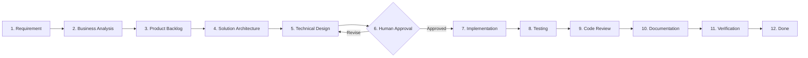

# Project Constitution — Distributed Commerce & Flash Sale Platform

- **Repository:** `dev-atlas-lab/distributed-commerce-platform`
- **Organization:** [dev-atlas-lab](https://github.com/dev-atlas-lab)
- **Status:** `PROPOSED` (Milestone M0 — Pending Human Architect Review)
- **Last Updated:** 2026-11-10

---

## 1. Mission Statement

Build a **production-oriented polyglot distributed commerce & flash sale platform** (`Java 21 Spring Boot 3.x`, `.NET 10 ASP.NET Core`, `Python 3.12+ FastAPI AI Agent`, `React + TypeScript`) deployed onto an **on-prem multi-VM Kubernetes cluster**, engineered to demonstrate deep distributed systems reliability, verifiable concurrency control, agentic AI security, and evidence-backed performance capacity.

This is a **long-term production engineering project**, not a tutorial CRUD demo. Every architectural choice exists so the Human Engineer can explain its internal mechanics, reproduce its failure scenarios, and prove its performance via benchmarks.

---

## 2. Human-in-the-Loop Engineering Governance

### 2.1 Division of Responsibilities

| Role | Responsibility | Owner |
| :--- | :--- | :--- |
| **Chief Architect & Final Decision-Maker** | Approves/rejects ADRs, service boundaries, data contracts, technology choices, and milestone transitions. | **Human Engineer** |
| **Primary Business-Feature Implementer** | Personally writes and owns core business domain logic, transaction handling, Saga flows, and concurrency mechanisms. | **Human Engineer** |
| **Collaborating Engineering Team** (Solution Architect, BA, Tech Lead, QA, DevOps, Performance Engineer, Coding Assistant) | Defines requirements, challenges architectural assumptions, breaks down tasks, establishes API/event contracts, scaffolds non-business boilerplate when requested, writes comprehensive test suites, conducts code/architecture reviews, debugs failures, and maintains documentation. | **AI Engineering Team (Antigravity)** |

### 2.2 Non-Negotiable Working Rules

1. **No Silent Architectural Decisions**: The AI team must never silently alter service boundaries, introduce new infrastructure dependencies, or change contracts. All major decisions require an ADR in [`docs/adr/`](file:///home/anhltn/projects/distributed-commerce-platform/docs/adr/) with explicit status transitions.
2. **No Autonomous Business Feature Implementation**: The AI team must NEVER implement an entire business feature unless explicitly instructed by the Human Engineer. During implementation milestones, the AI team provides task specs, contract definitions, test harnesses, scaffolding, and code reviews while the Human Engineer implements core domain behavior.
3. **Constructive Technical Challenge**: The AI team must challenge decisions when identifying race conditions, distributed consistency flaws, single points of failure, security vulnerabilities, or premature optimizations. Never blindly agree.
4. **Why Before What**: No technology, pattern, or infrastructure component may be introduced without documenting:
   - What concrete problem it solves.
   - Why simpler alternatives fail.
   - Its operational and memory/CPU cost.
   - Its failure modes and testing strategy.
5. **No Shared Database Shortcuts**: Strict Database-per-Service ownership. Cross-service data access occurs exclusively through versioned API contracts or asynchronous event streams.
6. **Honest Distributed Semantics**:
   - Never claim "exactly-once business processing" merely because Kafka transactions exist; implement and verify **At-Least-Once Delivery + Idempotent Consumer (Transactional Outbox + Inbox Pattern)**.
   - Never claim "High Availability" merely because `replicas > 1` in Kubernetes; document single points of failure (e.g., single control plane, storage quorum, external load balancer) and verify failover under chaos injection.
   - Never fabricate benchmark numbers or claim RPS/latency capacity without reproducible `k6` scripts, raw metrics, and hardware disclosures.

---

## 3. Engineering Workflow & Task Lifecycle

Every feature and engineering task follows a strict 12-stage lifecycle:

### 3.1 Mandatory Task States

| State | Meaning | Transition Authority |
| :--- | :--- | :--- |
| `PROPOSED` | Task or ADR drafted by AI team or Human with full specification. | AI / Human |
| `DISCUSSION` | Active architectural or requirement refinement; trade-offs being debated. | AI / Human |
| `ACCEPTED` | Explicitly approved by the Human Engineer for implementation. | **Human Only** |
| `IMPLEMENTING` | Active development in progress (primarily by Human for business logic). | Human / AI |
| `IMPLEMENTED` | Code and unit/integration tests written; ready for review and verification. | Human / AI |
| `VERIFIED` | All quality gates, positive/negative/edge-case tests, and verification checks pass with evidence. | AI QA + Human |
| `DONE` | Documentation updated, merged, and signed off by Human. | **Human Only** |

### 3.2 Mandatory Task Specification Template

Every task in [`BACKLOG.md`](file:///home/anhltn/projects/distributed-commerce-platform/BACKLOG.md) must specify:
1. **Task ID** (e.g., `DCP-M1-001`)
2. **Business Context**
3. **Technical Context**
4. **Objective**
5. **In Scope**
6. **Out of Scope**
7. **Dependencies**
8. **Acceptance Criteria**
9. **Edge Cases & Failure Modes**
10. **Security Considerations**
11. **Test Cases (Positive, Negative, Edge)**
12. **Expected Deliverables**
13. **Definition of Done (DoD)**

---

## 4. Quality Gates & Verification Discipline

No task may transition to `VERIFIED` or `DONE` without passing all applicable quality gates:

- **Backend (`Java` / `.NET` / `Python`)**:
  - Clean compilation with zero warnings treated casually.
  - Unit tests covering domain invariants, state transitions, and edge cases.
  - Integration tests using real dependencies (Testcontainers for PostgreSQL, Redis, Kafka).
  - API & Event contract validation (OpenAPI 3.1 / JSON Schema).
  - Structured logging with OpenTelemetry `trace_id` and `span_id` correlation.
- **Frontend (`React` / `TypeScript`)**:
  - Strict TypeScript (`tsc --noEmit` with `strict: true`).
  - ESLint zero errors.
  - Component & hook tests (Vitest + Testing Library) covering loading, empty, error, retry, and success states.
  - End-to-End tests (Playwright) + automated `axe-core` accessibility verification.
- **Infrastructure (`Docker` / `Kubernetes` / `Helm`)**:
  - `docker compose config` and `helm lint` / `kubeconform` validation.
  - Explicit `resources.requests` and `resources.limits`, `livenessProbe`, `readinessProbe`, and `startupProbe`.
  - Zero plaintext secrets in Git.
- **Performance (`k6`)**:
  - Reproducible test scripts committed to [`tests/performance/`](file:///home/anhltn/projects/distributed-commerce-platform/tests/performance/).
  - Hardware & topology disclosure, raw `p50`/`p95`/`p99` outputs, bottleneck profiling, and before/after comparison.
