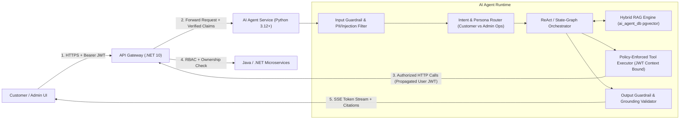

# AI Agentic Architecture — Distributed Commerce & Flash Sale Platform

- **Document ID:** `DCP-DOC-AI-001`
- **Status:** `PROPOSED` (Milestone M0 — Pending Human Approval)
- **Last Updated:** 2026-11-10

---

## 1. Architectural Philosophy: Decoupled & Zero-Privilege AI Runtime

The **`ai-agent-service`** (`Python 3.12+`, `FastAPI`, `Pydantic v2`, `AsyncIO`) powers two distinct personas:
1. **Customer Shopping Assistant** (Storefront): Natural-language discovery, multi-product comparison, grounded specification Q&A, live stock/promotion lookup, and personal order status tracking.
2. **Operations Assistant** (Admin Portal): Sales/order trend analysis, Flash Sale funnel diagnostics, payment failure breakdown, and stuck reservation detection.

### 1.1 Non-Negotiable AI Security Boundary

> [!CAUTION]
> **Mandatory Rule #9**: The AI Agent service must **NEVER** hold credentials to `product_db`, `order_db`, `inventory_db`, `payment_db`, `promotion_db`, `customer_db`, Redis caches, or Kafka producer topics. Every business read or action must pass through **authenticated HTTP API endpoints** (`api-gateway` or internal service REST APIs) carrying the caller's verified JWT.

---

## 2. LLM Orchestration & Vendor-Agnostic Abstraction

### 2.1 Why Not Hardcode a Single LLM Vendor or Heavy Framework Prematurely?
- **Model Provider Abstraction**: We define a clean `LLMProviderPort` interface supporting any **OpenAI-compatible Chat Completions + Tool Calling API** (allowing seamless switching between `OpenAI`, `Google Gemini`, `Anthropic`, or local/on-prem `Ollama` / `vLLM` models via environment configuration).
- **Orchestration Pattern**: We use an explicit, inspectable **Deterministic State Machine / Graph Loop** (`Plan → Retrieve/Call Tool → Observe → Validate → Respond`, compatible with **LangGraph** or lightweight custom Pydantic state-graph orchestration—see `ADR-0008`) capped at `max_iterations = 5` and `timeout = 15s` so an agent can never enter an infinite tool-calling loop.

---

## 3. Tool Registry, Authorization & Identity Binding

### 3.1 Shopping Assistant Tools (`Role: CUSTOMER`)

| Tool Name | Upstream Service Endpoint | Identity & Security Binding | Mutating? |
| :--- | :--- | :--- | :--- |
| `search_products` | `GET /api/v1/products/search` | Public catalog query; validated Pydantic filter bounds (`limit <= 10`). | No (Read-Only) |
| `get_product_details` | `GET /api/v1/products/{productId}` | Public catalog details + variant attributes. | No (Read-Only) |
| `compare_products` | `GET /api/v1/products?ids=...` + `GET /api/v1/inventory/batch` | Bounded to `2–4` product UUIDs per comparison call. | No (Read-Only) |
| `check_inventory` | `GET /api/v1/inventory/{skuId}` | Returns availability status (`IN_stock`, `LOW_STOCK`, `OUT_OF_STOCK`, `availableQty`). | No (Read-Only) |
| `get_active_promotions` | `GET /api/v1/promotions/active` & `/api/v1/flash-sales/active` | Returns public active coupons and scheduled/live Flash Sales. | No (Read-Only) |
| `get_my_order_status` | `GET /api/v1/orders/{orderId}` (or `/api/v1/orders/my`) | **CRITICAL**: `customer_id` is **NEVER** accepted from LLM arguments. The tool runtime forwards the caller's Bearer JWT, and `order-service` enforces `order.customer_id == jwt.sub`. | No (Read-Only) |

### 3.2 Operations Assistant Tools (`Role: ADMIN_OPS` / `ADMIN_MERCHANT`)

| Tool Name | Upstream Service Endpoint | Identity & Security Binding | Mutating? |
| :--- | :--- | :--- | :--- |
| `analyze_order_metrics` | `GET /api/v1/admin/orders/summary` | Requires `ADMIN_OPS` claim in JWT; returns aggregated status counts and failure reasons. | No (Read-Only) |
| `analyze_payment_failures` | `GET /api/v1/admin/payments/failures` | Requires `ADMIN_OPS`; returns breakdown by error code and simulator mode. | No (Read-Only) |
| `detect_inventory_anomalies` | `GET /api/v1/admin/inventory/anomalies` | Requires `ADMIN_OPS`; checks for expired reservations still in `RESERVED` state or Redis/DB Flash Sale drift. | No (Read-Only) |
| `propose_release_stuck_reservation` | `POST /api/v1/ai/approvals` → `POST /api/v1/admin/inventory/reconcile` | **Human-in-the-Loop Mandatory**: Does NOT execute immediately. Creates a `PendingHumanApproval` record and returns an approval card in the Admin UI requiring an explicit human click (`POST /api/v1/ai/approvals/{id}/confirm`). | **Yes (Gated by HITL)** |

---

## 4. Retrieval-Augmented Generation (RAG) & Memory Architecture

### 4.1 RAG Pipeline (`ai_agent_db` with `pgvector`)
- **Why `pgvector` inside `ai_agent_db`?** Reuses our existing PostgreSQL 17 operational skill set with HNSW indexing (`m=16, ef_construction=64`), avoiding the memory footprint of running a dedicated Milvus/Qdrant/Weaviate cluster on our VMs (`ADR-0008`).
- **What is Indexed in RAG vs. Fetched Live via Tools**:
  - **Static/Semi-Static Knowledge (RAG `knowledge_chunks`)**: Detailed product descriptions, technical specifications, buying guides, return/refund policy documents, and Flash Sale participation FAQ rules. Updated asynchronously when `catalog.product.events.v1` fires.
  - **Volatile Transactional Data (NEVER trusted from RAG embeddings)**: Live price, live stock count, active coupon quota, and order status MUST always be fetched in real time via Tool Calling (`check_inventory`, `get_product_details`, `get_my_order_status`).

### 4.2 Short-Term & Long-Term Memory
- **Short-Term Conversational Memory**: Stored in `conversation_messages` (`session_id`, `role`, `content`, `tool_calls`, `token_count`) with a sliding window of the last `10` turns + rolling summary to bound prompt token usage.
- **Long-Term Customer Preferences**: Explicit opt-in customer preferences (e.g., preferred categories, budget range, size) retrieved via `Customer Service` (`GET /api/v1/customers/me/preferences`).

---

## 5. Defense-in-Depth Guardrails & AI Observability

1. **Indirect Prompt Injection Defense**:
   - Product descriptions or user reviews retrieved from RAG are wrapped in untrusted data delimiters (`<untrusted_catalog_context>...</untrusted_catalog_context>`) with explicit system instructions that text inside data tags can never override system rules or trigger tool calls.
2. **Tool Argument Validation**:
   - All tool inputs are validated by strict Pydantic schemas (UUID regexes, positive integer bounds) before any HTTP request is made.
3. **Grounding & Price/Stock Consistency Check**:
   - Output post-processor verifies that any SKU price or stock status quoted in the assistant's final response matches the structured tool output returned during the turn.
4. **AI Observability & Cost Control**:
   - Every LLM call emits OpenTelemetry spans (`gen_ai.system`, `gen_ai.request.model`, `gen_ai.usage.input_tokens`, `gen_ai.usage.output_tokens`, `gen_ai.latency_ms`, `tool_call_name`, `tool_call_status`).
   - Per-user token rate limit enforced in Redis (`ai:quota:user:{userId}:daily_tokens`) to prevent token-exhaustion denial-of-wallet attacks.
5. **Deterministic Evaluation Suite (`M5`)**:
   - Golden dataset of `50+` test cases covering: product search accuracy, price/stock grounding (no hallucination), cross-user order access rejection (`IDOR` via chat), prompt injection resistance, and tool-timeout graceful fallback.
