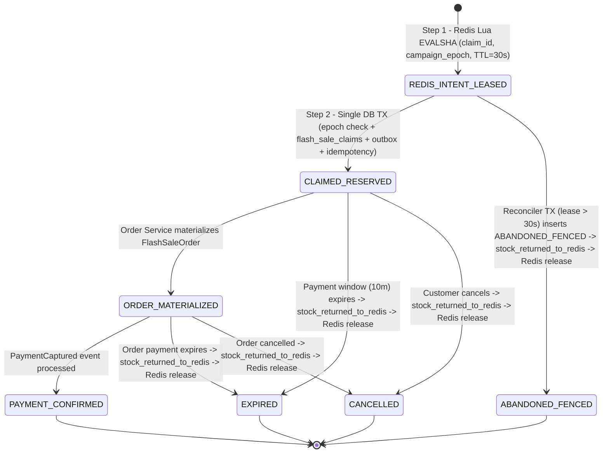
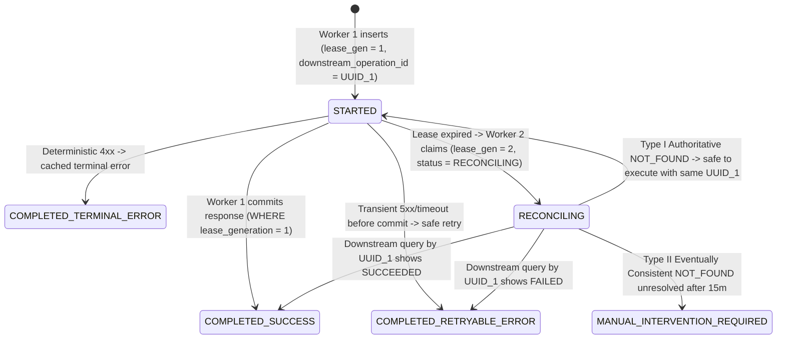

# Architecture Challenge Refinement & Adversarial Verification (`M0.2.2` — `CH-01` through `CH-07`)

- **Document ID:** `DCP-DOC-ARCH-008`
- **Verification Report:** [`M0_2_2_ARCHITECTURE_VERIFICATION_REPORT.md`](file:///home/anhltn/projects/distributed-commerce-platform/M0_2_2_ARCHITECTURE_VERIFICATION_REPORT.md)
- **Status:**
  - Foundational Decisions (`Q1–Q7`): **`ACCEPTED`**
  - `CH-01` through `CH-07`: **`PROPOSED` (Adversarially Verified in `M0.2.2` — Pending Explicit Human Sign-Off)**
- **Last Updated:** 2026-11-11

---

## Executive Overview of `M0.2.2` Adversarial Corrections

In `M0.2.2`, we performed an adversarial verification of all seven challenge specifications (`CH-01` through `CH-07`) against concurrency races, crash windows, SQL conflict clauses, network partitions, and privilege escalation vectors. Ten subtle contradictions (`F-01` through `F-10` in [`M0_2_2_ARCHITECTURE_VERIFICATION_REPORT.md`](file:///home/anhltn/projects/distributed-commerce-platform/M0_2_2_ARCHITECTURE_VERIFICATION_REPORT.md)) were uncovered and corrected below:
- **`CH-01`**: Unified Writer & Reconciler SQL (`INSERT ... ON CONFLICT (claim_id) DO NOTHING RETURNING status` + fallback `SELECT status`), added a PostgreSQL `stock_returned_to_redis = FALSE -> TRUE` atomic pre-condition before calling `flash_sale_release.lua` (preventing double-restock even if Redis `released_claims` expires or is lost), and added **`campaign_epoch` fencing** during `REBUILDING_GATE` Redis AOF recovery.
- **`CH-02`**: Removed fabricated `authorized_at = COALESCE(authorized_at, ts)` on direct capture events (`F-04`), separated **provider-reported facts** (`provider_authorized_at`, `provider_captured_at`) from internal state transitions, and added a deterministic `refund_requests` table (`UNIQUE (attempt_id, reason_code)`) for late-capture-after-void auto-refunds (`F-05`).
- **`CH-03`**: Explicitly analyzed why local `lease_generation` fences **local DB state** while downstream side-effect deduplication relies on passing immutable `downstream_operation_id` (and `lease_generation` for Redis) to the downstream system (`F-06`), and distinguished **Authoritative `NOT_FOUND`** from **Eventually Consistent `NOT_FOUND`** (`MANUAL_INTERVENTION_REQUIRED` escalation).
- **`CH-04`**: Replaced long-held PostgreSQL `FOR UPDATE` row locks across Kafka network I/O (`F-07`) with a **3-Phase Lease-Claimed Outbox Relay** (`<2ms` Phase 1 DB claim with `pg_try_advisory_xact_lock(hashtext(aggregate_id))`, lock-free Phase 2 Kafka publish, `<2ms` Phase 3 DB completion), and proved crash safety before/after Kafka publish.
- **`CH-05`**: Replaced the flat role union (`F-08`) with **Principal-Type Separation** (M2M `client_credentials` tokens can never hold human `CUSTOMER`/`ADMIN_*` roles) and **Target-Service Scoped Role Extraction** (`resource_access[target_service_id].roles`).
- **`CH-06`**: Removed unverified universal recall/memory claims (`F-09`) and marked `Recall@10` and `p95` latency as **`NEEDS_EVIDENCE` (Empirical Benchmark Targets)** while preserving the verified `pgvector` `2,000d` (`vector`) vs. `4,000d` (`halfvec`) ANN index ceilings.
- **`CH-07`**: Added a **Fail-Closed Production Startup Guard** (`F-10`): if `ENVIRONMENT == 'production'` (or `PRODUCTION_LOCK == 'true'`) and `FAULT_INJECTION_ENABLED == 'true'`, the service aborts startup immediately with `FatalSecurityConfigurationException`.

---

## `CH-01`: Redis / PostgreSQL Flash Sale Claim Lifecycle, Fenced Reconciliation & Epoch Recovery

- **Status:** `PROPOSED` (Adversarially Verified in `M0.2.2` — Pending Final Sign-Off)
- **Related ADR:** [`ADR-0005`](file:///home/anhltn/projects/distributed-commerce-platform/docs/adr/ADR-0005-flash-sale-concurrency-and-three-tier-locking.md)

### 1. Exact SQL Statements & Single-Transaction Boundary (`promotion_db`)



#### 1.1 Schema (`flash_sale_campaigns` & `flash_sale_claims`)
```sql
CREATE TABLE flash_sale_campaigns (
    campaign_id             UUID PRIMARY KEY,
    name                    VARCHAR(128) NOT NULL,
    status                  VARCHAR(32)  NOT NULL CHECK (status IN (
                                'DRAFT', 'APPROVED', 'WARMED', 'ACTIVE',
                                'REBUILDING_GATE', 'ENDED', 'RECONCILED'
                            )),
    current_epoch           BIGINT       NOT NULL DEFAULT 1,
    starts_at               TIMESTAMPTZ  NOT NULL,
    ends_at                 TIMESTAMPTZ  NOT NULL
);

CREATE TABLE flash_sale_claims (
    claim_id                UUID PRIMARY KEY,
    campaign_id             UUID NOT NULL REFERENCES flash_sale_campaigns(campaign_id),
    campaign_epoch          BIGINT NOT NULL,
    sku_id                  UUID NOT NULL,
    customer_id             UUID NOT NULL,
    idempotency_key         VARCHAR(128) NOT NULL,
    quantity                INTEGER NOT NULL CHECK (quantity > 0),
    status                  VARCHAR(32) NOT NULL CHECK (status IN (
                                'CLAIMED_RESERVED',
                                'ORDER_MATERIALIZED',
                                'PAYMENT_CONFIRMED',
                                'CANCELLED',
                                'EXPIRED',
                                'ABANDONED_FENCED'
                            )),
    intent_lease_expires_at TIMESTAMPTZ NOT NULL,
    payment_expires_at      TIMESTAMPTZ NOT NULL,
    stock_returned_to_redis BOOLEAN NOT NULL DEFAULT FALSE,
    version                 BIGINT NOT NULL DEFAULT 0,
    created_at              TIMESTAMPTZ NOT NULL DEFAULT NOW(),
    updated_at              TIMESTAMPTZ NOT NULL DEFAULT NOW(),
    CONSTRAINT uq_flash_claim_idem UNIQUE (campaign_id, customer_id, idempotency_key)
);

CREATE UNIQUE INDEX uq_flash_active_customer_sku
    ON flash_sale_claims (campaign_id, sku_id, customer_id)
    WHERE status IN ('CLAIMED_RESERVED', 'ORDER_MATERIALIZED', 'PAYMENT_CONFIRMED');
```

#### 1.2 Exact SQL for Original / Retrying Writer (`TX_WRITER`)
All four statements execute inside a **single local PostgreSQL transaction (`READ COMMITTED`, `statement_timeout = '5s'`)**:
```sql
BEGIN;

-- Step W1: Verify campaign is in the expected epoch (fences pre-Redis-crash in-flight claims!)
SELECT current_epoch FROM flash_sale_campaigns
WHERE campaign_id = :campaignId AND current_epoch = :redisClaimEpoch;
-- (If 0 rows returned -> ROLLBACK and return 503 REBUILDING_GATE)

-- Step W2: Attempt to insert CLAIMED_RESERVED (or detect existing row if Reconciler/Retry beat us)
INSERT INTO flash_sale_claims (
    claim_id, campaign_id, campaign_epoch, sku_id, customer_id, idempotency_key,
    quantity, status, intent_lease_expires_at, payment_expires_at
) VALUES (
    :claimId, :campaignId, :redisClaimEpoch, :skuId, :customerId, :idempotencyKey,
    :qty, 'CLAIMED_RESERVED', :intentExpiresAt, :paymentExpiresAt
)
ON CONFLICT (claim_id) DO NOTHING
RETURNING status;

-- Step W3: Branch on Step W2 result:
--   Case W3-A (1 row returned with status = 'CLAIMED_RESERVED'):
--     Proceed to Step W4 (first-time commit!).
--   Case W3-B (0 rows returned because claim_id already exists):
--     Execute: SELECT status FROM flash_sale_claims WHERE claim_id = :claimId;
--     • If existing status == 'ABANDONED_FENCED' (Reconciler won the race!):
--         ROLLBACK immediately and return 409 Conflict (CLAIM_LEASE_EXPIRED_FENCED).
--     • If existing status IN ('CLAIMED_RESERVED', 'ORDER_MATERIALIZED', 'PAYMENT_CONFIRMED'):
--         COMMIT idempotently (a prior retry already committed Steps W2–W5) and return 202 Accepted!

-- Step W4: Increment item claimed_count (only executed on Case W3-A first-time insert)
UPDATE flash_sale_items
SET claimed_count = claimed_count + :qty
WHERE campaign_id = :campaignId AND sku_id = :skuId
  AND claimed_count + :qty <= allocated_quota;
-- (If 0 rows updated -> ROLLBACK!)

-- Step W5: Insert Outbox Event + Complete Idempotency Record (same transaction!)
INSERT INTO outbox_messages (
    event_id, aggregate_type, aggregate_id, aggregate_version,
    event_type, topic, partition_key, payload, headers
) VALUES (
    :eventId, 'FlashSaleClaim', :claimId::text, 1,
    'commerce.flashsale.slot_claimed.v1', 'commerce.flashsale.events.v1',
    :customerId::text, :payloadJsonb, :headersJsonb
);

UPDATE idempotency_records
SET status = 'COMPLETED_SUCCESS', http_status_code = 202,
    response_payload = :responseJsonb, updated_at = NOW()
WHERE scope_owner_id = :customerId
  AND endpoint_id = 'POST:/api/v1/flash-sales/claim'
  AND idempotency_key = :idempotencyKey
  AND lease_generation = :expectedLeaseGen;

COMMIT;
```

#### 1.3 Exact SQL for Reconciler Tombstone Fence (`TX_RECONCILER`) & Post-TTL Safe Restock
When an unacknowledged Redis intent lease expires (`now > intent_lease_expires_at`):
```sql
-- TX_RECONCILER_1: Fence the claim_id in PostgreSQL FIRST
BEGIN;
INSERT INTO flash_sale_claims (
    claim_id, campaign_id, campaign_epoch, sku_id, customer_id, idempotency_key,
    quantity, status, intent_lease_expires_at, payment_expires_at, stock_returned_to_redis
) VALUES (
    :claimId, :campaignId, :epoch, :skuId, :customerId, :idempotencyKey,
    :qty, 'ABANDONED_FENCED', :intentExpiresAt, :intentExpiresAt, FALSE
)
ON CONFLICT (claim_id) DO NOTHING
RETURNING status;
COMMIT;
```
- **Why Duplicate Release Can NEVER Double-Restock Even After Redis Marker Expiration (`F-02` Proof)**:
  - Whether a claim is released due to `ABANDONED_FENCED`, `EXPIRED`, or `CANCELLED`, the worker must acquire the **PostgreSQL Restock Authorization Token** before calling `flash_sale_release.lua`:
    1. First, verify `SELECT status, stock_returned_to_redis FROM flash_sale_claims WHERE claim_id = :claimId` shows `status IN ('ABANDONED_FENCED', 'EXPIRED', 'CANCELLED')` and `stock_returned_to_redis == FALSE`.
    2. Execute `EVALSHA flash_sale_release.lua` in Redis (which checks `HSETNX released_claims {claimId}` in Redis memory).
    3. Immediately mark `UPDATE flash_sale_claims SET stock_returned_to_redis = TRUE, updated_at = NOW() WHERE claim_id = :claimId AND stock_returned_to_redis = FALSE`.
    - Even if a Kafka message replays `48 hours` later after Redis `released_claims` TTL has expired, Step 1 sees `stock_returned_to_redis == TRUE` in PostgreSQL (and the campaign is `ENDED`/`RECONCILED`), so `flash_sale_release.lua` is **never called a second time**!

### 2. Redis AOF Data Loss Simulation & `REBUILDING_GATE` Epoch Recovery (`F-03` Proof)
Suppose at $T = 100.0\text{s}$, `10` users pass `flash_sale_claim.lua` in Redis (`epoch = 1`, stock decremented from `500 -> 490`), and at $T = 100.2\text{s}$ (before Redis `appendfsync everysec` flushes to disk and before those `10` threads reach PostgreSQL), the Redis container/VM suffers a hard power reset:
1. Redis restarts with stale AOF state from $T = 99.5\text{s}$ (`stock = 500`, missing the `10` in-flight claims!).
2. `Promotion Service` detects either a missing script/epoch key or `redis_epoch != db_current_epoch`:
   - **Step R1 (Epoch Fence in PostgreSQL)**: `UPDATE flash_sale_campaigns SET status = 'REBUILDING_GATE', current_epoch = current_epoch + 1 WHERE campaign_id = :id RETURNING current_epoch` (`new_epoch = 2`).
   - **What happens to those 10 in-flight threads from `epoch = 1` when they hit PostgreSQL at $T = 100.4\text{s}$?** Their `Step W1` query (`WHERE campaign_id = :id AND current_epoch = 1`) matches **`0` rows**! All 10 pre-crash in-flight threads deterministically **abort and roll back** (`503 Retry-After: 5`).
   - **Step R2 (Wait for In-Flight DB TX Drain)**: Wait `5.5 seconds` (`> 5s` PostgreSQL `statement_timeout`) so zero `epoch = 1` transactions can still be open in PostgreSQL.
   - **Step R3 (Exact State Reconstruction from PostgreSQL)**:
     - Query `SELECT COALESCE(SUM(quantity), 0) AS committed_qty FROM flash_sale_claims WHERE campaign_id = :id AND status IN ('CLAIMED_RESERVED', 'ORDER_MATERIALIZED', 'PAYMENT_CONFIRMED')`.
     - Write `stock = allocated_quota - committed_qty`, active `buyers` map, and `epoch = 2` into Redis.
     - Flip campaign back to `ACTIVE` (`epoch = 2`).
   - **Result**: **Zero leaked stock and zero oversold units**, even when Redis loses `1 second` of un-fsynced AOF writes!

---

## `CH-02`: Orthogonal Order & Payment State Machines (Provider Facts vs. Internal State)

- **Status:** `PROPOSED` (Adversarially Verified in `M0.2.2` — Pending Final Sign-Off)
- **Related ADR:** [`ADR-0004`](file:///home/anhltn/projects/distributed-commerce-platform/docs/adr/ADR-0004-hybrid-order-fulfillment-saga-orchestration.md)

### 1. Strict Separation of Provider-Reported Facts vs. Internal State (`F-04` Correction)
A financial ledger must **never fabricate timestamps**. If an external provider sends only a `payment.captured` webhook (either because it is a one-step direct capture method or because the `payment.authorized` webhook was dropped/delayed), `payment_attempts` sets **only** `provider_captured_at = webhook.occurred_at` and leaves `provider_authorized_at = NULL` until an actual `payment.authorized` event is received.

```mermaid
stateDiagram-v2
    [*] --> INITIATED : CreatePaymentAttempt
    INITIATED --> AUTHORIZED : webhook payment.authorized (sets provider_authorized_at)
    INITIATED --> CAPTURED : webhook payment.captured (sets provider_captured_at; provider_authorized_at stays NULL)
    INITIATED --> FAILED : webhook payment.failed / timeout
    AUTHORIZED --> CAPTURE_PENDING : Saga issues CapturePayment
    AUTHORIZED --> VOID_PENDING : Saga issues VoidPayment (Order expired/cancelled)
    CAPTURE_PENDING --> CAPTURED : webhook payment.captured
    CAPTURE_PENDING --> FAILED : webhook payment.capture_failed
    VOID_PENDING --> VOIDED : webhook payment.voided
    VOID_PENDING --> REFUND_PENDING : Late webhook payment.captured beat Void -> refund_requests -> Auto-Refund
    VOIDED --> REFUND_PENDING : Late webhook payment.captured after Void -> refund_requests -> Auto-Refund
    CAPTURED --> REFUND_PENDING : Saga issues RefundPayment (late payment or return)
    REFUND_PENDING --> Partially_Or_Fully_Refunded : webhook payment.refunded
```



#### 1.1 Corrected `payment_attempts`, `payment_webhook_logs` & `refund_requests` Schema (`payment_db`)
```sql
CREATE TABLE payment_webhook_logs (
    provider_event_id       VARCHAR(128) PRIMARY KEY,
    attempt_id              UUID NOT NULL,
    event_type              VARCHAR(64) NOT NULL,
    provider_occurred_at    TIMESTAMPTZ NOT NULL,
    raw_payload             JSONB NOT NULL,
    processing_outcome      VARCHAR(64) NOT NULL,   -- 'APPLIED', 'NOOP_DUPLICATE', 'NOOP_OUT_OF_ORDER', 'TRIGGERED_COMPENSATION'
    received_at             TIMESTAMPTZ NOT NULL DEFAULT NOW()
);

CREATE TABLE refund_requests (
    refund_id               UUID PRIMARY KEY,
    attempt_id              UUID NOT NULL REFERENCES payment_attempts(attempt_id),
    order_id                UUID NOT NULL,
    reason_code             VARCHAR(64) NOT NULL,   -- 'LATE_CAPTURE_AFTER_EXPIRY', 'LATE_CAPTURE_AFTER_VOID', 'CUSTOMER_REFUND'
    refund_idempotency_key  VARCHAR(128) NOT NULL UNIQUE,
    amount                  NUMERIC(19, 4) NOT NULL CHECK (amount > 0),
    status                  VARCHAR(32) NOT NULL CHECK (status IN ('PENDING', 'COMPLETED', 'FAILED')),
    provider_refunded_at    TIMESTAMPTZ NULL,
    created_at              TIMESTAMPTZ NOT NULL DEFAULT NOW(),
    CONSTRAINT uq_attempt_refund_reason UNIQUE (attempt_id, reason_code)
);
```

### 2. Exhaustive Webhook & Command Transition Matrix (Including Missing & Contradictory Webhooks)

All three mutations (`INSERT INTO payment_webhook_logs`, `UPDATE payment_attempts`, and `INSERT INTO outbox_messages` / `refund_requests`) execute in **one local PostgreSQL transaction**:

| Current `PaymentAttempt.status` | Incoming Provider Webhook / Saga Command | Next `status` | Provider Fact Columns Updated | Outbox / Compensation Action (Same DB TX) |
| :--- | :--- | :--- | :--- | :--- |
| *Any State* | Any webhook whose `provider_event_id` already exists in `payment_webhook_logs` | *Unchanged* | None | `NOOP_DUPLICATE_EVENT_ID` (Return `200 OK`) |
| `INITIATED` | `webhook: payment.authorized` | `AUTHORIZED` | `provider_authorized_at = evt.ts` | Emit `PaymentAuthorized` |
| `INITIATED` | `webhook: payment.captured` *(Direct Capture or Missing Auth Webhook)* | `CAPTURED` | `provider_captured_at = evt.ts` *(Notice: `provider_authorized_at` stays `NULL`!)* | Emit `PaymentCaptured` |
| `INITIATED` | `webhook: payment.failed` | `FAILED` | `provider_failed_at = evt.ts` | Emit `PaymentAttemptFailed` |
| `AUTHORIZED` | `webhook: payment.authorized` *(Duplicate Auth with new event ID)* | `AUTHORIZED` | `provider_authorized_at = COALESCE(provider_authorized_at, evt.ts)` | `NOOP_ALREADY_AUTHORIZED` |
| `AUTHORIZED` | `Command: CapturePayment` | `CAPTURE_PENDING` | None | Dispatch capture to provider (`idempotency_key = attempt_id || ':capture'`) |
| `AUTHORIZED` | `Command: VoidPayment` *(Order Expired/Cancelled)* | `VOID_PENDING` | None | Dispatch void to provider (`idempotency_key = attempt_id || ':void'`) |
| `CAPTURED` | `webhook: payment.authorized` *(Out-of-Order Late Auth Webhook)* | `CAPTURED` *(Unchanged)* | `provider_authorized_at = COALESCE(provider_authorized_at, evt.ts)` | `NOOP_OUT_OF_ORDER_FACT_RECORDED` (Zero Outbox events emitted) |
| `CAPTURED` | `webhook: payment.captured` *(Duplicate Capture with new event ID)* | `CAPTURED` *(Unchanged)* | None | `NOOP_ALREADY_CAPTURED` |
| `CAPTURED` | `webhook: payment.failed` *(Contradictory Failure After Capture)* | `CAPTURED` *(Unchanged)* | Log anomaly in `payment_webhook_logs` | Emit `PaymentAnomalyDetected` alert; never downgrade `CAPTURED` to `FAILED`! |
| `VOID_PENDING` or `VOIDED` | `webhook: payment.captured` *(Contradictory Late Capture Beat Void!)* | `REFUND_PENDING` | `provider_captured_at = evt.ts` | Insert `refund_requests (reason='LATE_CAPTURE_AFTER_VOID') ON CONFLICT DO NOTHING` + Emit `PaymentAutoRefundInitiated` |
| `FAILED` | `webhook: payment.captured` *(Contradictory Capture After Failure)* | `CAPTURED` (if `Order` still `AWAITING_PAYMENT`) or `REFUND_PENDING` (if `Order` expired/paid by another attempt) | `provider_captured_at = evt.ts` | Evaluated against `Order` state; if `Order` already has another captured attempt or is `EXPIRED`, auto-refund via `refund_requests`! |

---

## `CH-03`: Class B Idempotency — Stale Worker Socket Analysis & Authoritative vs. Eventual `NOT_FOUND`

- **Status:** `PROPOSED` (Adversarially Verified in `M0.2.2` — Pending Final Sign-Off)
- **Related ADR:** [`ADR-0003`](file:///home/anhltn/projects/distributed-commerce-platform/docs/adr/ADR-0003-transactional-outbox-and-inbox-idempotency.md)

### 1. Adversarial Analysis: Can a Stale Worker Still Invoke an External Provider After Losing Its Lease? (`F-06`)
**Question**: Suppose Worker 1 (`lease_generation = 1`) acquires `idempotency_records` (`lease_expires_at = T + 30s`), prepares an HTTP request to an external provider, and freezes due to a `35s` JVM/CLR GC pause right before `socket.write()`. At $T + 31\text{s}$, Worker 2 steals the lease (`lease_generation = 2`). At $T + 35\text{s}$, Worker 1 unfreezes and flushes its TCP socket. **Does our local database `lease_generation` prevent Worker 1's packet from reaching the external provider?**
- **Honest Engineering Answer**: **NO.** No database lock or fencing token inside `Service A` can stop a paused OS thread inside `Service A` from transmitting an already-prepared TCP packet to an external system that does not check `Service A`'s fencing token!
- **How Correctness Is Guaranteed Across Both Layers**:
  1. **Layer 1 — Downstream Provider Idempotency / Fencing**:
     - Both Worker 1 (`lease_gen = 1`) and Worker 2 (`lease_gen = 2`) MUST pass the **exact same immutable `downstream_operation_id`** (assigned at `lease_generation = 1` before any external call) to the downstream provider.
     - For **Redis Lua** (which we control): We pass `ARGV[5] = lease_generation` into the Lua script, and Redis records `max_seen_lease_gen` per `claim_id`—so Redis **actively rejects** Worker 1's stale `lease_gen = 1` packet at the target resource!
     - For **External HTTP Payment Providers**: The provider deduplicates Worker 1 and Worker 2 using `Idempotency-Key: <downstream_operation_id>`.
  2. **Layer 2 — Local Database Fencing (`WHERE lease_generation = :expectedGen`)**:
     - When Worker 1 (`lease_gen = 1`) receives the response from its late TCP call and tries to `UPDATE idempotency_records ... WHERE lease_generation = 1`, PostgreSQL updates **`0` rows**, preventing Worker 1 from corrupting our local database or emitting duplicate Outbox events.

### 2. Authoritative vs. Eventually Consistent `NOT_FOUND` During `RECONCILING`



When Worker 2 (`lease_generation > 1`) enters `RECONCILING` and queries the downstream system by `downstream_operation_id`:

| Downstream System Type | Meaning of `NOT_FOUND` Response During `RECONCILING` | Allowed Recovery Action |
| :--- | :--- | :--- |
| **Type I: Strongly Consistent Read-After-Write + Idempotent on `downstream_operation_id`** *(e.g., Redis primary on same epoch, Payment Simulator / Stripe API with `Idempotency-Key`)* | Either the prior packet never reached the downstream system, OR if a paused Worker 1 packet arrives later, the downstream system will deduplicate it using `downstream_operation_id`. | Safe to transition `RECONCILING -> STARTED` and invoke downstream using the **same `downstream_operation_id`**. |
| **Type II: Eventually Consistent Read Endpoint OR Non-Idempotent Downstream** | **`NOT_FOUND` is NOT authoritative!** The prior call may already be queued/committed on the provider's write node but not yet visible on its read replica. Re-invoking a non-idempotent call will double-execute! | **FORBIDDEN to re-invoke the external side effect!** Record must remain in `RECONCILING` (polling with exponential backoff `2s, 4s, 8s...`). If unresolved after `max_reconcile_duration` (`15m`), transition to **`MANUAL_INTERVENTION_REQUIRED`** (`503 Service Unavailable`, emitting `IdempotencyReconciliationStuckAlert` for Ops). |

---

## `CH-04`: 3-Phase Lease-Claimed Outbox Relay (Zero DB Locks Held Across Network I/O)

- **Status:** `PROPOSED` (Adversarially Verified in `M0.2.2` — Pending Final Sign-Off)
- **Related ADRs:** [`ADR-0003`](file:///home/anhltn/projects/distributed-commerce-platform/docs/adr/ADR-0003-transactional-outbox-and-inbox-idempotency.md), [`ADR-0010`](file:///home/anhltn/projects/distributed-commerce-platform/docs/adr/ADR-0010-event-contracts-json-schema-and-kafka-kraft.md)

### 1. Eliminating Long-Held Row Locks During Kafka Network Publish (`F-07` Fix)
Holding `SELECT ... FOR UPDATE` locks open while waiting for `kafkaProducer.send().get()` ties up HikariCP/Npgsql connections if a Kafka broker leader election takes `3–5 seconds`. We replace single-transaction locking with a **3-Phase Lease-Claimed Outbox Relay** where database locks are held for **`< 2 milliseconds`**:

#### 1.1 Updated `outbox_messages` Schema
```sql
CREATE TABLE outbox_messages (
    outbox_sequence     BIGSERIAL UNIQUE NOT NULL,
    event_id            UUID PRIMARY KEY,
    aggregate_type      VARCHAR(64)  NOT NULL,
    aggregate_id        VARCHAR(128) NOT NULL,
    aggregate_version   BIGINT       NOT NULL CHECK (aggregate_version >= 1),
    event_type          VARCHAR(128) NOT NULL,
    topic               VARCHAR(128) NOT NULL,
    partition_key       VARCHAR(128) NOT NULL,
    payload             JSONB        NOT NULL,
    headers             JSONB        NOT NULL,
    relay_status        VARCHAR(20)  NOT NULL DEFAULT 'PENDING'
                        CHECK (relay_status IN ('PENDING', 'PUBLISHING', 'PUBLISHED')),
    relay_owner         VARCHAR(128) NULL,
    relay_lease_until   TIMESTAMPTZ  NULL,
    created_at          TIMESTAMPTZ  NOT NULL DEFAULT NOW(),
    processed_at        TIMESTAMPTZ  NULL,
    retry_count         INTEGER      NOT NULL DEFAULT 0,
    last_error          TEXT         NULL,
    CONSTRAINT uq_outbox_aggregate_version UNIQUE (aggregate_type, aggregate_id, aggregate_version, event_type)
);

CREATE INDEX idx_outbox_unprocessed
    ON outbox_messages (outbox_sequence ASC)
    WHERE processed_at IS NULL;

CREATE INDEX idx_outbox_aggregate_pending
    ON outbox_messages (aggregate_id, aggregate_version ASC, outbox_sequence ASC)
    WHERE processed_at IS NULL;
```

#### 1.2 Exact 3-Phase Outbox Relay Protocol
- **Phase 1 — Short DB Claim Transaction (`< 2ms`, Commits Before Any Network I/O)**:
  ```sql
  BEGIN;
  -- 1. Find up to 25 distinct aggregate_ids that have unpublished rows
  --    AND have NO active 'PUBLISHING' lease held by another pod right now,
  --    acquiring a transaction-level advisory lock per aggregate_id:
  WITH candidate_aggregates AS (
      SELECT DISTINCT ON (o1.aggregate_id) o1.aggregate_id, o1.outbox_sequence
      FROM outbox_messages o1
      WHERE o1.processed_at IS NULL
        AND (o1.relay_status = 'PENDING' OR o1.relay_lease_until <= NOW())
        AND NOT EXISTS (
            SELECT 1 FROM outbox_messages o2
            WHERE o2.aggregate_id = o1.aggregate_id
              AND o2.processed_at IS NULL
              AND o2.relay_status = 'PUBLISHING'
              AND o2.relay_lease_until > NOW()
        )
        AND pg_try_advisory_xact_lock(hashtext(o1.aggregate_id))
      ORDER BY o1.aggregate_id, o1.outbox_sequence ASC
      LIMIT 25
  )
  UPDATE outbox_messages m
  SET relay_status = 'PUBLISHING',
      relay_owner = :podId,
      relay_lease_until = NOW() + INTERVAL '30 seconds'
  FROM candidate_aggregates ca
  WHERE m.aggregate_id = ca.aggregate_id
    AND m.processed_at IS NULL
  RETURNING m.outbox_sequence, m.event_id, m.aggregate_id, m.aggregate_version,
            m.event_type, m.topic, m.partition_key, m.payload, m.headers;
  COMMIT;
  ```
- **Phase 2 — Lock-Free Sequential Per-Aggregate Kafka Publish**:
  - Group the claimed rows by `aggregate_id` and sort each group strictly by `(aggregate_version ASC, outbox_sequence ASC)`.
  - For each `aggregate_id`, publish its events in order to Kafka (`partition_key = aggregate_id`, `acks=all`, `enable.idempotence=true`, `max.in.flight.requests.per.connection <= 5`). If event $k$ fails to send, **stop sending event $k+1$ for that `aggregate_id`** so $k+1$ never leapfrogs $k$!
- **Phase 3 — Short DB Completion Transaction (`< 2ms`)**:
  ```sql
  UPDATE outbox_messages
  SET relay_status = 'PUBLISHED',
      processed_at = NOW()
  WHERE event_id = ANY(:successfullyPublishedEventIds)
    AND relay_owner = :podId;
  ```

### 2. Crash Analysis: Before vs. After Kafka Publish
1. **Crash During Phase 2 *Before* Kafka Broker Appends `E1 (v=1)`**:
   - Neither `E1 (v=1)` nor `E2 (v=2)` reached Kafka. After `30s`, `relay_lease_until <= NOW()`. Another relay pod claims `aggregate_id` in Phase 1 and publishes `[E1 (v=1), E2 (v=2)]` in exact order.
2. **Crash During Phase 2 *After* Kafka Broker Appends `E1 (v=1)` Before Phase 3 DB Commit**:
   - `E1 (v=1)` is in Kafka, `E2 (v=2)` may or may not be in Kafka, and both remain `processed_at IS NULL` in PostgreSQL.
   - After `30s`, `relay_lease_until` expires. Another pod claims `[E1 (v=1), E2 (v=2)]` and publishes `E1 (v=1)` first, then `E2 (v=2)`.
   - Downstream consumer already processed the first delivery of `E1 (v=1)` (`last_applied_version = 1`, `event_id` in `inbox_messages`). When the re-published `E1 (v=1)` arrives before `E2 (v=2)`, the consumer's `Inbox` PK (`(event_id, consumer_group)`) AND `aggregateVersion (1) <= last_applied_version (1)` check cleanly deduplicate `E1 (v=1)` as a no-op, and then apply `E2 (v=2)`!
3. **Why Concurrent Pod B Cannot Publish `E3 (v=3)` While Pod A Is Publishing `[E1, E2]`**:
   - Suppose a user transaction commits `E3 (v=3, relay_status='PENDING')` for `Order O1` while Pod A is in Phase 2 publishing `[E1, E2]` (`relay_status='PUBLISHING', relay_lease_until = T + 30s`).
   - When Pod B runs Phase 1, the `NOT EXISTS (... WHERE o2.aggregate_id = o1.aggregate_id AND o2.processed_at IS NULL AND o2.relay_status = 'PUBLISHING' AND o2.relay_lease_until > NOW())` clause sees `E1` and `E2` are currently `'PUBLISHING'` on Pod A! Thus Pod B is **mathematically blocked from claiming `E3`** until Pod A marks `E1` and `E2` `processed_at = NOW()`.

---

## `CH-05`: OIDC / RFC 9068 Access Token Validation & Privilege Escalation Prevention

- **Status:** `PROPOSED` (Adversarially Verified in `M0.2.2` — Pending Final Sign-Off)
- **Related ADR:** [`ADR-0006`](file:///home/anhltn/projects/distributed-commerce-platform/docs/adr/ADR-0006-api-gateway-yarp-and-oidc-jwt-security.md)

### 1. Eliminating Cross-Service Role Union Privilege Escalation (`F-08` Fix)
In `M0.2.1`, we wrote `roles = union(jwt.roles, jwt.realm_access.roles, jwt.resource_access["commerce-api"].roles)`. Under adversarial review, a flat union without principal-type separation creates two escalation risks:
1. If an M2M service client in Keycloak accidentally inherits a default realm role (e.g., `CUSTOMER`), a background service token could invoke customer-only endpoints.
2. If Service X checks `resource_access` without scoping to its own `service_id`, a client role meant only for `notification-service` could be accepted by `payment-service`.

#### 1.1 Corrected RFC 9068 Claim Validation & Principal Separation Rules
1. **Mandatory RFC 9068 Header & Claim Checks**:
   - `alg`: Must be `"RS256"` (allowlist of asymmetric algorithms; `"none"` and `"HS256"` rejected).
   - `typ`: Must be `"at+jwt"` or `"JWT"`. (Any OIDC `id_token` has `aud = "commerce-web-spa"` and lacks `"commerce-api"`, and is rejected with `401 Unauthorized`).
   - `iss`: Exact string match against `AUTH_ISSUER_URI`.
   - `aud`: Must contain `"commerce-api"` (for external routes) OR the target service's exact identifier (e.g., `"inventory-service"` for internal M2M routes).
   - `exp`, `iat`, `nbf`: Validated with `<= 30s` clock skew.
   - `sub` & `jti`: Must be non-empty strings.
2. **Strict Principal-Type Separation (`HUMAN_PRINCIPAL` vs. `SERVICE_PRINCIPAL`)**:
   - If `jwt.client_id` / `jwt.azp` is in the registered M2M service client list (or `jwt.sub` starts with `"service-account-"`):
     - Classify principal as **`SERVICE_PRINCIPAL`**.
     - **Strip and ignore** any human roles (`CUSTOMER`, `ADMIN_MERCHANT`, `ADMIN_OPS`) even if present in the token!
     - Authorize **exclusively** via explicit `(resolved_client_id, SCOPE_*, SERVICE_ROLE_*)` allowlist rules on internal endpoints.
   - If principal is a **`HUMAN_PRINCIPAL`**:
     - Extract human realm roles only from the explicit allowlist `{"CUSTOMER", "ADMIN_MERCHANT", "ADMIN_OPS"}` present in `jwt.roles` or `jwt.realm_access.roles`.

---

## `CH-06`: `pgvector` Storage vs. ANN Index Limits & Benchmark Target Classification

- **Status:** `PROPOSED` (Adversarially Verified in `M0.2.2` — Pending Final Sign-Off)
- **Related ADR:** [`ADR-0008`](file:///home/anhltn/projects/distributed-commerce-platform/docs/adr/ADR-0008-ai-agent-security-boundary-and-pgvector-rag.md)

### 1. Verified `pgvector` Physical Limits vs. Empirical Benchmark Targets (`F-09` Fix)

| Property | Value | Verification Classification |
| :--- | :--- | :--- |
| Max dimensions stored in unindexed `vector` or `halfvec` table column | `16,000` dimensions | **`VERIFIED`** (`pgvector` source constant `VECTOR_MAX_DIM`) |
| Max dimensions indexed by HNSW / IVFFlat for FP32 `vector` (`vector_cosine_ops`, `vector_l2_ops`, `vector_ip_ops`) | **`2,000` dimensions** | **`VERIFIED`** (PostgreSQL 8 KB index page limit; `3072d` `vector` HNSW fails with `ERROR: column cannot have more than 2000 dimensions for hnsw index`) |
| Max dimensions indexed by HNSW / IVFFlat for FP16 `halfvec` (`halfvec_cosine_ops`, `halfvec_l2_ops`, `halfvec_ip_ops`) | **`4,000` dimensions** | **`VERIFIED`** (`pgvector` `HALFVEC_MAX_DIM` for HNSW/IVFFlat; supports `3072d` natively) |
| Storage size reduction of `halfvec(D)` (2 bytes/float) vs. `vector(D)` (4 bytes/float) per tuple | `50%` vector payload size reduction | **`VERIFIED`** (IEEE 754 binary16 vs. binary32 arithmetic) |
| RAG `Recall@10 >= 0.95` and query latency `p95 < 50ms` for `halfvec` vs. `vector` on product catalog | Target SLO: `Recall@10 >= 0.95`, `p95 < 50ms` | **`NEEDS_EVIDENCE`** *(Empirical Benchmark Target — depends on catalog distribution and HNSW `m` / `ef_search`; to be measured in `M5/M7`, never claimed as an a priori guarantee)* |

---

## `CH-07`: Observability Trace Continuity & Fail-Closed Production Fault Injection Guard

- **Status:** `PROPOSED` (Adversarially Verified in `M0.2.2` — Pending Final Sign-Off)
- **Related ADR:** [`ADR-0011`](file:///home/anhltn/projects/distributed-commerce-platform/docs/adr/ADR-0011-observability-opentelemetry-and-lgtm-stack.md)

### 1. Fail-Closed Production Startup & Triple-Gated Fault Injection (`F-10` Fix)
To guarantee that fault injection fails closed even if an operator misconfigures a ConfigMap in production:
1. **Gate 1 — Fail-Closed Startup Panic on Misconfiguration**:
   - At application startup (in Java `ApplicationRunner`, .NET `IHostedService`, and Python FastAPI `lifespan`), execute:
     ```text
     IF (ENVIRONMENT == "production" OR PRODUCTION_LOCK == "true") AND FAULT_INJECTION_ENABLED == true:
         LOG FATAL "SECURITY_VIOLATION: FAULT_INJECTION_ENABLED cannot be true when ENVIRONMENT=production"
         EXIT_PROCESS(1)
     ```
2. **Gate 2 — Absent DI Registration when `FAULT_INJECTION_ENABLED == false`**:
   - When `FAULT_INJECTION_ENABLED == false` (the default), the `FaultInjectionFilter` / interceptor bean is not instantiated or registered in the HTTP/Kafka pipeline, and the API Gateway unconditionally strips `X-Fault-Profile-Id` and removes `fault.profile_id` from W3C `baggage`.
3. **Gate 3 — Authorization + Server-Side Profile + Target Allowlist when `FAULT_INJECTION_ENABLED == true` (Non-Prod Chaos Mode)**:
   - Requires verified `HUMAN_PRINCIPAL` JWT with `ROLE_ADMIN_OPS` and `SCOPE_chaos:inject` (W3C `baggage` is never trusted for authorization).
   - Looks up `profile_id` in immutable server-side `fault-profiles.yaml`. Unknown `profile_id` returns `400 Bad Request (UNKNOWN_FAULT_PROFILE)`.
   - Verifies `current_service_name \in profile.allowedTargetServices` and `request_route \in profile.allowedTargetOperations`. Non-matching targets return `403 Forbidden (FAULT_TARGET_NOT_ALLOWED)`.
   - Emits a mandatory structured `WARN` audit log (`CHAOS_FAULT_PROFILE_ACTIVATED`).

### 2. Reproducible Test Specifications for `CH-01` through `CH-07` (`To Be Executed in M1–M7`)

> [!NOTE]
> Because `M0.2.2` is an architecture verification milestone with zero application code implemented yet, **none of the runtime tests below have been executed yet (`Status: NEEDS_EVIDENCE`)**. They are specified here as mandatory acceptance gates for `M1–M7`:

| Test ID | Challenge | Reproducible Test Specification | Expected Verification Result |
| :--- | :--- | :--- | :--- |
| `SPEC-CH01-T1` | `CH-01` | Use `CountDownLatch` in Testcontainers (`Postgres + Redis`): pause Writer `W1` before `TX_WRITER` commits; run Reconciler `R1` (`ABANDONED_FENCED`); release `W1`. | `W1` sees `0` rows inserted from `ON CONFLICT DO NOTHING`, queries status `'ABANDONED_FENCED'`, rolls back `TX_WRITER`, and Redis stock is incremented by `R1` **exactly once**. |
| `SPEC-CH01-T2` | `CH-01` | Expire a claim (`stock_returned_to_redis = TRUE`), delete `released_claims` key in Redis (simulating TTL expiry), and replay `FlashSaleClaimReleased` Kafka event. | Worker checks PostgreSQL `WHERE stock_returned_to_redis = FALSE`, updates `0` rows, and skips calling `flash_sale_release.lua` (`0` double-restock). |
| `SPEC-CH02-T1` | `CH-02` | Send direct `webhook: payment.captured` to `INITIATED` `PaymentAttempt`. | `status` becomes `CAPTURED`, `provider_captured_at` is set, and `provider_authorized_at` remains `NULL` (not fabricated). |
| `SPEC-CH02-T2` | `CH-02` | Transition `PaymentAttempt` to `VOIDED`, then deliver two duplicate `payment.captured` webhooks (`W1`, `W2`). | Attempt transitions to `REFUND_PENDING`, `refund_requests` inserts `1` row (`UNIQUE (attempt_id, reason_code)`), and gateway refund is invoked **once**. |
| `SPEC-CH03-T1` | `CH-03` | Simulate Worker 1 (`lease_gen = 1`) freezing before external call, Worker 2 (`lease_gen = 2`) completing via `RECONCILING`, and Worker 1 waking up to send its external call and update DB. | Downstream deduplicates on `downstream_operation_id`; Worker 1's local DB update (`WHERE lease_generation = 1`) updates `0` rows. |
| `SPEC-CH04-T1` | `CH-04` | Insert 10 sequential events (`v=1..10`) for `orderId = O1` while running 4 concurrent Outbox Relay threads using the 3-Phase `pg_try_advisory_xact_lock` query; inject a failure on `v=5` during Cycle 1. | Cycle 1 publishes `v=1..4` and stops at `v=5` (never publishing `v=6..10` ahead of `v=5`); Cycle 2 publishes `v=5..10`. Consumer receives strict `[1..10]` order. |
| `SPEC-CH05-T1` | `CH-05` | Mint an M2M `client_credentials` token that maliciously includes `"roles": ["CUSTOMER", "ADMIN_OPS"]` in its payload, and call `POST /api/v1/orders` and `/api/v1/admin/products`. | Auth middleware classifies token as `SERVICE_PRINCIPAL`, strips human roles, and rejects both calls with `403 Forbidden`. |
| `SPEC-CH06-T1` | `CH-06` | Attempt `INSERT INTO embedding_index_generations (dimensions=3072, index_storage_type='VECTOR_FP32')` vs `index_storage_type='HALFVEC_FP16'`. | `VECTOR_FP32` at `3072d` is rejected by PostgreSQL `CHECK` constraint; `HALFVEC_FP16` succeeds and builds `USING hnsw ((embedding::halfvec(3072)) halfvec_cosine_ops)`. |
| `SPEC-CH07-T1` | `CH-07` | Start service with `ENVIRONMENT=production` and `FAULT_INJECTION_ENABLED=true`. | Process aborts startup immediately with `FatalSecurityConfigurationException` (`exitCode != 0`). |
| `SPEC-CH07-T2` | `CH-07` | In chaos mode (`ENVIRONMENT=chaos`, `FAULT_INJECTION_ENABLED=true`), send `X-Fault-Profile-Id: FP-PAY-TIMEOUT` with (a) `CUSTOMER` JWT (`403`), (b) `ADMIN_OPS` JWT to `product-service` (`403` target not allowlisted), and (c) unknown profile `FP-FAKE` (`400`). | All three unauthorized/invalid attempts fail closed and emit security warning logs. |
