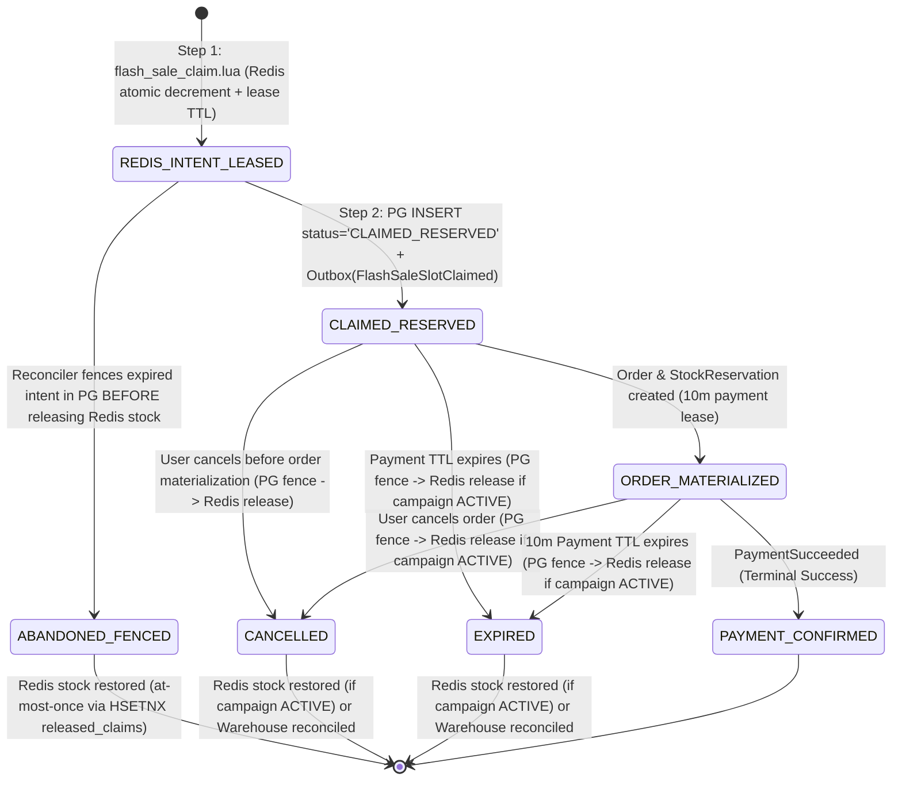
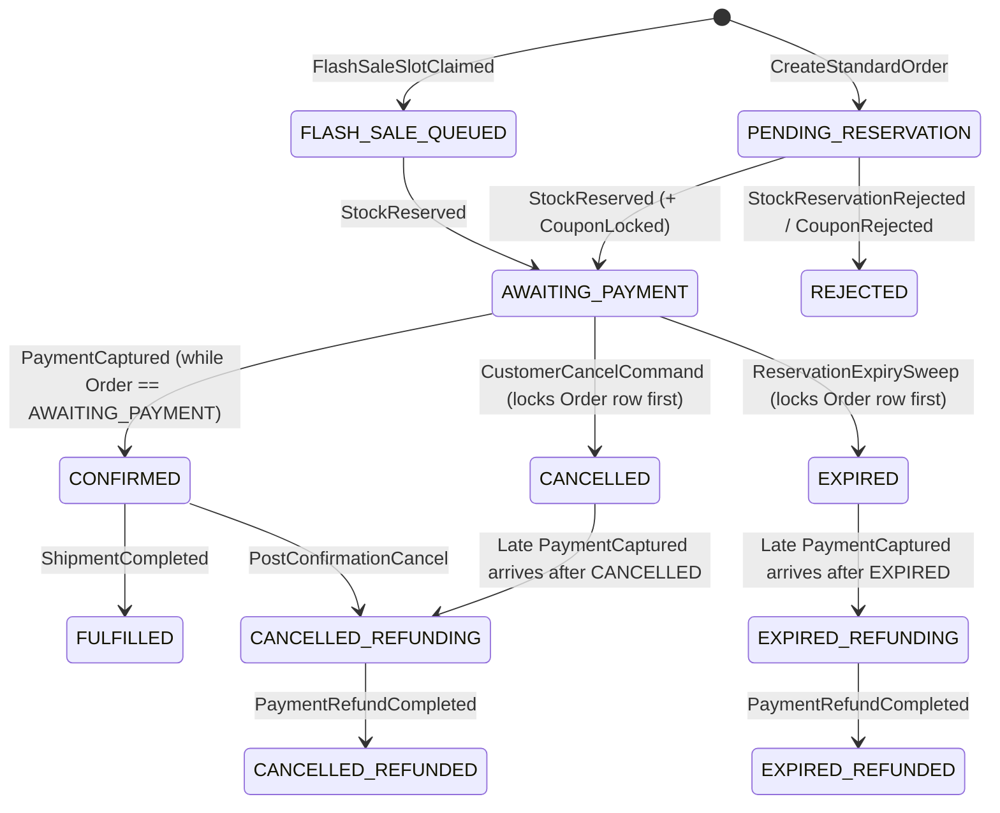
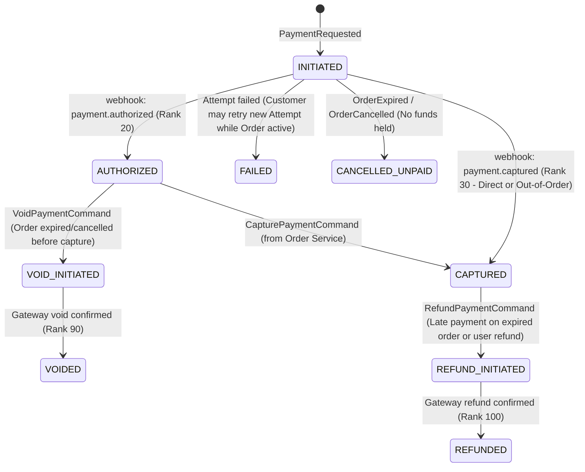
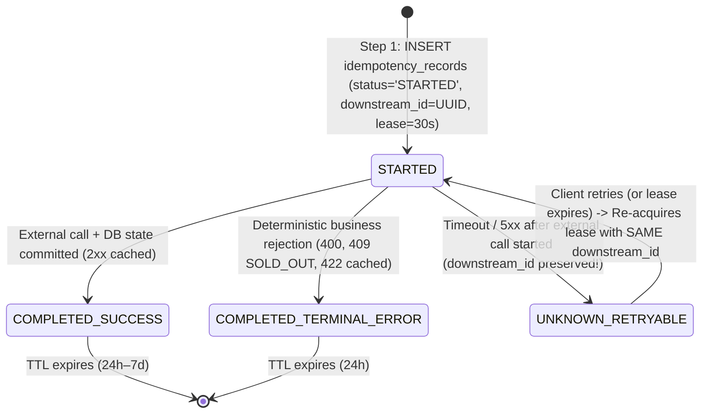
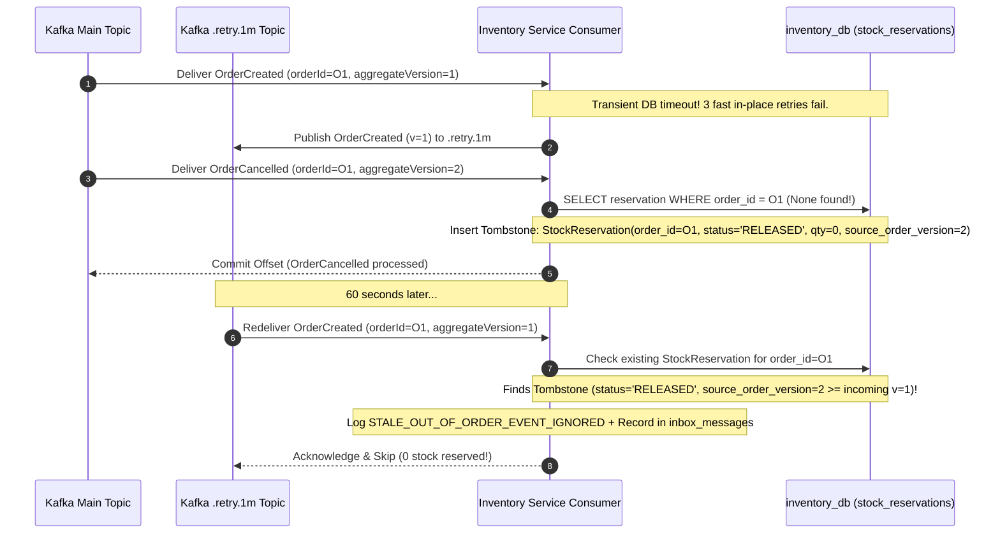
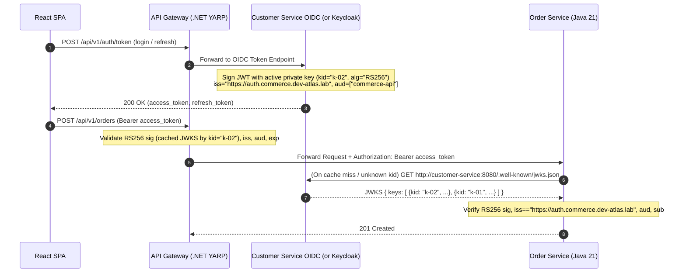
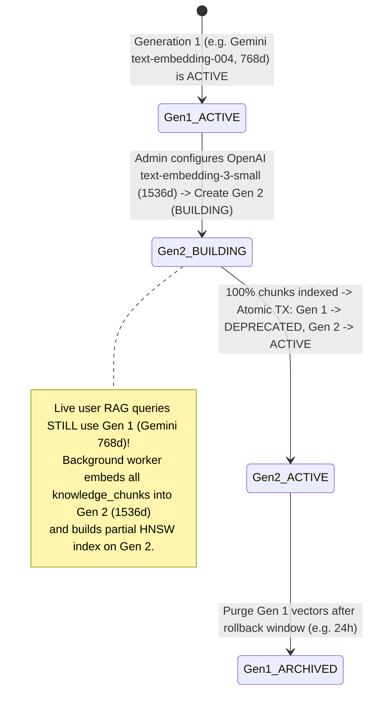
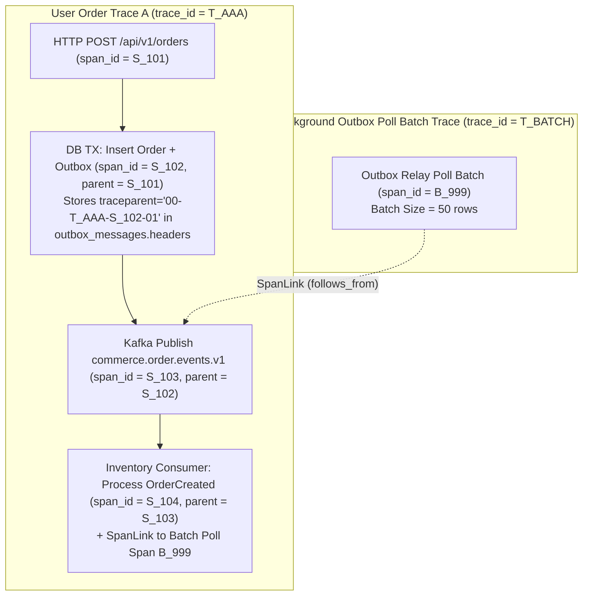

# Architecture Challenge Refinement (`M0.2` — `CH-01` through `CH-07`)

- **Document ID:** `DCP-DOC-ARCH-008`
- **Status:** `DISCUSSION` / `PROPOSED` (Refined in `M0.2` per Human Architect Feedback — Awaiting Explicit Approval)
- **Preserved Baseline:** Foundational Decisions `Q1–Q7` remain **`ACCEPTED`**.
- **Last Updated:** 2026-11-10

---

## Executive Overview of `M0.2` Refinements

In `M0.1`, seven initial edge-case proposals (`CH-01` through `CH-07`) were surfaced. During review, the Human Architect identified critical theoretical and operational shortcuts in those initial proposals—such as assuming a 30-second timeout proves a PostgreSQL transaction never committed (`CH-01`), relying on a 2-second clock buffer for payment expiry (`CH-02`), deleting idempotency keys on `5xx` responses (`CH-03`), assuming uniform `vector(768)` dimensions or cross-model vector compatibility (`CH-06`), and conflating parent-child spans with async Outbox batching (`CH-07`).

This document provides the rigorous **`M0.2` engineering specification** for all seven challenges. Every challenge is documented across **9 mandatory dimensions**:
1. **Problem**
2. **Failure Scenarios**
3. **Invariants That Must Always Hold**
4. **Proposed Design (with Mermaid State Machines & Sequence Flows)**
5. **Alternatives Evaluated**
6. **Trade-offs**
7. **Recovery Strategy**
8. **Acceptance Criteria**
9. **Remaining Questions for Human Architect Decision**

> [!IMPORTANT]
> Per strict governance rules, **none of the refined `CH-01`–`CH-07` designs in this document are marked `ACCEPTED`**. They are presented in `DISCUSSION` / `PROPOSED` status for your explicit sign-off.

---

## `CH-01`: Redis / PostgreSQL Flash Sale Claim Lifecycle & Reconciliation Correctness

- **Status:** `PROPOSED` (`M0.2` Revision — Supersedes `M0.1` 30s Timeout Assumption)
- **Related ADR:** [`ADR-0005`](file:///home/anhltn/projects/distributed-commerce-platform/docs/adr/ADR-0005-flash-sale-concurrency-and-three-tier-locking.md)

### 1. Problem
During a Flash Sale (`Q4 Option A — ACCEPTED`), Redis serves as the high-speed admission gate while PostgreSQL (`promotion_db` and `order_db`/`inventory_db`) is the durable system of record. Because Redis and PostgreSQL do not share a distributed 2PC transaction, any multi-step mutation across them is vulnerable to **split-brain uncertainty**:
1. **Why a 30-second timeout NEVER proves a DB transaction failed**: Suppose Pod A executes `flash_sale_claim.lua` in Redis at `T = 0s`, then sends `INSERT INTO flash_sale_claims ... COMMIT` to PostgreSQL. If Pod A experiences a 35-second JVM/.NET GC pause, network packet delay, or PostgreSQL connection stall right as the `COMMIT` packet is in flight, a reconciler that blindly rolls back the Redis slot at `T = 30s` (because it sees no DB row at `T = 30s`) will return the unit to Redis (`INCRBY stock 1`). Another user (`User B`) buys that unit at `T = 31s`. Then at `T = 32s`, Pod A's delayed PostgreSQL `COMMIT` lands on disk! Now **both User A and User B have committed claims for the same unit (`OVERSELL!`)**.
2. **Concurrent Expiration vs. Cancellation / Payment**: If an unpaid reservation expires at `T = 10m` (`Q4 Option A` returns stock to the active Redis pool) at the exact millisecond the user cancels or completes payment, or if a release event is delivered twice by Kafka, naive stock return increments Redis stock twice.

### 2. Failure Scenarios

| ID | Failure Scenario | Naive Failure Outcome | Required Safe Outcome |
| :--- | :--- | :--- | :--- |
| `FS-01A` | Redis Lua claim succeeds (`INTENT_RESERVED`), then Pod crashes (`kill -9`) before sending SQL `INSERT` to PostgreSQL. | Stock leaked in Redis; user locked out on retry (`USER_LIMIT_EXCEEDED`). | Same `(customerId, Idempotency-Key)` retry re-hydrates the existing `claimId` from Redis and completes DB persistence; if user never retries, lease expires only after DB fence makes late commit impossible. |
| `FS-01B` | Redis Lua claim succeeds, Pod sends SQL `INSERT`, network stalls for `35s`; reconciler runs while SQL commit is still in flight. | Reconciler releases Redis stock early → User B buys it → Pod A's delayed SQL commit succeeds → **Oversell**. | Reconciler MUST write a **`RECONCILED_ABORT` tombstone** to PostgreSQL *before* returning stock to Redis, fencing off any delayed in-flight SQL commit via primary/unique key conflict. |
| `FS-01C` | Reservation expiry worker and user cancellation worker both process `claimId` concurrently while campaign is `ACTIVE`. | Both workers call `INCRBY stock 1` in Redis → **Oversell** (`stock` inflated by `+2` instead of `+1`). | State transition in PostgreSQL (`CLAIMED_RESERVED -> EXPIRED` vs `CANCELLED`) wins once via atomic SQL `WHERE status = 'CLAIMED_RESERVED'`, AND Redis Lua release checks `HSETNX released_claims {claimId}`. |
| `FS-01D` | Kafka delivers `FlashSaleClaimReleased` event twice (`At-Least-Once` redelivery). | Second delivery increments Redis stock again → **Oversell**. | Redis Lua `HSETNX released_claims {claimId}` is idempotent; second call returns `ALREADY_RELEASED` with `0` stock delta. |

### 3. Invariants That Must Always Hold
- **`INV-FS-01 (Conservation of Campaign Quota)`**: At any instant $t$:
  $$\text{RedisAvailableStock}(t) + |\text{ActiveIntentLeases}(t)| + |\text{CommittedOrReservedClaims}(t)| = \text{AllocatedQuota}$$
- **`INV-FS-02 (Write-Fence Before Restock)`**: No unpersisted Redis claim intent may ever be returned to `RedisAvailableStock` unless PostgreSQL has first durably recorded a terminal `ABANDONED` / `EXPIRED` tombstone for that `claim_id` (guaranteeing that any delayed in-flight `INSERT/UPDATE` for that `claim_id` will deterministically fail on PostgreSQL constraints).
- **`INV-FS-03 (At-Most-Once Restock per Claim ID)`**: A given `claim_id` can increment `RedisAvailableStock` at most once across the entire lifetime of the campaign.
- **`INV-FS-04 (Per-Customer Quota Invariant)`**: A customer's net active claims (`INTENT_RESERVED` + `DB_PERSISTED` + `ORDER_PAID`) for `(campaign_id, sku_id)` must never exceed `per_customer_limit`.

### 4. Proposed Design: Two-Phase Claim Lease with PostgreSQL Tombstone Fencing

#### 4.1 Ownership Boundary (Redis vs. PostgreSQL)
- **Redis Owns**: High-speed admission control (`available_stock` counter, active `claim_intents` hash, per-user active claim counter, and idempotent `released_claims` set during the active campaign window).
- **PostgreSQL (`promotion_db.flash_sale_claims`) Owns**: The **authoritative lifecycle state machine** and **fencing ledger**. Whether a claim is ultimately valid, expired, cancelled, or abandoned is decided by a single row in `promotion_db.flash_sale_claims (claim_id PRIMARY KEY)`.

#### 4.2 Durable Identifiers & Uniqueness Constraints
- **`claim_id` (`UUIDv7`)**: Generated deterministically or assigned at the start of the request and bound 1:1 to `(campaign_id, sku_id, customer_id, idempotency_key)`.
- **PostgreSQL Schema (`promotion_db.flash_sale_claims`)**:
  ```sql
  CREATE TABLE flash_sale_claims (
      claim_id                UUID PRIMARY KEY,
      campaign_id             UUID NOT NULL REFERENCES flash_sale_campaigns(campaign_id),
      sku_id                  UUID NOT NULL,
      customer_id             UUID NOT NULL,
      idempotency_key         VARCHAR(128) NOT NULL,
      quantity                INTEGER NOT NULL CHECK (quantity > 0),
      status                  VARCHAR(32) NOT NULL CHECK (status IN (
                                  'CLAIMED_RESERVED',
                                  'ORDER_MATERIALIZED',
                                  'PAYMENT_CONFIRMED',
                                  'CANCELLED',
                                  'EXPIRED',
                                  'ABANDONED_FENCED'
                              )),
      intent_lease_expires_at TIMESTAMPTZ NOT NULL,
      payment_expires_at      TIMESTAMPTZ NOT NULL,
      stock_returned_to_redis BOOLEAN NOT NULL DEFAULT FALSE,
      version                 BIGINT NOT NULL DEFAULT 0,
      created_at              TIMESTAMPTZ NOT NULL DEFAULT NOW(),
      updated_at              TIMESTAMPTZ NOT NULL DEFAULT NOW(),
      CONSTRAINT uq_flash_claim_idem UNIQUE (campaign_id, customer_id, idempotency_key)
  );

  -- Partial unique index: a customer can hold at most 1 active (non-terminal) claim when per_customer_limit = 1
  CREATE UNIQUE INDEX uq_flash_active_customer_sku
      ON flash_sale_claims (campaign_id, sku_id, customer_id)
      WHERE status IN ('CLAIMED_RESERVED', 'ORDER_MATERIALIZED', 'PAYMENT_CONFIRMED');
  ```

#### 4.3 Claim State Machine (Mermaid)



#### 4.4 How Safe Reconciliation Works (Eliminating the 30s Timeout Fallacy)
Instead of assuming that an old Redis intent was never persisted, the **Reconciliation & Recovery Protocol** enforces **PostgreSQL Fencing First**:
1. **Step 1 (Redis Admission Lease)**: `flash_sale_claim.lua` atomically records an intent entry in Redis hash `flashsale:{campaignId}:sku:{skuId}:intents` keyed by `claimId` containing `{customerId, idempotencyKey, qty, leaseDeadlineMs = now + 60000}` and decrements `stock`.
   - Set statement timeout on the subsequent PostgreSQL `INSERT` to `5 seconds` (`SET LOCAL statement_timeout = '5s'`).
2. **Step 2 (Normal Path Confirmation)**: `Promotion Service` inserts `flash_sale_claims (claim_id, status = 'CLAIMED_RESERVED', ...)` + `outbox_messages (FlashSaleSlotClaimed)` in PostgreSQL (`<= 5s`). Once committed, it calls a lightweight Redis Lua ack (`HDEL intents {claimId}`, moving it to confirmed buyers).
3. **Step 3 (Fenced Reconciliation for Unacknowledged Intents past `leaseDeadlineMs`)**:
   - When the Reconciler finds an unacknowledged Redis intent where `now > leaseDeadlineMs` (`60s`, well past the `5s` PostgreSQL `statement_timeout`), it **DOES NOT touch Redis yet**.
   - First, the Reconciler queries/mutates **PostgreSQL**:
     ```sql
     INSERT INTO flash_sale_claims (
         claim_id, campaign_id, sku_id, customer_id, idempotency_key,
         quantity, status, intent_lease_expires_at, payment_expires_at
     ) VALUES (
         :claimId, :campaignId, :skuId, :customerId, :idempotencyKey,
         :qty, 'ABANDONED_FENCED', :leaseExp, :leaseExp
     )
     ON CONFLICT (claim_id) DO NOTHING
     RETURNING status;
     ```
   - **Outcome A (`INSERT` succeeded and inserted `ABANDONED_FENCED`)**: Now PostgreSQL has a durable tombstone row for `claim_id`! Even if a zombie thread from 60 seconds ago somehow woke up and tried to `INSERT` `CLAIMED_RESERVED` for `claim_id`, PostgreSQL's `PRIMARY KEY (claim_id)` will **reject the zombie write**! Now—and ONLY now—is it 100% safe for the Reconciler to execute `flash_sale_release.lua` in Redis (`HSETNX released_claims {claimId}` + `INCRBY stock qty`) and set `stock_returned_to_redis = true`.
   - **Outcome B (`ON CONFLICT DO NOTHING` returned 0 rows because `claim_id` ALREADY exists in PostgreSQL as `CLAIMED_RESERVED`!)**: The Reconciler discovers the DB commit actually succeeded earlier (only the Redis ack was lost). It simply clears the stale Redis intent key **without** returning stock!

### 5. Alternatives Evaluated
- **Alternative 1 (Pre-insert to PostgreSQL before Redis Lua)**: Impossible at 100K RPS spike load because PostgreSQL would have to absorb 100,000 `INSERT` transactions per second just to reject 99,000 losers.
- **Alternative 2 (Wait until Campaign Ends to Reconcile Orphaned Intents)**: Safe against overselling, but strands leaked units until the campaign is over instead of returning them to active shoppers (`Q4 Option A`).

### 6. Trade-offs
- **PostgreSQL Tombstone Fencing (Proposed)** adds `1` PostgreSQL `INSERT ... ON CONFLICT` per crashed/abandoned Redis intent (which only occurs on pod crashes or network faults, i.e., `<0.01%` of claims) while providing a **mathematical proof against split-brain overselling**.

### 7. Recovery Strategy
- **If Redis crashes/restarts mid-campaign**: Campaign temporarily pauses (`status = REBUILDING_GATE` returning `503 Retry-After: 5`), reconstructs exact Redis state (`allocated_quota - COUNT(active/paid claims in PG)` and active buyer hashes) from `promotion_db.flash_sale_claims`, and resumes `ACTIVE`.

### 8. Acceptance Criteria
1. **Crash Before DB Commit Test**: Inject fault after `flash_sale_claim.lua` before PG `INSERT`. Verify client retry with same `Idempotency-Key` succeeds using the same `claimId`, OR if unretried past lease deadline, Reconciler inserts `ABANDONED_FENCED` in PG before restoring Redis stock (`INV-FS-01` & `INV-FS-02`).
2. **Zombie Delayed Commit Test**: Simulate a stalled DB writer thread attempting to commit `CLAIMED_RESERVED` *after* the Reconciler has fenced `claim_id` as `ABANDONED_FENCED`. Verify PostgreSQL rejects the zombie commit with a primary-key violation and `0` oversell occurs.
3. **Concurrent Expiry + Cancel Test**: Trigger expiration worker and user cancel API on the same `claimId` at the same millisecond via a `CyclicBarrier`. Verify Redis stock is incremented **exactly once** (`INV-FS-03`).

### 9. Remaining Questions for Human Architect
- **`Q-CH01`**: Do you approve the **PostgreSQL Tombstone Fencing (`ABANDONED_FENCED`) before Redis Restock** protocol and the 6-state `FlashSaleClaim` lifecycle?

---

## `CH-02`: Decoupled Order Lifecycle vs. Payment Lifecycle & Webhook Race Resolution

- **Status:** `PROPOSED` (`M0.2` Revision — Supersedes `M0.1` 2-Second Buffer Assumption)
- **Related ADRs:** [`ADR-0004`](file:///home/anhltn/projects/distributed-commerce-platform/docs/adr/ADR-0004-hybrid-order-fulfillment-saga-orchestration.md), [`ADR-0005`](file:///home/anhltn/projects/distributed-commerce-platform/docs/adr/ADR-0005-flash-sale-concurrency-and-three-tier-locking.md)

### 1. Problem
In `M0.1`, we suggested a "2-second pre-capture expiry buffer" in `Payment Service`. As you rightly challenged, **wall-clock buffers are never a correctness guarantee in distributed systems** (network pauses, GC pauses, clock skew, or asynchronous external payment gateway webhooks can exceed 2 seconds, 30 seconds, or 10 minutes).
Furthermore, conflating the **Order Lifecycle** (commercial fulfillment contract & inventory reservation) with the **Payment Lifecycle** (financial authorization, capture, void, refund, and settlement ledger) makes it impossible to reason cleanly about:
- Out-of-order webhooks (`CAPTURED` webhook arriving before `AUTHORIZED` webhook).
- Duplicate webhooks (`CAPTURED` delivered 3 times).
- Late payment webhooks arriving after the Order's inventory reservation has already expired and been sold to another customer.
- Multiple payment attempts on the same Order (Attempt #1 fails with card declined; Attempt #2 succeeds).

### 2. Failure Scenarios

| ID | Failure Scenario | Naive Failure Outcome | Required Safe Outcome |
| :--- | :--- | :--- | :--- |
| `FS-02A` | Order expires at `T = 10m00s` (stock released to pool), and external gateway sends `webhook: payment.captured` at `T = 10m05s`. | Order either flips `EXPIRED -> CONFIRMED` (overselling released stock!) OR ignores webhook (stealing customer's money!). | `Order` stays terminal `EXPIRED` (stock safe); `Payment` records `CAPTURED` and Saga immediately triggers compensating `REFUND_INITIATED -> REFUNDED`. |
| `FS-02B` | Two-step payment (`AUTHORIZE` then `CAPTURE`): Order expires while payment is `AUTHORIZED` (funds held, not yet captured). | System issues a full refund on uncaptured funds (fails at gateway) or leaves hold hanging on customer card. | `Order Service` emits `CancelPaymentAuthorization`; `Payment Service` executes an **Authorization `VOID`** instead of a capture/refund. |
| `FS-02C` | Out-of-order webhook: `payment.captured` webhook arrives 100ms *before* `payment.authorized` webhook. | State machine rejects `payment.captured` because current status is `INITIATED`, losing the payment notification! | Payment state machine uses **monotonic state precedence** (`CAPTURED > AUTHORIZED > INITIATED`): `INITIATED` transitions directly to `CAPTURED`, and the late `payment.authorized` webhook is recorded in `payment_webhook_events` and ignored as a lower-precedence state. |
| `FS-02D` | Customer's first payment attempt (`Attempt #1`) fails (`INSUFFICIENT_FUNDS`) at `T = 2m`; customer retries with another card (`Attempt #2`) at `T = 3m` while reservation is still valid. | Single-attempt payment model cancels the entire order on Attempt #1 failure, forcing user to lose their Flash Sale item! | `PaymentIntent` (1 per Order) allows multiple `PaymentAttempt` executions while `Order.status == AWAITING_PAYMENT` and `now < order.expires_at`. |

### 3. Invariants That Must Always Hold
- **`INV-ORD-PAY-01 (Strict Separation of Concerns)`**: `Order` state reflects **commercial fulfillment & inventory commitment**; `PaymentIntent` / `PaymentAttempt` state reflects **financial money movement**. Neither state machine overwrites the other directly.
- **`INV-ORD-PAY-02 (Terminal Fulfillment Immutability)`**: Once an `Order` enters `EXPIRED`, `CANCELLED`, or `REJECTED` (causing its `StockReservation` to be released), it can **NEVER** transition to `CONFIRMED` or `FULFILLED` under any circumstance.
- **`INV-ORD-PAY-03 (Zero Unrefunded Captures on Non-Confirmed Orders)`**: Every `PaymentAttempt` that reaches `CAPTURED` for an `Order` in `EXPIRED` or `CANCELLED` state MUST deterministically produce a `Refund` (`REFUND_PENDING -> REFUNDED`), verified by both event-driven Saga compensation and a periodic Reconciliation query.
- **`INV-ORD-PAY-04 (At-Most-One Active Capture per Order)`**: If two payment attempts somehow both succeed (`CAPTURED`) for the same `Order`, the second `CAPTURED` attempt is automatically refunded.

### 4. Proposed Design: Orthogonal Order & Payment State Machines with Monotonic Webhook Resolution

#### 4.1 Order State Machine (`order-service` — `order_db`)



#### 4.2 Payment State Machine (`payment-service` — `payment_db`)
We model a `PaymentIntent` aggregate (`1:1` with `order_id`) containing `1..N` `PaymentAttempt` entities (`attempt_id`):
- **Two Modes Supported**:
  1. **Auth + Capture (`Two-Step` — Recommended for Flash Sale / High-Contention Orders)**: Gateway `AUTHORIZES` funds on customer's card → `Payment Service` emits `PaymentAuthorized` → `Order Service` verifies `Order` is still `AWAITING_PAYMENT` (locking the order from expiring) and emits `CapturePaymentCommand` → `Payment Service` captures funds (`CAPTURED`) → `Order` transitions to `CONFIRMED`. If the `Order` had already `EXPIRED` when `PaymentAuthorized` arrived, `Order Service` emits `VoidPaymentCommand` (`AUTHORIZED -> VOIDED`), releasing the card hold with zero settlement fee!
  2. **Direct Capture / Async Webhook (`One-Step` — e.g., QR / E-Wallet / Instant Transfer)**: Gateway sends `PaymentCaptured` directly. If `Order` is `AWAITING_PAYMENT`, `Order -> CONFIRMED`. If `Order` is already `EXPIRED` or `CANCELLED`, `Order -> EXPIRED_REFUNDING` and emits `RefundPaymentCommand` (`CAPTURED -> REFUND_INITIATED -> REFUNDED`).



#### 4.3 Handling Duplicate & Out-of-Order Webhooks
Every incoming webhook in `Payment Service`:
1. Verifies the `HMAC-SHA256` signature and inserts `webhook_event_id` into `payment_webhook_logs (webhook_event_id PRIMARY KEY)`. Duplicate webhook deliveries hit the PK constraint and return `200 OK` immediately.
2. Uses **Monotonic State Precedence Ranks** (`INITIATED = 10`, `AUTHORIZED = 20`, `CAPTURED = 30`, `VOID_INITIATED = 80`, `VOIDED = 90`, `REFUND_INITIATED = 95`, `REFUNDED = 100`):
   - If `payment.captured` (`Rank 30`) arrives *before* `payment.authorized` (`Rank 20`), the attempt transitions `INITIATED (10) -> CAPTURED (30)` and emits `PaymentCaptured` in the local Outbox transaction.
   - When the delayed `payment.authorized` (`Rank 20`) webhook arrives 200ms later, `20 < currentRank(30)`, so its payload is logged in `payment_webhook_logs` for audit and **no state regression or duplicate event occurs**.

### 5. Alternatives Evaluated
- **Alternative 1 (2-Second Clock Buffer)**: Rejected because clock buffers fail whenever network or webhook latency exceeds 2 seconds.
- **Alternative 2 (Distributed Lock across `order_db` and `payment_db`)**: Rejected because external payment webhooks are asynchronous and outside our lock boundary anyway.

### 6. Trade-offs
- Supporting both `AUTHORIZE -> CAPTURE / VOID` and `DIRECT CAPTURE -> REFUND` adds two states (`AUTHORIZED`, `VOIDED`) to `PaymentAttempt`, but accurately mirrors real Stripe/Adyen payment engineering and eliminates unnecessary refund fees when an order expires during authorization.

### 7. Recovery Strategy
- **Scheduled Payment-Order Reconciliation Job (every 5 minutes)**: Queries any `PaymentIntent` in `AUTHORIZED` or `CAPTURED` status for `> 5 minutes` whose corresponding `Order` in `order-service` is `EXPIRED` or `CANCELLED`, automatically re-triggering `VoidPaymentCommand` or `RefundPaymentCommand` if an event was delayed in DLQ.

### 8. Acceptance Criteria
1. **Late Capture Webhook Race Test**: Expire an order at `T0` (releasing stock), then deliver a signed `payment.captured` webhook at `T0 + 10ms`. Verify `Order` transitions `EXPIRED -> EXPIRED_REFUNDING -> EXPIRED_REFUNDED`, `Payment` transitions `CAPTURED -> REFUND_INITIATED -> REFUNDED`, and `StockItem` quantities remain untouched (`INV-ORD-PAY-02` & `INV-ORD-PAY-03`).
2. **Out-of-Order Webhook Test**: Deliver `payment.captured` followed 50ms later by `payment.authorized` for the same attempt. Verify final state is `CAPTURED` and `PaymentCaptured` is published to Outbox exactly once.
3. **Multi-Attempt Retry Test**: Fail `Attempt #1` with `INSUFFICIENT_FUNDS`, then submit `Attempt #2` (`SUCCEED`) before `order.expires_at`. Verify the order succeeds cleanly.

### 9. Remaining Questions for Human Architect
- **`Q-CH02`**: Do you approve the decoupled `Order` and `Payment` state machines (supporting both `Auth -> Capture/Void` and `Direct Capture -> Auto-Refund on late arrival`) and monotonic webhook rank resolution?

---

## `CH-03`: Rigorous Idempotency Protocol (State Machine, External Side Effects & Unknown Outcomes)

- **Status:** `PROPOSED` (`M0.2` Revision — Supersedes `M0.1` Blanket `5xx` Deletion Rule)
- **Related ADR:** [`ADR-0003`](file:///home/anhltn/projects/distributed-commerce-platform/docs/adr/ADR-0003-transactional-outbox-and-inbox-idempotency.md), [`ADR-0010`](file:///home/anhltn/projects/distributed-commerce-platform/docs/adr/ADR-0010-event-contracts-json-schema-and-kafka-kraft.md)

### 1. Problem
In `M0.1`, we proposed rolling back/deleting the idempotency record whenever a request failed with a `5xx` error. **That is only safe if the entire request is a single local PostgreSQL transaction (which automatically rolls back the idempotency row on abort), and is DANGEROUS if the request performs any external network side effect (such as calling Redis Lua or an external Payment Gateway) before failing with a `504 Gateway Timeout`!**
- If Request 1 calls an external gateway or Redis Lua, times out (`504`), and deletes the idempotency record, Request 2 with the same `Idempotency-Key` will generate a brand-new internal command and execute the side effect a **second time**!

### 2. Failure Scenarios

| ID | Failure Scenario | Naive Failure Outcome | Required Safe Outcome |
| :--- | :--- | :--- | :--- |
| `FS-03A` | Request 1 (`POST /payments/{id}/confirm`, Key `K1`) calls external gateway, socket times out (`504`) while gateway actually captured the charge; server deletes `K1`. | Client retries `K1` → Server treats `K1` as brand-new and charges the customer a second time! | Idempotency record transitions to `RECOVERY_REQUIRED` (retaining the deterministic `attempt_id` bound to `K1`); retry with `K1` resumes/queries the **same** `attempt_id` rather than creating a new charge. |
| `FS-03B` | Request 1 (`K1`) is currently `PROCESSING` on Pod 1; 5ms later Request 2 (`K1`) arrives on Pod 2. | Both pods execute the mutation concurrently. | Pod 1 acquires the `idempotency_records` row (`INSERT ... ON CONFLICT DO NOTHING`); Pod 2 sees `status = 'PROCESSING'` and `lease_expires_at > NOW()`, returning `409 Conflict (IDEMPOTENCY_IN_PROGRESS, Retry-After: 1)`. |
| `FS-03C` | Pod 1 crashes (`OOMKilled`) after committing Phase 1 (`status = 'PROCESSING'`) of a multi-step idempotent operation before writing the final response. | `K1` stays stuck in `PROCESSING` forever; client retries get `409` forever. | Each `PROCESSING` record carries a `lease_expires_at` (`NOW() + 30s`). Once `NOW() > lease_expires_at`, a retry steals the lease (`version + 1`) and advances from the saved `recovery_checkpoint`. |
| `FS-03D` | Client sends `{ "skuId": "A", "qty": 1 }` vs `{ "qty": 1, "skuId": "A" }` (key order difference) vs `{ "skuId": "B", "qty": 1 }` (payload mismatch) with the same `K1`. | Naive raw-string hash rejects equivalent JSON key orderings; missing hash check accepts mutated SKU! | Canonical JSON RFC 8785 (JCS) SHA-256 hash matches reordered keys cleanly, and rejects mutated values with `422 IDEMPOTENCY_PAYLOAD_MISMATCH`. |

### 3. Invariants That Must Always Hold
- **`INV-IDEM-01 (1:1 Downstream Token Binding)`**: Any idempotency record that initiates a non-transactional external side effect (Redis Lua script or external HTTP call) MUST persist its deterministic `downstream_operation_id` (`claim_id` or `attempt_id`) **before** invoking the external call, and **MUST NEVER delete** that idempotency record on timeout/network failure.
- **`INV-IDEM-02 (Payload Immutability)`**: A given `(scope_owner_id, endpoint_id, idempotency_key)` can never be executed with two different canonical request payload hashes (`SHA-256`).
- **`INV-IDEM-03 (Single Active Executor)`**: At most one worker thread/pod may hold an active execution lease on an idempotency key at any time.

### 4. Proposed Design: Two-Class Idempotency Model & State Machine

We distinguish two architectural classes of idempotent operations:

#### Class A: Pure Local-ACID + Outbox Operations (e.g., `POST /api/v1/orders` in `Order Service`)
- Because creating a standard order writes `orders`, `order_lines`, `order_saga_states`, `outbox_messages`, and `idempotency_records` in **one single local PostgreSQL transaction** with **zero external network calls during the transaction**:
  - If the transaction commits → `idempotency_records` is committed in `COMPLETED` state with the exact serialized `201 Created` response body.
  - If the transaction aborts/rolls back (e.g., DB deadlock or constraint violation) → PostgreSQL atomically rolls back the entire transaction (zero external side effects occurred), so a retry safely starts fresh.

#### Class B: Operations with External Side Effects (e.g., `POST /api/v1/flash-sales/{id}/claim` calling Redis Lua, or `Payment` gateway calls)
- Cannot rely on a single DB transaction rollback. Must follow the **Atomic Phase-Checkpointed Idempotency State Machine**:



#### 4.3 Canonical Payload Hashing & Retry Rules
1. **Canonical Hashing (`RFC 8785` / Sorted-Key Normalized JSON)**:
   - Parse request body DTO, serialize with lexicographically sorted property names and normalized numbers/whitespace, and compute `SHA-256` (`request_hash`).
2. **Exact Rules for When Execution Can Safely Restart**:
   - **Rule 1 (`COMPLETED_SUCCESS` — `200`/`201`/`202`)**: Never re-execute; return cached status code and response JSON immediately (`X-Idempotency-Replayed: true`).
   - **Rule 2 (`COMPLETED_TERMINAL_ERROR` — `400`, `409 SOLD_OUT`, `422`)**: Business rule or validation deterministically rejected the request; return cached error (or allow new `Idempotency-Key` if client fixes input).
   - **Rule 3 (`STARTED` with `lease_expires_at > NOW()`)**: Another thread is actively executing this key right now → return `409 Conflict` (`IDEMPOTENCY_REQUEST_IN_PROGRESS`, `Retry-After: 1`).
   - **Rule 4 (`UNKNOWN_RETRYABLE` or `STARTED` with `lease_expires_at <= NOW()`)**: A previous attempt timed out or crashed mid-flight. The retrying request atomically updates `SET lease_expires_at = NOW() + 30s, version = version + 1 WHERE version = :prevVersion`, reads the **already-assigned `downstream_operation_id`** (`claim_id` or `payment_attempt_id`), and **resumes idempotently using that exact `downstream_operation_id`**!
3. **Record Retention & Cleanup**:
   - Retain `idempotency_records` for **`24 hours`** (`7 days` for payment endpoints).
   - A daily background job deletes expired rows in bounded batches (`DELETE FROM idempotency_records WHERE id IN (SELECT id FROM idempotency_records WHERE expires_at < NOW() LIMIT 1000)`).

### 5. Alternatives Evaluated
- **Alternative 1 (Delete idempotency key on all `5xx` errors — `M0.1` draft)**: Unsafe whenever an external call was already dispatched before the `5xx` occurred.
- **Alternative 2 (Store idempotency keys only in Redis with TTL)**: If Redis evicts a key or restarts without fsync, payment or order idempotency is lost. Storing `idempotency_records` in the owning service's PostgreSQL database guarantees ACID durability alongside the domain entities.

### 6. Trade-offs
- Class B operations require `1` lightweight `INSERT/UPDATE` on `idempotency_records` before and after the external side effect, trading `~1–2ms` of local DB latency for complete protection against timeout double-charges and crashed-pod lockouts.

### 7. Acceptance Criteria
1. **Timeout After External Call Test**: Simulate a socket timeout right after `flash_sale_claim.lua` (or payment gateway charge) succeeds, leaving `idempotency_records` in `UNKNOWN_RETRYABLE`. Retry with the same `Idempotency-Key` and verify it reuses the exact same `claim_id`/`attempt_id` and completes without double-claiming or double-charging (`INV-IDEM-01`).
2. **Canonical Hash Equivalence & Mismatch Test**: Verify `{"a":1,"b":2}` and `{"b":2,"a":1}` with the same key produce the same `SHA-256` hash and return `200/201` replayed, whereas `{"a":1,"b":3}` with the same key returns `422 IDEMPOTENCY_PAYLOAD_MISMATCH` (`INV-IDEM-02`).
3. **Concurrent In-Flight Request Test**: Hold Request 1 inside a transaction barrier while sending Request 2 with the same key; verify Request 2 immediately receives `409 IDEMPOTENCY_REQUEST_IN_PROGRESS` (`INV-IDEM-03`).

### 8. Remaining Questions for Human Architect
- **`Q-CH03`**: Do you approve the Two-Class Idempotency Model (`Class A` single-TX atomic vs. `Class B` checkpointed state machine preserving `downstream_operation_id` across `UNKNOWN_RETRYABLE` states)?

---

## `CH-04`: Kafka Ordering Guarantees, Aggregate Sequence Versioning, Tombstones & DLQ Replay

- **Status:** `PROPOSED` (`M0.2` Revision)
- **Related ADRs:** [`ADR-0003`](file:///home/anhltn/projects/distributed-commerce-platform/docs/adr/ADR-0003-transactional-outbox-and-inbox-idempotency.md), [`ADR-0010`](file:///home/anhltn/projects/distributed-commerce-platform/docs/adr/ADR-0010-event-contracts-json-schema-and-kafka-kraft.md)

### 1. Problem
We must explicitly define **when Kafka message ordering IS guaranteed, when it is NOT guaranteed**, and how our consumers remain 100% state-consistent even when events arrive **out of order** (due to non-blocking retry topics, DLQ replays, or partition count changes).

### 2. When Ordering IS vs. IS NOT Guaranteed in Our Architecture

| Scenario | Is Strict Causal Ordering Guaranteed by Kafka Alone? | Why? |
| :--- | :--- | :--- |
| **Events for the same `aggregateId` (`orderId`) on the main topic (`enable.idempotence=true`, `max.in.flight.requests.per.connection <= 5`, fixed partition count)** | **YES** | Outbox Relay polls in `ORDER BY created_at ASC, outbox_seq ASC` and publishes with `partition_key = orderId`, landing all events for `orderId` on the exact same partition in causal order. |
| **Events across TWO DIFFERENT topics (e.g., `commerce.order.events.v1` vs `commerce.payment.events.v1`)** | **NO** | Consumers poll multiple topics/partitions at independent speeds; there is zero cross-topic ordering guarantee in Kafka. |
| **When Event $E_1$ is shunted to a Non-Blocking Retry Topic (`.retry.1m`) or `.dlq.v1` while Event $E_2$ for the same `orderId` arrives on the main topic** | **NO (Order Inversion Occurs)** | $E_2$ (`OrderCancelled`) is consumed immediately from the main topic at `T = 1s`, whereas $E_1$ (`OrderCreated`) is re-consumed from `.retry.1m` at `T = 60s` (`E_2` processed before `E_1`!). |
| **When an Operator Replays Messages from `.dlq.v1` hours later** | **NO** | The aggregate may have already advanced 3 states forward (`EXPIRED`, `CANCELLED`, or `REFUNDED`) since the DLQ event failed. |

### 3. Failure Scenarios

| ID | Failure Scenario | Naive Failure Outcome | Required Safe Outcome |
| :--- | :--- | :--- | :--- |
| `FS-04A` | `OrderCreated` ($v=1$) is shunted to `.retry.1m`; `OrderCancelled` ($v=2$) processes on main topic; 1m later `OrderCreated` ($v=1$) replays from `.retry.1m`. | Consumer processes `OrderCreated` ($v=1$) after cancellation and reserves stock for a dead order! | `OrderCancelled` ($v=2$) writes a `CANCELLED_TOMBSTONE` (`last_applied_aggregate_version = 2`) in `Inventory Service`; when $v=1$ arrives later, `1 < 2` (and status is terminal tombstone), so it is logged as `STALE_EVENT_SKIPPED` and acknowledged without reserving stock. |
| `FS-04B` | `ProductUpdated` ($v=5$, price `$999`) arrives after `ProductUpdated` ($v=6$, price `$899`) due to retry/replay. | Search read-model overwrites `$899` with stale price `$999`! | Read-model `UPDATE ... WHERE last_source_version < :incomingAggregateVersion` ignores $v=5$ because $5 < 6$. |
| `FS-04C` | Admin clicks "Replay DLQ Message" for an event that is now stale or already resolved. | Blind DLQ replay corrupts current aggregate state. | DLQ Replay goes through the exact same `Inbox` + `aggregateVersion` + monotonic state machine checks as live traffic. |

### 4. Invariants That Must Always Hold
- **`INV-ORD-KFK-01 (Monotonic Aggregate Version Guard)`**: Every event envelope MUST carry `aggregateVersion: long` (the monotonic `@Version` of the producing aggregate at the moment the event was emitted into `outbox_messages`). No state-projection or consumer may regress an aggregate's tracked `last_applied_version` (`incoming.aggregateVersion <= tracked.last_applied_version` for state overwrites is rejected as stale).
- **`INV-ORD-KFK-02 (Tombstone Precedence)`**: A cancellation/expiration event arriving before its corresponding creation/reservation event MUST create a durable **Terminal Tombstone Row** (`status = 'CANCELLED_TOMBSTONE'`) so the late creation event cannot resurrect the workflow.

### 5. Proposed Design: Sequence-Versioned Envelope + Tombstone Guards + Safe DLQ Replay

#### 5.1 Updated Event Envelope (`aggregateVersion` Mandatory)
We add `"aggregateVersion"` (`integer >= 1`) to [`docs/event-contracts/event-envelope.v1.schema.json`](file:///home/anhltn/projects/distributed-commerce-platform/docs/event-contracts/event-envelope.v1.schema.json) alongside a monotonic `outbox_sequence BIGSERIAL` column on `outbox_messages`:
```json
{
  "eventId": "019316a8-7c4b-7000-8a12-3f9c8d7e6b5a",
  "eventType": "commerce.order.cancelled.v1",
  "eventVersion": 1,
  "source": "order-service",
  "aggregateType": "Order",
  "aggregateId": "f47ac10b-58cc-4372-a567-0e02b2c3d479",
  "aggregateVersion": 2,
  "occurredAt": "2026-11-10T16:35:00.123Z",
  "correlationId": "4bf92f3577b34da6a3ce929d0e0e4736",
  "causationId": "019316a8-7000-7000-8000-111122223333",
  "payload": { ... }
}
```

#### 5.2 Out-of-Order & Tombstone Resolution Flow (Mermaid)



#### 5.3 Retry Escalation, Retention & DLQ Replay Strategy
1. **Tier 1 (In-Place Short Backoff)**: `3` attempts (`100ms`, `250ms`, `500ms`) inside the consumer before leaving the main partition (resolves brief lock/network blips while preserving partition order).
2. **Tier 2 (Non-Blocking Retry Topics)**: `.retry.1m` → `.retry.5m` for transient dependency outages (`DatabaseUnavailableException`, `HttpTimeoutException`). Validation/schema errors (`JsonProcessingException`, `InvalidDomainInvariantException`) bypass retry topics and go straight to `.dlq.v1`.
3. **DLQ Storage & Controlled Replay**:
   - DLQ messages are persisted into an `admin_dlq_messages` table (or inspected from `.dlq.v1`) with status `PENDING_REVIEW | REPLAYED | DISCARDED`.
   - When an `ADMIN_OPS` engineer triggers **Replay**, the message is re-dispatched with header `x-dlq-replayed-by` through the normal consumer pipeline—where **`Inbox` deduplication, `aggregateVersion` staleness checks, and Tombstone guards remain active**, guaranteeing that replaying an old DLQ event can never corrupt a newer aggregate state.

### 6. Alternatives Evaluated
- **Alternative 1 (Strict Partition-Halting Retry — Pause Partition Until Fixed)**: Guarantees 100% order preservation, but a single bug on 1 order halts checkout for 1/6th of all customers on the platform.
- **Alternative 2 (Keyed Per-Aggregate Block List in Redis during Retry)**: When `orderId=O1` goes to `.retry.1m`, write `retry_blocked:O1` in Redis so subsequent events for `O1` on the main topic also get routed to `.retry.1m`.
  - *Trade-off*: Preserves per-aggregate ordering across retry topics, but if Redis is unreachable or a retry takes 5m, a user's `OrderCancelled` event is unnecessarily delayed instead of immediately tombstoning the order. Our **Tombstone + `aggregateVersion` design** handles out-of-order cancellation immediately without waiting!

### 7. Acceptance Criteria
1. **Out-of-Order Cancel Before Create Test**: Deliver `OrderCancelled (aggregateVersion=2)` to `Inventory Service` *before* `OrderCreated (aggregateVersion=1)`. Verify `OrderCancelled` writes a terminal tombstone row, `OrderCreated` is skipped as stale upon arrival, and `available_qty` is never decremented (`INV-ORD-KFK-01` & `INV-ORD-KFK-02`).
2. **Stale Read-Model Event Test**: Deliver `ProductUpdated (aggregateVersion=4, price=100)` followed by `ProductUpdated (aggregateVersion=3, price=200)`. Verify search read-model retains `price=100` (`version=4`).
3. **DLQ Replay Safety Test**: Route a failed event to `.dlq.v1`, advance the order to `CANCELLED`, then replay the DLQ event via the Admin API; verify the consumer safely ignores the stale replay and marks the DLQ record `REPLAYED_NOOP_STALE`.

### 8. Remaining Questions for Human Architect
- **`Q-CH04`**: Do you approve adding mandatory `aggregateVersion` to the event envelope, the Tombstone pattern (`RELEASED / CANCELLED_TOMBSTONE` on out-of-order cancel), and the 3-tier retry + state-guarded DLQ replay strategy?

---

## `CH-05`: Standards-Compliant OIDC, Split-Horizon Discovery, Key Rotation & Service Identity

- **Status:** `PROPOSED` (`M0.2` Revision)
- **Related ADR:** [`ADR-0006`](file:///home/anhltn/projects/distributed-commerce-platform/docs/adr/ADR-0006-api-gateway-yarp-and-oidc-jwt-security.md)

### 1. Problem
Per `Q5` (`ACCEPTED`), we must design OIDC cleanly from Day 1 in `customer-service` so that introducing **Keycloak** later requires zero application code rewrites across Java, .NET, and Python services. To achieve true standards compliance without custom auth hacks, we must define:
1. Public vs. internal OIDC Discovery & JWKS resolution (`iss` validation vs. container-network `jwks_uri` fetching).
2. Audience (`aud`) validation per resource server vs. API Gateway.
3. Asymmetric key rotation (`kid`) without downtime.
4. Machine-to-machine (`M2M`) service identity using standard OAuth2 `grant_type=client_credentials` and fine-grained `scope` claims.
5. Exact claim mapping compatibility with Keycloak (`roles`, `realm_access.roles`, `scope`, `azp`).

### 2. Failure Scenarios

| ID | Failure Scenario | Naive Failure Outcome | Required Safe Outcome |
| :--- | :--- | :--- | :--- |
| `FS-05A` | Browser gets JWT with `iss: "https://auth.commerce.dev-atlas.lab"`; `order-service` pod inside K8s fetches JWKS from `http://customer-service:8080/.well-known/jwks.json`. | Validation fails with `Invalid Issuer` (if `issuer-uri` is set to internal URL) OR `Connection Refused` (if pod tries to resolve external URL without hairpin NAT). | Resource servers validate `iss == AUTH_ISSUER_URI` (`https://auth.commerce.dev-atlas.lab`) while fetching signing keys over `AUTH_JWKS_URI` (`http://customer-service:8080/.well-known/jwks.json`). |
| `FS-05B` | Signing key is rotated (`kid: "key-2026-11"` → `kid: "key-2026-12"`). | All active 15-minute user tokens signed with `key-2026-11` immediately fail with `401 Unauthorized`! | `/.well-known/jwks.json` publishes **both** the active signing key (`key-2026-12`) and the previous verification-only key (`key-2026-11`) for a grace period $\ge 2 \times \text{MaxTokenTTL}$ (`30m`). |
| `FS-05C` | Compromised or buggy service token (`client_credentials` for `notification-service`) attempts to call `POST /api/v1/admin/inventory/adjust`. | Flat `"INTERNAL_SERVICE"` role grants god-mode access to all internal endpoints! | M2M tokens carry explicit `azp` (`client_id`) and least-privilege OAuth2 `scope` claims (e.g., `inventory:read`, `flashsale:warm`), enforced at the target endpoint. |

### 3. Invariants That Must Always Hold
- **`INV-OIDC-01 (Strict Issuer + Audience + Signature Verification)`**: Every Resource Server MUST verify:
  1. Cryptographic signature (`RS256`) against the JWK matching the JWT header's `kid`.
  2. `iss` claim exact match against `AUTH_ISSUER_URI`.
  3. `aud` claim contains `"commerce-api"` (or the specific target service identifier).
  4. `exp` and `nbf` timestamps (with maximum `30s` clock-skew tolerance).
- **`INV-OIDC-02 (Zero-Downtime Key Rotation)`**: Whenever a new RSA key pair (`kid_new`) is promoted to active signer, `kid_old` MUST remain published in `/.well-known/jwks.json` for verification until all tokens signed by `kid_old` have expired.
- **`INV-OIDC-03 (Least-Privilege Service Scopes)`**: No `client_credentials` M2M token may possess wildcard admin scopes; each service client ID is granted only the explicit scopes required for its bounded context interactions.

### 4. Proposed Design: OIDC Discovery, Key Rotation & Scoped M2M Identity



#### 4.1 Standardized Claims Contract (100% Keycloak-Compatible)
Both our built-in OIDC provider (`customer-service` in `M2–M5`) and `Keycloak` (when enabled via config in `M6+`) emit tokens conforming to RFC 7519 & RFC 9068 (JWT Profile for OAuth 2.0 Access Tokens):
- **Human User Access Token**:
  ```json
  {
    "iss": "https://auth.commerce.dev-atlas.lab",
    "sub": "9b1deb4d-3b7d-4bad-9bdd-2b0d7b3dcb6d",
    "aud": ["commerce-api"],
    "azp": "commerce-web-spa",
    "scope": "openid profile email orders:write flashsale:claim",
    "roles": ["CUSTOMER"],
    "realm_access": { "roles": ["CUSTOMER"] },
    "jti": "019316b0-1122-7000-9abc-def012345678",
    "iat": 1794325500,
    "nbf": 1794325500,
    "exp": 1794326400
  }
  ```
- **Service-to-Service (`client_credentials`) Access Token**:
  ```json
  {
    "iss": "https://auth.commerce.dev-atlas.lab",
    "sub": "service-account-promotion-service",
    "aud": ["inventory-service", "commerce-api"],
    "azp": "promotion-service-client",
    "client_id": "promotion-service-client",
    "scope": "inventory:quota:allocate inventory:read",
    "roles": ["SERVICE_PROMOTION"],
    "jti": "019316b0-9999-7000-8abc-def012345678",
    "iat": 1794325500,
    "exp": 1794325800
  }
  ```
- **Service Scope Matrix**:
  - `promotion-service-client`: `scope: "inventory:quota:allocate inventory:read"`
  - `order-service-client`: `scope: "products:read customers:address:read inventory:read"`
  - `ai-agent-service`: Uses **On-Behalf-Of / User JWT Propagation** (never uses a god-mode service account to query user orders!).

### 5. Alternatives Evaluated
- **Alternative 1 (Mutual TLS `mTLS` via Istio/Linkerd Service Mesh for S2S Auth)**: Provides strong workload identity, but running an envoy sidecar per pod across 15+ pods adds `~1.5 GiB` RAM overhead on our 4–5 VM cluster. Standard OAuth2 `client_credentials` JWTs with `scope` claims use `0 MiB` extra infrastructure and work identically in Docker Compose and Kubernetes.
- **Alternative 2 (Single static RSA key without `kid` rotation)**: Breaks all active sessions whenever keys are rotated.

### 6. Trade-offs
- Maintaining a `signing_keys` table / key ring supporting `[ACTIVE_SIGNER, VERIFY_ONLY_PREVIOUS]` in `customer-service` adds ~60 lines of C# code, which directly demonstrates production OIDC key rotation mechanics and seamless Keycloak compatibility.

### 7. Acceptance Criteria
1. **Split-Horizon Discovery Test**: Configure `AUTH_ISSUER_URI=https://auth.commerce.dev-atlas.lab` and `AUTH_JWKS_URI=http://customer-service:8080/.well-known/jwks.json`; verify both Java Spring Security and .NET `JwtBearer` accept valid tokens and reject tokens with a mismatched `iss` or `aud` (`INV-OIDC-01`).
2. **Zero-Downtime Key Rotation Test**: Issue Token A signed with `kid="k1"`, rotate active key to `kid="k2"` (keeping `k1` as `VERIFY_ONLY` in JWKS), issue Token B signed with `kid="k2"`, and verify Resource Servers accept **both** Token A and Token B until Token A expires (`INV-OIDC-02`).
3. **Scoped M2M Authorization Test**: Obtain a `client_credentials` token for `promotion-service-client` (`scope="inventory:read"`) and attempt to call an admin payment refund endpoint (`requires scope="payments:refund"`); verify `403 Forbidden` (`INV-OIDC-03`).

### 8. Remaining Questions for Human Architect
- **`Q-CH05`**: Do you approve the RFC 9068 OIDC token profile, dual-key JWKS rotation (`ACTIVE_SIGNER` + `VERIFY_ONLY`), split `AUTH_ISSUER_URI` / `AUTH_JWKS_URI` resolution, and scoped `client_credentials` for M2M calls?

---

## `CH-06`: Multi-Provider Embedding Abstraction, Vector Space Isolation & Zero-Downtime Re-Indexing

- **Status:** `PROPOSED` (`M0.2` Revision — Removes `M0.1` Mandatory `vector(768)` Assumption)
- **Related ADR:** [`ADR-0008`](file:///home/anhltn/projects/distributed-commerce-platform/docs/adr/ADR-0008-ai-agent-security-boundary-and-pgvector-rag.md)

### 1. Problem
In `M0.1`, we proposed forcing all embedding providers into a single `vector(768)` column. Your review highlighted two fundamental flaws with that assumption:
1. **Not all embedding providers/models use 768 dimensions** (e.g., OpenAI `text-embedding-3-small` native is `1536`, `text-embedding-3-large` is `3072`, Cohere/Voyage models use `1024`, Gemini `text-embedding-004` uses `768`).
2. **Equal dimensions NEVER imply equivalent vector spaces!** Even if Model A (`OpenAI text-embedding-3-small` truncated to `768`) and Model B (`Google Gemini text-embedding-004` native `768`) both output `768` floats, their coordinate spaces are learned from completely different neural network weights and tokenizers. Computing cosine similarity between a query embedded with Gemini (`768`) and product chunks embedded with OpenAI (`768`) produces **mathematically meaningless random noise**!

### 2. Failure Scenarios

| ID | Failure Scenario | Naive Failure Outcome | Required Safe Outcome |
| :--- | :--- | :--- | :--- |
| `FS-06A` | Operator switches `AI_EMBEDDING_PROVIDER` from `openai` (`text-embedding-3-small`, `v1`, `768d`) to `gemini` (`text-embedding-004`, `v1`, `768d`) without isolating model spaces in SQL queries. | Query vector from Gemini is compared via `<=>` cosine distance against existing OpenAI chunk vectors of the same `768` dimension → **Garbage RAG retrieval & hallucinations!** | Every vector search query MUST filter strictly by `(provider, model_name, model_version, dimensions)` matching the active query encoder (`INV-EMB-01`). |
| `FS-06B` | Operator switches from a `768`-dimension model to a `1536`-dimension model (`text-embedding-3-small` native `1536d`). | Fixed `vector(768)` column fails with `ERROR: expected 768 dimensions, not 1536`. | Storage design supports arbitrary model dimensions (`768`, `1024`, `1536`, `3072`) without destructive downtime. |
| `FS-06C` | Re-indexing 10,000 product chunks for a new embedding model takes 3 minutes; users ask questions in the AI Shopping Assistant during the migration. | Deleting old embeddings before new embeddings finish causes 3 minutes of empty RAG results (`0` chunks found). | **Blue/Green Index Generation Pointer (`active_index_generation`)**: New model embeddings are populated in the background under a new `index_generation_id`; the active retrieval pointer flips atomically only after `100%` of chunks are indexed! |

### 3. Invariants That Must Always Hold
- **`INV-EMB-01 (Strict Vector Space Homogeneity)`**: A cosine/inner-product similarity query (`<=>` / `<#>`) is mathematically valid **if and only if** the query vector and every candidate document vector were produced by the exact same `(provider, model_name, model_version, dimensions)` tuple. Cross-model vector comparisons are strictly forbidden at the SQL query layer.
- **`INV-EMB-02 (Zero-Downtime Model Migration)`**: Switching or upgrading the embedding model must never serve empty or partially indexed RAG results to live users; the previous `(provider, model_name, model_version)` index remains active for reads until the new index generation reaches `READY` status (`100%` coverage).

### 4. Proposed Design: Model-Versioned Embedding Registry & Storage Architecture

#### 4.1 Evaluating PostgreSQL / `pgvector` Multi-Dimension Storage Alternatives

We evaluate three concrete ways to store multi-dimension vectors in `ai_agent_db` (`PostgreSQL 17 + pgvector`):

| Storage Option | How It Works in PostgreSQL + `pgvector` | Pros | Cons |
| :--- | :--- | :--- | :--- |
| **Option 1: Document/Chunk Table Separated from Dimension-Typed Embedding Tables / Partitions (Recommended)** | Store canonical text & metadata in `knowledge_chunks (chunk_id)` and store embeddings in `chunk_embeddings` with an `embedding_index_generations` registry and expression/partial HNSW indexes per dimension (`(embedding::vector(768))`, `(embedding::vector(1024))`, `(embedding::vector(1536))` or partitioned by `index_generation_id`). | • Supports `768`, `1024`, `1536`, `3072` natively.<br/>• `knowledge_chunks` text is never duplicated during Blue/Green model re-indexing!<br/>• Each `index_generation_id` has its own isolated HNSW index. | Requires a `JOIN` between `chunk_embeddings` and `knowledge_chunks` on `chunk_id` (fast PK join on top-$K=10$ results). |
| **Option 2: Single Unbounded `vector` Column + Partial Functional HNSW Indexes** | `embedding vector` (without a fixed length modifier on the column) + `CREATE INDEX ... USING hnsw ((embedding::vector(1536)) vector_cosine_ops) WHERE index_generation_id = 'gen_02'`. | Very clean schema; dynamically created partial HNSW index per `index_generation_id` during migration. | Requires creating the partial HNSW index per generation via migration/admin worker. |
| **Option 3: Fixed Single `vector(768)` Column (`M0.1` Draft)** | Hardcodes `vector(768)` on `knowledge_chunks`. | Simplest DDL. | **Rejected**: Cannot store `1024` or `1536` models and tempts developers to compare incompatible `768d` models in place. |

#### 4.2 Chosen Design (Combining Option 1 + Option 2: Generation-Isolated `chunk_embeddings`)

```sql
-- 1. Tracks each embedding model configuration & Blue/Green lifecycle state
CREATE TABLE embedding_index_generations (
    generation_id       UUID PRIMARY KEY,
    provider            VARCHAR(32) NOT NULL,   -- e.g. 'openai', 'gemini', 'anthropic_voyage'
    model_name          VARCHAR(64) NOT NULL,   -- e.g. 'text-embedding-3-small', 'text-embedding-004'
    model_version       VARCHAR(32) NOT NULL,   -- e.g. '2024-05', 'v1'
    dimensions          INTEGER NOT NULL CHECK (dimensions IN (384, 768, 1024, 1536, 3072)),
    distance_metric     VARCHAR(16) NOT NULL DEFAULT 'COSINE',
    status              VARCHAR(20) NOT NULL CHECK (status IN ('BUILDING', 'ACTIVE', 'DEPRECATED', 'ARCHIVED')),
    total_chunks        INTEGER NOT NULL DEFAULT 0,
    indexed_chunks      INTEGER NOT NULL DEFAULT 0,
    created_at          TIMESTAMPTZ NOT NULL DEFAULT NOW(),
    activated_at        TIMESTAMPTZ NULL
);

-- At most ONE generation may be ACTIVE at any moment
CREATE UNIQUE INDEX uq_active_embedding_generation
    ON embedding_index_generations ((status))
    WHERE status = 'ACTIVE';

-- 2. Canonical source text chunks (provider-agnostic, never duplicated on model switch)
CREATE TABLE knowledge_chunks (
    chunk_id            UUID PRIMARY KEY,
    source_type         VARCHAR(32) NOT NULL,   -- 'PRODUCT_SPEC', 'STORE_POLICY', 'FAQ'
    source_id           VARCHAR(128) NOT NULL,  -- e.g. product_id
    chunk_index         INTEGER NOT NULL,
    content_text        TEXT NOT NULL,
    content_hash        CHAR(64) NOT NULL,      -- SHA-256 of content_text (skips re-embedding unchanged text!)
    metadata            JSONB NOT NULL DEFAULT '{}',
    updated_at          TIMESTAMPTZ NOT NULL DEFAULT NOW(),
    CONSTRAINT uq_source_chunk UNIQUE (source_type, source_id, chunk_index)
);

-- 3. Model-versioned vector embeddings linked to a specific generation
CREATE TABLE chunk_embeddings (
    generation_id       UUID NOT NULL REFERENCES embedding_index_generations(generation_id) ON DELETE CASCADE,
    chunk_id            UUID NOT NULL REFERENCES knowledge_chunks(chunk_id) ON DELETE CASCADE,
    dimensions          INTEGER NOT NULL,
    embedding           vector NOT NULL,        -- Unbounded pgvector column; validated & indexed per generation
    created_at          TIMESTAMPTZ NOT NULL DEFAULT NOW(),
    PRIMARY KEY (generation_id, chunk_id),
    CONSTRAINT chk_vector_dims CHECK (vector_dims(embedding) = dimensions)
);
```

#### 4.3 Blue/Green Model Migration & Retrieval Flow (Mermaid)



- **Retrieval Query Enforcement**:
  1. `RAGService` reads the current `ACTIVE` row from `embedding_index_generations` (`gen_id`, `provider`, `model_name`, `model_version`, `dimensions`).
  2. `RAGService` calls `EmbeddingProviderPort.embed_query(text, provider=gen.provider, model=gen.model_name, dimensions=gen.dimensions)`—guaranteeing the query is encoded with the **exact** model that built the active index generation!
  3. SQL query restricts `WHERE ce.generation_id = :activeGenId`, using that generation's HNSW index.

### 5. Acceptance Criteria
1. **Cross-Model Isolation Test**: Seed `Gen 1` (`gemini/text-embedding-004/768d`, `ACTIVE`) and `Gen 2` (`openai/text-embedding-3-small/768d`, `BUILDING`). Verify RAG retrieval queries ONLY `Gen 1` vectors and embeds the user query using the `Gen 1` Gemini adapter (`INV-EMB-01`).
2. **Heterogeneous Dimension Migration Test**: Migrate from `768d` (`Gen 1`) to `1536d` (`Gen 2`). Verify `chk_vector_dims` enforces `1536` on `Gen 2`, live traffic experiences `0` dropped queries during `BUILDING`, and atomic promotion switches queries to `Gen 2` (`INV-EMB-02`).

### 6. Remaining Questions for Human Architect
- **`Q-CH06`**: Do you approve the **Generation-Isolated `embedding_index_generations` + `chunk_embeddings` schema** with Blue/Green atomic model switching and strict `(provider, model_name, model_version, dimensions)` query coupling?

---

## `CH-07`: Observability Trace Continuity (Parent Spans vs. Span Links), Baggage Privacy & Production-Safe Fault Injection

- **Status:** `PROPOSED` (`M0.2` Revision)
- **Related ADR:** [`ADR-0011`](file:///home/anhltn/projects/distributed-commerce-platform/docs/adr/ADR-0011-observability-opentelemetry-and-lgtm-stack.md)

### 1. Problem
1. **Trace Propagation & Span Links vs. Parent-Child**: When an HTTP request writes an event to `outbox_messages`, how should OpenTelemetry represent:
   - The **Batch Outbox Polling Job** (which wakes up every 100ms and fetches `N = 50` rows belonging to `50` different user HTTP traces)?
   - The **Individual Kafka Message Publish & Consumer Processing** for each specific event?
   - If the batch poll span tries to set 50 parents, that is invalid in OpenTelemetry (a span can have at most 1 parent). Conversely, if the per-message Kafka consumer span does not link back to the originating HTTP trace, the end-to-end Saga waterfall in Grafana Tempo is broken.
2. **W3C Baggage Privacy Hazard**: OpenTelemetry supports `baggage` headers that propagate automatically across all downstream HTTP and Kafka hops. If a developer puts PII (e.g., customer email, phone number, JWT, or address) into W3C `baggage`, it leaks into third-party logs and external LLM/payment webhook HTTP requests!
3. **Fault Injection Production Safety**: We need deterministic chaos/fault simulation hooks for `M4`, `M6`, and `M7` without creating a remotely exploitable backdoor in production builds.

### 2. Failure Scenarios

| ID | Failure Scenario | Naive Failure Outcome | Required Safe Outcome |
| :--- | :--- | :--- | :--- |
| `FS-07A` | Outbox Relay polls 50 messages from 50 different orders in one batch. | Either all 50 messages share a random background `trace_id` (losing user trace correlation) OR the batch span crashes trying to attach 50 parents. | Follow **OpenTelemetry Messaging Semantic Conventions**:<br/>• The `outbox.poll_batch` span is a root span with **Span Links** to the 50 message contexts.<br/>• Each individual `kafka.publish` + `kafka.consume` span restores that message's stored `traceparent` as its parent (or linked context) so each Order's Saga trace remains a continuous waterfall in Tempo! |
| `FS-07B` | Developer attaches `user.email` to W3C `baggage` header; `ai-agent-service` or `payment-service` makes an outbound HTTPS call, leaking `baggage` header externally. | PII leaked to external APIs and proxy access logs. | Outbound HTTP clients to external domains strip `baggage`; W3C `baggage` is restricted by an allowlist filter (`correlation.id`, `test.run_id`, `fault.profile_id` only—zero PII). |
| `FS-07C` | Attacker sends `X-Fault-Inject: delay=10000ms,status=500` to `POST /api/v1/orders` in production. | Attacker triggers self-inflicted Denial of Service! | Fault injection middleware is **excluded/disabled at two independent gates**: (1) Environment/Build gate (`FAULT_INJECTION_ENABLED=false` default), AND (2) even in staging/chaos environments, requires a cryptographically signed JWT with role `ADMIN_OPS` + scope `chaos:inject`. |

### 3. Invariants That Must Always Hold
- **`INV-OBS-01 (End-to-End Saga Traceability)`**: Given any `orderId` or `traceId` returned in an HTTP response or `ProblemDetails`, querying Grafana Tempo by `traceId` (or tag `commerce.order_id`) MUST surface the complete chain of HTTP, Outbox publish, Kafka consumer, and DB spans across Java, .NET, and Python.
- **`INV-OBS-02 (Zero PII in W3C Baggage & Span Attributes)`**: Passwords, raw JWTs, email addresses, phone numbers, and street addresses must NEVER be placed in W3C `baggage` or unredacted OpenTelemetry span attributes.
- **`INV-OBS-03 (Dual-Gated Fault Injection)`**: No fault injection directive (`simulatorMode` override or latency/exception injection) may execute unless **both** `FAULT_INJECTION_ENABLED == true` in server config **and** the request is authenticated with an authorized `chaos:inject` / test-harness credential (or is an internal Payment Simulator test account in non-prod).

### 4. Proposed Design: OpenTelemetry Outbox/Inbox Propagation & Dual-Gated Fault Injection

#### 4.1 Trace Context & Span Link Topology Across Outbox/Inbox (Mermaid)



1. **At `INSERT INTO outbox_messages` Time**:
   - Extract current active span's `traceparent` (`00-{traceId}-{spanId}-{flags}`) and allowed `tracestate`, storing them in `outbox_messages.headers` (`JSONB`).
2. **At Outbox Relay Poll Time**:
   - Start a single `outbox.relay.batch` span (`batch.size = N`) for operational monitoring of the poller itself.
   - For each `outbox_message` row in the batch:
     - Reconstruct the saved `Context` from `row.headers["traceparent"]`.
     - Start a `PRODUCER` span (`{topic} publish`) with **parent = saved `row.headers["traceparent"]`** and a **SpanLink** pointing to `outbox.relay.batch`.
     - Inject the updated `traceparent` into the Kafka `ProducerRecord` headers.
3. **At Kafka Consumer (`Inbox`) Time**:
   - Extract `traceparent` from Kafka record headers and start a `CONSUMER` span (`{topic} process`) as a child of the producer span, attaching semantic attributes `messaging.system = "kafka"`, `messaging.destination.name = topic`, `messaging.kafka.consumer.group = groupId`, `messaging.message.id = eventId`, and `commerce.aggregate.id = aggregateId`.

#### 4.2 Production Safety Controls for Fault Injection & Payment Simulator
1. **Control 1 — Gateway Header Stripping**: `api-gateway` unconditionally strips `X-Fault-*` headers from all external requests unless `FAULT_INJECTION_ENABLED == true` AND the caller's verified JWT carries `roles: ["ADMIN_OPS"]` + `scope: "chaos:inject"`.
2. **Control 2 — Service-Level Conditional Bean / Middleware Registration**:
   - In Java (`@ConditionalOnProperty(name = "commerce.fault-injection.enabled", havingValue = "true", matchIfMissing = false)`) and .NET (`if (builder.Configuration.GetValue<bool>("FaultInjection:Enabled"))`), the fault-injection interceptor is **not even registered in the DI container or middleware pipeline** when `false` (the default in production Helm charts).
3. **Control 3 — Audit Logging**: Every activated fault injection rule logs a `WARN` event with `event.type = "CHAOS_FAULT_INJECTED"`, `actor.sub`, and `trace_id`.

### 5. Acceptance Criteria
1. **End-to-End Trace Continuity Test**: Execute `POST /api/v1/orders` and query Tempo for the returned `traceId`; verify the single trace tree contains the Gateway span, `order-service` HTTP span, `order-service` Outbox publish span, `inventory-service` Kafka consumer span, and `payment-service` span (`INV-OBS-01`).
2. **Baggage Redaction Test**: Send a request with `baggage: user.email=secret@example.com,correlation.id=123`; verify `user.email` is stripped at the Gateway and never appears in downstream spans or outbound headers (`INV-OBS-02`).
3. **Fault Injection Production Lockout Test**: With `FAULT_INJECTION_ENABLED=false` (default), send fault-injection headers and simulator override parameters; verify they are completely ignored (`INV-OBS-03`). With `FAULT_INJECTION_ENABLED=true` and an unprivileged `CUSTOMER` JWT, verify `X-Fault-*` headers are rejected with `403 Forbidden`.

### 6. Remaining Questions for Human Architect
- **`Q-CH07`**: Do you approve the OpenTelemetry Outbox/Inbox propagation model (per-message parent restoration + SpanLink to batch poller), the W3C `baggage` allowlist, and the dual-gated (`DI registration + ADMIN_OPS RBAC`) fault injection controls?

---

## Summary Checklist of `M0.2` Decisions Requiring Your Approval

| Challenge ID | Refined Design Summary | Status |
| :--- | :--- | :--- |
| **`CH-01`** | Two-Phase Flash Sale Claim Lease with **PostgreSQL Tombstone Fencing (`ABANDONED_FENCED`) BEFORE Redis Restock**, `HSETNX released_claims` at-most-once restock guard, and 6-state `FlashSaleClaim` machine. | `PROPOSED` |
| **`CH-02`** | Strictly separated **`Order` State Machine** (commercial/inventory commitment) and **`Payment` State Machine** (`Auth -> Capture/Void` + `Direct Capture -> Auto-Refund` on late webhook) with monotonic webhook state ranks. | `PROPOSED` |
| **`CH-03`** | **Two-Class Idempotency Protocol**: Class A (atomic single-TX) vs. Class B (`STARTED -> UNKNOWN_RETRYABLE -> COMPLETED` preserving `downstream_operation_id` across timeouts) + RFC 8785 canonical `SHA-256` payload hashing. | `PROPOSED` |
| **`CH-04`** | Mandatory `aggregateVersion` in event envelope + `outbox_sequence`, **Tombstone rows** (`RELEASED / CANCELLED_TOMBSTONE`) when cancel arrives before create, and 3-tier retry + state-guarded DLQ replay. | `PROPOSED` |
| **`CH-05`** | RFC 9068 OIDC token profile, split `AUTH_ISSUER_URI` (logical claim) vs. `AUTH_JWKS_URI` (internal fetch), dual-key JWKS rotation (`ACTIVE_SIGNER` + `VERIFY_ONLY`), and least-privilege scoped `client_credentials` M2M tokens. | `PROPOSED` |
| **`CH-06`** | Generation-isolated **`embedding_index_generations` + `chunk_embeddings`** schema supporting arbitrary dimensions (`768`, `1024`, `1536`, `3072`), strict `(provider, model, version, dims)` query filtering, and Blue/Green atomic re-indexing. | `PROPOSED` |
| **`CH-07`** | OpenTelemetry per-message `traceparent` restoration across Outbox/Inbox + **SpanLink** to batch poller, W3C `baggage` PII allowlist filter, and dual-gated (`@ConditionalOnProperty` + `ADMIN_OPS` `chaos:inject` scope) fault injection. | `PROPOSED` |
