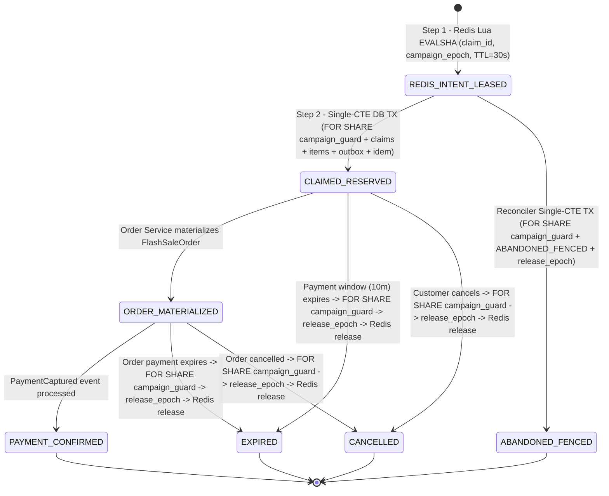
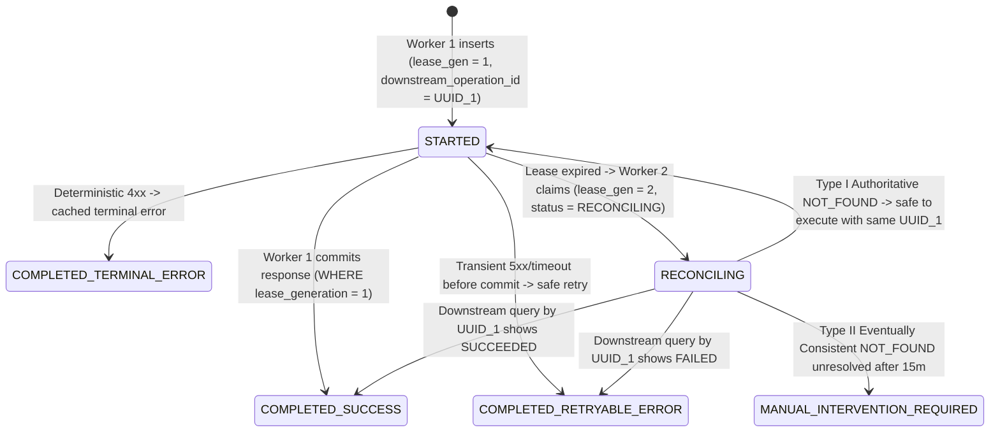

# Architecture Challenge Refinement & Final Freeze (`M0.3` — `CH-01` through `CH-07`)

- **Document ID:** `DCP-DOC-ARCH-008`
- **Decision Register:** [`DECISION_REGISTER.md`](file:///home/anhltn/projects/distributed-commerce-platform/docs/architecture/DECISION_REGISTER.md)
- **Verification Reports:** [`M0_2_2_ARCHITECTURE_VERIFICATION_REPORT.md`](file:///home/anhltn/projects/distributed-commerce-platform/M0_2_2_ARCHITECTURE_VERIFICATION_REPORT.md), [`M0_2_3_CONCURRENCY_CORRECTIONS.md`](file:///home/anhltn/projects/distributed-commerce-platform/M0_2_3_CONCURRENCY_CORRECTIONS.md), [`M0_2_4_FINAL_FENCING_REVIEW.md`](file:///home/anhltn/projects/distributed-commerce-platform/M0_2_4_FINAL_FENCING_REVIEW.md), [`M0_2_5_LOCK_AND_KAFKA_OWNERSHIP_REVIEW.md`](file:///home/anhltn/projects/distributed-commerce-platform/M0_2_5_LOCK_AND_KAFKA_OWNERSHIP_REVIEW.md)
- **Status:**
  - Foundational Decisions (`Q1–Q7`): **`ACCEPTED`**
  - `CH-01` through `CH-07`: **`DESIGN_ACCEPTED` (Frozen in `M0.3` with Simplified `CH-04` Consumer-Boundary Ordering Contract)**
- **Last Updated:** 2026-04-11

---

## Executive Overview of `M0.3` Frozen Architecture Decisions

In `M0.3`, the human decision-maker froze `CH-01` through `CH-07` at `DESIGN_ACCEPTED` as the implementation baseline:
- **`CH-01` (`DESIGN_ACCEPTED` — Least-Privilege `SECURITY DEFINER` Stored Procedures & Canonical Lock Ordering)**: Encapsulates all 8 Promotion mutation paths (`fn_mp01`–`fn_mp08`) in imperative PL/pgSQL `SECURITY DEFINER` stored procedures owned by a dedicated non-login, non-superuser role (`promotion_proc_owner NOLOGIN NOSUPERUSER NOCREATEDB NOCREATEROLE`) with `SET search_path = pg_catalog, public` and explicit `EXECUTE` grants to `promotion_app_role`. Direct `INSERT, UPDATE, DELETE` privileges on protected tables (`flash_sale_campaigns`, `flash_sale_claims`, `flash_sale_items`, `outbox_messages`, `idempotency_records`) are revoked from `promotion_app_role`. Every path locks `flash_sale_campaigns` first (`FOR SHARE` for normal paths, `FOR UPDATE` for Rebuilder), then `flash_sale_claims` (`ORDER BY claim_id ASC`), `flash_sale_items` (`ORDER BY item_id ASC`), `outbox_messages`, and `idempotency_records`. The custom GUC witness (`promotion.locked_campaign_<uuid>`) is documented strictly as an **accidental-bug guard for privileged maintenance scripts/functions** and **not** an independent security boundary.
- **`CH-02` (`DESIGN_ACCEPTED`)**: Explicit `Order` and `PaymentAttempt` transition matrices, separated provider-reported facts (`provider_authorized_at`, `provider_captured_at`) from internal state transitions, and deterministic `refund_requests` (`UNIQUE (attempt_id, reason_code)`) for late-capture-after-void auto-refunds.
- **`CH-03` (`DESIGN_ACCEPTED`)**: Class A local DB + outbox atomicity; Class B `lease_generation` fencing + immutable `downstream_operation_id` + `RECONCILING` state + `MANUAL_INTERVENTION_REQUIRED` after `15m` for Type II eventually consistent downstreams.
- **`CH-04` (`DESIGN_ACCEPTED` — Simplified At-Least-Once Outbox + Consumer-Boundary Ordering)**: Supersedes `HD-04` (generation-scoped Kafka `transactional.id` broker fencing). Uses standard idempotent Kafka producers (`partition_key = aggregate_id`), lowest unpublished `aggregate_version` per aggregate per cycle (`DISTINCT ON (aggregate_id)`), and PostgreSQL shard lease coordination (`outbox_relay_shards`, without claiming that a DB lease fences a running Kafka producer). Strict per-aggregate ordering and state correctness are enforced at the **Consumer Boundary** via atomic `inbox_messages` deduplication and sequential version checks (`incoming.version == last_applied_version + 1`; `<= last_applied_version` is a stale/duplicate no-op; `> last_applied_version + 1` is deferred/retried and never skipped).
- **`CH-05` (`DESIGN_ACCEPTED`)**: Standards-compliant OIDC + RFC 9068 OAuth2 access token validation, ID token rejection on API calls, principal-type separation (`HUMAN_PRINCIPAL` vs `SERVICE_PRINCIPAL`), and target-service scoped role extraction.
- **`CH-06` (`DESIGN_ACCEPTED`, Benchmark Targets `NEEDS_EVIDENCE`)**: PostgreSQL 17 FTS initially + `pgvector` with generation isolation (`embedding_index_generations`) and verified `2,000d` (`vector`) vs `4,000d` (`halfvec`) ANN index ceilings; latency and recall targets remain `NEEDS_EVIDENCE`.
- **`CH-07` (`DESIGN_ACCEPTED`)**: Server-side fault profiles (`fault-profiles.yaml`), strict target allowlists, non-production only, W3C baggage never trusted for auth, mandatory audit logging, and a fail-closed production startup panic.

---

## `CH-01`: Redis / PostgreSQL Flash Sale Claim Lifecycle, Lock-Serialized Epoch Fencing & Rebuild

- **Status:** `DESIGN_ACCEPTED` (Frozen in `M0.3` — Least-Privilege `promotion_proc_owner`, Safe `search_path`, Explicit `EXECUTE` Grants, and GUC Witness Clarification)
- **Related ADR:** [`ADR-0005`](file:///home/anhltn/projects/distributed-commerce-platform/docs/adr/ADR-0005-flash-sale-concurrency-and-three-tier-locking.md)
- **Detailed Concurrency Report:** [`M0_2_3_CONCURRENCY_CORRECTIONS.md#2-ch-01-redesign`](file:///home/anhltn/projects/distributed-commerce-platform/M0_2_3_CONCURRENCY_CORRECTIONS.md)

### 1. Strict Lock Acquisition Order & Single-Statement CTE Mutations (`promotion_db`)

To prevent deadlocks and guarantee that **no old-epoch transaction can ever commit after `TX_REBUILDER` begins reading the authoritative snapshot** (without relying on any fixed sleep timer), every Flash Sale transaction acquires locks in strict topological order:
$$\text{1. } \texttt{flash\_sale\_campaigns} \longrightarrow \text{2. } \texttt{flash\_sale\_claims} \longrightarrow \text{3. } \texttt{flash\_sale\_items} \longrightarrow \text{4. } \texttt{outbox\_messages} \longrightarrow \text{5. } \texttt{idempotency\_records}$$



#### 1.1 Schema & Engine-Level Epoch Fencing Trigger (`flash_sale_campaigns` & `flash_sale_claims`)
```sql
CREATE TABLE flash_sale_campaigns (
    campaign_id             UUID PRIMARY KEY,
    name                    VARCHAR(128) NOT NULL,
    status                  VARCHAR(32)  NOT NULL CHECK (status IN (
                                'DRAFT', 'APPROVED', 'WARMED', 'ACTIVE',
                                'REBUILDING_GATE', 'ENDED', 'RECONCILED'
                            )),
    current_epoch           BIGINT       NOT NULL DEFAULT 1,
    starts_at               TIMESTAMPTZ  NOT NULL,
    ends_at                 TIMESTAMPTZ  NOT NULL,
    updated_at              TIMESTAMPTZ  NOT NULL DEFAULT NOW()
);

CREATE TABLE flash_sale_claims (
    claim_id                UUID PRIMARY KEY,
    campaign_id             UUID NOT NULL REFERENCES flash_sale_campaigns(campaign_id),
    campaign_epoch          BIGINT NOT NULL,
    release_epoch           BIGINT NULL,
    sku_id                  UUID NOT NULL,
    customer_id             UUID NOT NULL,
    idempotency_key         VARCHAR(128) NOT NULL,
    quantity                INTEGER NOT NULL CHECK (quantity > 0),
    status                  VARCHAR(32) NOT NULL CHECK (status IN (
                                'CLAIMED_RESERVED',
                                'ORDER_MATERIALIZED',
                                'PAYMENT_CONFIRMED',
                                'CANCELLED',
                                'EXPIRED',
                                'ABANDONED_FENCED'
                            )),
    intent_lease_expires_at TIMESTAMPTZ NOT NULL,
    payment_expires_at      TIMESTAMPTZ NOT NULL,
    stock_returned_to_redis BOOLEAN NOT NULL DEFAULT FALSE,
    version                 BIGINT NOT NULL DEFAULT 0,
    created_at              TIMESTAMPTZ NOT NULL DEFAULT NOW(),
    updated_at              TIMESTAMPTZ NOT NULL DEFAULT NOW(),
    CONSTRAINT uq_flash_claim_idem UNIQUE (campaign_id, customer_id, idempotency_key)
);

CREATE UNIQUE INDEX uq_flash_active_customer_sku
    ON flash_sale_claims (campaign_id, sku_id, customer_id)
    WHERE status IN ('CLAIMED_RESERVED', 'ORDER_MATERIALIZED', 'PAYMENT_CONFIRMED');

-- Non-locking pre-lock witness trigger (M0.2.5 — prevents Table 2/3 -> Table 1 AB-BA deadlock edges):
-- Application role (promotion_app_role) has REVOKE INSERT, UPDATE, DELETE on flash_sale_campaigns,
-- flash_sale_claims, and flash_sale_items, and may only invoke SECURITY DEFINER functions fn_mp01..fn_mp08.
CREATE OR REPLACE FUNCTION fn_verify_campaign_prelocked()
RETURNS TRIGGER LANGUAGE plpgsql AS $$
DECLARE
    v_campaign_id  UUID := COALESCE(NEW.campaign_id, OLD.campaign_id);
    v_locked_epoch TEXT;
BEGIN
    v_locked_epoch := current_setting(
        'promotion.locked_campaign_' || replace(v_campaign_id::text, '-', ''),
        true
    );
    IF v_locked_epoch IS NULL OR v_locked_epoch = '' THEN
        RAISE EXCEPTION 'LOCK_ORDER_VIOLATION: flash_sale_campaigns(%) must be locked before mutating %',
            v_campaign_id, TG_TABLE_NAME USING ERRCODE = 'P0004';
    END IF;
    RETURN COALESCE(NEW, OLD);
END;
$$;

CREATE TRIGGER trg_verify_claims_campaign_prelocked
BEFORE INSERT OR UPDATE OR DELETE ON flash_sale_claims
FOR EACH ROW EXECUTE FUNCTION fn_verify_campaign_prelocked();

CREATE TRIGGER trg_verify_items_campaign_prelocked
BEFORE INSERT OR UPDATE OR DELETE ON flash_sale_items
FOR EACH ROW EXECUTE FUNCTION fn_verify_campaign_prelocked();
```

> [!IMPORTANT]
> **Complete Imperative `SECURITY DEFINER` Stored Procedures (`fn_mp01` through `fn_mp08`)**:
> See [`M0_2_5_LOCK_AND_KAFKA_OWNERSHIP_REVIEW.md#232`](file:///home/anhltn/projects/distributed-commerce-platform/M0_2_5_LOCK_AND_KAFKA_OWNERSHIP_REVIEW.md) for the complete PL/pgSQL definitions of all 8 mutation paths (`fn_mp01_writer_claim`, `fn_mp02_reconcile_fenced`, `fn_mp03_expire_or_cancel`, `fn_mp04_restock_finalize`, `fn_mp05_order_payment_progress`, `fn_mp06_admin_configure_item`, `fn_mp07_rebuilder_fence_and_snapshot`, `fn_mp08_campaign_lifecycle`), where `Step 1` imperatively locks `flash_sale_campaigns` and sets `promotion.locked_campaign_<uuid>` before `Step 2` (`flash_sale_claims`) or `Step 3` (`flash_sale_items`) executes.

#### 1.2 Exact Single-Statement Data-Modifying CTE for Writer (`TX_WRITER`)
All five steps execute inside **one single-roundtrip SQL statement** (with session timeouts `statement_timeout = '3s'`, `idle_in_transaction_session_timeout = '3s'`, `lock_timeout = '2s'`), eliminating any possibility of a client JVM/.NET pause between statements while holding an open transaction:
```sql
WITH
campaign_guard AS (
    SELECT campaign_id, current_epoch
    FROM flash_sale_campaigns
    WHERE campaign_id = :campaignId
      AND current_epoch = :redisClaimEpoch
      AND status = 'ACTIVE'
    FOR SHARE
),
inserted_claim AS (
    INSERT INTO flash_sale_claims (
        claim_id, campaign_id, campaign_epoch, sku_id, customer_id, idempotency_key,
        quantity, status, intent_lease_expires_at, payment_expires_at
    )
    SELECT
        :claimId, cg.campaign_id, cg.current_epoch, :skuId, :customerId, :idempotencyKey,
        :qty, 'CLAIMED_RESERVED', :intentExpiresAt, :paymentExpiresAt
    FROM campaign_guard cg
    ON CONFLICT (claim_id) DO NOTHING
    RETURNING claim_id, campaign_id, sku_id, quantity, status
),
updated_item AS (
    UPDATE flash_sale_items fsi
    SET claimed_count = fsi.claimed_count + ic.quantity
    FROM inserted_claim ic
    WHERE fsi.campaign_id = ic.campaign_id
      AND fsi.sku_id = ic.sku_id
      AND fsi.claimed_count + ic.quantity <= fsi.allocated_quota
    RETURNING fsi.sku_id
),
inserted_outbox AS (
    INSERT INTO outbox_messages (
        event_id, shard_id, aggregate_type, aggregate_id, aggregate_version,
        event_type, topic, partition_key, payload, headers
    )
    SELECT
        :eventId, mod(abs(hashtext(:customerId::text)), 16), 'FlashSaleClaim', ic.claim_id::text, 1,
        'commerce.flashsale.slot_claimed.v1', 'commerce.flashsale.events.v1',
        :customerId::text, :payloadJsonb, :headersJsonb
    FROM inserted_claim ic
    JOIN updated_item ui ON ui.sku_id = ic.sku_id
    RETURNING event_id
),
completed_idem AS (
    UPDATE idempotency_records
    SET status = 'COMPLETED_SUCCESS', http_status_code = 202,
        response_payload = :responseJsonb, updated_at = NOW()
    WHERE scope_owner_id = :customerId
      AND endpoint_id = 'POST:/api/v1/flash-sales/claim'
      AND idempotency_key = :idempotencyKey
      AND lease_generation = :expectedLeaseGen
      AND EXISTS (SELECT 1 FROM inserted_outbox)
    RETURNING idempotency_key
)
SELECT
    (SELECT COUNT(*) FROM campaign_guard) AS epoch_valid,
    (SELECT status FROM inserted_claim) AS inserted_status,
    (SELECT COUNT(*) FROM updated_item) AS quota_updated,
    (SELECT status FROM flash_sale_claims WHERE claim_id = :claimId) AS existing_status;
```

#### 1.3 Exact Single-Statement CTE for Reconciler (`TX_RECONCILER`) & Epoch-Checked `flash_sale_release.lua`
```sql
WITH campaign_guard AS (
    SELECT campaign_id, current_epoch
    FROM flash_sale_campaigns
    WHERE campaign_id = :campaignId
      AND current_epoch = :redisClaimEpoch
      AND status = 'ACTIVE'
    FOR SHARE
),
fenced_claim AS (
    INSERT INTO flash_sale_claims (
        claim_id, campaign_id, campaign_epoch, release_epoch, sku_id, customer_id,
        idempotency_key, quantity, status, intent_lease_expires_at, payment_expires_at,
        stock_returned_to_redis
    )
    SELECT
        :claimId, cg.campaign_id, cg.current_epoch, cg.current_epoch, :skuId, :customerId,
        :idempotencyKey, :qty, 'ABANDONED_FENCED', :intentExpiresAt, :intentExpiresAt,
        FALSE
    FROM campaign_guard cg
    ON CONFLICT (claim_id) DO NOTHING
    RETURNING claim_id, status, release_epoch
)
SELECT
    (SELECT COUNT(*) FROM campaign_guard) AS epoch_valid,
    (SELECT status FROM fenced_claim) AS fenced_status,
    (SELECT release_epoch FROM fenced_claim) AS release_epoch,
    (SELECT status FROM flash_sale_claims WHERE claim_id = :claimId) AS existing_status;
```
- **Why Cross-Epoch Releases Cannot Inflate Stock (`F-12` Proof)**:
  - Every `ABANDONED_FENCED`, `EXPIRED`, or `CANCELLED` mutation records `release_epoch = current_epoch` while holding `FOR SHARE` on `flash_sale_campaigns`.
  - `flash_sale_release.lua` validates `tonumber(redis.call('HGET', KEYS[1], 'epoch')) == tonumber(ARGV[3])` (`release_epoch`) and clamps `new_stock = math.min(allocated_quota, current_stock + add_qty)`.
  - If a Redis rebuild (`TX_REBUILDER_FENCE_AND_SNAPSHOT`) occurs first and advances `current_epoch` to `E + 1`, the Rebuilder's snapshot (`allocated_quota - SUM(active_claims)`) **already restores all freed stock from epochs `<= E`** and marks all `stock_returned_to_redis = FALSE` rows as `TRUE` inside the same `FOR UPDATE` transaction! Any in-flight RPC calling `flash_sale_release.lua` with `release_epoch = E < E + 1` is rejected by Redis Lua (`return -2`).

### 2. Sleep-Free `REBUILDING_GATE` Exclusive Lock & Zombie Termination Protocol (`F-11` Fix)
When `Promotion Service` detects a Redis restart/failover or missing/mismatched epoch:
1. **Step R0 (Active Zombie Backend Termination)**: Terminate any stalled backend holding a lock on `flash_sale_campaigns` for `> 3 seconds`:
   ```sql
   SELECT pg_terminate_backend(l.pid)
   FROM pg_locks l
   JOIN pg_stat_activity a ON a.pid = l.pid
   WHERE l.relation = 'flash_sale_campaigns'::regclass
     AND l.granted = TRUE
     AND a.pid <> pg_backend_pid()
     AND (NOW() - a.xact_start) > INTERVAL '3 seconds';
   ```
2. **Step R1 (`TX_REBUILDER_FENCE_AND_SNAPSHOT` — Exclusive `FOR UPDATE` Lock + Snapshot in One DB TX)**:
   - Execute `UPDATE flash_sale_campaigns SET status = 'REBUILDING_GATE', current_epoch = current_epoch + 1 WHERE campaign_id = :id RETURNING current_epoch`.
   - Because `UPDATE` acquires an exclusive `FOR UPDATE` lock on `flash_sale_campaigns` that conflicts with `FOR SHARE`, PostgreSQL's lock manager **blocks Step R1 until 100% of open `TX_WRITER`, `TX_RECONCILER`, and `TX_EXPIRE_OR_CANCEL` transactions holding `FOR SHARE` have committed or rolled back**, and blocks any new `FOR SHARE` locker until Step R1 commits!
   - Inside the **same transaction**, mark all prior `EXPIRED`/`CANCELLED`/`ABANDONED_FENCED` rows (`stock_returned_to_redis = TRUE`), reconcile `flash_sale_items.claimed_count`, and read the authoritative `remaining_stock` and active `buyers` map.
3. **Step R2 & R3 (Redis Reconstruction & Activation)**:
   - Write the snapshot and `epoch = :newEpoch` into Redis while `status = 'REBUILDING_GATE'` prevents any DB mutations, then flip Redis and `flash_sale_campaigns.status` back to `'ACTIVE'`.

---

## `CH-02`: Orthogonal Order & Payment State Machines (Provider Facts vs. Internal State)

- **Status:** `DESIGN_ACCEPTED` (Frozen in `M0.3`)
- **Related ADR:** [`ADR-0004`](file:///home/anhltn/projects/distributed-commerce-platform/docs/adr/ADR-0004-hybrid-order-fulfillment-saga-orchestration.md)

### 1. Strict Separation of Provider-Reported Facts vs. Internal State (`F-04` Correction)
A financial ledger must **never fabricate timestamps**. If an external provider sends only a `payment.captured` webhook (either because it is a one-step direct capture method or because the `payment.authorized` webhook was dropped/delayed), `payment_attempts` sets **only** `provider_captured_at = webhook.occurred_at` and leaves `provider_authorized_at = NULL` until an actual `payment.authorized` event is received.

```mermaid
stateDiagram-v2
    [*] --> INITIATED : CreatePaymentAttempt
    INITIATED --> AUTHORIZED : webhook payment.authorized (sets provider_authorized_at)
    INITIATED --> CAPTURED : webhook payment.captured (sets provider_captured_at; provider_authorized_at stays NULL)
    INITIATED --> FAILED : webhook payment.failed / timeout
    AUTHORIZED --> CAPTURE_PENDING : Saga issues CapturePayment
    AUTHORIZED --> VOID_PENDING : Saga issues VoidPayment (Order expired/cancelled)
    CAPTURE_PENDING --> CAPTURED : webhook payment.captured
    CAPTURE_PENDING --> FAILED : webhook payment.capture_failed
    VOID_PENDING --> VOIDED : webhook payment.voided
    VOID_PENDING --> REFUND_PENDING : Late webhook payment.captured beat Void -> refund_requests -> Auto-Refund
    VOIDED --> REFUND_PENDING : Late webhook payment.captured after Void -> refund_requests -> Auto-Refund
    CAPTURED --> REFUND_PENDING : Saga issues RefundPayment (late payment or return)
    REFUND_PENDING --> Partially_Or_Fully_Refunded : webhook payment.refunded
```



#### 1.1 Corrected `payment_attempts`, `payment_webhook_logs` & `refund_requests` Schema (`payment_db`)
```sql
CREATE TABLE payment_webhook_logs (
    provider_event_id       VARCHAR(128) PRIMARY KEY,
    attempt_id              UUID NOT NULL,
    event_type              VARCHAR(64) NOT NULL,
    provider_occurred_at    TIMESTAMPTZ NOT NULL,
    raw_payload             JSONB NOT NULL,
    processing_outcome      VARCHAR(64) NOT NULL,   -- 'APPLIED', 'NOOP_DUPLICATE', 'NOOP_OUT_OF_ORDER', 'TRIGGERED_COMPENSATION'
    received_at             TIMESTAMPTZ NOT NULL DEFAULT NOW()
);

CREATE TABLE refund_requests (
    refund_id               UUID PRIMARY KEY,
    attempt_id              UUID NOT NULL REFERENCES payment_attempts(attempt_id),
    order_id                UUID NOT NULL,
    reason_code             VARCHAR(64) NOT NULL,   -- 'LATE_CAPTURE_AFTER_EXPIRY', 'LATE_CAPTURE_AFTER_VOID', 'CUSTOMER_REFUND'
    refund_idempotency_key  VARCHAR(128) NOT NULL UNIQUE,
    amount                  NUMERIC(19, 4) NOT NULL CHECK (amount > 0),
    status                  VARCHAR(32) NOT NULL CHECK (status IN ('PENDING', 'COMPLETED', 'FAILED')),
    provider_refunded_at    TIMESTAMPTZ NULL,
    created_at              TIMESTAMPTZ NOT NULL DEFAULT NOW(),
    CONSTRAINT uq_attempt_refund_reason UNIQUE (attempt_id, reason_code)
);
```

### 2. Exhaustive Webhook & Command Transition Matrix (Including Missing & Contradictory Webhooks)

All three mutations (`INSERT INTO payment_webhook_logs`, `UPDATE payment_attempts`, and `INSERT INTO outbox_messages` / `refund_requests`) execute in **one local PostgreSQL transaction**:

| Current `PaymentAttempt.status` | Incoming Provider Webhook / Saga Command | Next `status` | Provider Fact Columns Updated | Outbox / Compensation Action (Same DB TX) |
| :--- | :--- | :--- | :--- | :--- |
| *Any State* | Any webhook whose `provider_event_id` already exists in `payment_webhook_logs` | *Unchanged* | None | `NOOP_DUPLICATE_EVENT_ID` (Return `200 OK`) |
| `INITIATED` | `webhook: payment.authorized` | `AUTHORIZED` | `provider_authorized_at = evt.ts` | Emit `PaymentAuthorized` |
| `INITIATED` | `webhook: payment.captured` *(Direct Capture or Missing Auth Webhook)* | `CAPTURED` | `provider_captured_at = evt.ts` *(Notice: `provider_authorized_at` stays `NULL`!)* | Emit `PaymentCaptured` |
| `INITIATED` | `webhook: payment.failed` | `FAILED` | `provider_failed_at = evt.ts` | Emit `PaymentAttemptFailed` |
| `AUTHORIZED` | `webhook: payment.authorized` *(Duplicate Auth with new event ID)* | `AUTHORIZED` | `provider_authorized_at = COALESCE(provider_authorized_at, evt.ts)` | `NOOP_ALREADY_AUTHORIZED` |
| `AUTHORIZED` | `Command: CapturePayment` | `CAPTURE_PENDING` | None | Dispatch capture to provider (`idempotency_key = attempt_id || ':capture'`) |
| `AUTHORIZED` | `Command: VoidPayment` *(Order Expired/Cancelled)* | `VOID_PENDING` | None | Dispatch void to provider (`idempotency_key = attempt_id || ':void'`) |
| `CAPTURED` | `webhook: payment.authorized` *(Out-of-Order Late Auth Webhook)* | `CAPTURED` *(Unchanged)* | `provider_authorized_at = COALESCE(provider_authorized_at, evt.ts)` | `NOOP_OUT_OF_ORDER_FACT_RECORDED` (Zero Outbox events emitted) |
| `CAPTURED` | `webhook: payment.captured` *(Duplicate Capture with new event ID)* | `CAPTURED` *(Unchanged)* | None | `NOOP_ALREADY_CAPTURED` |
| `CAPTURED` | `webhook: payment.failed` *(Contradictory Failure After Capture)* | `CAPTURED` *(Unchanged)* | Log anomaly in `payment_webhook_logs` | Emit `PaymentAnomalyDetected` alert; never downgrade `CAPTURED` to `FAILED`! |
| `VOID_PENDING` or `VOIDED` | `webhook: payment.captured` *(Contradictory Late Capture Beat Void!)* | `REFUND_PENDING` | `provider_captured_at = evt.ts` | Insert `refund_requests (reason='LATE_CAPTURE_AFTER_VOID') ON CONFLICT DO NOTHING` + Emit `PaymentAutoRefundInitiated` |
| `FAILED` | `webhook: payment.captured` *(Contradictory Capture After Failure)* | `CAPTURED` (if `Order` still `AWAITING_PAYMENT`) or `REFUND_PENDING` (if `Order` expired/paid by another attempt) | `provider_captured_at = evt.ts` | Evaluated against `Order` state; if `Order` already has another captured attempt or is `EXPIRED`, auto-refund via `refund_requests`! |

---

## `CH-03`: Class B Idempotency — Stale Worker Socket Analysis & Authoritative vs. Eventual `NOT_FOUND`

- **Status:** `DESIGN_ACCEPTED` (Frozen in `M0.3`)
- **Related ADR:** [`ADR-0003`](file:///home/anhltn/projects/distributed-commerce-platform/docs/adr/ADR-0003-transactional-outbox-and-inbox-idempotency.md)

### 1. Adversarial Analysis: Can a Stale Worker Still Invoke an External Provider After Losing Its Lease? (`F-06`)
**Question**: Suppose Worker 1 (`lease_generation = 1`) acquires `idempotency_records` (`lease_expires_at = T + 30s`), prepares an HTTP request to an external provider, and freezes due to a `35s` JVM/CLR GC pause right before `socket.write()`. At $T + 31\text{s}$, Worker 2 steals the lease (`lease_generation = 2`). At $T + 35\text{s}$, Worker 1 unfreezes and flushes its TCP socket. **Does our local database `lease_generation` prevent Worker 1's packet from reaching the external provider?**
- **Honest Engineering Answer**: **NO.** No database lock or fencing token inside `Service A` can stop a paused OS thread inside `Service A` from transmitting an already-prepared TCP packet to an external system that does not check `Service A`'s fencing token!
- **How Correctness Is Guaranteed Across Both Layers**:
  1. **Layer 1 — Downstream Provider Idempotency / Fencing**:
     - Both Worker 1 (`lease_gen = 1`) and Worker 2 (`lease_gen = 2`) MUST pass the **exact same immutable `downstream_operation_id`** (assigned at `lease_generation = 1` before any external call) to the downstream provider.
     - For **Redis Lua** (which we control): We pass `ARGV[5] = lease_generation` into the Lua script, and Redis records `max_seen_lease_gen` per `claim_id`—so Redis **actively rejects** Worker 1's stale `lease_gen = 1` packet at the target resource!
     - For **External HTTP Payment Providers**: The provider deduplicates Worker 1 and Worker 2 using `Idempotency-Key: <downstream_operation_id>`.
  2. **Layer 2 — Local Database Fencing (`WHERE lease_generation = :expectedGen`)**:
     - When Worker 1 (`lease_gen = 1`) receives the response from its late TCP call and tries to `UPDATE idempotency_records ... WHERE lease_generation = 1`, PostgreSQL updates **`0` rows**, preventing Worker 1 from corrupting our local database or emitting duplicate Outbox events.

### 2. Authoritative vs. Eventually Consistent `NOT_FOUND` During `RECONCILING`



When Worker 2 (`lease_generation > 1`) enters `RECONCILING` and queries the downstream system by `downstream_operation_id`:

| Downstream System Type | Meaning of `NOT_FOUND` Response During `RECONCILING` | Allowed Recovery Action |
| :--- | :--- | :--- |
| **Type I: Strongly Consistent Read-After-Write + Idempotent on `downstream_operation_id`** *(e.g., Redis primary on same epoch, Payment Simulator / Stripe API with `Idempotency-Key`)* | Either the prior packet never reached the downstream system, OR if a paused Worker 1 packet arrives later, the downstream system will deduplicate it using `downstream_operation_id`. | Safe to transition `RECONCILING -> STARTED` and invoke downstream using the **same `downstream_operation_id`**. |
| **Type II: Eventually Consistent Read Endpoint OR Non-Idempotent Downstream** | **`NOT_FOUND` is NOT authoritative!** The prior call may already be queued/committed on the provider's write node but not yet visible on its read replica. Re-invoking a non-idempotent call will double-execute! | **FORBIDDEN to re-invoke the external side effect!** Record must remain in `RECONCILING` (polling with exponential backoff `2s, 4s, 8s...`). If unresolved after `max_reconcile_duration` (`15m`), transition to **`MANUAL_INTERVENTION_REQUIRED`** (`503 Service Unavailable`, emitting `IdempotencyReconciliationStuckAlert` for Ops). |

---

## `CH-04`: Simplified At-Least-Once Outbox Relay & Consumer-Boundary Sequential Ordering

- **Status:** `DESIGN_ACCEPTED` (Simplified Contract Frozen in `M0.3`; `HD-04` Generation-Scoped `transactional.id` Broker Fencing `SUPERSEDED`)
- **Related ADRs:** [`ADR-0003`](file:///home/anhltn/projects/distributed-commerce-platform/docs/adr/ADR-0003-transactional-outbox-and-inbox-idempotency.md), [`ADR-0010`](file:///home/anhltn/projects/distributed-commerce-platform/docs/adr/ADR-0010-event-contracts-json-schema-and-kafka-kraft.md)

### 1. Simplified Outbox & Consumer-Boundary Ordering Contract (`M0.3` Freeze)

In `M0.3`, the previous generation-scoped Kafka `transactional.id` broker-fencing design (`HD-04` from `M0.2.5`) is marked **`SUPERSEDED`** and replaced with a pragmatic, industry-standard division of responsibility between the **Outbox Relay** and the **Consumer Inbox**:

1. **Explicit Distinction of Ordering Guarantees**:
   - **Kafka Delivery Order (`At-Least-Once`, Best-Effort Partition Order)**: Standard idempotent Kafka producers (`enable.idempotence=true`, `acks=all`) publish messages with `partition_key = aggregate_id`.
   - **PostgreSQL Lease Coordination (`outbox_relay_shards`)**: Relay workers coordinate shard ownership via `outbox_relay_shards (shard_id, owner_pod, fencing_epoch, lease_until)` to minimize duplicate polling. **We explicitly do NOT claim that a PostgreSQL lease fences an already-running paused Kafka producer at the broker.** If a relay worker pauses past `lease_until`, duplicate delivery or a temporary version inversion (`v+1` arriving before `v`) on the Kafka partition is tolerated.
   - **Consumer Application Order (`Strictly Sequential per Aggregate`)**: Consumers enforce atomic `inbox_messages (event_id, consumer_group)` deduplication and strict version continuity (`incoming.aggregate_version == aggregate.last_applied_version + 1`) inside a single local database transaction:
     - `incoming.aggregate_version <= last_applied_version`: Duplicate or stale delivery -> **idempotent no-op** (acknowledged and ignored).
     - `incoming.aggregate_version == last_applied_version + 1`: Next expected version -> **applied atomically** and `last_applied_version` incremented.
     - `incoming.aggregate_version > last_applied_version + 1`: Out-of-order version gap -> **buffered/deferred for bounded retry** (`SEQUENCE_GAP_DETECTED`); **never applied early and never skipped**.
   - **Aggregate State Correctness (`Deterministic`)**: Because the consumer boundary enforces exact sequential application (`v = 1, 2, 3...`), downstream aggregate state and Saga transitions are 100% deterministic without requiring broker-level generation fencing.
2. **Head-of-Aggregate Single-Version-Per-Cycle (`DISTINCT ON (aggregate_id)`)**:
   - Each relay polling cycle selects at most **one** event (the lowest unpublished `aggregate_version`) per `aggregate_id` (`SELECT DISTINCT ON (aggregate_id) ... WHERE processed_at IS NULL ORDER BY aggregate_id, aggregate_version ASC, outbox_sequence ASC LIMIT 100`), publishes to Kafka with `key = aggregate_id`, and marks `processed_at = NOW()` where `processed_at IS NULL`.

---

## `CH-05`: OIDC / RFC 9068 Access Token Validation & Privilege Escalation Prevention

- **Status:** `DESIGN_ACCEPTED` (Frozen in `M0.3`)
- **Related ADR:** [`ADR-0006`](file:///home/anhltn/projects/distributed-commerce-platform/docs/adr/ADR-0006-api-gateway-yarp-and-oidc-jwt-security.md)

### 1. Eliminating Cross-Service Role Union Privilege Escalation (`F-08` Fix)
In `M0.2.1`, we wrote `roles = union(jwt.roles, jwt.realm_access.roles, jwt.resource_access["commerce-api"].roles)`. Under adversarial review, a flat union without principal-type separation creates two escalation risks:
1. If an M2M service client in Keycloak accidentally inherits a default realm role (e.g., `CUSTOMER`), a background service token could invoke customer-only endpoints.
2. If Service X checks `resource_access` without scoping to its own `service_id`, a client role meant only for `notification-service` could be accepted by `payment-service`.

#### 1.1 Corrected RFC 9068 Claim Validation & Principal Separation Rules
1. **Mandatory RFC 9068 Header & Claim Checks**:
   - `alg`: Must be `"RS256"` (allowlist of asymmetric algorithms; `"none"` and `"HS256"` rejected).
   - `typ`: Must be `"at+jwt"` or `"JWT"`. (Any OIDC `id_token` has `aud = "commerce-web-spa"` and lacks `"commerce-api"`, and is rejected with `401 Unauthorized`).
   - `iss`: Exact string match against `AUTH_ISSUER_URI`.
   - `aud`: Must contain `"commerce-api"` (for external routes) OR the target service's exact identifier (e.g., `"inventory-service"` for internal M2M routes).
   - `exp`, `iat`, `nbf`: Validated with `<= 30s` clock skew.
   - `sub` & `jti`: Must be non-empty strings.
2. **Strict Principal-Type Separation (`HUMAN_PRINCIPAL` vs. `SERVICE_PRINCIPAL`)**:
   - If `jwt.client_id` / `jwt.azp` is in the registered M2M service client list (or `jwt.sub` starts with `"service-account-"`):
     - Classify principal as **`SERVICE_PRINCIPAL`**.
     - **Strip and ignore** any human roles (`CUSTOMER`, `ADMIN_MERCHANT`, `ADMIN_OPS`) even if present in the token!
     - Authorize **exclusively** via explicit `(resolved_client_id, SCOPE_*, SERVICE_ROLE_*)` allowlist rules on internal endpoints.
   - If principal is a **`HUMAN_PRINCIPAL`**:
     - Extract human realm roles only from the explicit allowlist `{"CUSTOMER", "ADMIN_MERCHANT", "ADMIN_OPS"}` present in `jwt.roles` or `jwt.realm_access.roles`.

---

## `CH-06`: `pgvector` Storage vs. ANN Index Limits & Benchmark Target Classification

- **Status:** `DESIGN_ACCEPTED` (Frozen in `M0.3`; Benchmark Targets `NEEDS_EVIDENCE`)
- **Related ADR:** [`ADR-0008`](file:///home/anhltn/projects/distributed-commerce-platform/docs/adr/ADR-0008-ai-agent-security-boundary-and-pgvector-rag.md)

### 1. Verified `pgvector` Physical Limits vs. Empirical Benchmark Targets (`F-09` Fix)

| Property | Value | Verification Classification |
| :--- | :--- | :--- |
| Max dimensions stored in unindexed `vector` or `halfvec` table column | `16,000` dimensions | **`VERIFIED`** (`pgvector` source constant `VECTOR_MAX_DIM`) |
| Max dimensions indexed by HNSW / IVFFlat for FP32 `vector` (`vector_cosine_ops`, `vector_l2_ops`, `vector_ip_ops`) | **`2,000` dimensions** | **`VERIFIED`** (PostgreSQL 8 KB index page limit; `3072d` `vector` HNSW fails with `ERROR: column cannot have more than 2000 dimensions for hnsw index`) |
| Max dimensions indexed by HNSW / IVFFlat for FP16 `halfvec` (`halfvec_cosine_ops`, `halfvec_l2_ops`, `halfvec_ip_ops`) | **`4,000` dimensions** | **`VERIFIED`** (`pgvector` `HALFVEC_MAX_DIM` for HNSW/IVFFlat; supports `3072d` natively) |
| Storage size reduction of `halfvec(D)` (2 bytes/float) vs. `vector(D)` (4 bytes/float) per tuple | `50%` vector payload size reduction | **`VERIFIED`** (IEEE 754 binary16 vs. binary32 arithmetic) |
| RAG `Recall@10 >= 0.95` and query latency `p95 < 50ms` for `halfvec` vs. `vector` on product catalog | Target SLO: `Recall@10 >= 0.95`, `p95 < 50ms` | **`NEEDS_EVIDENCE`** *(Empirical Benchmark Target — depends on catalog distribution and HNSW `m` / `ef_search`; to be measured in `M5/M7`, never claimed as an a priori guarantee)* |

---

## `CH-07`: Observability Trace Continuity & Fail-Closed Production Fault Injection Guard

- **Status:** `DESIGN_ACCEPTED` (Frozen in `M0.3`)
- **Related ADR:** [`ADR-0011`](file:///home/anhltn/projects/distributed-commerce-platform/docs/adr/ADR-0011-observability-opentelemetry-and-lgtm-stack.md)

### 1. Fail-Closed Production Startup & Triple-Gated Fault Injection (`F-10` Fix)
To guarantee that fault injection fails closed even if an operator misconfigures a ConfigMap in production:
1. **Gate 1 — Fail-Closed Startup Panic on Misconfiguration**:
   - At application startup (in Java `ApplicationRunner`, .NET `IHostedService`, and Python FastAPI `lifespan`), execute:
     ```text
     IF (ENVIRONMENT == "production" OR PRODUCTION_LOCK == "true") AND FAULT_INJECTION_ENABLED == true:
         LOG FATAL "SECURITY_VIOLATION: FAULT_INJECTION_ENABLED cannot be true when ENVIRONMENT=production"
         EXIT_PROCESS(1)
     ```
2. **Gate 2 — Absent DI Registration when `FAULT_INJECTION_ENABLED == false`**:
   - When `FAULT_INJECTION_ENABLED == false` (the default), the `FaultInjectionFilter` / interceptor bean is not instantiated or registered in the HTTP/Kafka pipeline, and the API Gateway unconditionally strips `X-Fault-Profile-Id` and removes `fault.profile_id` from W3C `baggage`.
3. **Gate 3 — Authorization + Server-Side Profile + Target Allowlist when `FAULT_INJECTION_ENABLED == true` (Non-Prod Chaos Mode)**:
   - Requires verified `HUMAN_PRINCIPAL` JWT with `ROLE_ADMIN_OPS` and `SCOPE_chaos:inject` (W3C `baggage` is never trusted for authorization).
   - Looks up `profile_id` in immutable server-side `fault-profiles.yaml`. Unknown `profile_id` returns `400 Bad Request (UNKNOWN_FAULT_PROFILE)`.
   - Verifies `current_service_name \in profile.allowedTargetServices` and `request_route \in profile.allowedTargetOperations`. Non-matching targets return `403 Forbidden (FAULT_TARGET_NOT_ALLOWED)`.
   - Emits a mandatory structured `WARN` audit log (`CHAOS_FAULT_PROFILE_ACTIVATED`).

### 2. Reproducible Test Specifications for `CH-01` through `CH-07` (`To Be Executed in M1–M7`)

> [!NOTE]
> Because `M0.2.3` is an architecture verification milestone with zero application code implemented yet, **none of the runtime tests below have been executed yet (`Status: NEEDS_EVIDENCE`)**. They are specified here as mandatory acceptance gates for `M1–M7`:

| Test ID | Challenge | Reproducible Test Specification | Expected Verification Result |
| :--- | :--- | :--- | :--- |
| `SPEC-CH01-T1` | `CH-01` | Use `CountDownLatch` in Testcontainers (`Postgres + Redis`): pause Writer `W1` before `TX_WRITER` commits; run Reconciler `R1` (`ABANDONED_FENCED`); release `W1`. | `W1` sees `0` rows inserted from `ON CONFLICT DO NOTHING`, queries status `'ABANDONED_FENCED'`, rolls back `TX_WRITER`, and Redis stock is incremented by `R1` **exactly once**. |
| `SPEC-CH01-T2` | `CH-01` | Expire a claim (`stock_returned_to_redis = TRUE`), delete `released_claims` key in Redis (simulating TTL expiry), and replay `FlashSaleClaimReleased` Kafka event. | Worker checks PostgreSQL `WHERE stock_returned_to_redis = FALSE`, updates `0` rows, and skips calling `flash_sale_release.lua` (`0` double-restock). |
| `SPEC-CH01-T3` | `CH-01` | Hold `SELECT ... FROM flash_sale_campaigns WHERE campaign_id = :id AND current_epoch = 1 FOR SHARE` open for `6s` while starting `TX_REBUILDER_FENCE_AND_SNAPSHOT`. | `idle_in_transaction_session_timeout = 3s` / `Step R0` (`pg_terminate_backend`) terminates the stalled backend, `TX_REBUILDER` bumps `current_epoch = 2`, and any late single-CTE Writer carrying `redisClaimEpoch = 1` matches `0` rows in `campaign_guard` and aborts. |
| `SPEC-CH01-T4` | `CH-01` | Expire claim `C1` in `epoch = 1` (`release_epoch = 1`), run `TX_REBUILDER_FENCE_AND_SNAPSHOT` (`current_epoch = 2`), and invoke `flash_sale_release.lua` with `ARGV[3] = 1`. | Redis Lua returns `-2` (`STALE_EPOCH`) and does not increment `epoch = 2` stock above `allocated_quota - claimed_count`. |
| `SPEC-CH01-T5` | `CH-01` | Attempt (a) `UPDATE flash_sale_claims SET stock_returned_to_redis = TRUE` with stale `release_epoch < current_epoch`, (b) `UPDATE flash_sale_claims SET status = 'ORDER_MATERIALIZED'` during `REBUILDING_GATE`, and (c) `UPDATE flash_sale_items` during `REBUILDING_GATE`. | All three mutations are blocked by `fn_mp04`/`fn_mp05`/`fn_mp06` and rejected (`SQLSTATE P0001`). |
| `SPEC-CH01-T6` | `CH-01` | Connect as `promotion_app_role` and attempt direct `SELECT * FROM flash_sale_claims FOR UPDATE` or `UPDATE flash_sale_claims`; connect as `promotion_proc_owner` and attempt direct `UPDATE flash_sale_claims` without setting `promotion.locked_campaign_<uuid>`. | `promotion_app_role` fails with `SQLSTATE 42501 (permission denied)`; `promotion_proc_owner` accidental direct query fails with `SQLSTATE P0004 (LOCK_ORDER_VIOLATION)` from `trg_verify_claims_campaign_prelocked` (accidental-bug guard). |
| `SPEC-CH02-T1` | `CH-02` | Send direct `webhook: payment.captured` to `INITIATED` `PaymentAttempt`. | `status` becomes `CAPTURED`, `provider_captured_at` is set, and `provider_authorized_at` remains `NULL` (not fabricated). |
| `SPEC-CH02-T2` | `CH-02` | Transition `PaymentAttempt` to `VOIDED`, then deliver two duplicate `payment.captured` webhooks (`W1`, `W2`). | Attempt transitions to `REFUND_PENDING`, `refund_requests` inserts `1` row (`UNIQUE (attempt_id, reason_code)`), and gateway refund is invoked **once**. |
| `SPEC-CH03-T1` | `CH-03` | Simulate Worker 1 (`lease_gen = 1`) freezing before external call, Worker 2 (`lease_gen = 2`) completing via `RECONCILING`, and Worker 1 waking up to send its external call and update DB. | Downstream deduplicates on `downstream_operation_id`; Worker 1's local DB update (`WHERE lease_generation = 1`) updates `0` rows. |
| `SPEC-CH04-T1` | `CH-04` | Insert 10 sequential events (`v=1..10`) for `orderId = O1` while running Outbox Relay threads using `DISTINCT ON (aggregate_id)`. | Each cycle claims only the lowest unpublished `aggregate_version` for `O1` with `partition_key = aggregate_id`. |
| `SPEC-CH04-T2` | `CH-04` | Deliver duplicate (`v=1`), out-of-order gap (`v=3`), and expected next (`v=2`) events for `O1` (`last_applied_version = 1`) to the Consumer Inbox. | `v=1` is ignored as an idempotent no-op, `v=3` is deferred (`SEQUENCE_GAP_DETECTED`), `v=2` is applied advancing `last_applied_version = 2`, and `v=3` is subsequently applied advancing `last_applied_version = 3`. |
| `SPEC-CH05-T1` | `CH-05` | Mint an M2M `client_credentials` token that maliciously includes `"roles": ["CUSTOMER", "ADMIN_OPS"]` in its payload, and call `POST /api/v1/orders` and `/api/v1/admin/products`. | Auth middleware classifies token as `SERVICE_PRINCIPAL`, strips human roles, and rejects both calls with `403 Forbidden`. |
| `SPEC-CH06-T1` | `CH-06` | Attempt `INSERT INTO embedding_index_generations (dimensions=3072, index_storage_type='VECTOR_FP32')` vs `index_storage_type='HALFVEC_FP16'`. | `VECTOR_FP32` at `3072d` is rejected by PostgreSQL `CHECK` constraint; `HALFVEC_FP16` succeeds and builds `USING hnsw ((embedding::halfvec(3072)) halfvec_cosine_ops)`. |
| `SPEC-CH07-T1` | `CH-07` | Start service with `ENVIRONMENT=production` and `FAULT_INJECTION_ENABLED=true`. | Process aborts startup immediately with `FatalSecurityConfigurationException` (`exitCode != 0`). |
| `SPEC-CH07-T2` | `CH-07` | In chaos mode (`ENVIRONMENT=chaos`, `FAULT_INJECTION_ENABLED=true`), send `X-Fault-Profile-Id: FP-PAY-TIMEOUT` with (a) `CUSTOMER` JWT (`403`), (b) `ADMIN_OPS` JWT to `product-service` (`403` target not allowlisted), and (c) unknown profile `FP-FAKE` (`400`). | All three unauthorized/invalid attempts fail closed and emit security warning logs. |
