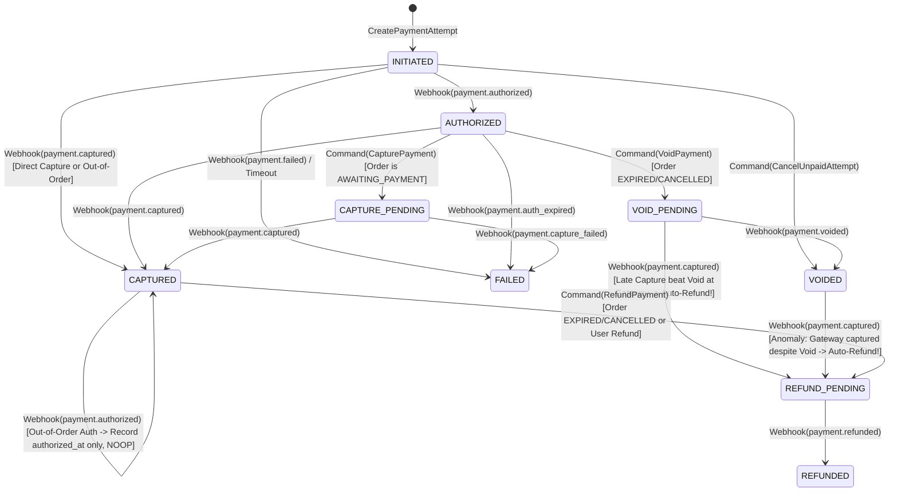
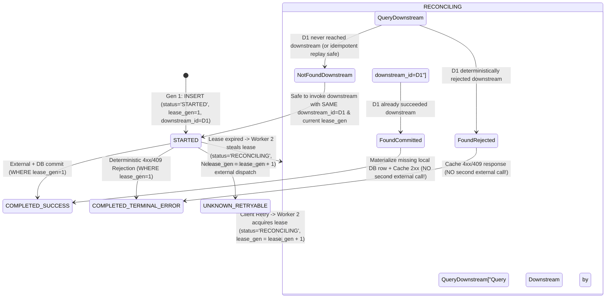

# Architecture Challenge Refinement (`M0.2.1` — Final Corrections for `CH-01` through `CH-07`)

- **Document ID:** `DCP-DOC-ARCH-008`
- **Status:**
  - Foundational Decisions (`Q1–Q7`): **`ACCEPTED`**
  - `CH-01`, `CH-05`, `CH-07`: **`PROPOSED` (Design Direction Approved — Pending Final Validation Sign-Off)**
  - `CH-02`, `CH-03`, `CH-04`, `CH-06`: **`PROPOSED` (Final Corrections Applied in `M0.2.1` — Pending User Sign-Off)**
- **Last Updated:** 2026-11-10

---

## Executive Overview of `M0.2.1` Final Corrections

Following the `M0.2` review, the Human Architect approved the overall direction of `CH-01`, `CH-05`, and `CH-07` subject to final operational clarifications, and mandated targeted technical corrections for `CH-02`, `CH-03`, `CH-04`, and `CH-06`:
1. **`CH-01`**: Explicitly verify single-transaction atomicity of all claim DB side effects, trace PostgreSQL row-lock waiting when the original writer and reconciler collide concurrently, provide the complete atomic `flash_sale_release.lua` script, and document Redis persistence/failover assumptions (`WAIT`, AOF `everysec`) and `released_claims` TTL cleanup.
2. **`CH-02`**: **Eliminate scalar numeric payment state ranks (`10..100`)**. Replace them with an explicit **Directed Acyclic Transition Matrix (`AllowedTransitions`) + Recorded Fact Flags** (`authorized_at`, `captured_at`, `voided_at`, `refunded_at`) so mutually exclusive branches (`AUTHORIZED -> CAPTURED` vs. `AUTHORIZED -> VOIDED`) cannot overwrite one another.
3. **`CH-03`**: **Add monotonic Lease Generation / Fencing Tokens (`lease_generation BIGINT`)** and prove why **an expired lease alone NEVER authorizes re-executing an external side effect**. Define pre-retry **Unknown-Outcome Reconciliation (`RECONCILING` state)** and downstream idempotency requirements.
4. **`CH-04`**: **Solve Outbox Relay multi-worker ordering inversions**. Distinguish `BIGSERIAL` sequence allocation order from PostgreSQL `COMMIT` visibility order, enforce **per-aggregate publication serialization** across concurrent relay workers, specify exact Kafka Producer (`acks=all`, `enable.idempotence=true`, `max.in.flight.requests.per.connection <= 5`) guarantees, and handle **sequence gaps (`incoming.aggregateVersion > last_applied_version + 1`)** alongside stale events (`<= last_applied_version`).
5. **`CH-05`**: Explicitly distinguish **OIDC Identity (`id_token`)** from **OAuth2 Resource Authorization (`RFC 9068` JWT `access_token`)**, specify exact `iss`, `aud`, `scope`, `client_id`, `azp`, and role-claim normalization rules for seamless **Keycloak** migration, and define per-service authorization policies.
6. **`CH-06`**: **Correct `pgvector` physical index limits**. Explicitly distinguish maximum stored dimensions (`16,000` for `vector`) from **maximum ANN-indexed dimensions (`2,000` for float32 `vector` vs. `4,000` for float16 `halfvec` in HNSW/IVFFlat)**. Document why a `3072`-dimensional embedding (`text-embedding-3-large`) **cannot** use a normal `vector_cosine_ops` HNSW index and must use `halfvec_cosine_ops` (`(embedding::halfvec(3072))`) or Matryoshka dimension reduction, along with FP16 recall trade-offs.
7. **`CH-07`**: Enforce that **W3C `baggage` is NEVER an authorization or identity carrier**, restrict fault injection to **pre-registered server-side `fault.profile_id` lookups** (never parsing arbitrary client delay/status parameters from headers), enforce compile/startup exclusion in production, and require mandatory target allowlists and audit logs.

---

## `CH-01`: Redis / PostgreSQL Flash Sale Claim Lifecycle, Fenced Reconciliation & Redis Failover

- **Status:** `PROPOSED` (Design Direction Approved — Final Validation in `M0.2.1`)
- **Related ADR:** [`ADR-0005`](file:///home/anhltn/projects/distributed-commerce-platform/docs/adr/ADR-0005-flash-sale-concurrency-and-three-tier-locking.md)

### 1. Problem & Atomic DB Transaction Boundary
When a user claims a Flash Sale slot, Redis executes the fast admission gate (`flash_sale_claim.lua`) and returns a leased `claim_id`. Subsequently, `Promotion Service` persists the claim in PostgreSQL.
- **Mandatory Single-Transaction Atomicity**: In `promotion_db`, **all** claim-related database side effects MUST be committed inside a **single local PostgreSQL ACID transaction**:
  1. `INSERT INTO flash_sale_claims (claim_id, status='CLAIMED_RESERVED', ...)`
  2. `UPDATE flash_sale_items SET claimed_count = claimed_count + :qty WHERE item_id = :itemId AND claimed_count + :qty <= allocated_quota`
  3. `INSERT INTO outbox_messages (event_type='commerce.flashsale.slot_claimed.v1', aggregate_id=claim_id, ...)`
  4. `UPDATE idempotency_records SET status='COMPLETED_SUCCESS', response_payload=...`
  - **Zero partial DB state is possible**: Either all four rows commit atomically, or all four roll back.

### 2. Concurrent Collision Analysis: Original Writer vs. Reconciler Tombstone Fence
What happens when the Original Writer (`Worker W1`, delayed by a long GC/network pause) and the Reconciler (`Worker R1`, running after `intent_lease_expires_at`) hit PostgreSQL **at the exact same millisecond** for the same `claim_id`?

```mermaid
sequenceDiagram
    autonumber
    participant W1 as Original Claim Worker (Delayed)
    participant PG as PostgreSQL (promotion_db)
    participant R1 as Reconciler Worker (Lease Expired)
    participant Redis as Redis 7.4 (Lua Engine)

    Note over W1,R1: Case A: Original Worker acquires PK index lock on claim_id FIRST (T = 60.001s)
    W1->>PG: BEGIN; INSERT flash_sale_claims (claim_id=C1, status='CLAIMED_RESERVED') + Outbox
    R1->>PG: INSERT flash_sale_claims (claim_id=C1, status='ABANDONED_FENCED') ON CONFLICT (claim_id) DO NOTHING
    Note over PG,R1: PG blocks R1 on C1's uncommitted PK index tuple until W1 finishes!
    W1->>PG: COMMIT (C1 is now durably 'CLAIMED_RESERVED')
    PG-->>R1: Unblocks R1 -> ON CONFLICT DO NOTHING returns 0 rows inserted!
    R1->>PG: SELECT status FROM flash_sale_claims WHERE claim_id=C1 -> 'CLAIMED_RESERVED'
    R1->>Redis: HDEL intents C1 (Clears stale intent; DOES NOT increment Redis stock!)

    Note over W1,R1: Case B: Reconciler acquires PK index lock on claim_id FIRST (T = 60.001s)
    R1->>PG: BEGIN; INSERT flash_sale_claims (claim_id=C1, status='ABANDONED_FENCED'); COMMIT;
    W1->>PG: INSERT flash_sale_claims (claim_id=C1, status='CLAIMED_RESERVED') ...
    PG-->>W1: ERROR 23505: duplicate key value violates unique constraint "flash_sale_claims_pkey"
    Note over W1: W1 transaction aborts & rolls back Outbox message!
    R1->>Redis: EVALSHA flash_sale_release.lua (HSETNX released_claims C1 -> INCRBY stock)
```

- **Why PostgreSQL's Index Lock Guarantees Mutual Exclusion**: In PostgreSQL, two concurrent `INSERT` statements with the same `PRIMARY KEY (claim_id)` never race silently: the second statement to reach the B-Tree index page sees the first transaction's uncommitted `xmin` on the index tuple and **waits on the first transaction's `XID` lock** until the first transaction either `COMMIT`s or `ROLLBACK`s.

### 3. Atomic Redis Lua Release Script (`flash_sale_release.lua`)
To guarantee that **deduplication (`released_claims`)** and **stock increment (`INCRBY`)** execute atomically with zero race window:

```lua
-- KEYS[1]: flashsale:{campaignId}:sku:{skuId}:meta            (Hash: allocated_quota, status, end_ts)
-- KEYS[2]: flashsale:{campaignId}:sku:{skuId}:stock           (String: integer available stock)
-- KEYS[3]: flashsale:{campaignId}:sku:{skuId}:buyers          (Hash: customerId -> active_claimed_qty)
-- KEYS[4]: flashsale:{campaignId}:sku:{skuId}:intents         (Hash: claimId -> intent metadata)
-- KEYS[5]: flashsale:{campaignId}:sku:{skuId}:released_claims (Hash: claimId -> release_timestamp_ms)
-- ARGV[1]: claim_id
-- ARGV[2]: customer_id
-- ARGV[3]: release_qty
-- ARGV[4]: now_epoch_ms

-- 1. Idempotency Guard: Has this claim_id already been released?
local is_new_release = redis.call('HSETNX', KEYS[5], ARGV[1], ARGV[4])
if is_new_release == 0 then
    redis.call('HDEL', KEYS[4], ARGV[1])
    return {0, 'ALREADY_RELEASED'}
end

-- 2. Always remove from active intents if present
redis.call('HDEL', KEYS[4], ARGV[1])

-- 3. Decrement customer's active claimed count (floor at 0)
local req_qty = tonumber(ARGV[3])
local prev_user_qty = tonumber(redis.call('HGET', KEYS[3], ARGV[2]) or '0')
if prev_user_qty <= req_qty then
    redis.call('HDEL', KEYS[3], ARGV[2])
else
    redis.call('HINCRBY', KEYS[3], ARGV[2], -req_qty)
end

-- 4. Only restore stock to live Redis counter if campaign is still ACTIVE and within window
local status = redis.call('HGET', KEYS[1], 'status')
local end_ts = tonumber(redis.call('HGET', KEYS[1], 'end_ts') or '0')
local now_ts = tonumber(ARGV[4])
local quota  = tonumber(redis.call('HGET', KEYS[1], 'allocated_quota') or '0')

if status == 'ACTIVE' and now_ts < end_ts then
    local current_stock = tonumber(redis.call('GET', KEYS[2]) or '0')
    local new_stock = math.min(quota, current_stock + req_qty)
    redis.call('SET', KEYS[2], tostring(new_stock))
    return {1, 'RESTOCKED_TO_ACTIVE_POOL', new_stock}
else
    return {2, 'CAMPAIGN_ENDED_RECONCILE_TO_WAREHOUSE', 0}
end
```

### 4. Redis Persistence, Failover Assumptions & `released_claims` Retention
1. **Honest Redis Persistence & Failover Disclosure**:
   - Redis is configured with **`appendonly yes` (`appendfsync everysec`)** + RDB snapshots. Under a sudden Linux kernel panic or power loss on the stateful node, up to `1 second` of un-fsynced Redis mutations can be lost on disk.
   - **Why Redis Failover Never Causes Silent Oversell**: If Redis restarts or fails over to a replica that is missing the last `1 second` of decrements, `Promotion Service` detects the missing/cold script or epoch mismatch (`flashsale:{campaignId}:epoch`) and flips the campaign gate to **`REBUILDING_GATE` (`503 Retry-After: 5`)**. A recovery routine queries PostgreSQL (`SELECT COUNT(*), COALESCE(SUM(quantity),0) FROM flash_sale_claims WHERE campaign_id = :id AND status IN ('CLAIMED_RESERVED', 'ORDER_MATERIALIZED', 'PAYMENT_CONFIRMED')`), sets Redis `stock = allocated_quota - db_committed_qty - safety_margin`, repopulates `buyers` and `released_claims` from PostgreSQL, increments `epoch`, and resumes `ACTIVE`.
2. **`released_claims` Memory Bound & Campaign Cleanup**:
   - Each entry in `flashsale:{campaignId}:sku:{skuId}:released_claims` is `~56 bytes` (`UUID` -> `timestamp`). Even if `5,000` claims expire/cancel during a campaign, the hash consumes `< 300 KB` of Redis memory.
   - When a campaign transitions to `ENDED` and finishes final warehouse reconciliation (`RECONCILED`), `Promotion Service` sets an explicit Redis TTL (`EXPIRE ... 86400` — `24 hours` after `end_ts`) on all `5` campaign keys (`meta`, `stock`, `buyers`, `intents`, `released_claims`), guaranteeing zero long-term Redis memory leak.

### 5. Invariants & Acceptance Criteria (`CH-01`)
- **`INV-FS-01`**: $\text{RedisAvailableStock}(t) + |\text{ActiveIntentLeases}(t)| + |\text{ActiveAndPaidDBClaims}(t)| \le \text{AllocatedQuota}$.
- **`INV-FS-02`**: No Redis intent lease may be restocked to Redis without first committing `ABANDONED_FENCED` (or `EXPIRED`/`CANCELLED`) in PostgreSQL `flash_sale_claims` inside an atomic transaction.
- **`INV-FS-03`**: `HSETNX released_claims {claimId}` guarantees at-most-once Redis stock restoration per `claim_id`, capped at `allocated_quota`.
- **Acceptance Criteria**:
  1. **Concurrent Writer + Reconciler Lock Test**: Pause `Worker W1` right before `INSERT INTO flash_sale_claims` commits; trigger `Reconciler R1` `INSERT ... ON CONFLICT DO NOTHING`. Verify PostgreSQL serializes the two via the PK index lock so either `CLAIMED_RESERVED` wins (and `0` stock is returned to Redis) or `ABANDONED_FENCED` wins (and `W1` rolls back with `23505`).
  2. **Redis Restart Reconstruction Test**: Flush/restart Redis mid-campaign after 300 claims are committed in PostgreSQL; verify the gate enters `REBUILDING_GATE`, reconstructs `stock = quota - 300` from PostgreSQL, and completes the campaign with `0` oversold units.
  3. **Post-Campaign Key TTL Test**: Transition campaign to `RECONCILED` and verify `TTL` on all `5` `flashsale:{campaignId}:*` keys is set to `<= 86400s`.

---

## `CH-02`: Decoupled Order & Payment State Machines with Explicit Transition Matrices

- **Status:** `PROPOSED` (`M0.2.1` Final Correction — Scalar Ranks Replaced by Explicit Transition Graph)
- **Related ADR:** [`ADR-0004`](file:///home/anhltn/projects/distributed-commerce-platform/docs/adr/ADR-0004-hybrid-order-fulfillment-saga-orchestration.md)

### 1. Problem: Why Scalar Monotonic Ranks Are Flawed for Payment States
In `M0.2`, we proposed numeric precedence ranks (`INITIATED=10, AUTHORIZED=20, CAPTURED=30, VOIDED=90, REFUNDED=100`). As you identified, **payment states form a branching Directed Acyclic Graph (DAG), NOT a total linear order**:
- `CAPTURED` and `VOIDED` are **mutually exclusive branches** from `AUTHORIZED`! If `VOIDED` had rank `90` and `CAPTURED` had rank `30`, a late or erroneously emitted `void` event would appear to have a "higher rank" than `CAPTURED` (even though you can never void an already-captured charge—you must refund it!). Conversely, if a payment is already `VOIDED`, a late `captured` webhook represents an **anomaly/conflict requiring immediate refund/alert**, not a lower-rank no-op!

### 2. Failure Scenarios

| ID | Failure Scenario | Flawed Scalar-Rank Outcome | Explicit Transition Matrix Outcome |
| :--- | :--- | :--- | :--- |
| `FS-02A` | Out-of-Order Webhook: `payment.captured` arrives at `T = 100ms`, followed by `payment.authorized` at `T = 250ms`. | Works by coincidence. | `INITIATED -> CAPTURED` is in `AllowedTransitions` (records both `authorized_at = COALESCE(authorized_at, event_time)` and `captured_at = event_time`). When `payment.authorized` arrives while state is `CAPTURED`, `(CAPTURED, ON_WEBHOOK_AUTHORIZED)` is explicitly mapped to **`NOOP_RECORD_TIMESTAMP_ONLY`** (`authorized_at` updated, state stays `CAPTURED`, no duplicate Outbox event). |
| `FS-02B` | Branch Conflict: Payment is `VOIDED` (because order expired), and then a gateway bug delivers `payment.captured`! | Scalar rank `CAPTURED(30) < VOIDED(90)` would silently ignore the capture, leaving the customer charged! | `(VOIDED, ON_WEBHOOK_CAPTURED)` is explicitly mapped to **`ANOMALY_LATE_CAPTURE_AFTER_VOID`**, transitioning to `REFUND_INITIATED` and emitting `RefundPaymentCommand` + Ops Alert! |
| `FS-02C` | Duplicate Webhook: Gateway sends `payment.captured` (`webhook_id = W1`) and later resends the same capture (`webhook_id = W2` or `W1`). | Could emit duplicate `PaymentCaptured` events if only `webhook_id` is checked. | `(CAPTURED, ON_WEBHOOK_CAPTURED)` is an **idempotent self-loop (`NOOP_ALREADY_IN_STATE`)**; `captured_at` is already set, so zero duplicate `PaymentCaptured` Outbox events are emitted. |

### 3. Invariants That Must Always Hold
- **`INV-ORD-PAY-01 (Orthogonal State Ownership)`**: `Order` (`order_db`) owns commercial fulfillment & stock reservation life; `PaymentIntent` / `PaymentAttempt` (`payment_db`) owns financial life.
- **`INV-ORD-PAY-02 (Terminal Order Fulfillment Lockout)`**: An `Order` in `EXPIRED`, `CANCELLED`, or `REJECTED` state can **NEVER** transition to `CONFIRMED` or `FULFILLED`.
- **`INV-ORD-PAY-03 (Mutual Exclusion of `VOIDED` and `CAPTURED`)`**: In normal operation, an `AUTHORIZED` `PaymentAttempt` transitions to **either** `CAPTURED` **or** `VOIDED`. If an external gateway forces a capture after a void request, the state machine MUST transition to `REFUND_INITIATED` (`zero unrefunded captures on non-confirmed orders`).
- **`INV-ORD-PAY-04 (Transactional Outbox Atomicity)`**: Every `Order` or `PaymentAttempt` state transition and its corresponding domain event (`PaymentAuthorized`, `PaymentCaptured`, `PaymentVoided`, `PaymentRefunded`) are committed in the **same local PostgreSQL transaction**.

### 4. Proposed Design: Explicit State Transition Table & Fact Timestamps

#### 4.1 `PaymentAttempt` Schema & Recorded Facts (`payment_db`)
Instead of relying on a single status column to remember history, `payment_attempts` records **immutable fact timestamps** alongside the current `status`:
```sql
CREATE TABLE payment_attempts (
    attempt_id          UUID PRIMARY KEY,
    payment_intent_id   UUID NOT NULL REFERENCES payment_intents(payment_intent_id),
    order_id            UUID NOT NULL,
    attempt_number      INTEGER NOT NULL CHECK (attempt_number >= 1),
    idempotency_key     VARCHAR(128) NOT NULL UNIQUE,
    amount              NUMERIC(19, 4) NOT NULL CHECK (amount > 0),
    currency            CHAR(3) NOT NULL DEFAULT 'USD',
    status              VARCHAR(32) NOT NULL CHECK (status IN (
                            'INITIATED',
                            'AUTHORIZED',
                            'CAPTURE_PENDING',
                            'CAPTURED',
                            'VOID_PENDING',
                            'VOIDED',
                            'REFUND_PENDING',
                            'REFUNDED',
                            'FAILED'
                        )),
    gateway_txn_id      VARCHAR(128) NULL,
    authorized_at       TIMESTAMPTZ NULL,
    captured_at         TIMESTAMPTZ NULL,
    voided_at           TIMESTAMPTZ NULL,
    refunded_at         TIMESTAMPTZ NULL,
    failed_at           TIMESTAMPTZ NULL,
    failure_code        VARCHAR(64) NULL,
    version             BIGINT NOT NULL DEFAULT 0,
    created_at          TIMESTAMPTZ NOT NULL DEFAULT NOW(),
    updated_at          TIMESTAMPTZ NOT NULL DEFAULT NOW()
);
```

#### 4.2 Explicit `PaymentAttempt` State Machine & Transition Matrix



| Current `PaymentAttempt.status` | Incoming Event / Command | Next `status` | Fact Timestamp Updated | Outbox Event Emitted (Same DB TX) |
| :--- | :--- | :--- | :--- | :--- |
| `INITIATED` | `Webhook: payment.authorized` | `AUTHORIZED` | `authorized_at = ts` | `PaymentAuthorized` |
| `INITIATED` | `Webhook: payment.captured` *(Direct or Out-of-Order)* | `CAPTURED` | `authorized_at = COALESCE(authorized_at, ts)`, `captured_at = ts` | `PaymentCaptured` |
| `CAPTURED` | `Webhook: payment.authorized` *(Late Out-of-Order Auth)* | `CAPTURED` *(No change)* | `authorized_at = COALESCE(authorized_at, ts)` | **None** (`NOOP_OUT_OF_ORDER_AUTH_RECORDED`) |
| `AUTHORIZED` | `Command: CapturePayment` *(from Order Saga)* | `CAPTURE_PENDING` | — | Gateway API call / Simulator trigger |
| `AUTHORIZED` | `Command: VoidPayment` *(Order Expired/Cancelled)* | `VOID_PENDING` | — | Gateway Void call / Simulator trigger |
| `VOID_PENDING` or `VOIDED` | `Webhook: payment.captured` *(Gateway Race Anomaly)* | `REFUND_PENDING` | `captured_at = ts` | `PaymentCapturedOnVoidedAttempt` → Triggers immediate `Refund` |
| `CAPTURED` | `Command: RefundPayment` *(Late capture on expired order)* | `REFUND_PENDING` | — | Gateway Refund call / Simulator trigger |
| `REFUND_PENDING` | `Webhook: payment.refunded` | `REFUNDED` | `refunded_at = ts` | `PaymentRefunded` |
| *Any State $S$* | *Duplicate Webhook for already-recorded fact* | $S$ *(No change)* | None | **None** (`NOOP_IDEMPOTENT`) |

#### 4.3 Explicit `Order` State Machine (`order-service`)

| Current `Order.status` | Incoming Event / Command | Next `Order.status` | Action & Outbox Event Emitted (Same DB TX) |
| :--- | :--- | :--- | :--- |
| `AWAITING_PAYMENT` | `PaymentAuthorized` | `PAYMENT_AUTHORIZED` | Locks order against expiry sweep; emits `CapturePaymentCommand` to Payment Service. |
| `AWAITING_PAYMENT` or `PAYMENT_AUTHORIZED` | `PaymentCaptured` | `CONFIRMED` | Emits `OrderConfirmed` (commits `StockReservation` in Inventory Service). |
| `AWAITING_PAYMENT` | `OrderExpirySweep` or `CustomerCancel` | `EXPIRED` or `CANCELLED` | Emits `OrderExpired` / `OrderCancelled` (releases `StockReservation` & voids any initiated payment). |
| `EXPIRED` or `CANCELLED` | `PaymentAuthorized` *(Late Auth)* | `EXPIRED` / `CANCELLED` *(Unchanged)* | Emits **`VoidPaymentCommand`** (`Order` never resurrects!). |
| `EXPIRED` or `CANCELLED` | `PaymentCaptured` *(Late Capture)* | `EXPIRED_REFUNDING` / `CANCELLED_REFUNDING` | Emits **`RefundPaymentCommand`** (`Order` never resurrects; customer refunded!). |
| `EXPIRED_REFUNDING` / `CANCELLED_REFUNDING` | `PaymentRefunded` | `EXPIRED_REFUNDED` / `CANCELLED_REFUNDED` | Terminal reconciled state. |

### 5. Acceptance Criteria (`CH-02`)
1. **Explicit Transition Enforcement Test**: Verify any transition not present in the transition table throws `IllegalPaymentStateTransitionException` (never using numeric rank comparison).
2. **Out-of-Order `captured` before `authorized` Test**: Deliver `payment.captured` to an `INITIATED` attempt (`-> CAPTURED`, `PaymentCaptured` emitted once), then deliver `payment.authorized`. Verify status remains `CAPTURED`, `authorized_at` is populated, and zero extra Outbox events are emitted.
3. **Late Capture vs. Void Race Test**: Transition an `Order` to `EXPIRED` (sending `VoidPaymentCommand`), then simulate the gateway delivering `payment.captured` instead of `payment.voided`. Verify `PaymentAttempt` transitions `VOID_PENDING -> REFUND_PENDING -> REFUNDED` and the customer is automatically refunded (`INV-ORD-PAY-03`).

---

## `CH-03`: Class B Idempotency with Lease Generation Fencing & Unknown-Outcome Reconciliation

- **Status:** `PROPOSED` (`M0.2.1` Final Correction — Adds Lease Generation Fencing & Pre-Retry Reconciliation)
- **Related ADR:** [`ADR-0003`](file:///home/anhltn/projects/distributed-commerce-platform/docs/adr/ADR-0003-transactional-outbox-and-inbox-idempotency.md)

### 1. Problem: Why an Expired Lease Alone Must Never Authorize Another External Side Effect
In `M0.2`, we introduced a 30-second lease on `STARTED` Class B idempotency records. However, consider what happens if **Worker 1** pauses for 35 seconds (GC pause or slow socket) while executing an external side effect:
1. At $T = 31\text{s}$, `lease_expires_at` passes.
2. **Worker 2** (handling a client retry) sees `lease_expires_at < NOW()` and steals the lease.
3. If Worker 2 immediately fires a second external call **without first reconciling whether Worker 1's external call already took effect**, OR if Worker 1 wakes up at $T = 32\text{s}$ and overwrites `idempotency_records` without checking a **fencing token (`lease_generation`)**, we get **concurrent duplicate execution and corrupted idempotency state**!

### 2. Failure Scenarios

| ID | Failure Scenario | Unfenced Lease Outcome | Fenced + Reconciled Outcome (`M0.2.1`) |
| :--- | :--- | :--- | :--- |
| `FS-03A` | Worker 1 (`lease_generation = 1`) stalls after calling external service; lease expires at $30\text{s}$; Worker 2 steals lease (`lease_generation = 2`); Worker 1 wakes up at $32\text{s}$ and tries to `UPDATE idempotency_records`. | Worker 1 overwrites Worker 2's state! | Worker 1's `UPDATE ... WHERE idempotency_key = :k AND lease_generation = 1` affects **`0` rows** → Worker 1 detects `StaleLeaseFencedException` and aborts immediately! |
| `FS-03B` | Worker 1 (`lease_generation = 1`) timed out (`504`) after sending external side effect; Worker 2 acquires `lease_generation = 2`. | Worker 2 blindly re-executes the external side effect without checking if Gen 1 succeeded! | Worker 2 enters **`RECONCILING` state first**: it queries downstream state using the deterministic `downstream_operation_id` (`claim_id` or `attempt_id`) bound at record creation. If downstream already succeeded, Worker 2 advances directly to `COMPLETED_SUCCESS` **without** re-executing the side effect! |

### 3. Invariants That Must Always Hold
- **`INV-IDEM-01 (Immutable Downstream Operation ID)`**: `downstream_operation_id` (`UUID`) is generated and committed on the initial `INSERT INTO idempotency_records` (`lease_generation = 1`) and **never changes** across subsequent lease generations (`2, 3, ...`).
- **`INV-IDEM-02 (Monotonic Lease Generation Fencing)`**: Every state update to `idempotency_records` MUST include `WHERE lease_generation = :expectedGeneration` (and every downstream Redis Lua / internal command carries `lease_generation` or idempotent `downstream_operation_id`). A worker with a stale `lease_generation` can never mutate state.
- **`INV-IDEM-03 (Reconcile-Before-Retry Rule)`**: Whenever `lease_generation > 1` (meaning a prior attempt timed out into `UNKNOWN_RETRYABLE` or its lease expired), the recovery worker **MUST execute a read/reconcile check against the downstream system for `downstream_operation_id` BEFORE deciding whether to re-invoke the external command**.
- **`INV-IDEM-04 (Downstream Idempotency Contract)`**: Any external/downstream system called by a Class B operation MUST itself be idempotent on `downstream_operation_id` (e.g., Redis Lua checks `claim_id` in `intents`/`buyers`/`released_claims`; Payment Simulator checks `attempt_id` `UNIQUE` constraint).

### 4. Proposed Design: Fenced & Reconciled Class B Idempotency State Machine

#### 4.1 Schema (`idempotency_records`)
```sql
CREATE TABLE idempotency_records (
    scope_owner_id          VARCHAR(128) NOT NULL,  -- customer_id or client_id
    endpoint_id             VARCHAR(64)  NOT NULL,  -- e.g. 'POST:/api/v1/flash-sales/claim'
    idempotency_key         VARCHAR(128) NOT NULL,
    request_hash            CHAR(64)     NOT NULL,  -- RFC 8785 Canonical JSON SHA-256
    downstream_operation_id UUID         NOT NULL,  -- Assigned once at Gen 1; NEVER changes
    status                  VARCHAR(32)  NOT NULL CHECK (status IN (
                                'STARTED',
                                'UNKNOWN_RETRYABLE',
                                'RECONCILING',
                                'COMPLETED_SUCCESS',
                                'COMPLETED_TERMINAL_ERROR'
                            )),
    lease_generation        BIGINT       NOT NULL DEFAULT 1,
    lease_owner             VARCHAR(128) NOT NULL,  -- pod/instance UUID
    lease_expires_at        TIMESTAMPTZ  NOT NULL,
    http_status_code        INTEGER      NULL,
    response_payload        JSONB        NULL,
    last_error_code         VARCHAR(64)  NULL,
    created_at              TIMESTAMPTZ  NOT NULL DEFAULT NOW(),
    updated_at              TIMESTAMPTZ  NOT NULL DEFAULT NOW(),
    expires_at              TIMESTAMPTZ  NOT NULL,
    PRIMARY KEY (scope_owner_id, endpoint_id, idempotency_key)
);
```

#### 4.2 Fenced Recovery & Reconciliation State Machine (Mermaid)



#### 4.3 Concrete Unknown-Outcome Reconciliation Procedures
1. **For Flash Sale Claim (`Promotion Service` -> Redis Lua)**:
   - When Worker 2 enters `RECONCILING` (`lease_generation = 2`) for `downstream_operation_id = claim_id`:
   - Worker 2 runs a read/reconcile check in Redis & PostgreSQL for `claim_id`:
     - If `claim_id` is already in `promotion_db.flash_sale_claims` (`CLAIMED_RESERVED`) → return cached `202 Accepted`.
     - If `claim_id` is already in Redis `intents` (meaning Worker 1's Lua call succeeded before Worker 1 crashed!) → Worker 2 **does NOT decrement Redis stock again**; it directly executes Step 2 (`INSERT INTO flash_sale_claims ... ON CONFLICT (claim_id) DO NOTHING`) and transitions to `COMPLETED_SUCCESS`!
     - If `claim_id` is in `promotion_db` as `ABANDONED_FENCED` → return `409 Conflict (CLAIM_LEASE_EXPIRED_PLEASE_RETRY_NEW_KEY)`.
     - Only if `claim_id` is absent from both PG and Redis `intents`/`released_claims` does Worker 2 invoke `flash_sale_claim.lua` with `claim_id`.
2. **For Payment Execution (`Payment Service` -> Payment Simulator / Gateway)**:
   - Worker 2 (`lease_generation = 2`) queries the Gateway's `GET /simulator/transactions/{downstream_operation_id}` status endpoint first:
     - If Gateway reports `AUTHORIZED` or `CAPTURED` → update local `PaymentAttempt` and complete without sending a second charge request.
     - Only if Gateway reports `404 Not Found` does Worker 2 dispatch the `POST` charge request carrying `idempotency_key = downstream_operation_id`.

### 5. Acceptance Criteria (`CH-03`)
1. **Zombie Lease Fencing Test**: Pause Worker 1 (`lease_generation = 1`) after external dispatch; advance clock past `lease_expires_at`; let Worker 2 acquire `lease_generation = 2` and complete `COMPLETED_SUCCESS`; resume Worker 1 and verify its `UPDATE ... WHERE lease_generation = 1` updates `0` rows and throws `StaleLeaseFencedException` (`INV-IDEM-02`).
2. **Reconcile-Before-Retry Test**: Simulate a socket timeout right after Redis `flash_sale_claim.lua` succeeds (leaving `claim_id` in Redis `intents` and `idempotency_records` in `UNKNOWN_RETRYABLE`). Retry with the same `Idempotency-Key`; verify Worker 2 transitions through `RECONCILING`, detects `claim_id` already exists in Redis `intents`, persists the PostgreSQL row **without** decrementing Redis stock a second time, and returns `202 Accepted` (`INV-IDEM-03`).

---

## `CH-04`: Outbox Relay Serialization, Commit-Order Inversion & Consumer Sequence-Gap Handling

- **Status:** `PROPOSED` (`M0.2.1` Final Correction — Solves Multi-Worker Relay Races & DB Sequence vs Commit Order)
- **Related ADRs:** [`ADR-0003`](file:///home/anhltn/projects/distributed-commerce-platform/docs/adr/ADR-0003-transactional-outbox-and-inbox-idempotency.md), [`ADR-0010`](file:///home/anhltn/projects/distributed-commerce-platform/docs/adr/ADR-0010-event-contracts-json-schema-and-kafka-kraft.md)

### 1. Problem: Three Subtle Outbox & Kafka Ordering Hazards
In `M0.2`, we added `outbox_sequence BIGSERIAL` and `aggregateVersion`. Your `M0.2.1` review pinpointed three deep distributed-systems subtleties that must be solved explicitly:
1. **Concurrent Outbox Relay Workers Race (`FOR UPDATE SKIP LOCKED` Trap)**:
   - Suppose `order-service` runs `2` pods (`Pod A` and `Pod B`), each running an Outbox Relay loop with `SELECT ... WHERE processed_at IS NULL ORDER BY outbox_sequence ASC LIMIT 100 FOR UPDATE SKIP LOCKED`.
   - If `Order O1` has two uncommitted/unprocessed outbox events: `E1 (aggregateVersion = 1)` and `E2 (aggregateVersion = 2)`:
     - If `Pod A` locks `E1` while `Pod B` skips locked `E1` and locks `E2`, and `Pod B` finishes its Kafka `send()` `5ms` faster than `Pod A`, **`E2 (v=2)` is published to the Kafka partition BEFORE `E1 (v=1)`**!
2. **PostgreSQL `BIGSERIAL` Allocation Order $\neq$ Transaction Commit Visibility Order**:
   - Transaction `TX_1` allocates `outbox_sequence = 100` at $T = 0\text{ms}$ and commits at $T = 50\text{ms}$.
   - Transaction `TX_2` allocates `outbox_sequence = 101` at $T = 5\text{ms}$ and commits at $T = 10\text{ms}$.
   - Note that for events belonging to the **same aggregate (`order_id = O1`)**, the aggregate row lock (`@Version` / `FOR NO KEY UPDATE` on `orders WHERE order_id = O1`) strictly serializes `TX_1` ($v=1$) and `TX_2` ($v=2$) so `TX_2` cannot even begin mutating `O1` until `TX_1` has committed! Thus, **within a single aggregate (`aggregate_id`)**, `aggregate_version` (`1, 2, 3...`) AND `outbox_sequence` are strictly monotonic in commit order. Across *different* aggregates (`O1` vs `O2`), `TX_2` (`seq 101`) can become visible before `TX_1` (`seq 100`)—which is why our poller uses `WHERE processed_at IS NULL` (never advancing a high-watermark cursor that skips late-committing `seq 100`!).
3. **Missing / Future Aggregate Versions at the Consumer (`incoming.aggregateVersion > last_applied_version + 1`)**:
   - In `M0.2`, we handled stale events (`incoming <= last_applied`) and Cancel-before-Create tombstones. What if an aggregate has `3` sequential state updates ($v=1 \to v=2 \to v=3$), and $v=2$ is shunted to `.retry.1m` while $v=3$ arrives on the main topic? Now `incoming (3) > last_applied (1) + 1` ($v=2$ is **missing/in-flight**)!

### 2. Failure Scenarios

| ID | Failure Scenario | Naive Failure Outcome | `M0.2.1` Safe Outcome |
| :--- | :--- | :--- | :--- |
| `FS-04A` | Two Outbox Relay pods concurrently poll `outbox_messages` using naive row-level `SKIP LOCKED`; Pod 1 grabs `(O1, v=1)` and Pod 2 grabs `(O1, v=2)`. | Pod 2 publishes `v=2` to Kafka before Pod 1 publishes `v=1` → **Producer-side order inversion!** | Outbox Relay enforces **Per-Aggregate Serialization** (partitioning poll work by `hashtext(aggregate_id)` advisory lock or ensuring a batch only claims `aggregate_id`s where no earlier unprocessed row exists). |
| `FS-04B` | Kafka Producer sends batch 1 (`v=1`) and batch 2 (`v=2`) over TCP; batch 1 fails transiently and retries without idempotent sequence numbers. | Batch 2 lands in Kafka log before retried Batch 1. | Producer enforces `acks=all`, `enable.idempotence=true`, `max.in.flight.requests.per.connection=5` (Kafka broker strictly validates monotonic producer sequence numbers per partition and rejects out-of-order batches). |
| `FS-04C` | Sequence Gap at Consumer: $v=1$ is applied (`last_applied_version = 1`), $v=2$ fails transiently into `.retry.1m`, and $v=3$ arrives on the main topic (`3 > 1 + 1`). | Applying $v=3$ when $v=2$ was skipped leaves missing state transitions or fails precondition checks. | Consumer detects **Sequence Gap (`incoming.aggregateVersion > last_applied_version + 1`)**; unless $v=3$ is a self-contained terminal cancellation/snapshot, $v=3$ throws `RetryableOutboxSequenceGapException` and routes to `.retry.1m` so $v=2$ executes first! |

### 3. Invariants That Must Always Hold
- **`INV-ORD-KFK-01 (Per-Aggregate Outbox Publication Serialization)`**: Across all running instances of a service's Outbox Relay, at most **one** worker may publish unprocessed outbox messages for a given `aggregate_id` at any time, and messages for that `aggregate_id` MUST be published in strict `aggregate_version ASC, outbox_sequence ASC` order.
- **`INV-ORD-KFK-02 (Database Visibility Independence)`**: The Outbox Relay tracks completion per row (`processed_at IS NOT NULL`) rather than a global `last_published_sequence` watermark, guaranteeing that a slower transaction with `outbox_sequence = 100` committing after `outbox_sequence = 101` is never skipped.
- **`INV-ORD-KFK-03 (Consumer Version Continuity & Gap Detection)`**: For any stateful consumer tracking `last_applied_version` per `aggregate_id`:
  1. If `incoming.aggregateVersion <= last_applied_version`: **Stale / Duplicate** → Acknowledge & ignore (`NOOP`).
  2. If `incoming.aggregateVersion == last_applied_version + 1`: **In-Order Next Step** → Apply transition & set `last_applied_version = incoming.aggregateVersion`.
  3. If `incoming.aggregateVersion > last_applied_version + 1`:
     - If incoming event is a **Terminal Cancellation / Expiry (`OrderCancelled`, `OrderExpired`)** and `last_applied_version == 0` (no reservation created yet): Apply **Terminal Tombstone** (`source_order_version = incoming.aggregateVersion`).
     - If incoming event is a **Full-State Idempotent Snapshot** (e.g., `ProductCatalogSnapshot` carrying the complete current document): Apply snapshot & set `last_applied_version = incoming.aggregateVersion`.
     - If incoming event is a **Delta / State-Machine Step requiring prior steps**: Reject as **`SEQUENCE_GAP_DETECTED`** (do NOT insert into `inbox_messages`) and route to `.retry.1m` so the missing prior version ($v = \text{last\_applied} + 1$) is processed first!

### 4. Proposed Design: Partitioned Outbox Relay & Consumer Version Gate

#### 4.1 Per-Aggregate Serialized Outbox Query (Preventing Multi-Worker Inversion)
To prevent two relay pods from concurrently grabbing `(O1, v=1)` and `(O1, v=2)`, our Outbox Relay uses **Aggregate-Head Locking** (or bucket assignment via `pg_try_advisory_xact_lock`):
```sql
-- Each Relay Worker claims a batch of distinct aggregate_ids by locking the OLDEST
-- unprocessed outbox row per aggregate_id, then fetches all unprocessed rows for those aggregates
-- in strict (aggregate_version ASC, outbox_sequence ASC) order:
WITH locked_heads AS (
    SELECT outbox_sequence, aggregate_id
    FROM outbox_messages o1
    WHERE o1.processed_at IS NULL
      AND NOT EXISTS (
          SELECT 1 FROM outbox_messages o2
          WHERE o2.aggregate_id = o1.aggregate_id
            AND o2.processed_at IS NULL
            AND o2.outbox_sequence < o1.outbox_sequence
      )
    ORDER BY o1.outbox_sequence ASC
    LIMIT 50
    FOR UPDATE SKIP LOCKED
)
SELECT m.*
FROM outbox_messages m
JOIN locked_heads lh ON m.aggregate_id = lh.aggregate_id
WHERE m.processed_at IS NULL
ORDER BY m.aggregate_id, m.aggregate_version ASC, m.outbox_sequence ASC
FOR UPDATE OF m;
```
- **Why This Guarantees Strict Per-Aggregate Serialization**:
  1. If `Order O1` has unprocessed events `v=1 (seq 10)` and `v=2 (seq 15)`, only `v=1 (seq 10)` satisfies the `NOT EXISTS (... earlier unprocessed row ...)` head predicate!
  2. When **Pod A** locks `v=1 (seq 10)` in `locked_heads`, it then locks and publishes `[v=1, v=2]` sequentially for `O1` in one batch.
  3. If **Pod B** polls concurrently, `v=1 (seq 10)` is locked by Pod A (`SKIP LOCKED`), and `v=2 (seq 15)` is excluded by `NOT EXISTS` because `v=1` is still `processed_at IS NULL`! Therefore, **Pod B can NEVER leapfrog Pod A on the same `aggregate_id`**!
  4. Furthermore, within the batch for `O1`, if publishing `v=1` to Kafka fails, the relay worker stops processing subsequent events (`v=2`) for `O1` in that cycle so `v=2` is never sent before `v=1`.

#### 4.2 Database Ordering vs. Kafka Partition Ordering Comparison

| Dimension | PostgreSQL `outbox_messages` Ordering | Apache Kafka Partition Ordering |
| :--- | :--- | :--- |
| **Ordering Key** | `(aggregate_id, aggregate_version ASC, outbox_sequence ASC)` | `ProducerRecord.key = aggregate_id` (`murmur2(key) % numPartitions`) |
| **Cross-Transaction Visibility** | `BIGSERIAL` allocates numbers at `INSERT` time, not `COMMIT` time; solved by `WHERE processed_at IS NULL` per-row tracking rather than sequence watermark cursors. | Broker appends records in the exact order producer batches arrive on the partition leader. |
| **In-Flight Network Reordering Protection** | Head-of-aggregate `FOR UPDATE SKIP LOCKED` query prevents 2 relay pods from sending `v=2` before `v=1`. | `enable.idempotence=true` + `acks=all` + `max.in.flight.requests.per.connection <= 5` assigns monotonic `(ProducerId, SequenceNumber)` per batch. |
| **Consumer-Side Reordering Recovery** | N/A | Enforced via `aggregateVersion` continuity check (`<`: stale no-op, `== +1`: apply, `> +1`: tombstone or retry gap). |

### 5. Acceptance Criteria (`CH-04`)
1. **Multi-Worker Outbox Serialization Test**: Insert 5 sequential events (`v=1..5`) for `orderId = O1` and 50 events for other orders; run `4` concurrent Outbox Relay worker threads polling simultaneously. Verify `O1`'s events arrive on the Kafka partition in strict `[1, 2, 3, 4, 5]` order (`INV-ORD-KFK-01`).
2. **Out-of-Order Commit Sequence Test**: Start `TX_1` (allocates `outbox_sequence = 10`), then start and commit `TX_2` (`outbox_sequence = 11`), run the Outbox Relay (publishes `11`), then commit `TX_1` (`10`) and run the Outbox Relay again. Verify `10` is published on the second poll and never skipped (`INV-ORD-KFK-02`).
3. **Missing Version Gap Test**: Deliver `v=1` (`applied`), skip `v=2`, and deliver delta event `v=3`. Verify consumer detects `3 > 1 + 1`, routes `v=3` to `.retry.1m` without committing it to `inbox_messages`, then processes `v=2` followed by `v=3` cleanly (`INV-ORD-KFK-03`).

---

## `CH-05`: OIDC Identity vs. OAuth2 Authorization (RFC 9068), Claim Normalization & Service Policies

- **Status:** `PROPOSED` (Design Direction Approved — Clarified in `M0.2.1`)
- **Related ADR:** [`ADR-0006`](file:///home/anhltn/projects/distributed-commerce-platform/docs/adr/ADR-0006-api-gateway-yarp-and-oidc-jwt-security.md)

### 1. Explicit Separation: OIDC Authentication (`id_token`) vs. OAuth2 Authorization (`access_token`)
To avoid a common industry anti-pattern (passing OIDC `id_token`s to backend microservices or conflating identity claims with API authorization):

| Token Type | Standard | Intended Recipient (`aud`) | Purpose | Never Used For |
| :--- | :--- | :--- | :--- | :--- |
| **OIDC `id_token`** | OpenID Connect Core 1.0 | **Frontend Client Application ONLY** (`aud: "commerce-web-spa"`) | Proves to the React SPA *who the logged-in human user is* (`name`, `email`, `picture`, `authenticated_at`). | **NEVER sent in `Authorization: Bearer` headers to `api-gateway` or backend microservices!** (`api-gateway` rejects `id_token`s because their `aud` is `"commerce-web-spa"`, not `"commerce-api"`). |
| **OAuth2 JWT `access_token`** | **RFC 9068** (JWT Profile for OAuth 2.0 Access Tokens) | **API Gateway & Resource Servers** (`aud: ["commerce-api", ...]`) | Authorizes API operations via `sub`, `scope`, `roles`, `client_id` / `azp`. | Never used by the frontend as a profile data store. |
| **OAuth2 `refresh_token`** | RFC 6749 / RFC 9700 | **OIDC Token Endpoint ONLY** (`POST /api/v1/auth/token`) | Opaque/rotating high-entropy token stored in `HttpOnly; Secure; SameSite=Strict` cookie (or secure storage) with reuse detection in `customer_db`. | Never sent to Resource Servers. |

### 2. RFC 9068 Access Token Validation & Keycloak Claim Normalization Contract
Every Resource Server (`Java Spring Security`, `.NET JwtBearer`, `Python FastAPI`) executes a standardized **5-Step Token Validation & Claim Normalization Pipeline**:
1. **Step 1 — JWS Signature & Algorithm Check**: Verify `alg == "RS256"` (reject `alg: "none"` or symmetric `HS256`) and validate signature against the public key in `AUTH_JWKS_URI` matching header `kid` (with `ACTIVE_SIGNER` + `VERIFY_ONLY` key rotation cache).
2. **Step 2 — Token Type Header (`typ`) Check**: Accept `typ` in `["at+jwt", "JWT"]` (RFC 9068 `application/at+jwt` and Keycloak default `JWT`).
3. **Step 3 — Issuer (`iss`) & Timestamps (`exp`, `nbf`, `iat`)**: Exact match `iss == AUTH_ISSUER_URI` (`https://auth.commerce.dev-atlas.lab`) with max `30s` clock skew.
4. **Step 4 — Audience (`aud`) Enforcement**:
   - External user endpoints via Gateway require `"commerce-api" \in aud`.
   - Internal M2M endpoints additionally verify that the target service name (e.g., `"inventory-service"`) or `"commerce-api"` is present in `aud`.
5. **Step 5 — Deterministic Claim Normalization (Zero-Code-Change Keycloak Compatibility)**:
   - **Caller Client ID**: Normalized as `resolved_client_id = coalesce(jwt.client_id, jwt.azp)` (RFC 9068 uses `client_id`; Keycloak places the client identifier in `azp` and sets `client_id` on M2M tokens).
   - **Granted Scopes (`SCOPE_*`)**: Parsed from space-delimited `jwt.scope` string (`"openid orders:write flashsale:claim"`).
   - **Granted Roles (`ROLE_*`)**: Union of:
     - `jwt.roles[]` (top-level array emitted by `customer-service` and configurable Keycloak protocol mapper),
     - `jwt.realm_access.roles[]` (Keycloak default realm roles), and
     - `jwt.resource_access["commerce-api"].roles[]` (Keycloak client roles).

### 3. Per-Service Authorization Policy Matrix

| Target Service & Endpoint Group | Accepted Principal Type | Required Role (`ROLE_*`) | Required Scope (`SCOPE_*`) | Resource Ownership / ABAC Rule |
| :--- | :--- | :--- | :--- | :--- |
| `product-service`: `GET /api/v1/products/**` | Public / Any | None | None | Public read |
| `product-service`: `POST/PUT/DELETE /api/v1/admin/products/**` | Human Admin | `ADMIN_MERCHANT` | `catalog:write` | — |
| `order-service`: `POST /api/v1/orders`, `GET /api/v1/orders/**` | Human Customer | `CUSTOMER` | `orders:write` / `orders:read` | `order.customer_id == jwt.sub` (`IDOR` protection) |
| `promotion-service`: `POST /api/v1/flash-sales/{id}/claim` | Human Customer | `CUSTOMER` | `flashsale:claim` | Rate-limited + bound to `jwt.sub` |
| `inventory-service`: `POST /api/v1/internal/inventory/flash-quota` | M2M Service (`client_credentials`) | `SERVICE_PROMOTION` | `inventory:quota:allocate` | `resolved_client_id == "promotion-service-client"` |
| `ai-agent-service`: `POST /api/v1/ai/chat/shopping` | Human Customer | `CUSTOMER` | `ai:shopping` | Propagates caller's Bearer JWT to downstream tools (`On-Behalf-Of` user `jwt.sub`) |
| `ai-agent-service`: `POST /api/v1/ai/chat/ops` | Human Admin | `ADMIN_OPS` | `ai:ops` | Mutating tool proposals gated by Human-in-the-Loop approval |

### 4. Acceptance Criteria (`CH-05`)
1. **`id_token` Rejection at Resource Server Test**: Send a valid OIDC `id_token` (`aud: "commerce-web-spa"`) as a Bearer token to `POST /api/v1/orders`; verify `api-gateway` and `order-service` reject it with `401 invalid_token` (missing `aud: "commerce-api"`).
2. **Keycloak Claim Format Compatibility Test**: Feed a JWT structured with Keycloak's native `realm_access.roles: ["ADMIN_MERCHANT"]`, `azp: "commerce-admin-spa"`, and `typ: "JWT"` into Java, .NET, and Python auth middleware; verify all three runtimes extract `ROLE_ADMIN_MERCHANT` and `client_id = "commerce-admin-spa"` identically without code changes.

---

## `CH-06`: `pgvector` Physical Storage vs. ANN Index Limits (`vector` vs. `halfvec`) & Generation Isolation

- **Status:** `PROPOSED` (`M0.2.1` Final Correction — Corrects `pgvector` 2,000-Dim `vector` vs. 4,000-Dim `halfvec` Index Limits)
- **Related ADR:** [`ADR-0008`](file:///home/anhltn/projects/distributed-commerce-platform/docs/adr/ADR-0008-ai-agent-security-boundary-and-pgvector-rag.md)

### 1. Problem: Hard Physical Limits in PostgreSQL `pgvector` (`0.7+` / `0.8+`)
In `M0.2`, we listed `3072` dimensions (`OpenAI text-embedding-3-large`) alongside `768`, `1024`, and `1536` on a standard `vector` column. As you challenged, **in PostgreSQL `pgvector`, a standard 32-bit floating-point `vector(3072)` column CANNOT be indexed by a normal HNSW or IVFFlat ANN index!**
Why? Because PostgreSQL index tuples must fit within a single **8 KB (`8,192 bytes`) heap/index page** (specifically `INDEX_SIZE_MASK` / page item limit):
- A `3072`-dimensional **float32 (`vector`)** occupies $3072 \times 4\text{ bytes} = 12,288\text{ bytes}$ (`> 8,192 bytes`), which exceeds PostgreSQL's index page limit!
- Consequently, `pgvector` enforces **strictly different ceilings for unindexed storage vs. ANN indexes, and for `vector` (FP32) vs. `halfvec` (FP16)**:

| `pgvector` Data Type | Bytes per Dimension | Max Dimensions Stored (Table Column / Exact Sequential Scan) | Max Dimensions Indexed by **HNSW / IVFFlat ANN Index** | Operator Classes for Cosine Similarity |
| :--- | :--- | :--- | :--- | :--- |
| **`vector(D)`** (`32-bit float` / FP32) | `4 bytes` |Up to **`16,000`** dims | **Max `2,000` dims** (`384`, `768`, `1024`, `1536` work; **`3072` FAILS with `ERROR: column cannot have more than 2000 dimensions for hnsw index`**!) | `vector_cosine_ops`, `vector_l2_ops`, `vector_ip_ops` |
| **`halfvec(D)`** (`16-bit float` / FP16) | `2 bytes` | Up to **`16,000`** dims | **Max `4,000` dims** (Supports `384`, `768`, `1024`, `1536`, AND **`3072`** natively!) | `halfvec_cosine_ops`, `halfvec_l2_ops`, `halfvec_ip_ops` |
| **`bit(D)`** (Binary Quantized) | `1 bit` | Up to **`64,000`** dims | **Max `64,000` dims** | `bit_hamming_ops`, `bit_jaccard_ops` |

### 2. Why Equal Dimensions Never Imply Equivalent Embedding Spaces
Even when two models output the exact same dimension (e.g., `OpenAI text-embedding-3-small` with `dimensions=768` vs. `Google Gemini text-embedding-004` with `768` dimensions):
1. **Orthogonal Basis Vectors**: Each model is trained independently via contrastive loss over different transformer architectures and tokenizers. Dimension $i$ in OpenAI's `768`-dimensional unit hypersphere has **zero mathematical correspondence** to dimension $i$ in Gemini's `768`-dimensional hypersphere (up to an unknown high-dimensional rotation/projection that does not even exist isometrically).
2. **Consequence**: Computing `gemini_query_vec <=> openai_doc_vec` produces pseudo-random cosine similarity scores centered near $0.0$. Therefore, **every vector query MUST be hard-scoped to a single `generation_id`** representing one immutable `(provider, model_name, model_version, dimensions, storage_precision)` tuple (`INV-EMB-01`).

### 3. Trade-offs: FP32 (`vector`) vs. FP16 (`halfvec`) vs. Matryoshka Reduction for `3072d` Models

| Approach for High-Dimensional Models (e.g., `3072d`) | Recall@10 Retention vs. Raw FP32 `3072d` | Index RAM & Disk Footprint (`100K` Chunks) | `pgvector` HNSW Index Support |
| :--- | :--- | :--- | :--- |
| **1. `vector(1536)` / `vector(768)` (FP32 for models $\le 2000\text{d}$, or Matryoshka `dimensions=1536` on `text-embedding-3-large`)** | `~99.5%+` (OpenAI Matryoshka MRL `1536d` outperforms `ada-002`) | `1536d FP32`: `~600 MB` | Native `vector_cosine_ops` (`<= 2000d`) |
| **2. `halfvec(3072)` (FP16 Half-Precision Indexing via `halfvec_cosine_ops`)** | **`~99.8–99.9%`** (Unit-normalized embedding components lie in $[-1, 1]$, where IEEE 754 FP16 has 10 mantissa bits $\approx 3.3$ decimal digits of precision—virtually indistinguishable from FP32 in ANN ranking!) | `3072d FP16`: `~600 MB` (`50%` smaller than FP32!) | Native `halfvec_cosine_ops` (`<= 4000d`) |
| **3. Unindexed `vector(3072)` Sequential Scan** | `100%` (Exact) | `~1.2 GB` heap table | **None** ($O(N)$ full table scan; latency degrades linearly above `10K` rows). |

### 4. Proposed Design: Precision-Aware Generation Registry & Expression HNSW Indexing

#### 4.1 Corrected PostgreSQL + `pgvector` Schema (`ai_agent_db`)
```sql
CREATE EXTENSION IF NOT EXISTS vector;

CREATE TABLE embedding_index_generations (
    generation_id       UUID PRIMARY KEY,
    provider            VARCHAR(32) NOT NULL,   -- 'openai', 'gemini', 'anthropic_voyage'
    model_name          VARCHAR(64) NOT NULL,   -- 'text-embedding-3-small', 'text-embedding-3-large', 'text-embedding-004'
    model_version       VARCHAR(32) NOT NULL,   -- 'v1', '2024-05'
    dimensions          INTEGER NOT NULL CHECK (dimensions BETWEEN 128 AND 4000),
    index_storage_type  VARCHAR(16) NOT NULL CHECK (
                            (index_storage_type = 'VECTOR_FP32'  AND dimensions <= 2000) OR
                            (index_storage_type = 'HALFVEC_FP16' AND dimensions <= 4000)
                        ),
    distance_metric     VARCHAR(16) NOT NULL DEFAULT 'COSINE' CHECK (distance_metric IN ('COSINE', 'L2', 'IP')),
    hnsw_index_name     VARCHAR(128) NOT NULL UNIQUE,
    status              VARCHAR(20) NOT NULL CHECK (status IN ('BUILDING', 'ACTIVE', 'DEPRECATED', 'ARCHIVED')),
    total_chunks        INTEGER NOT NULL DEFAULT 0,
    indexed_chunks      INTEGER NOT NULL DEFAULT 0,
    created_at          TIMESTAMPTZ NOT NULL DEFAULT NOW(),
    activated_at        TIMESTAMPTZ NULL
);

-- Enforce at most ONE active generation for live RAG traffic
CREATE UNIQUE INDEX uq_single_active_embedding_gen
    ON embedding_index_generations ((status))
    WHERE status = 'ACTIVE';

CREATE TABLE knowledge_chunks (
    chunk_id            UUID PRIMARY KEY,
    source_type         VARCHAR(32) NOT NULL,
    source_id           VARCHAR(128) NOT NULL,
    chunk_index         INTEGER NOT NULL,
    content_text        TEXT NOT NULL,
    content_hash        CHAR(64) NOT NULL,
    metadata            JSONB NOT NULL DEFAULT '{}',
    updated_at          TIMESTAMPTZ NOT NULL DEFAULT NOW(),
    CONSTRAINT uq_knowledge_source_chunk UNIQUE (source_type, source_id, chunk_index)
);

CREATE TABLE chunk_embeddings (
    generation_id       UUID NOT NULL REFERENCES embedding_index_generations(generation_id) ON DELETE CASCADE,
    chunk_id            UUID NOT NULL REFERENCES knowledge_chunks(chunk_id) ON DELETE CASCADE,
    dimensions          INTEGER NOT NULL CHECK (dimensions BETWEEN 128 AND 4000),
    embedding           halfvec NOT NULL,       -- Stored as halfvec (or vector) up to 4,000 dims; indexed per generation
    created_at          TIMESTAMPTZ NOT NULL DEFAULT NOW(),
    PRIMARY KEY (generation_id, chunk_id),
    CONSTRAINT chk_embedding_dims CHECK (halfvec_dims(embedding) = dimensions)
);
```

- **How Per-Generation Partial HNSW Indexes Work**:
  - When a new generation `gen_uuid` is created (e.g., `dimensions = 768` or `1536` or `3072`), the migration/index builder creates a **generation-scoped partial functional HNSW index**:
    ```sql
    -- Works for ANY dimension from 128 up to 4,000 (including 768, 1024, 1536, and 3072!)
    -- and uses 50% less RAM on our 3.8 GiB VM!
    CREATE INDEX CONCURRENTLY idx_hnsw_gen_<short_id>
        ON chunk_embeddings
        USING hnsw ((embedding::halfvec(3072)) halfvec_cosine_ops)
        WITH (m = 16, ef_construction = 64)
        WHERE generation_id = '<gen_uuid>';
    ```
  - For dimensions $\le 2000$ where full FP32 `vector` indexing is desired (`index_storage_type = 'VECTOR_FP32'`), `(embedding::vector(1536)) vector_cosine_ops` is supported identically, while the `CHECK` constraint on `embedding_index_generations` **prevents anyone from attempting `VECTOR_FP32` on a column with `dimensions > 2000`**!

### 5. Invariants & Acceptance Criteria (`CH-06`)
- **`INV-EMB-01 (Model-Generation Query Isolation)`**: Every similarity query MUST bind `WHERE ce.generation_id = :activeGenId` and encode the search query using the exact `(provider, model_name, model_version, dimensions)` recorded on `:activeGenId`.
- **`INV-EMB-02 (Physical ANN Index Ceiling Enforcement)`**: Any generation with `dimensions > 2000` (up to `4000`, such as `3072`) MUST use `HALFVEC_FP16` (`halfvec_cosine_ops`); `VECTOR_FP32` is permitted only when `dimensions <= 2000`.
- **`INV-EMB-03 (Blue/Green Atomic Promotion)`**: Live RAG queries read only the `ACTIVE` generation while a new generation builds (`BUILDING`), switching atomically only after `indexed_chunks == total_chunks` and the partial HNSW index is valid (`pg_index.indisvalid = true`).
- **Acceptance Criteria**:
  1. **2,000-Dim FP32 Guard Test**: Attempt to register an `embedding_index_generations` row with `dimensions = 3072` and `index_storage_type = 'VECTOR_FP32'`; verify PostgreSQL rejects it via the `CHECK` constraint (`INV-EMB-02`), while `dimensions = 3072` with `HALFVEC_FP16` builds its `halfvec_cosine_ops` HNSW index cleanly and uses `Index Scan using idx_hnsw_gen_...` in `EXPLAIN`.
  2. **Cross-Model Isolation Test**: Populate two `768d` generations (`Gen A: Gemini` and `Gen B: OpenAI`). Verify that when `Gen A` is `ACTIVE`, `0` rows from `Gen B` are ever scanned or returned (`INV-EMB-01`).

---

## `CH-07`: Observability Trace Continuity, Baggage Zero-Trust & Server-Registered Fault Profiles

- **Status:** `PROPOSED` (Design Direction Approved — Clarified in `M0.2.1`)
- **Related ADR:** [`ADR-0011`](file:///home/anhltn/projects/distributed-commerce-platform/docs/adr/ADR-0011-observability-opentelemetry-and-lgtm-stack.md)

### 1. Final Security & Operational Clarifications (`M0.2.1`)
1. **W3C `baggage` Is NEVER Authorization or Identity (`INV-OBS-02`)**:
   - W3C `baggage` is strictly an **untrusted diagnostic correlation carrier** (restricted at the API Gateway to an allowlist of `correlation.id`, `test.run_id`, and `fault.profile_id`).
   - Services must **NEVER** read user identity, customer ID, tenant ID, roles, or permissions from `baggage` or OpenTelemetry span attributes. Identity and authorization are derived exclusively from the cryptographically verified RFC 9068 `Authorization: Bearer <access_token>` (or signed Kafka event envelope).
2. **Server-Side Registered Fault Profile Lookup (Zero Arbitrary Client Parameters)**:
   - Even in staging/chaos environments where `FAULT_INJECTION_ENABLED=true`, callers **cannot** pass raw delay durations, SQL strings, or arbitrary exception class names in headers (e.g., `X-Fault-Inject: delay=999999` is rejected).
   - Instead, chaos experiments reference an immutable **Server-Side Fault Profile ID** (e.g., `fault.profile_id = "FP-PAY-GATEWAY-TIMEOUT-5S"` or `"FP-INV-DB-LOCK-CONTENTION"`) defined in a read-only server configuration map (`fault-profiles.yaml`) that specifies:
     - `profileId`: `"FP-PAY-GATEWAY-TIMEOUT-5S"`
     - `allowedTargetServices`: `["payment-service"]` (Target Allowlist — ignored by all other services!)
     - `allowedTargetOperations`: `["POST:/api/v1/payments/{orderId}/confirm"]`
     - `maxDurationMs`: `5000` (Hard-capped ceiling)
     - `behavior`: `SIMULATE_GATEWAY_TIMEOUT`
3. **Unavailable in Production (`INV-OBS-03`)**:
   - Production container builds / Helm charts set `FAULT_INJECTION_ENABLED=false` (and read-only config), preventing the fault-injection middleware/beans from being registered in the DI container at startup.
   - Any attempt to pass `X-Fault-Profile-Id` or `baggage: fault.profile_id=...` when `FAULT_INJECTION_ENABLED=false` is stripped at the Gateway; when `FAULT_INJECTION_ENABLED=true` (chaos test environment), it requires a verified JWT with `ROLE_ADMIN_OPS` + `SCOPE_chaos:inject` and emits a mandatory structured audit log (`CHAOS_FAULT_PROFILE_ACTIVATED` with `actor_sub`, `profile_id`, `target_service`, `trace_id`).

### 2. Acceptance Criteria (`CH-07`)
1. **Outbox Parent + Batch SpanLink Verification**: Verify in Tempo that a single order's HTTP → Outbox → Kafka → Inventory/Payment trace forms one continuous parent-child tree, while the background `outbox.relay.batch` span links to each published message via OpenTelemetry `SpanLink` (`INV-OBS-01`).
2. **Baggage Zero-Trust & Allowlist Test**: Inject `baggage: sub=admin,roles=ADMIN_OPS,user.email=leak@test.com,correlation.id=abc`; verify the Gateway strips `sub`, `roles`, and `user.email` before forwarding, and downstream authorization ignores `baggage` completely (`INV-OBS-02`).
3. **Fault Profile Allowlist & Production Lockout Test**:
   - In production mode (`FAULT_INJECTION_ENABLED=false`), verify fault profile interceptors are absent from the Spring/.NET/FastAPI request pipeline.
   - In chaos mode (`FAULT_INJECTION_ENABLED=true`) with a valid `ADMIN_OPS` (`chaos:inject`) token, verify that requesting an unregistered profile ID (`FP-UNKNOWN`) or targeting a non-allowlisted service (`product-service` for a `payment-service`-only profile) is rejected and logged (`INV-OBS-03`).

---

## Summary Table of All `CH-01` – `CH-07` Statuses after `M0.2.1`

| Challenge ID | Title | `M0.2.1` Status | Ready for Final Sign-Off? |
| :--- | :--- | :--- | :--- |
| **`CH-01`** | Flash Sale Claim Lifecycle, Single-TX Atomicity, Concurrent Writer/Reconciler Lock Serialization, Atomic Lua Release & Redis Failover | `PROPOSED` *(Direction Approved)* | **Yes** |
| **`CH-02`** | Decoupled Order & Payment State Machines with Explicit Transition Matrices & Recorded Fact Timestamps (No Scalar Ranks) | `PROPOSED` *(Corrected in `M0.2.1`)* | **Yes** |
| **`CH-03`** | Two-Class Idempotency with Monotonic `lease_generation` Fencing & Mandatory `RECONCILING` Pre-Retry Check | `PROPOSED` *(Corrected in `M0.2.1`)* | **Yes** |
| **`CH-04`** | Head-of-Aggregate Serialized Outbox Relay (`SKIP LOCKED`), DB vs. Kafka Ordering & Consumer Version-Gap Handling | `PROPOSED` *(Corrected in `M0.2.1`)* | **Yes** |
| **`CH-05`** | OIDC `id_token` vs. RFC 9068 OAuth2 `access_token`, Keycloak Claim Normalization & Per-Service Policy Matrix | `PROPOSED` *(Direction Approved)* | **Yes** |
| **`CH-06`** | `pgvector` Physical Storage (`16,000d`) vs. ANN Index Ceilings (`2,000d` `vector` FP32 vs. `4,000d` `halfvec` FP16) & Generation Isolation | `PROPOSED` *(Corrected in `M0.2.1`)* | **Yes** |
| **`CH-07`** | OpenTelemetry Outbox Parent + Batch SpanLink, Baggage Zero-Trust & Server-Allowlisted Fault Profiles | `PROPOSED` *(Direction Approved)* | **Yes** |
