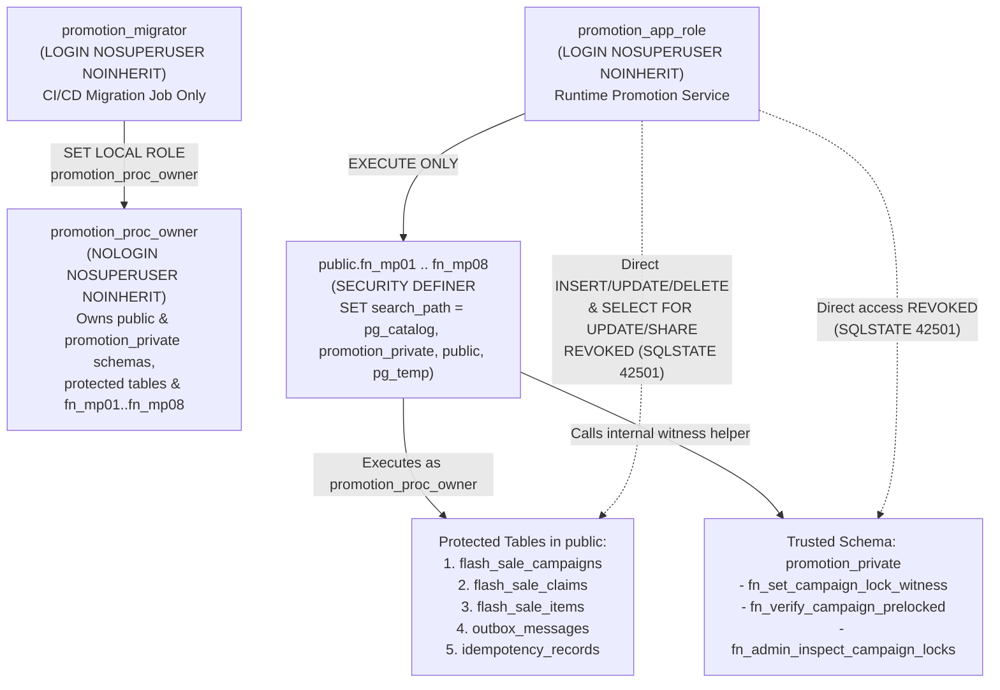

# Database Ownership, Migration Strategy & Promotion Privilege Architecture (`DATABASE_MIGRATION_STRATEGY.md`)

- **Document ID:** `DCP-DOC-ARCH-012`
- **Repository:** `dev-atlas-lab/distributed-commerce-platform`
- **Milestone:** `M1.2 — Database Foundation & Promotion Security Implementation`
- **Status:** `TEST_VERIFIED` (Locally Verified on PostgreSQL 17 via [`scripts/verify-m1-2-db-security.sh`](file:///home/anhltn/projects/distributed-commerce-platform/scripts/verify-m1-2-db-security.sh) and [`tests/security/test-promotion-db-security.sh`](file:///home/anhltn/projects/distributed-commerce-platform/tests/security/test-promotion-db-security.sh))
- **Governing ADRs:** [`ADR-0002`](file:///home/anhltn/projects/distributed-commerce-platform/docs/adr/ADR-0002-database-per-service-on-shared-postgres-instance.md), [`ADR-0003`](file:///home/anhltn/projects/distributed-commerce-platform/docs/adr/ADR-0003-transactional-outbox-and-inbox-idempotency.md), [`ADR-0005`](file:///home/anhltn/projects/distributed-commerce-platform/docs/adr/ADR-0005-flash-sale-concurrency-and-three-tier-locking.md), [`ADR-0007`](file:///home/anhltn/projects/distributed-commerce-platform/docs/adr/ADR-0007-catalog-search-postgresql-fts-vs-opensearch.md), [`ADR-0008`](file:///home/anhltn/projects/distributed-commerce-platform/docs/adr/ADR-0008-ai-agent-security-boundary-and-pgvector-rag.md)
- **Last Updated:** 2026-11-11

---

## 1. Database Ownership, Role & Migration Matrix (Phase A)

Every persistent database in `distributed-commerce-platform` has **strictly one owning microservice** (`NFR-GOV-001`, `ADR-0002`). Furthermore, **zero runtime application roles (`*_svc_user` / `promotion_app_role`) own schemas or possess DDL (`CREATE`) privileges**. Schema ownership and migration execution are isolated to dedicated migration roles (`*_migrator`) that are rejected if ever used as a runtime application identity (`public.fn_verify_runtime_app_identity()`).

| Bounded Context / Service | Source Path | Runtime Stack | Database Name | Runtime Application Role (`NOSUPERUSER`, `NO CREATE`) | Dedicated Migration Role (`NOSUPERUSER`, Deployment Only) | Schema & Object Owner | Migration Tool & Convention | Permitted Runtime Database Access |
| :--- | :--- | :--- | :--- | :--- | :--- | :--- | :--- | :--- |
| **Edge API Gateway** | `src/gateways/api-gateway` | `.NET 10` (`YARP`) | **None** *(Stateless + Redis rate limit)* | **None** | **None** | **None** | **None** | **Zero PostgreSQL access** (never receives DB credentials or network routes to PostgreSQL). |
| **Catalog & Search** | `src/services/catalog` | `Java 21` (`Spring Boot 3.4`) | `catalog_db` (`pg_trgm`) | `catalog_svc_user` | `catalog_migrator` | `catalog_migrator` (`public`) | **Flyway SQL** (`src/main/resources/db/migration/V001__*.sql`) | `catalog_db` only: `USAGE` on `public`; `SELECT, INSERT, UPDATE, DELETE` on domain/outbox/inbox tables; `SELECT` on `schema_migration_history`. |
| **Inventory Ledger** | `src/services/inventory` | `Java 21` (`Spring Boot 3.4`) | `inventory_db` | `inventory_svc_user` | `inventory_migrator` | `inventory_migrator` (`public`) | **Flyway SQL** (`src/main/resources/db/migration/V001__*.sql`) | `inventory_db` only: `USAGE` on `public`; `SELECT, INSERT, UPDATE, DELETE` on domain/outbox/inbox tables; `SELECT` on `schema_migration_history`. |
| **Order & Saga** | `src/services/order` | `Java 21` (`Spring Boot 3.4`) | `order_db` | `order_svc_user` | `order_migrator` | `order_migrator` (`public`) | **Flyway SQL** (`src/main/resources/db/migration/V001__*.sql`) | `order_db` only: `USAGE` on `public`; `SELECT, INSERT, UPDATE, DELETE` on domain/outbox/inbox tables; `SELECT` on `schema_migration_history`. |
| **Payment & Webhooks** | `src/services/payment` | `Java 21` (`Spring Boot 3.4`) | `payment_db` | `payment_svc_user` | `payment_migrator` | `payment_migrator` (`public`) | **Flyway SQL** (`src/main/resources/db/migration/V001__*.sql`) | `payment_db` only: `USAGE` on `public`; `SELECT, INSERT, UPDATE, DELETE` on domain/outbox/inbox tables; `SELECT` on `schema_migration_history`. |
| **Customer & Identity** | `src/services/customer` | `.NET 10` (`ASP.NET Core`) | `customer_db` | `customer_svc_user` | `customer_migrator` | `customer_migrator` (`public`) | **DbUp SQL** (`Infrastructure/Persistence/Migrations/V001__*.sql`) | `customer_db` only: `USAGE` on `public`; `SELECT, INSERT, UPDATE, DELETE` on domain/outbox/inbox tables; `SELECT` on `schema_migration_history`. |
| **Promotion & Flash Sale** | `src/services/promotion` | `.NET 10` (`ASP.NET Core`) | `promotion_db` | `promotion_app_role` | `promotion_migrator` *(member of `promotion_proc_owner`)* | `promotion_proc_owner` (`NOLOGIN NOSUPERUSER`, owns `public` & `promotion_private`) + `promotion_dba_admin` | **DbUp SQL** (`Infrastructure/Persistence/Migrations/V001__*.sql`, `V002__*.sql`) | `promotion_db` only: `USAGE` on `public` (`NO USAGE` on `promotion_private`); `SELECT` only on tables (**zero direct `INSERT/UPDATE/DELETE/FOR UPDATE`**); `EXECUTE` only on `public.fn_mp01`–`fn_mp08`. |
| **Notification Worker** | `src/services/notification` | `.NET 10` (`ASP.NET Core`) | `notification_db` | `notification_svc_user` | `notification_migrator` | `notification_migrator` (`public`) | **DbUp SQL** (`Infrastructure/Persistence/Migrations/V001__*.sql`) | `notification_db` only: `USAGE` on `public`; `SELECT, INSERT, UPDATE, DELETE` on domain/outbox/inbox tables; `SELECT` on `schema_migration_history`. |
| **AI Assistant & RAG** | `src/workers/ai-worker` | `Python 3.12+` (`FastAPI`) | `ai_agent_db` (`vector` / `pgvector`) | `ai_agent_svc_user` | `ai_agent_migrator` | `ai_agent_migrator` (`public`) | **Alembic SQL** (`infrastructure/persistence/migrations/V001__*.sql`) | `ai_agent_db` only (`FR-AI-002`: **zero credentials or `CONNECT` access to any business database**). |

---

## 2. Polyglot Migration Tooling Evaluation & Rationale (Phase B)

### 2.1 Why SQL-First Versioned Migrations Are Used Across Java, .NET, and Python
Instead of forcing a single third-party CLI across all languages or relying on opaque ORM code-generation snapshots, we align each stack with its idiomatic **SQL-first versioned migration convention**:

| Runtime Stack | Evaluated Options | Chosen Convention & Location | Engineering Rationale & Trade-Offs |
| :--- | :--- | :--- | :--- |
| **Java 21** (`catalog`, `inventory`, `order`, `payment`) | 1. **Flyway SQL** (`V001__*.sql`)<br>2. Liquibase XML/YAML<br>3. Hibernate `hbm2ddl.auto` | **Flyway SQL** (`src/services/<svc>/src/main/resources/db/migration/V001__*.sql`) | Native to Spring Boot; supports PostgreSQL 17 syntax (`GIN` `tsvector`/`pg_trgm` indexes, partial indexes, `CHECK` constraints) directly in plain SQL without XML abstraction overhead. `hbm2ddl.auto` is forbidden outside `validate`. |
| **.NET 10** (`customer`, `promotion`, `notification`) | 1. **DbUp Versioned SQL Scripts** (`V001__*.sql`)<br>2. EF Core Designer Migrations (`Migrations/*.Designer.cs` + `ModelSnapshot.cs`) | **DbUp Versioned SQL** (`Commerce.<Service>.Api/Infrastructure/Persistence/Migrations/V001__*.sql`) | `promotion-service` (`ADR-0005` / `CH-01`) requires `SET LOCAL ROLE promotion_proc_owner`, `SECURITY DEFINER` PL/pgSQL procedures (`fn_mp01`–`fn_mp08`), `REVOKE`/`GRANT` ACLs, and custom GUC witness triggers (`promotion_private.fn_verify_campaign_prelocked`). Expressing these in versioned `.sql` scripts makes security audits deterministic and avoids 2,000-line auto-generated C# `ModelSnapshot.cs` merge conflicts. |
| **Python 3.12+** (`ai-worker`) | 1. **Alembic / Versioned SQL** (`V001__*.sql`)<br>2. SQLAlchemy `Base.metadata.create_all()` | **Alembic Versioned SQL** (`src/ai_worker/infrastructure/persistence/migrations/V001__*.sql`) | `ai_agent_db` (`CH-06`, `ADR-0008`) requires `pgvector` `vector(D)` and `halfvec(D)` expression HNSW indexes (`USING hnsw ((embedding::halfvec(3072)) halfvec_cosine_ops)`) and dimension-ceiling `CHECK` constraints that SQLAlchemy autogenerate cannot synthesize reliably. |

### 2.2 Deterministic Execution, Immutability & Fail-Fast Guarantees
All versioned migrations are executed via [`scripts/run-migrations.sh`](file:///home/anhltn/projects/distributed-commerce-platform/scripts/run-migrations.sh) (and service-specific migration init jobs in CI/CD) under the following rules:
1. **Explicit Execution Identity**: Every migration connects strictly as `<service>_migrator` (never as `<service>_svc_user` or `postgres` superuser). For `promotion_db`, `promotion_migrator` executes `SET LOCAL ROLE promotion_proc_owner;` inside the migration transaction so all created schemas, tables, and functions are owned by `promotion_proc_owner`.
2. **Deterministic Ordering**: Scripts follow `V<3-digit-version>__<snake_case_description>.sql` (`V001__...`, `V002__...`) and are sorted under `LC_ALL=C`.
3. **Single-Transaction Fail-Fast Execution**: Each migration script runs inside `psql --single-transaction -v ON_ERROR_STOP=1`. Any DDL or constraint failure rolls back the entire script atomically and exits non-zero.
4. **Migration History & SHA-256 Immutability Verification**:
   - Applied migrations are recorded in `public.schema_migration_history` (`version PK`, `description`, `script_name UNIQUE`, `checksum_sha256`, `installed_by`, `installed_on`, `execution_time_ms`, `success`).
   - Re-running migrations computes `sha256sum` for every `V###__*.sql` file: if the version is already recorded and its SHA-256 matches, it is skipped (`[SKIP]`); if a previously applied script was modified (`checksum_sha256` mismatch), the runner aborts immediately with `IMMUTABILITY_VIOLATION`.

### 2.3 Separation of Schema Migrations vs. Data Migrations & Upgrade/Rollback Policy
1. **Schema (DDL) vs. Data (DML) Separation**:
   - Schema migrations (`V###__*.sql`) define structural DDL (`CREATE TABLE`, `ALTER TABLE`, `CREATE INDEX`, `CREATE OR REPLACE FUNCTION`, `GRANT`/`REVOKE`). They must never embed environment-specific seed data or unbounded multi-million-row `UPDATE` backfills that hold `ACCESS EXCLUSIVE` table locks.
   - Large data backfills must run as batched, idempotent background jobs after the expand-phase schema migration completes.
2. **Expand-and-Contract Upgrade & Rollback Policy**:
   - **Forward-Only Immutable History**: Once merged to `main`, a `V###__*.sql` file is never edited or deleted.
   - **Expand Phase (Release $N$)**: Add nullable columns, new tables, or updated `CREATE OR REPLACE FUNCTION` definitions backward-compatibly with Release $N-1$ application pods.
   - **Rollback Strategy**: If an application deployment in Release $N$ fails, roll back the stateless application container image first while leaving the backward-compatible expand-phase schema in place. If a schema object or stored procedure must be reverted, commit a new forward migration (`V<N+1>__revert_<feature>.sql`).

---

## 3. Promotion Security Implementation & `SECURITY DEFINER` Hardening (Phase C — `CH-01` / `ADR-0005`)

### 3.1 Four-Role Privilege Separation in `promotion_db`



| Role Name | Attributes | Purpose & Enforced Restrictions |
| :--- | :--- | :--- |
| **`promotion_proc_owner`** | `NOLOGIN NOSUPERUSER NOCREATEDB NOCREATEROLE NOINHERIT` | Non-login owner of `promotion_db`, schemas `public` and `promotion_private`, all protected tables, internal trigger/helper functions, and `fn_mp01`–`fn_mp08`. Because it is `NOSUPERUSER`, even a bug inside a `SECURITY DEFINER` procedure cannot escalate to PostgreSQL superuser or bypass filesystem/cross-DB boundaries. |
| **`promotion_migrator`** | `LOGIN NOSUPERUSER NOCREATEDB NOCREATEROLE NOINHERIT` | Granted membership in `promotion_proc_owner` (`GRANT promotion_proc_owner TO promotion_migrator`). Because `NOINHERIT` is set and direct table `SELECT`/`DML` and function `EXECUTE` are revoked from `promotion_migrator`, a normal login session as `promotion_migrator` cannot query business tables or invoke `fn_mp01`–`fn_mp08` (`SQLSTATE 42501`), and `public.fn_verify_runtime_app_identity()` rejects it immediately. |
| **`promotion_app_role`** | `LOGIN NOSUPERUSER NOCREATEDB NOCREATEROLE NOINHERIT` | Runtime service connection pool identity. Has `USAGE` on `public` (`NO CREATE`), zero privileges on `promotion_private`, `SELECT` only on `public` tables (**zero `INSERT, UPDATE, DELETE, TRUNCATE, REFERENCES, TRIGGER` and therefore zero `SELECT ... FOR UPDATE/SHARE` capability**), and `EXECUTE` strictly on `public.fn_mp01`–`fn_mp08` and `public.fn_verify_runtime_app_identity()`. |
| **`promotion_dba_admin`** | `LOGIN NOSUPERUSER NOCREATEDB NOCREATEROLE NOINHERIT` | Break-glass human DBA role. Forbidden as a runtime application identity (`fn_verify_runtime_app_identity()` raises `42501`), and guarded against accidental out-of-order manual table edits by `trg_verify_claims_campaign_prelocked` and `trg_verify_items_campaign_prelocked` (`SQLSTATE P0004`). |

### 3.2 `SECURITY DEFINER` Hardening & Why `pg_temp` Must Be Placed Last in `search_path`
1. **Why `search_path = pg_catalog, public` Alone Is Insufficient**:
   - In PostgreSQL (`src/backend/catalog/namespace.c`, `recomputeNamespacePath()`), if a function's `SET search_path` does **not** explicitly list `pg_temp`, PostgreSQL implicitly places `pg_temp` **before** all user schemas (`pg_catalog, pg_temp, ...`)!
   - If an attacker or compromised session creates a temporary table or function in `pg_temp`, any unqualified object reference in a `SECURITY DEFINER` function whose `search_path` omitted `pg_temp` would resolve to `pg_temp` first!
2. **Defense-in-Depth Strategy Implemented in `V001` & `V002`**:
   - **Dedicated Trusted Schema (`promotion_private`)**: Internal helper and trigger functions (`promotion_private.fn_set_campaign_lock_witness`, `promotion_private.fn_verify_campaign_prelocked`, `promotion_private.fn_admin_inspect_campaign_locks`) live in `promotion_private`, where `PUBLIC`, `promotion_app_role`, and `promotion_migrator` have **zero `USAGE` and zero `CREATE` privileges**.
   - **Safe Explicit `search_path` Ordering**: Every `SECURITY DEFINER` function declares:
     ```sql
     SET search_path = pg_catalog, promotion_private, public, pg_temp
     ```
     By placing `pg_temp` explicitly **at the end**, PostgreSQL searches `pg_catalog` $\to$ `promotion_private` $\to$ `public` before `pg_temp`, while `CREATE` is revoked on both `promotion_private` and `public` from `PUBLIC` and `promotion_app_role`.
   - **Explicit Schema & Operator Qualification**: All table, function, and critical operator references inside `fn_mp01`–`fn_mp08` and `promotion_private` functions are explicitly schema-qualified (`public.flash_sale_campaigns`, `promotion_private.fn_set_campaign_lock_witness`, `pg_catalog.now()`, `pg_catalog.set_config()`, `OPERATOR(pg_catalog.=)`).
   - **Global `ALTER DEFAULT PRIVILEGES` Function Hardening (`src/backend/catalog/aclchk.c`)**:
     In PostgreSQL, the built-in default `EXECUTE ON FUNCTIONS TO PUBLIC` privilege lives in the **global** default ACL (`defaclnamespace = 0`), and per-schema `ALTER DEFAULT PRIVILEGES ... IN SCHEMA public` entries are additive over global defaults. Therefore, both [`init-multi-db.sh`](file:///home/anhltn/projects/distributed-commerce-platform/deploy/local/postgres/init-multi-db.sh) and [`V001__promotion_schema_and_protected_tables.sql`](file:///home/anhltn/projects/distributed-commerce-platform/src/services/promotion/Commerce.Promotion.Api/Infrastructure/Persistence/Migrations/V001__promotion_schema_and_protected_tables.sql) execute global `ALTER DEFAULT PRIVILEGES FOR ROLE promotion_proc_owner REVOKE EXECUTE ON FUNCTIONS FROM PUBLIC, promotion_app_role, promotion_migrator;` (without `IN SCHEMA`), verified by `pg_default_acl` and Phase D Test #10.

### 3.3 Promotion Function Ownership & Privilege Matrix

| Schema & Function Name | Owner | Security Mode | `search_path` Configuration | `PUBLIC` `EXECUTE` | `promotion_migrator` `EXECUTE` | `promotion_app_role` `EXECUTE` | `promotion_dba_admin` `EXECUTE` |
| :--- | :--- | :--- | :--- | :--- | :--- | :--- | :--- |
| `promotion_private.fn_set_campaign_lock_witness(uuid, bigint)` | `promotion_proc_owner` | `SECURITY INVOKER` | `pg_catalog, promotion_private, public, pg_temp` | **Revoked** | **Revoked** | **Revoked** | **Revoked** *(internal to `promotion_proc_owner`)* |
| `promotion_private.fn_verify_campaign_prelocked()` | `promotion_proc_owner` | `SECURITY DEFINER` | `pg_catalog, promotion_private, public, pg_temp` | **Revoked** | **Revoked** | **Revoked** | **Revoked** *(invoked by trigger engine)* |
| `promotion_private.fn_admin_inspect_campaign_locks(uuid)` | `promotion_proc_owner` | `SECURITY DEFINER` | `pg_catalog, promotion_private, public, pg_temp` | **Revoked** | **Revoked** | **Revoked** | **Granted** *(DBA diagnostic only)* |
| `public.fn_mp01_writer_claim(...)` | `promotion_proc_owner` | `SECURITY DEFINER` | `pg_catalog, promotion_private, public, pg_temp` | **Revoked** | **Revoked** | **Granted** | **Granted** |
| `public.fn_mp02_reconcile_fenced(...)` | `promotion_proc_owner` | `SECURITY DEFINER` | `pg_catalog, promotion_private, public, pg_temp` | **Revoked** | **Revoked** | **Granted** | **Granted** |
| `public.fn_mp03_expire_or_cancel(...)` | `promotion_proc_owner` | `SECURITY DEFINER` | `pg_catalog, promotion_private, public, pg_temp` | **Revoked** | **Revoked** | **Granted** | **Granted** |
| `public.fn_mp04_restock_finalize(...)` | `promotion_proc_owner` | `SECURITY DEFINER` | `pg_catalog, promotion_private, public, pg_temp` | **Revoked** | **Revoked** | **Granted** | **Granted** |
| `public.fn_mp05_order_payment_progress(...)` | `promotion_proc_owner` | `SECURITY DEFINER` | `pg_catalog, promotion_private, public, pg_temp` | **Revoked** | **Revoked** | **Granted** | **Granted** |
| `public.fn_mp06_admin_configure_item(...)` | `promotion_proc_owner` | `SECURITY DEFINER` | `pg_catalog, promotion_private, public, pg_temp` | **Revoked** | **Revoked** | **Granted** | **Granted** |
| `public.fn_mp07_rebuilder_fence_and_snapshot(...)` | `promotion_proc_owner` | `SECURITY DEFINER` | `pg_catalog, promotion_private, public, pg_temp` | **Revoked** | **Revoked** | **Granted** | **Granted** |
| `public.fn_mp08_campaign_lifecycle(...)` | `promotion_proc_owner` | `SECURITY DEFINER` | `pg_catalog, promotion_private, public, pg_temp` | **Revoked** | **Revoked** | **Granted** | **Granted** |
| `public.fn_verify_runtime_app_identity()` | `promotion_proc_owner` | `SECURITY DEFINER` | `pg_catalog, promotion_private, public, pg_temp` | **Revoked** | **Granted** *(raises `42501`)* | **Granted** *(returns `TRUE`)* | **Granted** *(raises `42501`)* |
