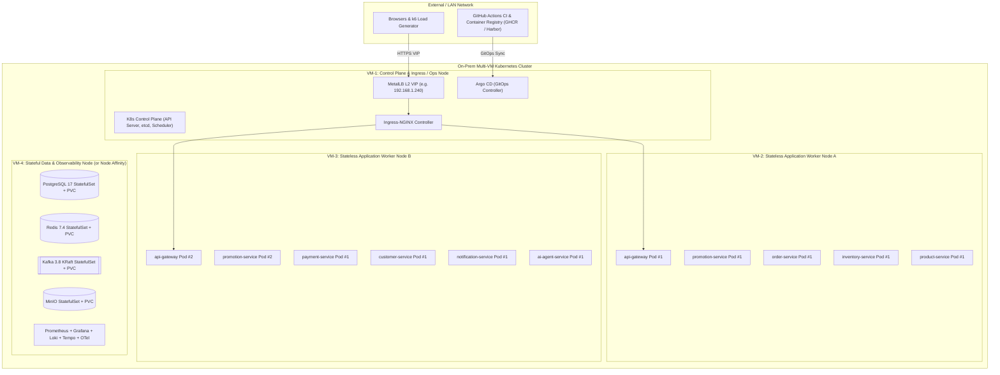

# Deployment & On-Prem Kubernetes Architecture — Distributed Commerce & Flash Sale Platform

- **Document ID:** `DCP-DOC-DEP-001`
- **Status:** `PROPOSED` (Milestone M0 — Pending Human Approval)
- **Last Updated:** 2026-11-10

---

## 1. Hybrid Environment Strategy

Our infrastructure evolves cleanly across two operational modes:
1. **Mode 1 — Local / Single-VM Development (`M1–M5`)**: Composable **Docker Compose** profiles (`infra`, `core-commerce`, `flash-sale`, `ai`, `observability`) so developers can run the exact subset of services needed for the active task without exhausting RAM.
2. **Mode 2 — Multi-VM On-Prem Kubernetes Cluster (`M6–M7`)**: Production-grade Kubernetes deployment across multiple Linux VMs using **Helm**, **Argo CD (GitOps)**, **MetalLB**, **Ingress NGINX**, and **Longhorn / Local-Path Storage**.

---

## 2. Critical Decision: `K3s` vs. `kubeadm` for On-Prem VMs

We evaluate both Kubernetes distributions against your project goals and hardware constraints (recorded in `ADR-0009`):

| Evaluation Dimension | Option A: `K3s` (CNCF Certified Kubernetes) | Option B: `kubeadm` (Upstream Vanilla K8s) |
| :--- | :--- | :--- |
| **Control Plane Memory Overhead** | **~500–600 MiB RAM** (single binary bundling containerd, CoreDNS, metrics-server). | **~1.5–2.2 GiB RAM** (separate kube-apiserver, etcd, controller-manager, scheduler pods). |
| **Kubernetes API & Workload Fidelity** | **100% CNCF Certified**. Identical `Deployment`, `StatefulSet`, `HPA`, `PDB`, `NetworkPolicy`, `Helm`, and `Argo CD` APIs. | **100% Upstream**. Requires manual CNI (`Calico`/`Cilium`), CRI (`containerd`), and certs wiring. |
| **Setup & Maintenance Focus** | Fast bootstrap (`<5m`); lets you focus engineering time on **Microservices, Helm, GitOps, NetworkPolicies, Storage, Chaos, and Performance**. | Deep PKI certificate, `etcd` quorum, and CNI bootstrapping practice (CKA-style administration). |
| **Customizability** | Can disable bundled Traefik/ServiceLB (`--disable traefik --disable servicelb`) to install production **MetalLB + Ingress-NGINX + Calico/Canal** identically to `kubeadm`. | Everything is installed from scratch. |

### Architectural Recommendation (`ADR-0009`)
- **Primary Recommendation: `K3s` (with bundled Traefik & ServiceLB disabled so we explicitly deploy `MetalLB` + `Ingress-NGINX` + `Calico/Flannel NetworkPolicy`)** if each VM has **4–8 GiB RAM**, because saving `~1.2 GiB` of control-plane overhead per node leaves vital memory for our 9 polyglot services, Kafka, PostgreSQL, Redis, and Prometheus.
- **Alternative (Supported if you prefer CKA-depth cluster bootstrapping and have $\ge 8\text{ GiB}$ RAM per VM)**: **`kubeadm` with `containerd` + `Calico CNI`**. All Helm charts, Argo CD manifests, NetworkPolicies, and Chaos scenarios in [`infrastructure/kubernetes/`](file:///home/anhltn/projects/distributed-commerce-platform/infrastructure/kubernetes/) are 100% identical between both options. (This is listed in Open Question Q3 for your final choice).

---

## 3. Target Multi-VM Kubernetes Topology

We design for a **3-to-4 Linux VM Topology** (adaptable to your exact VM count and RAM):

---

## 4. Infrastructure Component Evaluation (Use Case, Cost & Alternatives)

| Component | Engineering Purpose | Operational / RAM Cost | Alternatives Evaluated | Adoption Phase |
| :--- | :--- | :--- | :--- | :--- |
| **MetalLB (L2 Mode)** | Assigns a real LAN Virtual IP (`LoadBalancer` service type) on bare-metal/on-prem VMs lacking cloud ALB/NLB. | Low (`~50 MiB`) | NodePort (`:30080` ugly ports, no VIP failover), kube-vip. | **Adopt in M6** |
| **Ingress-NGINX** | L7 TLS termination, host/path routing to `api-gateway` and `frontend`, connection keep-alive pooling. | Low (`~120 MiB`) | Traefik, Envoy Gateway. | **Adopt in M6** |
| **Persistent Storage (`local-path` vs. `Longhorn`)** | Provides `PersistentVolumeClaims` (`PVCs`) for PostgreSQL, Kafka, Redis, and MinIO. | `local-path`: `~20 MiB` (0 network replication overhead). `Longhorn`: `~1–1.5 GiB` across cluster + 3x disk/network I/O. | **Recommendation**: Use **`local-path-provisioner` + automated `pg_dump`/MinIO backups** on RAM-constrained VMs; adopt **Longhorn** only if VMs have dedicated SSDs and $\ge 8\text{ GiB}$ RAM per node. | **Adopt in M6** |
| **Container Registry (`GHCR` vs. `Harbor`)** | Stores versioned container images built by CI. | `GHCR`: `0 MiB` on-prem cost. `Harbor`: `~2+ GiB` RAM (7 containers). | **Recommendation**: Use **GitHub Container Registry (`ghcr.io/dev-atlas-lab/...`)** initially; evaluate self-hosted Harbor only if air-gapped registry scanning is required. | **Adopt in M1/M6** |
| **Secrets (`SOPS + age` vs. `External Secrets`)** | Encrypts K8s `Secret` manifests safely in Git for Argo CD GitOps. | `SOPS`: `0 MiB` runtime cost. | SealedSecrets, HashiCorp Vault (too heavy). | **Adopt in M6** |
| **Helm + Argo CD** | Parameterizes environment manifests (`values-dev.yaml`, `values-prod.yaml`) and automates declarative GitOps sync. | Argo CD: `~600 MiB` RAM. | Raw Kustomize + `kubectl apply` in CI. | **Adopt in M6** |

---

## 5. Production Readiness: Probes, Resources, HPA, PDB & NetworkPolicies

Every service Helm chart MUST define:
1. **Three-Probe Health Configuration**:
   - `startupProbe`: Gives JVM/.NET containers up to `60s` to finish cold start and Flyway/EF migrations without premature kills.
   - `livenessProbe` (`/health/live` or `/actuator/health/liveness`): Checks only local process responsiveness (never checks downstream DB/Kafka, preventing cascading restart loops!).
   - `readinessProbe` (`/health/ready` or `/actuator/health/readiness`): Verifies local DB pool & critical dependencies; removes pod from `Service` endpoints during graceful shutdown (`preStop: sleep 5`).
2. **Resource Requests & Limits**:
   - CPU `requests` set to baseline load; **CPU `limits` omitted or set generously** on JVM/.NET pods to avoid Linux CFS CPU throttling spikes during GC or JIT compilation (`ADR-0009`).
   - Memory `requests == limits` (Guaranteed QoS class for critical stateful/transactional services) sized with `25%` non-heap headroom above `-XX:MaxRAMPercentage`.
3. **Horizontal Pod Autoscaler (HPA) & Pod Disruption Budget (PDB)**:
   - `api-gateway`, `promotion-service`, `order-service`, and `product-service` scale `minReplicas: 2 → maxReplicas: 4` on CPU/custom RPS metrics, protected by `PDB (minAvailable: 1)`.

---

## 6. Honest Availability Disclosure & Reproducible Failure Scenarios

> [!IMPORTANT]
> **Mandatory Rule #6**: Running 2 pods of `order-service` does NOT make the platform "100% Highly Available" if they share a single PostgreSQL instance or single Control Plane node. We explicitly document our single points of failure and test 10 concrete failure scenarios in **M6 & M7**:

| Scenario ID | Failure Scenario | Expected System Behavior | Verification Method |
| :--- | :--- | :--- | :--- |
| **FAIL-01** | **Stateless Pod Crash (`kill -9` on `order-service` pod)** | Readiness removes pod; `api-gateway` retries idempotent read or routes new requests to Pod #2; in-flight Saga resumes via Outbox/Saga recovery worker. | `kubectl delete pod` during `k6` checkout load. |
| **FAIL-02** | **Worker Node Failure (VM-2 shutdown)** | Pods evicted/rescheduled to VM-3; MetalLB fails over VIP if VM-1/2 ingress moves; zero lost committed transactions. | Power off worker VM during load test. |
| **FAIL-03** | **PostgreSQL Unavailable (`30s` network block)** | Readiness probes mark DB-dependent services unready; Circuit Breakers trip fast (`503 ProblemDetails`); Flash Sale Redis gate returns degraded error; automatic recovery when DB returns. | `iptables` / Toxiproxy / container pause. |
| **FAIL-04** | **Redis Unavailable during Normal vs. Flash Sale Traffic** | Catalog falls back to PostgreSQL with bulkhead rate limit; Flash Sale claim endpoint fails closed (`503 Service Unavailable`)—**never** falls back to unthrottled PostgreSQL under 100K spike! | Pause Redis container during `k6` spike test. |
| **FAIL-05** | **Kafka Broker Unavailable (`60s` outage)** | Synchronous `POST /orders` still succeeds because events are written to PostgreSQL `outbox_messages`; when Kafka recovers, Outbox Relay drains backlog with 0 lost events. | Stop Kafka container during order creation, then restart. |
| **FAIL-06** | **Network Partition between `order-service` and `payment-service`** | Webhooks or Kafka events delayed; Saga remains in `AWAITING_PAYMENT`; reconciliation/expiry worker resolves state once partition heals. | NetworkPolicy / tc netem packet drop. |
| **FAIL-07** | **Storage Full / Disk I/O Saturation** | PostgreSQL WAL / Kafka log write latency spikes; Prometheus `node_filesystem_avail_bytes` alert fires before disk hits 90%. | `fallocate` / `fio` stress test in sandbox. |
| **FAIL-08** | **Memory Pressure / OOMKill** | Container exceeds cgroup memory limit; Kubernetes logs `OOMKilled` (`exitCode 137`); alerts trigger heap dump analysis (`-XX:+HeapDumpOnOutOfMemoryError`). | Artificial memory allocation stress endpoint in test profile. |
| **FAIL-09** | **CPU Throttling (`container_cpu_cfs_throttled_seconds_total`)** | Artificially low CPU limit (`200m`) on Java service causes `p99` latency spike from `40ms` to `800ms` during JIT/GC; resolved by tuning CPU limits. | Before/After `k6` benchmark under tight vs. tuned CPU limits. |
| **FAIL-10** | **Rolling Deployment During Active Traffic** | `helm upgrade` with `maxUnavailable: 0, maxSurge: 1` + `preStop` sleep hook + graceful shutdown achieves **0 dropped requests (`0%` error rate)**. | Run `k6` at 200 RPS while rolling `product-service` & `order-service`. |
