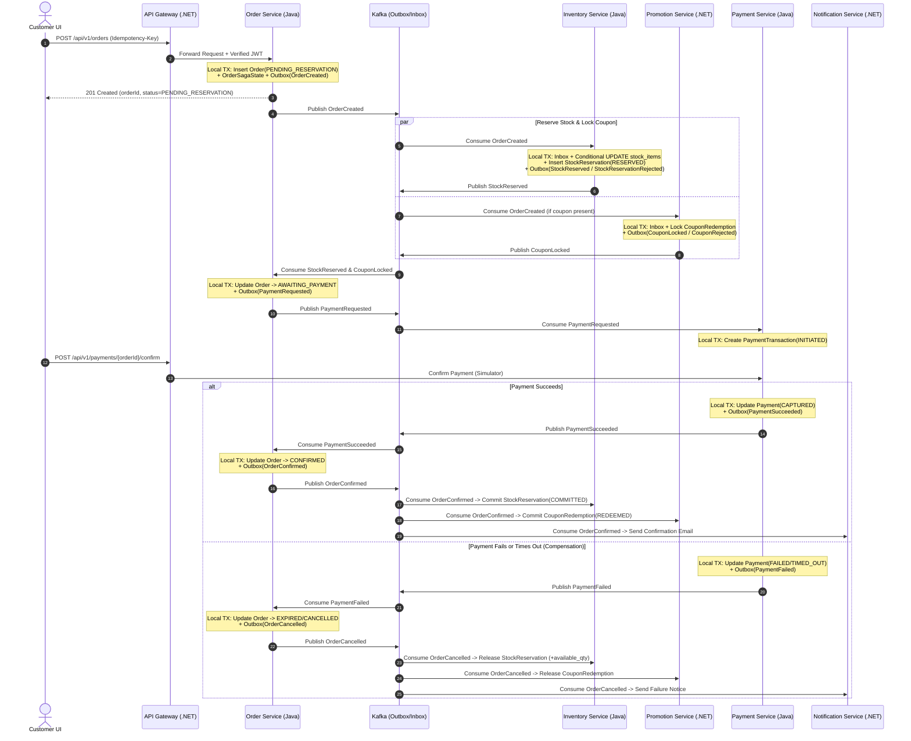
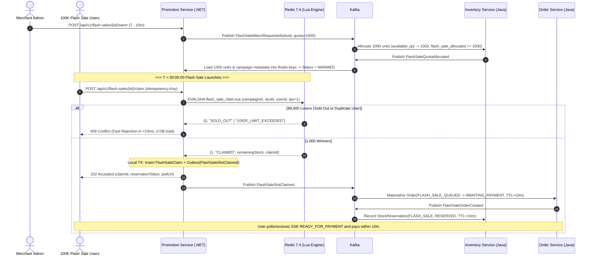

# Event-Driven Architecture, Saga & API Contracts — Distributed Commerce & Flash Sale Platform

- **Document ID:** `DCP-DOC-EDA-001`
- **Status:** `PROPOSED` (Milestone M0 — Pending Human Approval)
- **Last Updated:** 2026-11-10

---

## 1. REST API Contract Strategy

All synchronous HTTP APIs exposed through `api-gateway` and internal services follow **OpenAPI 3.1** specifications stored in [`docs/api-contracts/`](file:///home/anhltn/projects/distributed-commerce-platform/docs/api-contracts/).

### 1.1 API Standards & Versioning
- **URI Versioning**: `/api/v1/{resource}` (e.g., `/api/v1/products`, `/api/v1/orders`, `/api/v1/flash-sales/{campaignId}/claim`).
- **Standardized Error Format**: **RFC 9457 (Problem Details for HTTP APIs)** across Java (`ProblemDetail`), .NET (`ProblemDetails`), and Python (`FastAPI` exception handler):
  ```json
  {
    "type": "https://api.commerce.dev-atlas.lab/errors/insufficient-stock",
    "title": "Insufficient Stock",
    "status": 409,
    "detail": "SKU 'IPHONE-16-PRO-256' has 0 available units.",
    "instance": "/api/v1/orders",
    "errorCode": "INVENTORY_INSUFFICIENT_STOCK",
    "traceId": "4bf92f3577b34da6a3ce929d0e0e4736",
    "timestamp": "2026-11-10T15:45:00Z"
  }
  ```
- **Idempotency Header**: All state-mutating `POST` and `PATCH` endpoints (`POST /api/v1/orders`, `POST /api/v1/flash-sales/{id}/claim`, `POST /api/v1/payments`) require `Idempotency-Key: <UUIDv4>`.
- **Pagination**: Cursor-based pagination (`?cursor=...&limit=20`) for high-volume feeds (`orders`, `inventory_ledger`) and offset pagination (`?page=1&size=20`) for bounded admin tables.

---

## 2. Apache Kafka Event Architecture

### 2.1 Why JSON Schema (Draft 2020-12) + CloudEvents Envelope
For our polyglot stack (`Java 21`, `.NET 10`, `Python 3.12+`), we use a standardized **CloudEvents-inspired JSON Envelope** validated against **JSON Schema** contracts stored in [`docs/event-contracts/`](file:///home/anhltn/projects/distributed-commerce-platform/docs/event-contracts/).
- **Why not require Confluent Schema Registry + Avro in M1–M3?** Running an additional JVM Schema Registry container on a constrained VM adds `~400 MiB` RAM overhead. Versioned JSON Schema files in the monorepo (`docs/event-contracts/`) validated in CI and consumer/producer contract tests give us 100% schema discipline with zero runtime container overhead, while remaining human-readable in Kafka UI and logs. (See `ADR-0005`).

### 2.2 Standard Event Envelope Specification

```json
{
  "eventId": "019316a8-7c4b-7000-8a12-3f9c8d7e6b5a",
  "eventType": "commerce.order.created.v1",
  "eventVersion": 1,
  "source": "order-service",
  "aggregateType": "Order",
  "aggregateId": "f47ac10b-58cc-4372-a567-0e02b2c3d479",
  "occurredAt": "2026-11-10T15:45:00.123Z",
  "correlationId": "4bf92f3577b34da6a3ce929d0e0e4736",
  "causationId": "019316a8-7000-7000-8000-111122223333",
  "payload": {
    "orderId": "f47ac10b-58cc-4372-a567-0e02b2c3d479",
    "customerId": "9b1deb4d-3b7d-4bad-9bdd-2b0d7b3dcb6d",
    "orderType": "STANDARD",
    "totalAmount": 1299.00,
    "currency": "USD",
    "items": [
      {
        "skuId": "6ba7b810-9dad-11d1-80b4-00c04fd430c8",
        "quantity": 1,
        "unitPrice": 1299.00
      }
    ]
  }
}
```

### 2.3 Kafka Topic Taxonomy & Partitioning Strategy

| Topic Name | Producer | Consumers | Partition Key | Partitions (Dev / Prod) | Retention |
| :--- | :--- | :--- | :--- | :--- | :--- |
| `catalog.product.events.v1` | `product-service` | `ai-agent-service` | `productId` | `3 / 6` | `7d` |
| `commerce.order.events.v1` | `order-service` | `inventory-service`, `promotion-service`, `payment-service`, `notification-service` | `orderId` | `6 / 12` | `14d` |
| `commerce.flashsale.events.v1` | `promotion-service` | `order-service`, `inventory-service`, `notification-service` | `customerId` (or `skuId`) | `6 / 24` | `7d` |
| `inventory.stock.events.v1` | `inventory-service` | `order-service`, `product-service`, `promotion-service` | `orderId` (Saga replies) / `skuId` | `6 / 12` | `14d` |
| `commerce.payment.events.v1` | `payment-service` | `order-service`, `notification-service` | `orderId` | `6 / 12` | `30d` |
| `commerce.promotion.events.v1` | `promotion-service` | `order-service` | `orderId` | `3 / 6` | `14d` |
| `*.<consumer-group>.retry.1m` | Consumer Retry Handler | Same Consumer Group | Original Key | `3` | `3d` |
| `*.<consumer-group>.dlq.v1` | Consumer Error Handler | Admin DLQ Inspector / Alerting | Original Key | `3` | `30d` |

> [!TIP]
> **Why `orderId` is the Partition Key for Saga Topics**: Keying `commerce.order.events.v1`, `inventory.stock.events.v1` (saga replies), and `commerce.payment.events.v1` by `orderId` guarantees that all lifecycle events for the same `Order` land on the same partition and are processed in strict causal order by `order-service`.

---

## 3. Distributed Transaction Strategy: Saga Workflows

### 3.1 Workflow A: Standard Checkout Saga (Happy Path & Compensation)



---

### 3.2 Workflow B: High-Concurrency Flash Sale Pipeline


