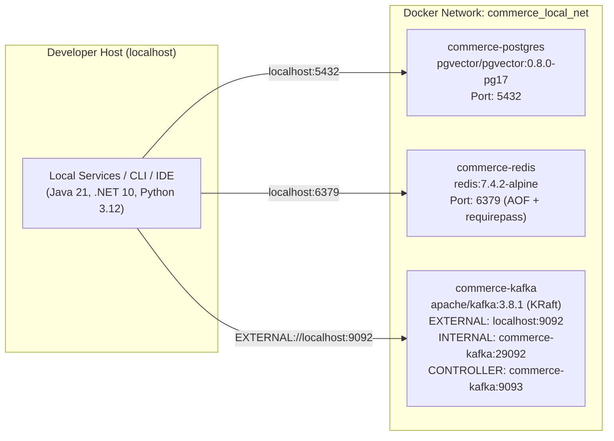

# Local Infrastructure Architecture (`LOCAL_INFRASTRUCTURE.md`)

**Milestone:** `M1.1` — Local Infrastructure Bootstrap
**Status:** `IMPLEMENTED` (Locally Verified on Host VM; Production Cluster Topology Remains `NEEDS_EVIDENCE` Until `M6/M9`)
**Date:** 2026-04-11

This document describes the local development infrastructure topology, network listeners, database/role isolation model, persistent storage, and explicit differences between the local environment and the target production Kubernetes cluster.

---

## 1. Local Infrastructure Topology & Pinned Images

All local infrastructure services run inside the dedicated bridge network `commerce_local_net` defined in [`deploy/local/docker-compose.yml`](file:///home/anhltn/projects/distributed-commerce-platform/deploy/local/docker-compose.yml):

| Component | Container Name | Pinned Image | Host Port | Container Port | Named Persistent Volume | Health Check |
| :--- | :--- | :--- | :--- | :--- | :--- | :--- |
| **PostgreSQL 17 + `pgvector`** | `commerce-postgres` | `pgvector/pgvector:0.8.0-pg17` | `5432` (`POSTGRES_PORT`) | `5432` | `commerce_postgres_data` (`/var/lib/postgresql/data`) | `pg_isready -U "$POSTGRES_USER" -d postgres` |
| **Redis 7.4** | `commerce-redis` | `redis:7.4.2-alpine` | `6379` (`REDIS_PORT`) | `6379` | `commerce_redis_data` (`/data`, AOF `everysec`) | `REDISCLI_AUTH="$REDIS_PASSWORD" redis-cli ping` |
| **Apache Kafka 3.8.1 (KRaft)** | `commerce-kafka` | `apache/kafka:3.8.1` | `9092` (`KAFKA_EXTERNAL_PORT`) | `9092` (external), `29092` (internal), `9093` (controller) | `commerce_kafka_data` (`/var/lib/kafka/data`) | `kafka-broker-api-versions.sh --bootstrap-server localhost:29092` |

---

## 2. Apache Kafka 3.8.1 KRaft & Dual-Listener Architecture

Per [`ADR-0010`](file:///home/anhltn/projects/distributed-commerce-platform/docs/adr/ADR-0010-event-contracts-json-schema-and-kafka-kraft.md), ZooKeeper is eliminated in favor of **Apache Kafka 3.8.1 in native KRaft mode** (`KAFKA_PROCESS_ROLES=broker,controller`, `KAFKA_NODE_ID=1`).

### 2.1 Why Dual Listeners (`INTERNAL` vs `EXTERNAL`) Are Configured
When a Kafka client connects to a bootstrap server, the broker returns **advertised listener metadata** telling the client which hostname and port to connect to for subsequent partition produce/fetch requests:
1. **`EXTERNAL` Listener (`0.0.0.0:9092`, Advertised as `localhost:9092`)**:
   - Used by microservices, integration tests, and CLI tools running directly on the **developer host** (`KAFKA_BOOTSTRAP_SERVERS=localhost:9092`).
   - When a host process queries metadata on `localhost:9092`, Kafka advertises `localhost:9092`, which resolves cleanly on the host.
2. **`INTERNAL` Listener (`0.0.0.0:29092`, Advertised as `commerce-kafka:29092`)**:
   - Used for inter-broker communication (`KAFKA_INTER_BROKER_LISTENER_NAME=INTERNAL`) and by any container running **inside** the `commerce_local_net` Docker network (`commerce-kafka:29092`).
3. **`CONTROLLER` Listener (`0.0.0.0:9093`, Quorum Voter `1@commerce-kafka:9093`)**:
   - Dedicated to internal KRaft Raft quorum metadata traffic (`KAFKA_CONTROLLER_LISTENER_NAMES=CONTROLLER`).

### 2.2 Local vs. Production Kafka Settings
To keep local memory consumption low (`~512 MiB` vs multi-GiB), the local broker runs as a single combined KRaft node with:
- `KAFKA_OFFSETS_TOPIC_REPLICATION_FACTOR=1`
- `KAFKA_TRANSACTION_STATE_LOG_REPLICATION_FACTOR=1`
- `KAFKA_TRANSACTION_STATE_LOG_MIN_ISR=1`
- `KAFKA_AUTO_CREATE_TOPICS_ENABLE=false` (topics are created explicitly to catch typo bugs early).

---

## 3. PostgreSQL 17 Database-per-Service & Role Separation Model

Initialized automatically on first container startup by [`deploy/local/postgres/init-multi-db.sh`](file:///home/anhltn/projects/distributed-commerce-platform/deploy/local/postgres/init-multi-db.sh) (`ADR-0002`, `ADR-0005`, `M0.3.1`):

### 3.1 Isolated Bounded-Context Databases & Least-Privilege Roles
Every database revokes `CONNECT` from `PUBLIC` (`REVOKE ALL ON DATABASE <db> FROM PUBLIC`), revokes `CREATE` on schema `public` from `PUBLIC` and from all runtime application roles (`REVOKE ALL ON SCHEMA public FROM <app_role>; GRANT USAGE ON SCHEMA public TO <app_role>`), and separates schema ownership (`<service>_migrator` / `promotion_proc_owner`) from runtime application roles (`<service>_svc_user` / `promotion_app_role`). Zero application or migration roles are granted `SUPERUSER`, `CREATEDB`, or `CREATEROLE`:

| Bounded Context | Database Name | Runtime Application Role (`NO CREATE`) | Dedicated Migration Role (Schema Owner) | Role Attributes | Extensions Enabled |
| :--- | :--- | :--- | :--- | :--- | :--- |
| **Catalog** | `catalog_db` | `catalog_svc_user` | `catalog_migrator` | `LOGIN NOSUPERUSER NOCREATEDB NOCREATEROLE NOINHERIT` | `pg_trgm` (`ADR-0007`) |
| **Customer** | `customer_db` | `customer_svc_user` | `customer_migrator` | `LOGIN NOSUPERUSER NOCREATEDB NOCREATEROLE NOINHERIT` | — |
| **Order** | `order_db` | `order_svc_user` | `order_migrator` | `LOGIN NOSUPERUSER NOCREATEDB NOCREATEROLE NOINHERIT` | — |
| **Inventory** | `inventory_db` | `inventory_svc_user` | `inventory_migrator` | `LOGIN NOSUPERUSER NOCREATEDB NOCREATEROLE NOINHERIT` | — |
| **Payment** | `payment_db` | `payment_svc_user` | `payment_migrator` | `LOGIN NOSUPERUSER NOCREATEDB NOCREATEROLE NOINHERIT` | — |
| **Notification** | `notification_db` | `notification_svc_user` | `notification_migrator` | `LOGIN NOSUPERUSER NOCREATEDB NOCREATEROLE NOINHERIT` | — |
| **AI Worker** | `ai_agent_db` | `ai_agent_svc_user` | `ai_agent_migrator` | `LOGIN NOSUPERUSER NOCREATEDB NOCREATEROLE NOINHERIT` | `vector` (`pgvector 0.8.0`, `ADR-0008`) |
| **Promotion** | `promotion_db` | `promotion_app_role` | `promotion_migrator` *(+ `promotion_proc_owner` & `promotion_dba_admin`)* | All `NOSUPERUSER NOCREATEDB NOCREATEROLE NOINHERIT` | — |

### 3.2 Promotion Database 4-Role Separation (`ADR-0005` / `CH-01`)
Provisioned by [`init-multi-db.sh`](file:///home/anhltn/projects/distributed-commerce-platform/deploy/local/postgres/init-multi-db.sh) and migrated by [`V001__promotion_schema_and_protected_tables.sql`](file:///home/anhltn/projects/distributed-commerce-platform/src/services/promotion/Commerce.Promotion.Api/Infrastructure/Persistence/Migrations/V001__promotion_schema_and_protected_tables.sql) and [`V002__promotion_security_definer_procedures.sql`](file:///home/anhltn/projects/distributed-commerce-platform/src/services/promotion/Commerce.Promotion.Api/Infrastructure/Persistence/Migrations/V002__promotion_security_definer_procedures.sql):
1. **`promotion_proc_owner` (`NOLOGIN NOSUPERUSER NOCREATEDB NOCREATEROLE NOINHERIT`)**:
   - Owns `promotion_db`, schemas `public` and `promotion_private`, all protected tables, internal trigger/helper functions, and the 8 `SECURITY DEFINER` stored procedures (`fn_mp01`–`fn_mp08`).
   - Global default privileges are hardened (`ALTER DEFAULT PRIVILEGES FOR ROLE promotion_proc_owner REVOKE EXECUTE ON FUNCTIONS FROM PUBLIC`).
2. **`promotion_migrator` (`LOGIN NOSUPERUSER NOCREATEDB NOCREATEROLE NOINHERIT`)**:
   - Granted membership in `promotion_proc_owner` (`GRANT promotion_proc_owner TO promotion_migrator` with `NOINHERIT`) so CI/CD schema migrations can `SET LOCAL ROLE promotion_proc_owner` without requiring PostgreSQL superuser access. Forbidden as a runtime application identity (`public.fn_verify_runtime_app_identity()`).
3. **`promotion_app_role` (`LOGIN NOSUPERUSER NOCREATEDB NOCREATEROLE NOINHERIT`)**:
   - Runtime connection pool role for `promotion-service`.
   - Has `CONNECT` on `promotion_db`, `USAGE` on `schema public` (`NO CREATE`, and `NO USAGE/CREATE` on `promotion_private`), `SELECT` only on `public` tables (**zero direct `INSERT, UPDATE, DELETE, TRUNCATE, REFERENCES, TRIGGER` and zero `SELECT ... FOR UPDATE/SHARE`**), and `EXECUTE` strictly on `public.fn_mp01`–`fn_mp08`.
4. **`promotion_dba_admin` (`LOGIN NOSUPERUSER NOCREATEDB NOCREATEROLE NOINHERIT`)**:
   - Break-glass operational role separated from runtime application traffic and guarded by `trg_verify_claims_campaign_prelocked` / `trg_verify_items_campaign_prelocked` (`SQLSTATE P0004`).

---

## 4. Explicit Distinction: Locally Verified Behavior vs. Unverified Production Behavior

| Aspect | Locally Verified in `M1.1` & `M1.2` (`TEST_VERIFIED` on Local Host) | Unverified Production / Future Milestone Behavior (`NEEDS_EVIDENCE`) |
| :--- | :--- | :--- |
| **PostgreSQL 17 Isolation, Migrations & `CH-01` Security** | 8 isolated databases, dedicated `<service>_migrator` vs `<service>_svc_user` separation across all DBs, versioned migrations (`scripts/run-migrations.sh`), `promotion_db` 4-role model, `promotion_private` schema, `fn_mp01`–`fn_mp08` `SECURITY DEFINER` procedures, `pg_temp` shadowing resistance, and 85 security checks verified via [`scripts/verify-m1-2-db-security.sh`](file:///home/anhltn/projects/distributed-commerce-platform/scripts/verify-m1-2-db-security.sh). | Multi-thread Redis Lua + PostgreSQL `fn_mp01`/`fn_mp02` concurrent race tests (`SPEC-CH01-T1`..`T5`) and `k6` load benchmarks belong to **`M3` / `M4` / `M10`**. |
| **Redis 7.4** | Single Redis 7.4 instance with `requirepass` (`NOAUTH` rejection verified) and AOF persistence across container restart verified. | Redis failover / restart epoch-fencing (`REBUILDING_GATE`, `CH-01`) under concurrent load remains `NEEDS_EVIDENCE` until `M4`/`M11`. |
| **Kafka 3.8.1 (KRaft)** | Single-node combined KRaft broker/controller with external host produce/consume (`localhost:9092`) and internal listener (`commerce-kafka:29092`) verified. | Multi-broker replication (`RF=3`, `min.insync.replicas=2`), TLS/SASL authentication, and K3s/kubeadm StatefulSet storage (`Q3`, `ADR-0009`) are out of scope for local dev and remain `NEEDS_EVIDENCE` until `M6+`. |
| **Credentials Management** | `.env` loaded locally (excluded from Git via `.gitignore`); `.env.example` contains only safe `placeholder_*_replace_me` tokens. | Production secret injection via Kubernetes Secrets / External Secrets / SOPS (`ADR-0009`) remains `NEEDS_EVIDENCE` until `M6+`. |
