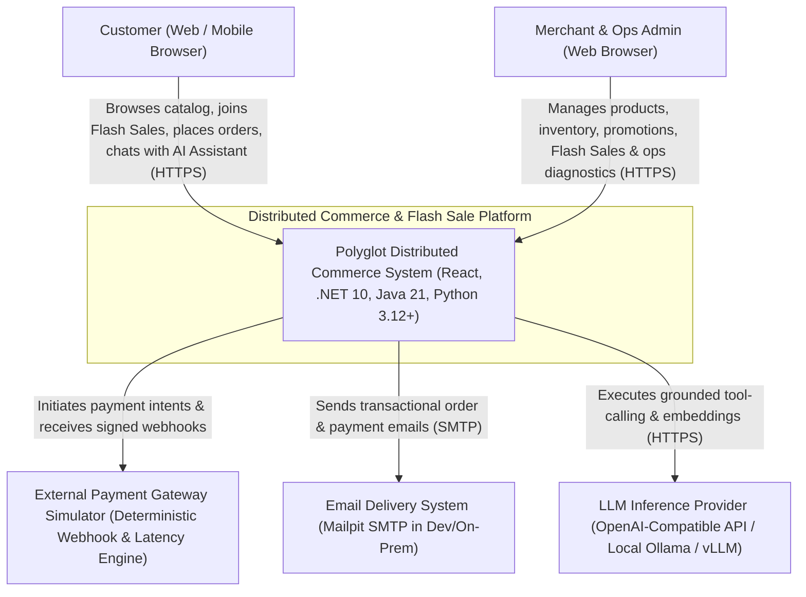
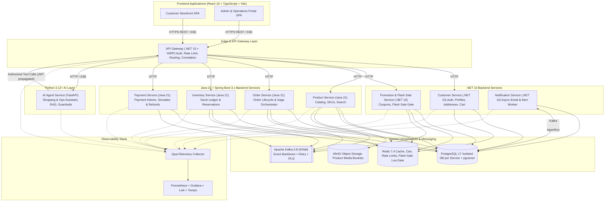

# System Architecture & Pattern Evaluation — Distributed Commerce & Flash Sale Platform

- **Document ID:** `DCP-DOC-ARCH-001`
- **Status:** `PROPOSED` (Milestone M0 — Pending Human Approval)
- **Last Updated:** 2026-11-10

---

## 1. C4 Level 1 — System Context Diagram

---

## 2. C4 Level 2 — Container & Communication Topology

---

## 3. Synchronous vs. Asynchronous Communication Strategy

| Interaction | Protocol | Pattern | Rationale |
| :--- | :--- | :--- | :--- |
| **Client → API Gateway → Service Queries (`GET`)** | Sync HTTP/1.1 or HTTP/2 (`JSON`) | Request-Response + Cache-Aside | Immediate data retrieval required by UI and AI tools. |
| **Order Checkout Initiation (`POST /api/v1/orders`)** | Sync HTTP (Edge) → Async Kafka (Internal Saga) | Command Acceptance + Async Saga | Validates idempotency key and snapshots product/price, saves `Order(PENDING_RESERVATION)`, returns `201 Created` (`or 202 Accepted`), and executes multi-service reservation/payment asynchronously. |
| **Flash Sale Claim (`POST /api/v1/flash-sales/{id}/claim`)** | Sync HTTP → Redis Lua Atomic Gate → Async Kafka | Fast Gate + Queue-Based Load Leveling | Protects PostgreSQL from 100K concurrent hits. Redis Lua filters out 99,000 losers in $<10\text{ ms}$; only the 1,000 winning claims emit `FlashSaleSlotClaimed` to Kafka for DB persistence. |
| **Order ↔ Inventory ↔ Promotion ↔ Payment** | Async Apache Kafka (`JSON Schema` events) | Saga Orchestration + Transactional Outbox | Eliminates distributed locks and temporal coupling across 4 databases. |
| **Notifications (`OrderConfirmed`, `PaymentFailed`)** | Async Apache Kafka | Event Choreography + Retry Topic + DLQ | Email/SMTP latency or downtime must never impact checkout latency or availability. |
| **AI Agent → Business Services** | Sync HTTP via Gateway / Internal Service URLs | Authenticated Tool Calling with Timeouts & Circuit Breaker | Ensures AI Agent obeys identical RBAC, rate limits, and validation rules as human users. |

---

## 4. Rigorous Evaluation of 21 Architectural Patterns

In accordance with Section 5 of the Mission Brief, every candidate pattern is evaluated across **7 mandatory dimensions** so no pattern is adopted as cargo-cult complexity.

### 4.1 Clean Architecture (Hexagonal / Ports & Adapters)
- **Problem Being Solved**: Business domain rules (`Order` state transitions, `StockItem` ledger invariants) become coupled to Spring Data JPA annotations, EF Core `DbContext`, or Kafka serialization classes, making unit testing slow and framework upgrades painful.
- **Why Appropriate**: Applied **pragmatically** in `order-service`, `inventory-service`, `payment-service`, and `promotion-service` to keep core domain aggregates 100% pure Java/C# with zero infrastructure imports.
- **Alternative Solutions**: Traditional 3-Tier Layered Architecture (`Controller → Service → Repository`), or Vertical Slice Architecture.
- **Trade-offs**: Increases mapping boilerplate between Domain Entities and JPA/EF Persistence Entities. We avoid double-mapping where simple (`customer-service`, `notification-service` use Vertical Slice/Layered structure).
- **Failure Scenarios**: Anemic domain models if developers put all logic in Application Services while still paying the mapping cost.
- **Implementation Strategy**: `domain/` (pure aggregates, value objects, domain events, repository interfaces), `application/` (use cases, command handlers, saga steps), `infrastructure/` (JPA/EF adapters, Kafka producers/consumers, Redis scripts), `presentation/` (REST controllers, exception handlers).
- **Testing Strategy**: ArchUnit (Java) and NetArchTest (.NET) unit tests enforcing zero imports from `infrastructure` or `presentation` inside `domain`.

### 4.2 Domain-Driven Design (DDD) & Bounded Contexts
- **Problem Being Solved**: Ambiguous ubiquitous language (e.g., what does "Product Price" or "Available Stock" mean across Catalog vs. Order vs. Flash Sale?) leads to god-classes and tangled shared tables.
- **Why Appropriate**: Partitioning `Product` (catalog metadata), `StockItem` (warehouse ledger), `FlashSaleItem` (campaign quota), and `OrderLine` (historical purchase snapshot) into separate Bounded Contexts gives each model a single, unambiguous responsibility.
- **Alternative Solutions**: Single unified enterprise canonical data model.
- **Trade-offs**: Requires duplicating minimal reference IDs (`sku_id`) and translating events across boundaries.
- **Failure Scenarios**: Leaking internal entity schemas into Kafka events instead of publishing versioned integration contracts.
- **Implementation Strategy**: Explicit Aggregate Roots with private setters and invariant-enforcing domain methods (`stockItem.reserve(qty, orderId)`).
- **Testing Strategy**: Pure domain unit tests verifying every invariant (`INV-STK-1` through `INV-PAY-2`) in $<50\text{ ms}$.

### 4.3 CQRS (Command Query Responsibility Segregation)
- **Problem Being Solved**: Write models optimized for transactional consistency (`Order` + `Inventory` + `Product` normalization) perform poorly for complex multi-criteria storefront search or admin analytics dashboards.
- **Why Appropriate**: Applied **selectively** at two levels:
  1. **Intra-service Method Separation**: Command handlers (`MediatR` / Application Services) mutate aggregates; Query handlers use lightweight read projections (`AsNoTracking()` in EF Core, DTO projections/JdbcClient in Spring) bypassing ORM change-tracking overhead.
  2. **Cross-service Read Model (Catalog Search)**: `Product Service` maintains a denormalized search document/table updated when `StockAvailabilityChanged` or `ProductUpdated` events arrive.
- **Alternative Solutions**: Full Event-Sourced CQRS with separate read/write databases for every service (rejected as massive over-engineering).
- **Trade-offs**: Eventual consistency lag ($100\text{ ms}–2\text{ s}$) between a write commit and search read-model update.
- **Failure Scenarios**: Read projection falls behind or corrupts due to out-of-order Kafka events.
- **Implementation Strategy**: Track `source_version` / `updated_at` on read projections so stale out-of-order events are ignored; provide an admin rebuild endpoint.
- **Testing Strategy**: Integration test asserting read projection convergence within SLA and out-of-order event rejection.

### 4.4 Saga Pattern (Orchestration vs. Choreography)
- **Problem Being Solved**: Maintaining business consistency across `Order`, `Inventory`, `Promotion`, and `Payment` without distributed 2PC locks.
- **Why Appropriate**: We use **Saga Orchestration** (coordinated by `Order Service`) for the core checkout workflow because checkout has cyclic compensation rules (if payment fails, release stock AND release coupon; if late payment arrives after expiry, refund payment). We use **Event Choreography** for downstream side effects (`Notification Service` sending emails, `Product Service` updating search stock badges).
- **Alternative Solutions**: Pure Choreography for everything (creates cyclic event spaghetti and makes debugging stuck orders difficult) or Temporal/Camunda external workflow engine (rejected to avoid extra infrastructure operational overhead and to learn Saga mechanics first-hand).
- **Trade-offs**: `Order Service` knows the command/event contract of `Inventory`, `Promotion`, and `Payment`, making it the central state coordinator.
- **Failure Scenarios**: Saga orchestrator crashes mid-step; compensating command fails repeatedly; reply message arrives out of order.
- **Implementation Strategy**: Persist `OrderSagaState` in `order_db` in the same local transaction as `outbox_messages`; make every participant step and compensation step idempotent; run a scheduled recovery worker for stuck sagas.
- **Testing Strategy**: State-machine unit tests for all forward/compensating transitions + Testcontainers chaos tests simulating participant failures at each step.

### 4.5 Transactional Outbox Pattern
- **Problem Being Solved**: Dual-write bug: committing to PostgreSQL and then calling `kafkaTemplate.send()` (or vice versa) loses events or publishes phantom events if the process crashes or network drops between the two operations.
- **Why Appropriate**: Guarantees atomic persistence of domain state and outgoing integration events inside a single local ACID database transaction.
- **Alternative Solutions**:
  1. Direct dual-write (broken under failure).
  2. Debezium CDC + Kafka Connect (powerful, but adds JVM Kafka Connect cluster operational overhead on constrained VMs).
  3. **Polling Publisher with `FOR UPDATE SKIP LOCKED`** (Chosen for M3 baseline; clean, zero extra containers, easy to inspect and benchmark).
- **Trade-offs**: Adds write amplification (1 extra `INSERT` + `UPDATE` per transaction) and small polling latency ($50–200\text{ ms}$).
- **Failure Scenarios**: Outbox table bloat if published rows are never archived/deleted; slow relay under massive burst if batch size is misconfigured.
- **Implementation Strategy**: `outbox_messages` table with partial index on `WHERE processed_at IS NULL`, relayed in batches of 100–500 rows using `SELECT ... FOR UPDATE SKIP LOCKED`, plus daily cleanup of rows older than 7 days.
- **Testing Strategy**: Fault-injection test that drops Kafka broker connection during DB commit, restarts Kafka, and verifies the Outbox relay delivers 100% of events without loss.

### 4.6 Inbox Pattern & Consumer Idempotency
- **Problem Being Solved**: Outbox relay + Kafka `acks=all` guarantees **At-Least-Once** delivery, meaning consumers WILL receive duplicate events when broker leaders fail over or consumers rebalance before committing offsets.
- **Why Appropriate**: Prevents double stock deduction, double payment capture, and duplicate customer emails.
- **Alternative Solutions**: Kafka EOS (`isolation.level=read_committed`) alone—**insufficient** because Kafka transactions cannot wrap an external PostgreSQL database update or SMTP email send.
- **Trade-offs**: Every consumer transaction must perform an `INSERT INTO inbox_messages (event_id, consumer_group, processed_at)` check and retain event IDs for a TTL window (e.g., 7–14 days).
- **Failure Scenarios**: Concurrent threads processing the same duplicate message simultaneously.
- **Implementation Strategy**: Enforce a `PRIMARY KEY (event_id, consumer_group)` constraint in PostgreSQL and couple it with business natural keys (`UNIQUE (order_id, sku_id)` on `stock_reservations`).
- **Testing Strategy**: Publish the exact same `OrderCreated` / `FlashSaleSlotClaimed` event 10 times concurrently to Kafka and assert `reserved_qty` and `Order` rows are mutated exactly once.

### 4.7 API Gateway & API Composition
- **Problem Being Solved**: Frontend clients shouldn't manage 8 service hostnames, validate JWTs inconsistently, or make 5 serial round-trips to render a single page.
- **Why Appropriate**: `.NET 10 + YARP` provides high-throughput reverse proxying, centralized JWT validation, rate limiting, and correlation ID injection (`X-Correlation-Id` / W3C `traceparent`).
- **Alternative Solutions**: Kong, Envoy, NGINX Ingress direct routing, or Spring Cloud Gateway. (`.NET 10 YARP` is explicitly part of our target stack and has exceptional throughput with minimal memory overhead).
- **Trade-offs**: Gateway is on the critical path for all external traffic.
- **Failure Scenarios**: Gateway becomes a monolith if business logic creeps into it; single point of failure if deployed with 1 replica.
- **Implementation Strategy**: Keep Gateway strictly free of domain business logic; use lightweight BFF/Composition endpoints only for read aggregation (e.g., Product Detail + Live Stock badge) with graceful degradation if a secondary upstream (`Inventory` or `Promotion`) times out.
- **Testing Strategy**: Gateway routing, rate-limit (`429`), auth (`401`/`403`), and upstream partial-failure fallback tests.

### 4.8 Resilience Patterns: Circuit Breaker, Retry with Exponential Backoff + Jitter, Bulkhead, Backpressure
- **Problem Being Solved**: A slow or failing downstream dependency (e.g., Payment Simulator experiencing 5s latency, or LLM API throttling) exhausts upstream HTTP thread pools and triggers cascading failure across the entire platform.
- **Why Appropriate**: Implemented via **Resilience4j** (Java), **Microsoft.Extensions.Http.Resilience / Polly v8** (.NET), and **Tenacity / asyncio Semaphores** (Python).
- **Alternative Solutions**: Unbounded retries or default infinite HTTP timeouts (causes retry storms and thread pool starvation).
- **Trade-offs**: Aggressive circuit breakers can trip prematurely during short GC pauses if sliding window minimum calls are set too low.
- **Failure Scenarios**: Retrying non-idempotent requests without an `Idempotency-Key`; retry storms when all clients retry at exact 1000ms intervals without random jitter.
- **Implementation Strategy**:
  - Explicit per-call timeouts (`1.5s` for internal sync reads, `15s` for LLM streaming).
  - Retries (`maxAttempts=3`, exponential backoff `100ms → 200ms → 400ms` + **decorrelated jitter**) ONLY on transient errors (`503`, network timeout) and ONLY when an `Idempotency-Key` is present.
  - Bulkhead isolation separating Flash Sale hot-path threads/connection pools from slow admin reporting queries.
  - Kafka consumer backpressure (`max.poll.records`, bounded worker queues) so bursts don't OOM consumers.
- **Testing Strategy**: Deterministic fault-injection tests verifying Circuit Breaker state transitions (`CLOSED → OPEN → HALF_OPEN → CLOSED`) and bulkhead rejection metrics.

### 4.9 Dead Letter Queue (DLQ) & Non-Blocking Retry Topics
- **Problem Being Solved**: A poison pill message (malformed schema or permanent business rule violation) blocks an entire Kafka partition if the consumer infinitely retries in place.
- **Why Appropriate**: Allows healthy messages on the same partition to continue processing while routing transient failures through backoff retry topics (`*.retry.1m`, `*.retry.5m`) and permanent failures to `*.dlq.v1`.
- **Alternative Solutions**: Infinite in-place blocking retry (halts partition consumption) or silent `catch (Exception) { log.error(); }` (silently loses business data).
- **Trade-offs**: Events forwarded to retry/DLQ topics lose strict per-key ordering relative to subsequent events on the main topic.
- **Failure Scenarios**: DLQ accumulates messages that nobody monitors or replays.
- **Implementation Strategy**: Include failure diagnostic headers (`x-exception-message`, `x-original-topic`, `x-original-partition`, `x-original-offset`, `x-retry-count`), trigger a Prometheus alert when `dlq_messages_total > 0`, and build an Admin DLQ Inspector & Replay endpoint.
- **Testing Strategy**: Inject a poison event followed by a valid event on the same partition key; verify the poison event lands in `*.dlq.v1` and the valid event is processed within SLA.

### 4.10 Caching Patterns: Cache-Aside & Stampede Protection
- **Problem Being Solved**: High read-to-write ratio (`100:1`) on product catalog details and active promotions hammers PostgreSQL unnecessarily, and when a hot Flash Sale campaign key expires at `T=0`, 10,000 concurrent cache misses cause a **Cache Stampede** that crushes PostgreSQL.
- **Why Appropriate**: Redis Cache-Aside with **randomized TTL jitter** (`base_ttl ± 15%`), **Single-Flight / Mutex Lock on recomputation**, and **Proactive Pre-Warming** for Flash Sale items eliminates database read spikes.
- **Alternative Solutions**: Write-Through cache for all entities (adds Redis latency/failure risk to every write path).
- **Trade-offs**: Stale reads if cache invalidation fails after a catalog update.
- **Failure Scenarios**: Cache Penetration (queries for non-existent UUIDs bypassing Redis and hitting DB every time); Cache Avalanche (mass simultaneous key expiration); Redis instance crash causing sudden 100% DB fallback load.
- **Implementation Strategy**: Cache negative results (`NULL_SENTINEL` with short 60s TTL) for non-existent IDs; invalidate cache keys asynchronously via `ProductUpdated` Kafka events + bounded TTL safety net.
- **Testing Strategy**: `k6` cache-miss storm test verifying single-flight lock allows only 1 DB query while 500 concurrent requests wait or serve stale-while-revalidate.

### 4.11 Concurrency & Locking: Optimistic vs. Pessimistic vs. Redis Atomic Lua
- **Problem Being Solved**: Preventing lost updates and negative stock when hundreds or thousands of requests mutate the same `StockItem`, `CouponCampaign`, or `FlashSaleItem` simultaneously.
- **Why Appropriate — We use a 3-Tier Locking Strategy tailored to contention level**:
  1. **Optimistic Locking (`@Version` / `xmin` RowVersion)**: Used on low-to-medium contention entities (`Order` state transitions, `Product` admin edits, `Customer` profile updates). Fast (zero DB lock wait on read), fails fast with `OptimisticLockingFailureException` on rare concurrent collision.
  2. **Single-Statement Conditional Atomic SQL Update (`UPDATE stock_items SET available_qty = available_qty - :qty, reserved_qty = reserved_qty + :qty, version = version + 1 WHERE sku_id = :skuId AND available_qty >= :qty`)**: Used in `Inventory Service` for standard stock reservations. Unlike read-modify-write Optimistic Locking (which causes a 99% retry storm when 500 users buy the same popular SKU simultaneously), PostgreSQL acquires the row-level `FOR NO KEY UPDATE` lock exclusively for the microsecond duration of the `UPDATE` statement and re-evaluates `available_qty >= :qty` cleanly without application-level retry loops! (When reading multiple rows before mutating, deterministic `SELECT ... ORDER BY sku_id FOR UPDATE` prevents deadlocks).
  3. **Redis Atomic Lua Script + Fencing Token**: Used for the **Flash Sale Hot Gate** (`100,000` users competing for `1,000` units). Executes in single-threaded Redis memory at `>50,000 ops/sec` without touching PostgreSQL until a slot is won.
- **Alternative Solutions**: Distributed Lock (`Redlock`) wrapping a DB read-modify-write transaction—**explicitly rejected for stock deduction** because GC pauses can expire the lock mid-transaction (unsafe without fencing tokens) and serializing network round-trips under a distributed lock kills throughput compared to an atomic Redis Lua script or atomic SQL conditional update.
- **Testing Strategy**: 200-thread barrier test (`CountDownLatch` / `k6`) hammering a SKU with `stock = 50`; assert `50` succeed, `150` fail cleanly with `INSUFFICIENT_STOCK`, `available_qty == 0`, and `0` deadlocks or unhandled `500` errors.

---

## 5. Architecture Risk Register

| Risk ID | Risk Description | Likelihood | Impact | Mitigation Strategy |
| :--- | :--- | :--- | :--- | :--- |
| **RISK-01** | **Redis Flash Sale Gate & PostgreSQL Out-of-Sync**: Redis decrements Flash Sale stock (`1000 → 999`), but the service crashes before committing the `FlashSaleClaim` + Outbox row in PostgreSQL, permanently "leaking" 1 unit of stock in Redis. | Medium | High | Use a local write-ahead claim record or Redis Stream / Lua idempotency key with a background **Flash Sale Reconciliation Worker** that compares Redis buyer set (`SCARD`/`HLEN`) against PostgreSQL `flash_sale_claims` every 30s and restores leaked orphaned slots. |
| **RISK-02** | **Late Payment Webhook Race**: User pays at `9m59s`, webhook arrives at `10m02s` after the reservation expiry job released the stock at `10m00s`. | Medium | Critical | `Order Service` treats `EXPIRED` as terminal for fulfillment; when `PaymentSucceeded` arrives for an `EXPIRED` order, it transitions to `REFUND_PENDING` and emits `RefundRequested` automatically (`INV-PAY-2`). |
| **RISK-03** | **Memory Exhaustion on Dev/On-Prem VMs**: Running 9 polyglot services + Kafka + Postgres + Redis + Observability exceeds 4–8 GiB VM RAM. | High | High | Use single Postgres instance with isolated databases (`ADR-0002`), Kafka KRaft mode (`no ZooKeeper`), Docker Compose profiles, and explicit JVM/`.NET` memory limits. |
| **RISK-04** | **AI Agent Prompt Injection & Privilege Escalation**: Malicious product review or user prompt tricks the LLM into querying another user's orders or triggering an admin refund. | Medium | Critical | Never pass `customer_id` as an LLM-chosen tool parameter; bind user identity strictly from the verified JWT in the Python tool execution runtime (`ADR-0008`). Require human confirmation tokens for any admin mutation. |
| **RISK-05** | **Multi-Item Order Deadlock in PostgreSQL**: Request A reserves `(SKU-1, SKU-2)` while Request B reserves `(SKU-2, SKU-1)` concurrently, causing a cycle in PostgreSQL's lock wait graph. | Medium | Medium | Always sort `OrderLine` items deterministically by `sku_id ASC` before executing batch `SELECT ... FOR UPDATE` or conditional `UPDATE` statements in `Inventory Service`. |
