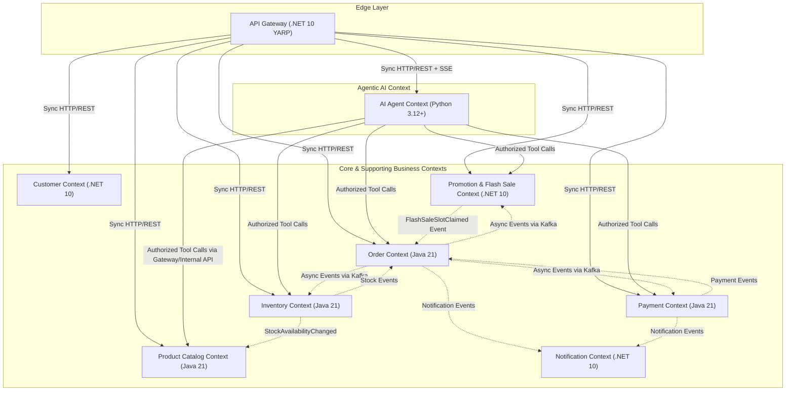
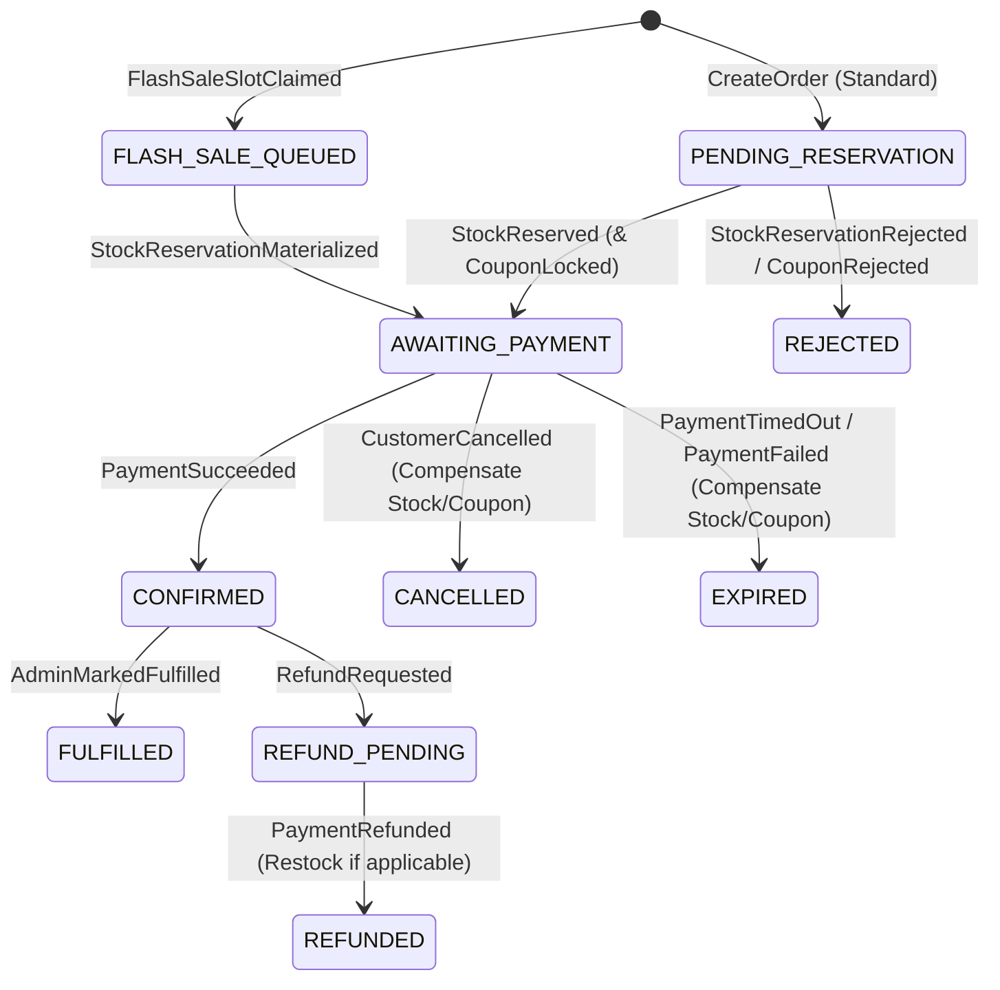

# Domain Model & Bounded Contexts — Distributed Commerce & Flash Sale Platform

- **Document ID:** `DCP-DOC-DOM-001`
- **Status:** `PROPOSED` (Milestone M0 — Pending Human Approval)
- **Last Updated:** 2026-11-10

---

## 1. Strategic Domain-Driven Design (DDD) Overview

We decompose the platform into **7 Core/Supporting Business Bounded Contexts** plus **1 Edge Gateway** and **1 Agentic AI Orchestration Context**.

### 1.1 Domain Classification

| Subdomain | DDD Classification | Strategic Reason | Owning Service | Language |
| :--- | :--- | :--- | :--- | :--- |
| **Flash Sale & High-Concurrency Reservation** | **Core Domain** | Primary technical differentiator; extreme concurrency, strict zero-oversell invariant, sub-50ms hot path. | `Promotion Service` (Campaigns & Fast Gate) + `Inventory Service` (Stock Ledger) | `.NET 10` + `Java 21` |
| **Order Management & Fulfillment Saga** | **Core Domain** | Orchestrates distributed state across Inventory, Promotion, and Payment with strict idempotency and compensation. | `Order Service` | `Java 21` |
| **Inventory & Stock Ledger** | **Core Domain** | Source of truth for physical/reservable stock; double-entry style ledger preventing negative stock. | `Inventory Service` | `Java 21` |
| **Payment Processing & Reconciliation** | **Supporting Domain** | Handles payment intents, asynchronous webhooks, timeouts, refunds, and stuck-payment reconciliation. | `Payment Service` | `Java 21` |
| **Product Catalog & Search** | **Supporting Domain** | Manages SPU/SKU hierarchy, attributes, pricing, media, and search indexing. | `Product Service` | `Java 21` |
| **Promotion & Coupon Engine** | **Supporting Domain** | Evaluates discount rules, coupon eligibility, per-user redemption limits, and Flash Sale campaign rules. | `Promotion Service` | `.NET 10` |
| **Customer, Identity & Cart** | **Supporting Domain** | Manages registration, authentication/RBAC (or delegates to IdP), profiles, addresses, and Redis cart. | `Customer Service` | `.NET 10` |
| **Notification Delivery** | **Generic Subdomain** | Consumes domain events and dispatches transactional emails/alerts with retry and DLQ. | `Notification Service` | `.NET 10` |
| **AI Shopping & Ops Assistant** | **Core Differentiator** | Conversational RAG, multi-step planning, and secure tool calling across read/diagnostic APIs. | `AI Agent Service` | `Python 3.12+` |

---

## 2. Context Map & Integration Relationships

### Context Mapping Patterns Used
- **Customer–Supplier / Published Language (`Event Contracts`)**: `Order`, `Inventory`, `Payment`, and `Promotion` communicate asynchronously through versioned JSON Schema event contracts over Apache Kafka.
- **Anti-Corruption Layer (ACL)**: Each consuming service translates external integration events or API DTOs into its own internal domain commands/value objects—never leaking another service's entity schema into its domain layer.
- **Open Host Service (OHS)**: `Product`, `Inventory`, `Promotion`, and `Order` expose standardized OpenAPI 3.1 query endpoints consumed by both the React Frontend and the Python `AI Agent Service`.

---

## 3. Tactical DDD: Aggregates, Entities, Value Objects & Invariants

### 3.1 Product Catalog Context (`Product Service` — Java)

- **Aggregate Root: `Product` (`product_id: UUID`)**
  - **Entities**:
    - `ProductVariant` (`sku_id: UUID`, `sku_code: String`, `attributes: Map<String,String>`, `base_price: Money`, `status: VariantStatus`)
    - `ProductMedia` (`media_id: UUID`, `object_key: String`, `display_order: int`, `is_primary: boolean`)
  - **Value Objects**: `Money(amount: BigDecimal, currency: CurrencyCode)`, `Slug`, `ProductStatus (DRAFT, ACTIVE, ARCHIVED)`
- **Aggregate Root: `Category` (`category_id: UUID`)**
  - **Attributes**: `parent_id: UUID?`, `name`, `slug`, `path` (materialized path e.g. `/electronics/phones/`)
- **Business Invariants**:
  1. `INV-PRD-1`: Every `ACTIVE` `Product` must have at least one `ACTIVE` `ProductVariant` (`SKU`).
  2. `INV-PRD-2`: `sku_code` must be globally unique and immutable once published.
  3. `INV-PRD-3`: `Money.amount` must be strictly $> 0$ with scale $\le 2$ (or $0$ for zero-decimal currencies).
- **Domain Events**: `ProductCreated`, `ProductUpdated`, `ProductVariantPriceChanged`, `ProductArchived`.

---

### 3.2 Customer Context (`Customer Service` — .NET)

- **Aggregate Root: `Customer` (`customer_id: UUID`)**
  - **Entities**:
    - `ShippingAddress` (`address_id: UUID`, `recipient_name`, `phone`, `line1`, `city`, `postal_code`, `country_code`, `is_default: bool`)
  - **Value Objects**: `EmailAddress`, `PhoneNumber`, `CustomerPreferences`, `AccountStatus (ACTIVE, SUSPENDED)`
- **Aggregate Root: `ShoppingCart` (`customer_id: UUID`, stored in Redis with PostgreSQL fallback/snapshot if needed)**
  - **Value Objects**: `CartItem(sku_id: UUID, quantity: int, added_at: Instant)`
- **Business Invariants**:
  1. `INV-CUS-1`: Normalized `EmailAddress` must be unique across all customers.
  2. `INV-CUS-2`: A customer can have at most one `is_default = true` shipping address at any time.
  3. `INV-CUS-3`: `CartItem.quantity` must be between `1` and `MAX_QTY_PER_LINE (10)`.
- **Domain Events**: `CustomerRegistered`, `CustomerAddressUpdated`.

---

### 3.3 Inventory Context (`Inventory Service` — Java)

- **Aggregate Root: `StockItem` (`sku_id: UUID`)**
  - **State Fields**:
    - `available_qty: int` (free stock for standard orders)
    - `reserved_qty: int` (locked for in-flight standard orders awaiting payment)
    - `flash_sale_allocated_qty: int` (carved out for active/warmed Flash Sale campaigns)
    - `flash_sale_reserved_qty: int` (claimed by Flash Sale buyers awaiting payment)
    - `version: long` (`@Version` optimistic lock column)
  - **Child Entities**:
    - `StockReservation` (`reservation_id: UUID`, `order_id: UUID`, `sku_id: UUID`, `quantity: int`, `type: STANDARD | FLASH_SALE`, `status: RESERVED | COMMITTED | RELEASED | EXPIRED`, `expires_at: Instant`)
    - `InventoryLedgerEntry` (`entry_id: UUID`, `sku_id: UUID`, `delta_available: int`, `delta_reserved: int`, `reason: LedgerReason`, `reference_id: String`, `created_at: Instant`) — append-only audit log.
- **Business Invariants**:
  1. `INV-STK-1 (Zero Oversell Invariant)`: At all times, `available_qty >= 0`, `reserved_qty >= 0`, `flash_sale_allocated_qty >= 0`, and `flash_sale_reserved_qty >= 0`.
  2. `INV-STK-2 (Conservation of Stock)`: Every mutation to `StockItem` quantities MUST produce an atomic `InventoryLedgerEntry` in the same local database transaction.
  3. `INV-STK-3 (Reservation Idempotency)`: At most one active `StockReservation` may exist per `(order_id, sku_id)` pair (`UNIQUE (order_id, sku_id)`).
  4. `INV-STK-4 (State Machine Monotonicity)`: A `StockReservation` in `COMMITTED`, `RELEASED`, or `EXPIRED` status is terminal and can never transition again.
- **Domain Events**: `StockReserved`, `StockReservationRejected`, `StockCommitted`, `StockReleased`, `StockLowThresholdReached`, `FlashSaleQuotaAllocated`.

---

### 3.4 Order Context (`Order Service` — Java)

- **Aggregate Root: `Order` (`order_id: UUID`)**
  - **Attributes**:
    - `customer_id: UUID`
    - `idempotency_key: String`
    - `order_type: STANDARD | FLASH_SALE`
    - `flash_sale_campaign_id: UUID?`
    - `status: OrderStatus`
    - `subtotal_amount: Money`, `discount_amount: Money`, `total_amount: Money`
    - `shipping_address_snapshot: AddressSnapshot` (value object copied at order creation)
    - `expires_at: Instant`
    - `version: long`
  - **Entities**:
    - `OrderLine` (`order_line_id: UUID`, `sku_id: UUID`, `sku_code: String`, `product_name_snapshot: String`, `unit_price_snapshot: Money`, `quantity: int`, `line_total: Money`)
    - `OrderSagaState` (`saga_id: UUID`, `order_id: UUID`, `current_step: SagaStep`, `stock_reserved: boolean`, `coupon_locked: boolean`, `payment_id: UUID?`, `failure_reason: String?`)
- **Order Status State Machine**:

- **Business Invariants**:
  1. `INV-ORD-1`: `total_amount == subtotal_amount - discount_amount` and `total_amount >= 0`.
  2. `INV-ORD-2`: `OrderLine` prices and shipping address are immutable snapshots; subsequent catalog price changes or customer address edits never alter existing orders.
  3. `INV-ORD-3`: Duplicate order creation requests with the same `(customer_id, idempotency_key)` must return the existing `Order` without side effects.
  4. `INV-ORD-4`: An order cannot transition to `CONFIRMED` unless both `StockReserved` and `PaymentSucceeded` are recorded.
- **Domain Events**: `OrderCreated`, `OrderReadyForPayment`, `OrderConfirmed`, `OrderCancelled`, `OrderExpired`, `OrderRejected`.

---

### 3.5 Payment Context (`Payment Service` — Java)

- **Aggregate Root: `PaymentTransaction` (`payment_id: UUID`)**
  - **Attributes**:
    - `order_id: UUID` (Unique constraint for active payment intent per order)
    - `customer_id: UUID`
    - `amount: Money`
    - `status: INITIATED | AUTHORIZED | CAPTURED | FAILED | TIMED_OUT | REFUNDED`
    - `simulator_mode: SimulatorBehavior`
    - `external_reference: String`
    - `idempotency_key: String`
    - `expires_at: Instant`
  - **Entities**:
    - `PaymentAttempt` (`attempt_id: UUID`, `gateway_response_code: String`, `occurred_at: Instant`)
    - `RefundRecord` (`refund_id: UUID`, `amount: Money`, `reason: String`, `status: COMPLETED | FAILED`)
- **Business Invariants**:
  1. `INV-PAY-1`: At most one `CAPTURED` payment can exist for a given `order_id`.
  2. `INV-PAY-2`: If a `PaymentSucceeded` webhook arrives after the `Order` has already transitioned to `EXPIRED`/`CANCELLED` (late webhook race condition), `Payment Service` or the Saga orchestrator MUST automatically trigger a compensating `RefundInitiated` workflow—never silently pocket the payment.
- **Domain Events**: `PaymentInitiated`, `PaymentSucceeded`, `PaymentFailed`, `PaymentTimedOut`, `PaymentRefunded`.

---

### 3.6 Promotion & Flash Sale Context (`Promotion Service` — .NET)

- **Aggregate Root: `CouponCampaign` (`coupon_id: UUID`)**
  - **Attributes**: `code: String`, `discount_type: PERCENTAGE | FIXED_AMOUNT`, `discount_value: decimal`, `min_order_amount: decimal`, `max_discount_amount: decimal?`, `total_quota: int`, `used_count: int`, `max_uses_per_customer: int`, `starts_at: Instant`, `ends_at: Instant`, `status: CampaignStatus`
  - **Entities**: `CouponRedemption` (`redemption_id: UUID`, `coupon_id: UUID`, `customer_id: UUID`, `order_id: UUID`, `status: LOCKED | REDEEMED | RELEASED`)
- **Aggregate Root: `FlashSaleCampaign` (`campaign_id: UUID`)**
  - **Attributes**: `name: String`, `starts_at: Instant`, `ends_at: Instant`, `status: DRAFT | APPROVED | WARMED | ACTIVE | ENDED | RECONCILED`
  - **Entities**:
    - `FlashSaleItem` (`item_id: UUID`, `sku_id: UUID`, `flash_price: Money`, `allocated_quota: int`, `claimed_count: int`, `per_customer_limit: int`)
    - `FlashSaleClaim` (`claim_id: UUID`, `campaign_id: UUID`, `sku_id: UUID`, `customer_id: UUID`, `quantity: int`, `reservation_token: String`, `status: CLAIMED | ORDER_CREATED | EXPIRED | CANCELLED`)
- **Business Invariants**:
  1. `INV-PRM-1`: For any `FlashSaleItem`, `claimed_count <= allocated_quota` at all times (enforced in Redis Lua gate AND PostgreSQL `CHECK (claimed_count <= allocated_quota)`).
  2. `INV-PRM-2`: A `customer_id` cannot claim more than `per_customer_limit` units in a single `(campaign_id, sku_id)` (`UNIQUE (campaign_id, sku_id, customer_id)` when limit is 1).
  3. `INV-PRM-3`: A `FlashSaleCampaign` cannot transition to `WARMED` or `ACTIVE` until `Inventory Service` confirms `FlashSaleQuotaAllocated`.
- **Domain Events**: `CouponLocked`, `CouponReleased`, `FlashSaleCampaignWarmed`, `FlashSaleSlotClaimed`, `FlashSaleCampaignEnded`.

---

### 3.7 Notification Context (`Notification Service` — .NET)

- **Aggregate Root: `NotificationDispatch` (`notification_id: UUID`)**
  - **Attributes**: `source_event_id: UUID` (for idempotency), `recipient_id: UUID`, `channel: EMAIL | IN_APP`, `template_code: String`, `status: PENDING | SENT | FAILED_RETRYING | DEAD_LETTERED`, `attempt_count: int`, `last_error: String?`
- **Business Invariant**:
  - `INV-NOT-1`: Never send duplicate emails for the same `(source_event_id, channel, recipient_id)`.

---

## 4. Deep Dive: Consistency Across Order, Inventory, Payment & Flash Sale

### 4.1 Why Distributed 2PC/XA Is Rejected
Using XA two-phase commit across `Order DB`, `Inventory DB`, `Promotion DB`, and `Payment DB` (plus Redis and Kafka) would hold row locks across network round-trips, causing severe lock contention and cascading availability collapse during Flash Sale spikes.

### 4.2 Chosen Consistency Mechanism: Saga + Outbox + Inbox + Fencing
1. **Local ACID + Transactional Outbox**: Every state change inside `Order`, `Inventory`, `Payment`, or `Promotion` commits the domain entity and an `outbox_messages` row in a **single local PostgreSQL transaction**.
2. **Idempotent Consumer (Inbox Pattern)**: Every Kafka consumer inserts `event_id` into `inbox_messages (event_id PRIMARY KEY, processed_at)` inside the same local transaction as its domain mutation. Duplicate Kafka deliveries are safely ignored.
3. **Time-Bounded Reservation Leases**: Stock reservations (`15m` standard, `10m` Flash Sale) carry an explicit `expires_at` timestamp. A background expiry worker in `Inventory Service` and `Order Service` sweeps expired reservations using `SELECT ... FOR UPDATE SKIP LOCKED` so crashed flows never leak stock permanently.
4. **Late Payment Race Protection**: If a payment succeeds at `T = 10m01s` just as the order expires at `T = 10m00s`, `Order Service` detects the state conflict (`Order.status == EXPIRED` upon receiving `PaymentSucceeded`) and emits `RefundRequested` so the customer is automatically refunded while stock remains safe.
