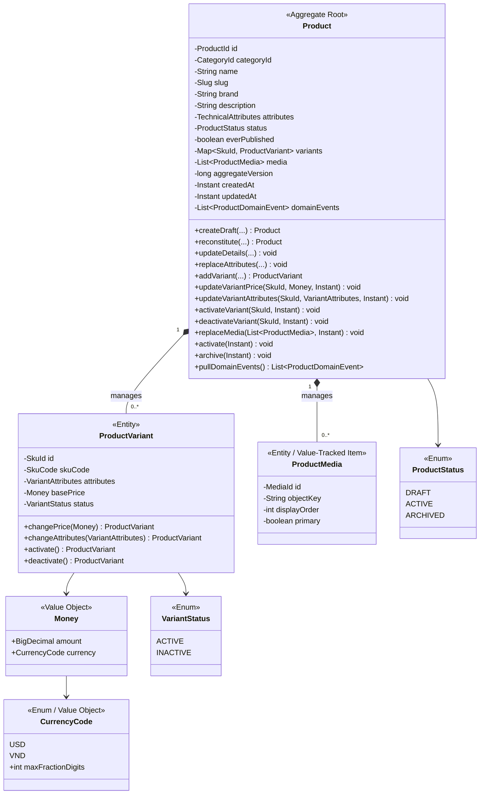
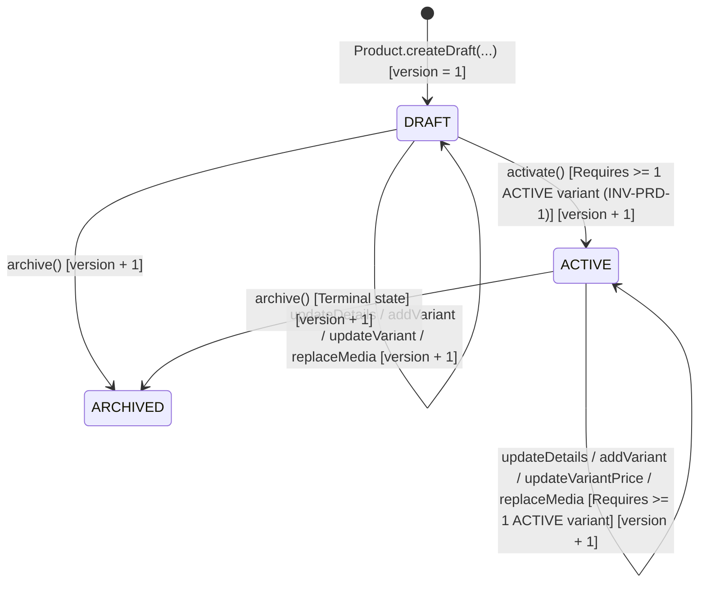

# M1.3.1 — Catalog `Product` Domain Implementation Brief

- **Milestone:** `M1.3.1 — Product Domain Implementation Brief`
- **Bounded Context:** Catalog Service (`src/services/catalog`, package `com.devatlas.commerce.catalog`)
- **Target Layer:** Pure Domain Layer (`com.devatlas.commerce.catalog.domain`)
- **Language & Runtime:** Java 21 LTS (zero external framework imports)
- **Status:** `READY_FOR_HUMAN_IMPLEMENTATION`

---

## 1. Purpose & Scope

This implementation brief prepares the specification for the **Catalog `Product` Domain** so the developer can implement the pure Java 21 domain model in `src/services/catalog/src/main/java/com/devatlas/commerce/catalog/domain/` and its unit test suite in `src/services/catalog/src/test/java/com/devatlas/commerce/catalog/domain/`.

### Scope Boundaries for This Brief
- **In Scope:**
  - `Product` Aggregate Root, child entities (`ProductVariant`, `ProductMedia`), Value Objects, Domain Events, Domain Exceptions, and the outbound `ProductRepository` domain port interface.
  - Domain invariants, state transition rules, and a pure JUnit 5 domain unit test matrix.
- **Out of Scope (Subsequent Milestones):**
  - Application command/query handlers, DTOs, `ProductSearchPort` / `ProductSearchRepository`, and MinIO pre-signed URL orchestration (`com.devatlas.commerce.catalog.application`).
  - PostgreSQL Flyway/SQL migrations for `products`, `product_variants`, `product_media`, and `product_search_documents`, JPA/JDBC persistence adapters, Outbox serialization, and Redis cache-aside adapters (`com.devatlas.commerce.catalog.infrastructure`).
  - REST controllers and OpenAPI request/response models (`com.devatlas.commerce.catalog.api`).

---

## 2. Existing Catalog Source Structure & Architecture Conventions

### 2.1 Current Source Layout (`src/services/catalog`)
```text
src/services/catalog/
├── pom.xml
└── src/
    ├── main/
    │   ├── java/com/devatlas/commerce/catalog/
    │   │   ├── CatalogServiceApplication.java
    │   │   ├── api/
    │   │   │   └── package-info.java          # Inbound REST adapters (Depends on application, domain)
    │   │   ├── application/
    │   │   │   └── package-info.java          # Use-case handlers & ports (Depends ONLY on domain)
    │   │   ├── config/
    │   │   │   └── OpenApiConfiguration.java
    │   │   ├── domain/
    │   │   │   └── package-info.java          # Pure Domain layer (ZERO framework/outer dependencies)
    │   │   └── infrastructure/
    │   │       └── package-info.java          # Outbound DB, Outbox, Redis, MinIO adapters
    │   └── resources/
    │       ├── application.yml
    │       └── db/migration/
    │           └── V001__baseline_messaging_and_idempotency.sql
    └── test/
        └── java/com/devatlas/commerce/catalog/
            └── CatalogServiceApplicationTest.java
```

### 2.2 Enforced Architecture & Java 21 Conventions
1. **Automated Boundary Test (`ArchitectureBoundaryTest.java`)**:
   - [`ArchitectureBoundaryTest.domainLayersMustNotDependOnOuterLayersOrFrameworks()`](file:///home/anhltn/projects/distributed-commerce-platform/tests/architecture/src/test/java/com/devatlas/commerce/architecture/ArchitectureBoundaryTest.java#L140-L185) scans every `.java` file under `src/services/catalog/src/main/java/com/devatlas/commerce/catalog/domain/` and fails the build if any file contains imports matching:
     - `org.springframework.`
     - `jakarta.persistence.`
     - `jakarta.servlet.`
     - `org.apache.kafka.`
     - `.api.`
     - `.application.`
     - `.infrastructure.`
2. **Java 21 Idioms (`M0_3_1_SOURCE_FOUNDATION_AUDIT.md`)**:
   - Package naming: lowercase reverse-DNS (`com.devatlas.commerce.catalog.domain.*`).
   - Types: `PascalCase`; methods/fields: `camelCase`; constants: `UPPER_SNAKE_CASE`.
   - Use Java 21 `record` types for immutable Value Objects and Domain Events with compact constructors enforcing invariant checks on construction.
   - Use `sealed interface` hierarchies for closed sets of Domain Events.
   - Expose read-only collection views (`List.copyOf(...)`, `Map.copyOf(...)`) from aggregates and entities so external callers cannot mutate internal state bypassing domain methods.

---

## 3. Requirement & Architecture Decision Traceability

| Source Artifact | Identifier | Summary of Requirement / Decision | Impact on `Product` Domain Model |
| :--- | :--- | :--- | :--- |
| [`REQUIREMENTS.md`](file:///home/anhltn/projects/distributed-commerce-platform/docs/requirements/REQUIREMENTS.md#L33-L39) | **`FR-CAT-001`** | Manage categories, products (SPU), SKUs, technical attributes, and media references; emit `ProductUpserted` (`aggregate_version` incremented by `1`) via Transactional Outbox on every state mutation. | `Product` aggregate tracks monotonic `aggregateVersion` ($1, 2, 3, \dots$) and records domain events on every state-changing operation. |
| [`REQUIREMENTS.md`](file:///home/anhltn/projects/distributed-commerce-platform/docs/requirements/REQUIREMENTS.md#L40-L43) | **`FR-CAT-002`** | Cache-aside product read model (`GET /api/v1/products/{id}`) invalidated/updated on `ProductUpserted`. | Domain state must expose complete, deterministic read accessors for mapping to cache/read projections and `ProductUpserted` event payloads. |
| [`REQUIREMENTS.md`](file:///home/anhltn/projects/distributed-commerce-platform/docs/requirements/REQUIREMENTS.md#L44-L53) | **`FR-CAT-003`** | Hybrid FTS (`tsvector`) + `pg_trgm` + `JSONB` search (`GET /api/v1/products/search`) behind a search port (`Q6`, `ADR-0007`), plus generation-isolated vector indexing (`CH-06`). | `Product` domain stores canonical textual fields (`name`/`title`, `brand`, `description`), `categoryId`, `status`, SKU `basePrice`s, and structured attributes, while keeping PostgreSQL `tsvector`/`halfvec` indexing strictly in `application`/`infrastructure`. |
| [`ACCEPTANCE_CRITERIA.md`](file:///home/anhltn/projects/distributed-commerce-platform/docs/requirements/ACCEPTANCE_CRITERIA.md#L30-L33) | **`AC-CAT-001`** | When a product is created or updated, the `products` row and its `outbox_messages` (`ProductUpserted.v1`) row commit atomically in the same transaction. | `Product.pullDomainEvents()` supplies the exact uncommitted domain events and `aggregateVersion` for the application/infrastructure Outbox writer. |
| [`DOMAIN_MODEL.md`](file:///home/anhltn/projects/distributed-commerce-platform/docs/domain/DOMAIN_MODEL.md#L85-L99) | **`INV-PRD-1`** | Every `ACTIVE` `Product` must have at least one `ACTIVE` `ProductVariant` (`SKU`). | Enforced during `Product.activate()` and whenever a variant's status is changed or deactivated on an `ACTIVE` product. |
| [`DOMAIN_MODEL.md`](file:///home/anhltn/projects/distributed-commerce-platform/docs/domain/DOMAIN_MODEL.md#L85-L99) | **`INV-PRD-2`** | `sku_code` must be globally unique and immutable once published. | Within a `Product`, duplicate `SkuCode`s are rejected immediately; once a `Product` has been published (`ACTIVE` or `ARCHIVED`), existing `ProductVariant.skuCode` cannot be mutated. Cross-product global uniqueness is enforced via repository check + DB `UNIQUE` constraint. |
| [`DOMAIN_MODEL.md`](file:///home/anhltn/projects/distributed-commerce-platform/docs/domain/DOMAIN_MODEL.md#L85-L99) | **`INV-PRD-3`** | `Money.amount` must be strictly $> 0$ with scale $\le 2$ (or $0$ for zero-decimal currencies). | Enforced in the `Money` Value Object compact constructor. |
| [`ADR-0003`](file:///home/anhltn/projects/distributed-commerce-platform/docs/adr/ADR-0003-transactional-outbox-and-inbox-idempotency.md#L19-L45) | **`CH-04`** | Outbox messages require `aggregate_type`, `aggregate_id`, and monotonically increasing `aggregate_version >= 1`. | `Product` initializes `aggregateVersion = 1L` on creation and increments `aggregateVersion` by `+1` per logical state mutation. |
| [`DATABASE_CONVENTIONS.md`](file:///home/anhltn/projects/distributed-commerce-platform/docs/standards/DATABASE_CONVENTIONS.md#L25-L34) | **Monetary & Time Standards** | Monetary amounts use exact `BigDecimal` (never `float`/`double`) paired with explicit 3-letter ISO-4217 currency code; all timestamps use UTC `Instant`. | `Money` uses `java.math.BigDecimal`; timestamps (`createdAt`, `updatedAt`) use `java.time.Instant` passed explicitly (or via `java.time.Clock`) for deterministic unit testing. |

---

## 4. Product Business Responsibilities & Bounded Context Boundaries

### 4.1 What the `Product` Aggregate Owns
1. **SPU (Standard Product Unit) Identity & Descriptive Metadata**:
   - `ProductId` (`UUID`), URL-safe `Slug`, `name` (title), `brand`, `description`, `CategoryId` reference, and SPU-level technical specifications (`TechnicalAttributes`).
2. **Product Lifecycle State (`ProductStatus`)**:
   - `DRAFT` -> `ACTIVE` -> `ARCHIVED` transitions and publication eligibility checks (`INV-PRD-1`).
3. **SKU Variants (`ProductVariant`)**:
   - Child entities within the `Product` consistency boundary (`SkuId`, `SkuCode`, variant option attributes such as `color`/`storage`, catalog `basePrice` as `Money`, and `VariantStatus`).
   - Enforcing within-product SKU code uniqueness and post-publication `SkuCode` immutability (`INV-PRD-2`).
4. **Product Media References (`ProductMedia`)**:
   - Ordered references to object storage keys (`MediaId`, `objectKey`, `displayOrder`, `isPrimary`), ensuring at most one primary media item per product.
5. **Monotonic Version & Domain Event Recording (`CH-04`)**:
   - Tracking `aggregateVersion` (`long >= 1`) and recording domain events (`ProductUpserted` / granular events) on state changes.

### 4.2 What the `Product` Aggregate Does NOT Own
- **Category Hierarchy Tree (`Category` Aggregate)**:
  - Per [`DOMAIN_MODEL.md` Section 3.1](file:///home/anhltn/projects/distributed-commerce-platform/docs/domain/DOMAIN_MODEL.md#L92-L93), `Category` (`category_id`, `parent_id`, `name`, `slug`, materialized `path`) is a separate Aggregate Root. `Product` holds only a `CategoryId` Value Object reference, not a nested `Category` object graph.
- **Physical or Reservable Stock Quantities (`Inventory Service`)**:
  - `available_qty`, `reserved_qty`, and `flash_sale_allocated_qty` belong exclusively to `StockItem` in `inventory-service` (`DOMAIN_MODEL.md` Section 3.3). `Product` never tracks stock counts in its domain model.
- **Flash Sale Quotas, Promotional Prices & Coupons (`Promotion Service`)**:
  - `ProductVariant.basePrice` is the standard catalog list price. Flash Sale prices (`flash_price`) and coupon discounts belong to `promotion-service` (`DOMAIN_MODEL.md` Section 3.6).
- **Pre-Signed URL Generation (`Infrastructure / Application`)**:
  - `ProductMedia` stores only the logical `objectKey` (e.g., `products/{productId}/{mediaId}.webp`), `displayOrder`, and `isPrimary`. Presigned MinIO upload/download URLs carry short-lived cryptographic signatures and belong in an application/infrastructure port (`MediaStoragePort`), never inside the `Product` domain aggregate.

---

## 5. Proposed Minimal `Product` Aggregate & Value Objects Design

### 5.1 Class & Record Diagram



### 5.2 Responsibilities of Each Domain Type

| Type | Category | Responsibility & Design Notes |
| :--- | :--- | :--- |
| `ProductId` | Value Object (`record`) | Wraps non-null `UUID value`. Provides `ProductId.generate()` (`UUID.randomUUID()`) and `ProductId.of(UUID)`. |
| `CategoryId` | Value Object (`record`) | Wraps non-null `UUID value` referencing the owning `Category` aggregate. |
| `SkuId` | Value Object (`record`) | Wraps non-null `UUID value` identifying a `ProductVariant`. |
| `MediaId` | Value Object (`record`) | Wraps non-null `UUID value` identifying a `ProductMedia` item. |
| `SkuCode` | Value Object (`record`) | Wraps normalized, trimmed, uppercase SKU string (e.g., `IPHONE-16-PRO-256GB-BLK`). Validates format `^[A-Z0-9][A-Z0-9_-]{2,63}$` (`3..64` chars). |
| `Slug` | Value Object (`record`) | Wraps URL-safe lowercase slug (`^[a-z0-9]+(-[a-z0-9]+)*$`, `2..128` chars). Provides `Slug.of(String)` and deterministic `Slug.fromName(String)` helper. |
| `CurrencyCode` | Enum / Value Object | Supported ISO-4217 currencies (`USD` with `maxFractionDigits = 2`, `VND` with `maxFractionDigits = 0` per `PRODUCT_REQUIREMENTS.md` Section 6.2 & `INV-PRD-3`). |
| `Money` | Value Object (`record`) | Wraps `(BigDecimal amount, CurrencyCode currency)`. Enforces `INV-PRD-3`: `amount != null`, `currency != null`, `amount.compareTo(BigDecimal.ZERO) > 0`, and `amount.scale() <= currency.maxFractionDigits()` (after stripping trailing zeros or normalizing scale). Implements value-based equality (`compareTo` / normalized scale so `10.0` USD equals `10.00` USD). |
| `TechnicalAttributes` | Value Object (`record`) | Wraps an immutable `Map<String, String> values` of SPU technical specifications (used for JSONB `@>` filtering in `FR-CAT-003`). Enforces non-blank keys (`<= 64` chars) and non-blank values (`<= 512` chars). |
| `VariantAttributes` | Value Object (`record`) | Wraps an immutable `Map<String, String> values` of SKU-specific dimension attributes (e.g., `{"color": "Black", "storage": "256GB"}`). Enforces non-blank keys and values. |
| `ProductStatus` | Enum | `DRAFT`, `ACTIVE`, `ARCHIVED` (`DOMAIN_MODEL.md` Section 3.1). |
| `VariantStatus` | Enum | `ACTIVE`, `INACTIVE` (`DOMAIN_MODEL.md` Section 3.1). |
| `ProductMedia` | Child Entity / Record | Holds `(MediaId id, String objectKey, int displayOrder, boolean primary)`. Enforces non-blank relative `objectKey` (no `http://` or leading `/`, max `512` chars) and `displayOrder >= 0`. |
| `ProductVariant` | Child Entity | Holds `(SkuId id, SkuCode skuCode, VariantAttributes attributes, Money basePrice, VariantStatus status)`. Package-private mutation or copy methods invoked exclusively through `Product` aggregate root methods. |
| `Product` | Aggregate Root | Enforces all cross-entity invariants (`INV-PRD-1`..`INV-PRD-3`), manages lifecycle state transitions, increments `aggregateVersion`, and records `ProductDomainEvent`s. |
| `ProductDomainEvent` | Sealed Domain Event Interface | Sealed interface with `eventId`, `productId`, `aggregateVersion`, and `occurredAt`, implemented by domain event records (`ProductCreated`, `ProductDetailsUpdated`, `ProductVariantAdded`, `ProductVariantPriceChanged`, `ProductVariantStatusChanged`, `ProductMediaUpdated`, `ProductActivated`, `ProductArchived` — all convertible to the integration event `ProductUpserted.v1`). |
| `ProductRepository` | Outbound Domain Port (`interface`) | Pure domain interface declaring `Optional<Product> findById(ProductId id)`, `boolean existsBySkuCode(SkuCode skuCode)`, `boolean existsBySlug(Slug slug)`, and `void save(Product product)`. |

---

## 6. Domain Operations, State Transitions & Expected Behavior

### 6.1 Product Lifecycle State Machine



### 6.2 State Transition Rules

| Current Status | Operation | Target Status | Preconditions & Invariants | Postconditions |
| :--- | :--- | :--- | :--- | :--- |
| *(None)* | `Product.createDraft(...)` | `DRAFT` | Valid `ProductId`, `CategoryId`, non-blank `name`, valid `Slug`, non-blank `brand`, non-null `TechnicalAttributes`, `now != null`. | `status = DRAFT`, `everPublished = false`, `aggregateVersion = 1L`, `ProductCreated` event recorded. |
| *(Persistence)* | `Product.reconstitute(...)` | *(Stored Status)* | Valid persisted fields (`aggregateVersion >= 1L`). If `status == ACTIVE`, must have $\ge 1$ `ACTIVE` variant. | Restores aggregate in memory with **empty** `domainEvents` list and without incrementing `aggregateVersion`. |
| `DRAFT` or `ACTIVE` | `updateDetails(categoryId, name, slug, brand, description, attributes, now)` | Unchanged (`DRAFT` or `ACTIVE`) | Product is not `ARCHIVED`; all arguments valid. | Updates fields, sets `updatedAt = now`, increments `aggregateVersion` by `+1`, records `ProductDetailsUpdated`. |
| `DRAFT` or `ACTIVE` | `addVariant(skuId, skuCode, attributes, basePrice, status, now)` | Unchanged | Product is not `ARCHIVED`; `skuId` and `skuCode` not already present on this product; currency matches existing variants on this product (if enforced — see `OQ-CAT-002`). | Adds `ProductVariant`, increments `aggregateVersion` by `+1`, records `ProductVariantAdded`. |
| `DRAFT` or `ACTIVE` | `updateVariantPrice(skuId, newPrice, now)` | Unchanged | Product is not `ARCHIVED`; variant `skuId` exists; `newPrice` valid per `INV-PRD-3`. | Updates variant `basePrice`, increments `aggregateVersion` by `+1`, records `ProductVariantPriceChanged`. |
| `DRAFT` | `updateVariantSkuCode(skuId, newSkuCode, now)` | `DRAFT` | Allowed **only** if `everPublished == false` (`INV-PRD-2`: `sku_code` is immutable once published) and `newSkuCode` is not duplicated in this product. | Updates variant `skuCode`, increments `aggregateVersion` by `+1`, records `ProductDetailsUpdated`. |
| `ACTIVE` | `updateVariantSkuCode(...)` | *(Rejected)* | Violates `INV-PRD-2` (`everPublished == true`). | Throws `ImmutableSkuCodeException`. |
| `DRAFT` or `ACTIVE` | `deactivateVariant(skuId, now)` | Unchanged | Product is not `ARCHIVED`; variant exists. **If `Product.status == ACTIVE`, at least one *other* variant must remain `ACTIVE` (`INV-PRD-1`).** | Sets variant `status = INACTIVE`, increments `aggregateVersion` by `+1`, records `ProductVariantStatusChanged`. If it is the last `ACTIVE` variant on an `ACTIVE` product, throws `ActiveProductRequiresActiveVariantException`. |
| `DRAFT` | `activate(now)` | `ACTIVE` | Product has at least 1 `ProductVariant` with `status == VariantStatus.ACTIVE` (`INV-PRD-1`). | Sets `status = ACTIVE`, `everPublished = true`, `updatedAt = now`, increments `aggregateVersion` by `+1`, records `ProductActivated`. |
| `DRAFT` or `ACTIVE` | `archive(now)` | `ARCHIVED` | Product is not already `ARCHIVED`. | Sets `status = ARCHIVED`, `updatedAt = now`, increments `aggregateVersion` by `+1`, records `ProductArchived`. |
| `ARCHIVED` | Any mutating operation (`updateDetails`, `addVariant`, `activate`, etc.) | *(Rejected)* | `ARCHIVED` is terminal (unless reactivation is approved in `OQ-CAT-001`). | Throws `ArchivedProductModificationException`. |

---

## 7. Invariants, Invalid States & Validation Rules

### 7.1 Complete Invariant & Validation Matrix

| Rule ID | Target | Rule / Invariant Specification | Invalid Input / State | Domain Exception Thrown |
| :--- | :--- | :--- | :--- | :--- |
| **`INV-PRD-1`** | `Product` + `ProductVariant` | Every `ACTIVE` `Product` must have $\ge 1$ `ACTIVE` `ProductVariant`. | Calling `product.activate()` with 0 variants or only `INACTIVE` variants; calling `product.deactivateVariant(skuId)` on the last `ACTIVE` variant of an `ACTIVE` product. | `ActiveProductRequiresActiveVariantException` |
| **`INV-PRD-2a`** | `Product` + `SkuCode` | `SkuCode` must be unique across all variants within a `Product` (and globally via `ProductRepository`). | Calling `addVariant` with a `SkuCode` already used by another variant in the same `Product`. | `DuplicateSkuCodeException` |
| **`INV-PRD-2b`** | `ProductVariant` | `SkuCode` is immutable once the product has been published (`everPublished == true`). | Attempting to change a variant's `SkuCode` when `status == ACTIVE` or `everPublished == true`. | `ImmutableSkuCodeException` |
| **`INV-PRD-3`** | `Money` | `Money.amount` must be strictly $> 0$ (`amount.compareTo(BigDecimal.ZERO) > 0`) and scale $\le 2$ for `USD` or $\le 0$ for `VND`. | `amount == null`, `amount <= 0`, `amount = 19.999` (`USD`), or `amount = 100.5` (`VND`). | `InvalidMoneyAmountException` |
| **`VAL-PRD-1`** | `ProductId`, `CategoryId`, `SkuId`, `MediaId` | Identifier `UUID` must not be `null`. | Passing `null` to ID constructor. | `InvalidDomainIdentifierException` (or subclass of `CatalogDomainException`) |
| **`VAL-PRD-2`** | `Product.name` | Trimmed product name must be non-blank and between `2` and `255` characters. | `null`, `""`, `"   "`, `"A"`, or $> 255$ chars. | `InvalidProductNameException` |
| **`VAL-PRD-3`** | `Product.brand` | Trimmed brand name must be non-blank and between `1` and `128` characters. | `null`, `""`, `"   "`, or $> 128$ chars. | `InvalidProductBrandException` |
| **`VAL-PRD-4`** | `Slug` | Must match `^[a-z0-9]+(-[a-z0-9]+)*$` and length `2..128`. | Uppercase letters, spaces, leading/trailing/double hyphens, empty string. | `InvalidSlugException` |
| **`VAL-PRD-5`** | `SkuCode` | Trimmed uppercase string matching `^[A-Z0-9][A-Z0-9_-]{2,63}$` (`3..64` chars). | `null`, blank, `< 3` chars, `> 64` chars, special characters (`@`, `/`, whitespace). | `InvalidSkuCodeException` |
| **`VAL-PRD-6`** | `ProductMedia` list | When media list is non-empty, **exactly one** item must have `isPrimary == true`, `MediaId`s and `objectKey`s must be unique within the product, and `displayOrder` must be $\ge 0$. | 0 primary media items when media list is non-empty, $\ge 2$ primary media items, negative `displayOrder`, blank `objectKey`. | `InvalidProductMediaException` |
| **`VAL-PRD-7`** | `Product.aggregateVersion` | Starts at `1L` upon creation; increments by exactly `+1L` per state-changing command; `pullDomainEvents()` drains and clears the internal event buffer. | `reconstitute` called with `aggregateVersion < 1L`; mutating a product without incrementing version. | `CatalogDomainException` |
| **`VAL-PRD-8`** | `Product` (`ARCHIVED`) | An `ARCHIVED` product cannot be mutated or re-activated. | Calling `updateDetails`, `addVariant`, `updateVariantPrice`, `replaceMedia`, or `activate` on an `ARCHIVED` product. | `ArchivedProductModificationException` |

---

## 8. Suggested Package Structure Following Java 21 Conventions

All files below belong under `src/services/catalog/src/main/java/com/devatlas/commerce/catalog/domain/`:

```text
src/services/catalog/src/main/java/com/devatlas/commerce/catalog/domain/
├── package-info.java
├── exception/
│   ├── CatalogDomainException.java                      # Base unchecked domain exception
│   ├── ActiveProductRequiresActiveVariantException.java # INV-PRD-1
│   ├── DuplicateSkuCodeException.java                   # INV-PRD-2a
│   ├── ImmutableSkuCodeException.java                   # INV-PRD-2b
│   ├── InvalidMoneyAmountException.java                 # INV-PRD-3
│   ├── ArchivedProductModificationException.java        # VAL-PRD-8
│   ├── ProductVariantNotFoundException.java
│   ├── InvalidProductNameException.java
│   ├── InvalidProductBrandException.java
│   ├── InvalidSlugException.java
│   ├── InvalidSkuCodeException.java
│   └── InvalidProductMediaException.java
└── product/
    ├── Product.java                                     # Aggregate Root
    ├── ProductVariant.java                              # Child Entity (SKU)
    ├── ProductMedia.java                                # Child Entity / Value-Tracked Media Item
    ├── ProductId.java                                   # Value Object (record)
    ├── CategoryId.java                                  # Value Object (record)
    ├── SkuId.java                                       # Value Object (record)
    ├── MediaId.java                                     # Value Object (record)
    ├── SkuCode.java                                     # Value Object (record)
    ├── Slug.java                                        # Value Object (record)
    ├── CurrencyCode.java                                # Enum (USD, VND)
    ├── Money.java                                       # Value Object (record)
    ├── TechnicalAttributes.java                         # Value Object (record)
    ├── VariantAttributes.java                           # Value Object (record)
    ├── ProductStatus.java                               # Enum (DRAFT, ACTIVE, ARCHIVED)
    ├── VariantStatus.java                               # Enum (ACTIVE, INACTIVE)
    ├── ProductRepository.java                           # Outbound Domain Port interface
    └── event/
        ├── ProductDomainEvent.java                      # Sealed interface
        ├── ProductCreated.java                          # record
        ├── ProductDetailsUpdated.java                   # record
        ├── ProductVariantAdded.java                     # record
        ├── ProductVariantPriceChanged.java              # record
        ├── ProductVariantStatusChanged.java             # record
        ├── ProductMediaUpdated.java                     # record
        ├── ProductActivated.java                        # record
        └── ProductArchived.java                         # record
```

> **Note on Exception Mapping to RFC 9457 `ProblemDetails`:**
> Domain exceptions extend `CatalogDomainException extends RuntimeException` and contain **zero** HTTP status codes or Spring annotations. Mapping `ActiveProductRequiresActiveVariantException` or `DuplicateSkuCodeException` to `409 Conflict` or `422 Unprocessable Entity` is the responsibility of the `api` layer exception translator (`@RestControllerAdvice`).

---

## 9. Proposed Domain Unit Test Matrix

All unit tests must live under `src/services/catalog/src/test/java/com/devatlas/commerce/catalog/domain/` and run with pure **JUnit 5 + AssertJ** in $< 100\text{ ms}$ with **zero Spring context startup**.

| Test ID | Target Class | Scenario | Input / Action | Expected Outcome |
| :--- | :--- | :--- | :--- | :--- |
| **`UT-PRD-001`** | `Money` | Valid `USD` and `VND` amounts (`INV-PRD-3`) | `Money.of(new BigDecimal("199.99"), CurrencyCode.USD)` and `Money.of(new BigDecimal("250000"), CurrencyCode.VND)` | Constructed cleanly; normalized scale preserved; value equality holds for `199.9` vs `199.90`. |
| **`UT-PRD-002`** | `Money` | Reject zero or negative amount (`INV-PRD-3`) | `Money.of(BigDecimal.ZERO, CurrencyCode.USD)` and `Money.of(new BigDecimal("-0.01"), CurrencyCode.USD)` | Throws `InvalidMoneyAmountException`. |
| **`UT-PRD-003`** | `Money` | Reject excessive decimal scale (`INV-PRD-3`) | `Money.of(new BigDecimal("10.999"), CurrencyCode.USD)` and `Money.of(new BigDecimal("1000.5"), CurrencyCode.VND)` | Throws `InvalidMoneyAmountException`. |
| **`UT-PRD-004`** | `SkuCode` | Valid normalization & format check | `SkuCode.of(" iphone-16-pro_256gb ")` | Normalized to `"IPHONE-16-PRO_256GB"`. |
| **`UT-PRD-005`** | `SkuCode` | Reject invalid SKU codes | `""`, `"AB"` (too short), `"SKU WITH SPACES"`, `"SKU@123"` | Throws `InvalidSkuCodeException`. |
| **`UT-PRD-006`** | `Slug` | Valid slug creation & invalid slug rejection | `Slug.of("iphone-16-pro")` vs `Slug.of("iPhone 16 Pro")`, `Slug.of("-leading")`, `Slug.of("double--dash")` | Valid succeeds; invalid throws `InvalidSlugException`. |
| **`UT-PRD-007`** | `Product` | Create draft product (`FR-CAT-001`, `CH-04`) | `Product.createDraft(...)` | `status == DRAFT`, `aggregateVersion == 1L`, `variants` empty, `pullDomainEvents()` returns 1 `ProductCreated` event with `aggregateVersion == 1L`, second call to `pullDomainEvents()` returns empty list. |
| **`UT-PRD-008`** | `Product` | Reconstitute existing product from storage | `Product.reconstitute(..., aggregateVersion = 7L)` | State matches arguments, `aggregateVersion == 7L`, `pullDomainEvents()` is empty. |
| **`UT-PRD-009`** | `Product` | Add valid SKU variant to `DRAFT` product | `product.addVariant(...)` | Variant added, `aggregateVersion` increments from `1L` to `2L`, `ProductVariantAdded` event recorded with `aggregateVersion == 2L`. |
| **`UT-PRD-010`** | `Product` | Reject duplicate `SkuCode` within same product (`INV-PRD-2a`) | Call `addVariant` twice with `SkuCode.of("SKU-001")` | Second call throws `DuplicateSkuCodeException`; `aggregateVersion` remains `2L`. |
| **`UT-PRD-011`** | `Product` | Reject activating `DRAFT` product with 0 variants (`INV-PRD-1`) | Create draft product -> `product.activate(now)` | Throws `ActiveProductRequiresActiveVariantException`; status remains `DRAFT`. |
| **`UT-PRD-012`** | `Product` | Reject activating `DRAFT` product when all variants are `INACTIVE` (`INV-PRD-1`) | Create draft -> add 1 `INACTIVE` variant -> `product.activate(now)` | Throws `ActiveProductRequiresActiveVariantException`; status remains `DRAFT`. |
| **`UT-PRD-013`** | `Product` | Activate `DRAFT` product with $\ge 1$ `ACTIVE` variant (`INV-PRD-1`) | Create draft -> add 1 `ACTIVE` variant -> `product.activate(now)` | `status == ACTIVE`, `everPublished == true`, `aggregateVersion == 3L`, `ProductActivated` event recorded. |
| **`UT-PRD-014`** | `Product` | Prevent deactivating the last `ACTIVE` variant of an `ACTIVE` product (`INV-PRD-1`) | Active product with 1 `ACTIVE` variant -> `product.deactivateVariant(skuId, now)` | Throws `ActiveProductRequiresActiveVariantException`; variant remains `ACTIVE`. |
| **`UT-PRD-015`** | `Product` | Allow deactivating one `ACTIVE` variant when another `ACTIVE` variant remains | Active product with 2 `ACTIVE` variants -> `product.deactivateVariant(sku1, now)` | `sku1` becomes `INACTIVE`, `sku2` remains `ACTIVE`, `Product` remains `ACTIVE`, `aggregateVersion` increments by `+1`. |
| **`UT-PRD-016`** | `Product` | Enforce `SkuCode` immutability after publication (`INV-PRD-2b`) | Activate product -> attempt `updateVariantSkuCode(skuId, newCode, now)` (even if subsequently archived) | Throws `ImmutableSkuCodeException`. |
| **`UT-PRD-017`** | `Product` | Update variant price (`INV-PRD-3`, `DOMAIN_MODEL.md`) | `product.updateVariantPrice(skuId, Money.of("179.99", USD), now)` | Variant `basePrice` updated, `aggregateVersion` incremented by `+1`, `ProductVariantPriceChanged` event recorded. |
| **`UT-PRD-018`** | `Product` | Media replacement & primary media invariant (`VAL-PRD-6`) | `replaceMedia` with 2 items (`1` primary, `1` non-primary) vs `replaceMedia` with `0` primary or `2` primary items | Valid list updates media and increments version; `0` or `2` primary items throws `InvalidProductMediaException`. |
| **`UT-PRD-019`** | `Product` | Archive product and reject subsequent mutations (`VAL-PRD-8`) | `product.archive(now)` -> attempt `updateDetails(...)` or `addVariant(...)` or `activate(...)` | Archive transitions status to `ARCHIVED` and increments version; subsequent mutations throw `ArchivedProductModificationException`. |
| **`UT-PRD-020`** | `Product` | Collection encapsulation & immutability | Attempt `.clear()` or `.put(...)` on `product.variants()`, `product.media()`, or `product.attributes().values()` | Throws `UnsupportedOperationException`; internal aggregate state is uncorrupted. |

---

## 10. Concerns That Must NOT Enter the Domain Layer

To preserve Clean / Hexagonal Architecture (`ADR-0001`) and pass `ArchitectureBoundaryTest`, the following concerns are strictly forbidden inside `com.devatlas.commerce.catalog.domain.**`:

1. **Spring Framework (`org.springframework.*`)**:
   - **Forbidden**: `@Service`, `@Component`, `@Repository`, `@Autowired`, `@Value`, `@Transactional`, `ApplicationEventPublisher`.
   - **Why**: The Domain layer models pure business rules and must be instantiable and testable with plain `new` / static factory calls without starting a Spring IoC container.
2. **JPA / Hibernate (`jakarta.persistence.*`, `org.hibernate.*`)**:
   - **Forbidden**: `@Entity`, `@Table`, `@Id`, `@GeneratedValue`, `@Column`, `@Version`, `@OneToMany`, `@Embeddable`, Hibernate `@JdbcTypeCode(SqlTypes.JSON)`, lazy-loading proxies, and package-private no-arg mutable constructors required only by ORM reflection.
   - **Why**: ORM annotations couple domain invariants to relational table schemas, force mutable fields or no-arg constructors that bypass domain validation, and introduce lazy-initialization traps. Persistence mapping belongs in `com.devatlas.commerce.catalog.infrastructure.persistence`.
3. **PostgreSQL & Database Drivers (`java.sql.*`, `org.postgresql.*`)**:
   - **Forbidden**: `PGobject`, `tsvector` weighted search expressions, `pg_trgm` similarity thresholds, `halfvec` embeddings (`CH-06`), `JSONB` operators (`@>`), `ResultSet`, or SQL strings.
   - **Why**: Search indexing (`ADR-0007`), `outbox_messages` (`ADR-0003`), and `JSONB` serialization are storage/query read-model concerns handled in `infrastructure`.
4. **HTTP, Servlet & JSON Serialization (`jakarta.servlet.*`, `com.fasterxml.jackson.*`, `jakarta.validation.*`)**:
   - **Forbidden**: `@RestController`, `ResponseEntity`, Spring `ProblemDetail`, Jackson `@JsonProperty`/`@JsonCreator`, and Jakarta Bean Validation (`@NotNull`, `@Size`).
   - **Why**: REST API representations and JSON schemas evolve independently of internal domain types and belong in `com.devatlas.commerce.catalog.api` / `infrastructure`. Domain objects validate themselves in their own constructors/methods.
5. **Apache Kafka & Outbox Polling (`org.apache.kafka.*`)**:
   - **Forbidden**: `KafkaTemplate`, `ProducerRecord`, topic names (`catalog.products.events.v1`), shard IDs (`0..15`), and `outbox_messages` row structures.
   - **Why**: The `Product` aggregate records pure in-memory `ProductDomainEvent` instances (`Product.pullDomainEvents()`). Translating those domain events into `outbox_messages` rows inside the application transaction belongs in the `application`/`infrastructure` layers.
6. **External Infrastructure SDKs (Redis, MinIO, OpenTelemetry)**:
   - **Forbidden**: `StringRedisTemplate`, cache keys (`product:v1:{id}`), TTL jitter logic, `io.minio.MinioClient`, presigned URL expiration logic, and `io.opentelemetry.*` spans.
   - **Why**: Cache-aside (`FR-CAT-002`) and S3 presigned URL generation (`FR-CAT-001`) are outbound infrastructure concerns coordinated by the `application` layer via ports.

---

## 11. Open Questions (`OPEN_QUESTION`) Requiring Human Decisions

Before or during your implementation of `M1.3`, please review the following questions where accepted architecture documents leave policy choices open:

- **`OPEN_QUESTION` `OQ-CAT-001` (Reactivating `ARCHIVED` Products)**:
  - [`DOMAIN_MODEL.md` Section 3.1](file:///home/anhltn/projects/distributed-commerce-platform/docs/domain/DOMAIN_MODEL.md#L91) defines `ProductStatus (DRAFT, ACTIVE, ARCHIVED)` and emits `ProductArchived`. Should `ARCHIVED` be a strictly terminal state, or should an admin be allowed to unarchive a product (`ARCHIVED -> DRAFT` or `ARCHIVED -> ACTIVE`)?
  - *Recommended Default in this Brief*: Treat `ARCHIVED` as **terminal** (`ArchivedProductModificationException` on any further mutation or activation).
- **`OPEN_QUESTION` `OQ-CAT-002` (Currency Uniformity Across Variants of a Single Product)**:
  - Each `ProductVariant` has `basePrice: Money(amount, currency)`. Must all variants belonging to the same `Product` share the same `CurrencyCode` (e.g., all variants of Product X use `USD`), or can different variants of the same product have different currencies?
  - *Recommended Default in this Brief*: Require all variants within the same `Product` to share the same `CurrencyCode` (throwing an invariant exception if a new variant's currency differs from existing variants on that product).
- **`OPEN_QUESTION` `OQ-CAT-003` (Deactivating the Last Active Variant on an `ACTIVE` Product)**:
  - By `INV-PRD-1`, every `ACTIVE` `Product` must have $\ge 1$ `ACTIVE` `ProductVariant`. If an admin attempts to deactivate the *last* `ACTIVE` variant of an `ACTIVE` product, should `Product.deactivateVariant(skuId)` **reject the operation** (`ActiveProductRequiresActiveVariantException`), or **automatically transition the parent `Product` back to `DRAFT`**?
  - *Recommended Default in this Brief*: **Reject the operation** (`ActiveProductRequiresActiveVariantException`) so a live catalog product is never silently unpublished as a side effect of a SKU edit.
- **`OPEN_QUESTION` `OQ-CAT-004` (No-Op Mutation Version & Event Behavior)**:
  - If `updateVariantPrice(skuId, newPrice, now)` is called with a `newPrice` equal to the current `basePrice`, should the domain treat it as a no-op (returning without incrementing `aggregateVersion` or emitting a domain event) or still record an update?
  - *Recommended Default in this Brief*: Treat identical value updates on `updateVariantPrice` as an **idempotent no-op** (do not increment `aggregateVersion` or emit `ProductVariantPriceChanged` when the price did not change).

---

## 12. Definition of Done (`DoD`) for Human Implementation (`M1.3`)

The `Product` Domain implementation will be considered complete when:

- [ ] All domain classes, records, enums, domain events, domain exceptions, and `ProductRepository` port are implemented under `src/services/catalog/src/main/java/com/devatlas/commerce/catalog/domain/`.
- [ ] Invariants `INV-PRD-1`, `INV-PRD-2` (`a` & `b`), and `INV-PRD-3` and validation rules `VAL-PRD-1` through `VAL-PRD-8` are enforced inside the domain model without external validators.
- [ ] `Product.aggregateVersion` starts at `1L` on `createDraft` and increments by `+1L` on every state mutation (`CH-04`, `FR-CAT-001`).
- [ ] All unit tests in the Domain Unit Test Matrix (`UT-PRD-001` through `UT-PRD-020`) are implemented under `src/services/catalog/src/test/java/com/devatlas/commerce/catalog/domain/` and pass via `./mvnw test -pl src/services/catalog`.
- [ ] Architecture boundary verification passes via `./mvnw test -pl tests/architecture` (`ArchitectureBoundaryTest`), confirming zero forbidden imports in `com.devatlas.commerce.catalog.domain`.
- [ ] Decisions on `OQ-CAT-001` through `OQ-CAT-004` are confirmed or adjusted by the human developer.
