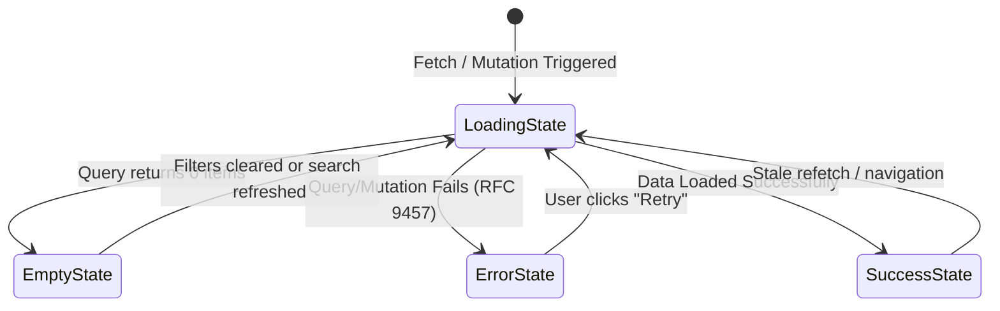

# Standard: UI/UX Design System & Experience Rules

- **Standard Identifier:** `DCP-STD-UI-001`
- **Status:** `ACCEPTED`
- **Applicability:** All web applications, storefronts, portals, and UI components (`frontend/`)
- **Conformance Target:** WCAG 2.2 Level AA, RFC 9457 Problem Details Client Integration, CLS < 0.1, INP < 200ms

---

## 1. Executive Summary & Design Philosophy

The Distributed Commerce & Flash Sale Platform operates two distinct user personas across a unified frontend codebase:
1. **Customer Storefront (`/`)**: A fast, trustworthy, high-conversion shopping experience with dedicated high-concurrency interfaces (Flash Sale Live Arena, AI Shopping Drawer, real-time inventory gauges).
2. **Operations & Admin Portal (`/admin`)**: An information-dense, keyboard-navigable operational console for catalog management, stock ledgers, flash sale campaigns, order inspection, and AI-assisted triage.

### Core Experience Principles

| Principle | Storefront Application | Admin Portal Application |
|---|---|---|
| **Speed & Responsiveness** | Optimistic UI updates, skeleton placeholders matching exact layout geometry, instant cart drawer feedback. | Dense data tables with instant server-side pagination, sorting, and debounced search (< 200ms). |
| **Trust & Radical Transparency** | Exact currency and price breakdown; zero hidden fees; real-time stock availability; honest countdown timers (no reset tricks or false scarcity). | Full audit trail transparency: timestamps, actor identity, correlation IDs, Outbox/Inbox delivery status. |
| **Fail Gracefully & Self-Healing** | RFC 9457 error banners with clear user explanations, non-cryptic error codes, and single-click retry actions. | Detailed error inspector displaying `errorCode`, `traceId`, affected aggregate ID, and retry actions without breaking application state. |
| **Accessibility First** | 100% keyboard navigable, high-contrast states ($\ge 4.5:1$), screen-reader announced state updates (`aria-live`). | Focus trap on modals, accessible data grid navigation, semantic form controls. |

---

## 2. Design Tokens & Visual Hierarchy

### 2.1 Color Palette & Semantic Roles

The design system uses Tailwind CSS with semantic CSS variables and tokens:

```
Neutral Base:
├── Surface / Background: #FFFFFF (Light) / #0F172A (Dark/Night)
├── Card / Elevated:     #F8FAFC (Light) / #1E293B (Dark)
├── Border / Divider:    #E2E8F0 (Light) / #334155 (Dark)
└── Text (Primary):      #0F172A (Light) / #F8FAFC (Dark)
└── Text (Muted):        #64748B (Light) / #94A3B8 (Dark)

Brand Primaries:
├── Storefront Primary:  #4F46E5 (Indigo 600) — trustworthy, modern, high contrast
├── Storefront Hover:    #4338CA (Indigo 700)
├── Admin Primary:       #0EA5E9 (Sky 600) / #0F172A (Slate 900) — crisp, operational
└── Admin Active:        #0284C7 (Sky 700)

Flash Sale & Urgency Accents:
├── Flash Flame:         #DC2626 (Red 600) / #EF4444 (Red 500) — high-visibility urgency
├── Flash Warning:       #D97706 (Amber 600) — low stock threshold (< 20%)
└── Flash Pre-warm:      #7C3AED (Violet 600) — upcoming sale badge

Semantic Feedback:
├── Success:             #059669 (Emerald 600) — confirmed orders, successful claims
├── Warning:             #D97706 (Amber 600) — expiring sessions, stock reservation warning
├── Danger / Error:      #DC2626 (Red 600) — validation failures, conflict errors, network faults
└── Info:                #2563EB (Blue 600) — system notifications, shipping updates
```

### 2.2 Typography & Numbers

- **Font Family**: System font stack (`Inter`, `-apple-system`, `BlinkMacSystemFont`, `"Segoe UI"`, `Roboto`, `sans-serif`).
- **Tabular Numerics (`font-mono tabular-nums`)**:
  - **MANDATORY** for all prices, quantities, countdown timers, SKU codes, and stock gauges.
  - Prevents jitter and width wobbling during countdown ticks or stock updates.
- **Scale Hierarchy**:
  - `text-xs` (12px, 16px line-height): Timestamps, badges, SKU codes, helper captions.
  - `text-sm` (14px, 20px line-height): Body text in tables, form inputs, secondary labels.
  - `text-base` (16px, 24px line-height): Standard body text, storefront product descriptions.
  - `text-lg` (18px, 28px line-height): Card titles, subheadings, cart summary lines.
  - `text-xl` to `text-3xl` (20px–30px): Section headers, modal titles, product detail pricing.
  - `text-4xl` to `text-5xl` (36px–48px): Flash sale countdown display, landing hero banner.

---

## 3. The 4-State Component Rule (Universal Requirement)

Every interactive container, data view, and page route **MUST** explicitly implement four discrete, well-tested visual states. Blank screens or raw exceptions are strictly prohibited.



### 3.1 State 1: `LoadingState`
- **Rule**: NEVER use full-screen blank spinners that block the entire viewport unless an atomic transaction is locking navigation.
- **Requirement**: Use **Skeleton Placeholders** (`LoadingSkeleton`) matching the geometry, dimensions, and card count of the expected content.
- Shimmer animations must respect `prefers-reduced-motion` media queries (fallback to static subtle opacity pulse).

### 3.2 State 2: `EmptyState`
- **Rule**: An empty list, cart, or search result must never render an empty blank void.
- **Requirement**: Component `EmptyState` must contain:
  1. An illustrative Lucide icon with a muted background badge.
  2. A concise headline (e.g., `"Your shopping cart is empty"` or `"No products match the selected filters"`).
  3. A helpful explanation sentence.
  4. At least one actionable primary CTA (e.g., `"Explore Catalog"` or `"Reset Filters"`).

### 3.3 State 3: `ErrorState`
- **Rule**: Never display unformatted error dialogs, raw Javascript stack traces, or generic `"Something went wrong"`.
- **Requirement**: Component `ErrorBannerWithRetry` must parse RFC 9457 `ProblemDetails`:
  1. Title matching the problem title (e.g., `"Out of Stock"` or `"Session Conflict"`).
  2. Detail explaining what happened in plain language.
  3. Machine-readable `errorCode` badge (e.g., `INSUFFICIENT_STOCK`, `ORDER_ALREADY_CANCELLED`).
  4. Trace / Correlation ID in small monospace text for support diagnostics.
  5. A primary `"Try Again"` / `"Retry"` button wired to TanStack Query `refetch()` or action retry.

### 3.4 State 4: `SuccessState`
- Content rendered cleanly with smooth transition.
- Numerical changes (stock count, cart badge) update with subtle emphasis.

---

## 4. Flash Sale Live Arena UI/UX Rules

Flash sale campaigns involve high emotional tension, intense latency expectations, and rapid depletion. The following specific UI/UX rules are mandatory:

### 4.1 Synchronized Countdown Timer
- **Drift Compensation**: The timer must sync with server UTC time on initial fetch and tick locally via `requestAnimationFrame` or high-resolution interval.
- **Urgency Transitions**:
  - `> 1 hour remaining`: Display format `HH : MM : SS`, neutral dark slate styling.
  - `< 10 minutes remaining`: Amber warning highlight with pulsatile badge.
  - `< 60 seconds remaining`: Red high-contrast urgency alert, ticking milliseconds.
  - `00:00:00`: Immediate transition to `Sale Ended` state without requiring page reload.

### 4.2 Stock Availability Gauge & Thresholds
- Display both percentage and discrete remaining units:
  - **High Availability (> 50%)**: Emerald progress bar (`bg-emerald-500`).
  - **Limited Availability (20% – 50%)**: Amber warning bar (`bg-amber-500`).
  - **Critical Stock (< 20%)**: Crimson pulsing bar (`bg-rose-600 animate-pulse`), text: `"Almost Gone! Only X left"`.
  - **Sold Out (0%)**: Solid grey disabled bar (`bg-slate-300`), text: `"Sold Out"`.

### 4.3 Claim Button State Machine
The claim button must prevent double submissions, inform queue status, and redirect cleanly:

```
[ Claim Now ] 
     ↓ User clicks
[ Reserving Item... (disabled + spinner) ] (Automatic Idempotency-Key generated)
     ↓ 
  ┌──┴───────────────────────────────────────┬──────────────────────────────────────────┐
  ↓ (HTTP 200/201 Claimed)                   ↓ (HTTP 202 In Queue)                      ↓ (HTTP 409 Sold Out / Limit Exceeded)
[ Success! Redirecting to Checkout (10m) ]  [ In Queue — Position #42 (Wait ~3s) ]    [ Sold Out / Limit Reached ]
```

### 4.4 10-Minute Payment Countdown Banner
- Once a stock claim or flash sale order is reserved, a persistent sticky top bar appears across all storefront views:
  `"Reserved for 09:45 — Complete payment before reservation expires!"`
- If the countdown reaches `00:00`, show a modal explaining: `"Your reservation has expired and inventory was returned to the pool."` with a primary button redirecting to the storefront.

---

## 5. Storefront vs. Admin Layout Architecture

### 5.1 Customer Storefront Shell (`StorefrontLayout`)
```
┌────────────────────────────────────────────────────────────────────────┐
│ Global Announcement / Active Flash Sale Sticky Banner                   │
├────────────────────────────────────────────────────────────────────────┤
│ Header: Logo | Search Bar (Debounced) | Categories | AI Assistant | Cart│
├────────────────────────────────────────────────────────────────────────┤
│ Main Content Area (Outlet):                                            │
│  - Catalog / Product Detail / Flash Arena / Cart / Checkout / Orders   │
├────────────────────────────────────────────────────────────────────────┤
│ Footer: Brand, Trust Badges, Payment Methods, Status Page, Policy Links│
└────────────────────────────────────────────────────────────────────────┘
```
- Responsive collapse: mobile bottom navigation bar (`Catalog`, `Flash`, `Cart (badge)`, `Profile`).
- Persistent Cart Drawer sliding from right on cart addition without forcing full page reload.
- Floating AI Shopping Drawer triggered from header button or bottom nav.

### 5.2 Admin Operations Portal Shell (`AdminLayout`)
```
┌────────────────────────────────────────────────────────────────────────┐
│ Top Nav: Admin Portal | Global Search (Cmd+K) | Env Tag | User Profile │
├──────────────┬─────────────────────────────────────────────────────────┤
│ Sidebar:     │ Breadcrumb Navigation & Action Toolbar                  │
│  - Dashboard ├─────────────────────────────────────────────────────────┤
│  - Products  │ Data View Area:                                         │
│  - Inventory │  - Search, Facet Filters, Date Pickers                  │
│  - Flash Sale│  - Dense Data Table (Tabular Numbers, Status Chips)     │
│  - Orders    │  - Pagination Controls (Page X of Y, Size Selector)     │
│  - AI Ops    │                                                         │
│  - Settings  │                                                         │
└──────────────┴─────────────────────────────────────────────────────────┘
```
- Responsive collapsible sidebar with tooltip icons.
- Dangerous actions (Delete, Archive, Cancel Campaign) require a two-step Confirmation Modal with explicit typing of the entity identifier.

---

## 6. Accessibility & WCAG 2.2 AA Compliance

1. **Keyboard Navigation**:
   - Every interactive control (`button`, `a`, `input`, `select`) must have a distinct `:focus-visible` ring (`ring-2 ring-indigo-500 ring-offset-2`).
   - Modals and drawers must trap focus using accessible dialog primitives and close on `Escape`.
2. **Screen Reader Announcements**:
   - Dynamic changes (e.g. `"Cart updated: 2 items"`, `"Flash sale starting in 1 minute"`) must use `role="status"` or `aria-live="polite"`.
   - Error messages must use `role="alert"` or `aria-live="assertive"`.
3. **Contrast Ratios**:
   - Body text against surface: $\ge 4.5:1$.
   - Large headings ($\ge 18\text{pt}$) and active UI icons: $\ge 3:1$.
4. **Touch Targets**:
   - All interactive touch targets on mobile viewports must measure $\ge 44 \times 44\text{px}$.

---

## 7. Anti-Patterns & Strict Prohibitions

| Prohibited Anti-Pattern | Reason / Threat | Compliant Requirement |
|---|---|---|
| **Dark Patterns (Fake Urgency)** | Deceives consumers, destroys brand trust, violates trade regulations. | Countdown timers must reflect real server campaigns; stock gauges must reflect real Redis/Postgres inventory counts. |
| **Cumulative Layout Shifts (CLS)** | Frustrating shifts cause misclicks and fail Core Web Vitals. | Images, banners, and skeleton cards must declare explicit aspect ratios or reserved heights (`aspect-video`, `h-48`). |
| **Window Alert / Confirm** | Blocks browser event loop, unstylable, untestable in automated E2E. | Use customized React dialog components (`ConfirmModal`, `ToastNotification`). |
| **Raw Stack Traces in UI** | Leaks database topology, class names, or backend implementation details. | Map errors through RFC 9457 parser to user-friendly messages with correlation IDs. |
| **Silent Mutation Failures** | Leaves user unaware that their cart or checkout failed. | Always display feedback via banner or toast on mutation rejection. |
